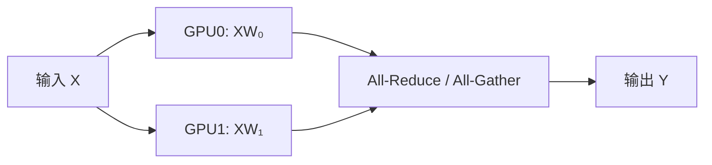

# Tensor Parallel

> 从 Bit 到 AGI · 第八章：推理（Inference） · 层内张量切分多卡

单卡放不下 70B 权重，或单卡算力不够在 SLA 内吐 token，就要 **多卡并行**。Tensor Parallel（TP）在 **每一层内部** 把大矩阵按列或行切到多张 GPU，前向每步都需要卡间通信——适合 **低延迟、同机 NVLink** 场景。

## 直觉

四个人合写一份周报：不是「你写第 1～10 页、我写 11～20 页」（那是 Pipeline Parallel），而是 **同一段落每人负责不同词性**——你写所有动词，我写所有名词，每写完一句要 **对一下表**（all-reduce）才能接下一句。

TP 把一层里的 $W \in \mathbb{R}^{d \times d'}$ 按列切成 $W = [W_1 | W_2 | \cdots | W_p]$，每张卡只存 $1/p$ 参数，算局部结果再 **汇总**。



## 定义

Megatron-LM 风格（简化）：

**Column Parallel**（按输出维切）：$Y = XW$，$W$ 列切 → 每卡 $Y_i = XW_i$，输出 **拼接** 或后续层 **行切** 则无需 all-gather。

**Row Parallel**（按输入维切）：$Y = \sum_i X_i W_i$，每卡 partial sum → **All-Reduce(SUM)** 得最终 $Y$。

一层 Transformer block 典型 TP 方案：

| 子模块 | 切分方式 | 通信 |
| ------ | -------- | ---- |
| QKV 投影 | Column | All-Gather 或传给行切 FC |
| Attention 输出投影 | Row | All-Reduce |
| FFN up | Column | — |
| FFN down | Row | All-Reduce |

**TP 度** $p$：参与切分的 GPU 数。每卡权重约 **$1/p$**，每步 decode 通常 **2～4 次** all-reduce（取决于实现）。

## 例子

**例 1：8B 模型要不要 TP？**

| 配置 | 权重 FP16 | 单卡 24G | 单卡 80G |
| ---- | --------- | -------- | -------- |
| 8B | ~16 GiB | 可单卡 + KV | 宽裕 |
| 70B | ~140 GiB | 必须 TP≥8 | TP=2 可跑 |

8B 在 A100-80G 上 **TP=1** 常见；70B 在 8×A100 上 **TP=8** 每卡 ~17.5 GiB 权重。

**例 2：通信量（decode 1 token）**

隐藏维 $d=8192$，TP=4，FP16：

- 一次 All-Reduce 向量大小 $d$ → $8192 \times 2 = 16$ KiB × 2（双向）量级很小。
- 但 **每层 2 次** × 80 层 → 160 次/步；NVLink 延迟 ~数 μs/次，累计 **~0.5～2 ms/步** 纯通信（视实现与拓扑）。
- 对比单卡 ITL 20～40 ms/tok：TP=4 同机往往有 **10～25%** 通信开销；跨机 PCIe 可能 **> 40%**。

**例 3：TP=2 vs TP=4（70B，A100）**

| TP | 卡数 | 每卡权重 | 典型 ITL（粗测量级） |
| -- | ---- | -------- | -------------------- |
| 8 | 8 | ~17 GiB | 80～120 ms/tok |
| 4 | 4 | ~35 GiB | 需 PP 叠层，见下篇 |

TP 增大 → 每卡显存 ↓、通信 ↑；在 **NVLink 全互联** 节点内 TP 通常优于跨节点 TP。

## 量化

- **显存**：权重、优化器（推理无）、**激活**（batch 小可忽略）、**KV Cache** 常 **按 TP 切 head 或复制**——实现不同；Megatron 推理常 **KV 按 head 分到各卡**。
- **扩展效率**：理想 $p$ 卡 **≈ p×** 算力；实际 **0.7～0.9×**（通信 + 负载不均）。
- **与 PP 组合**：超大模型 **TP × PP**（如 TP=4, PP=4 共 16 卡）。

::: info

第九章 [NVLink](/manual/llm/bit-to-agi/09-gpu/what-is-nvlink) 带宽远高于 PCIe；TP 应 **限制在同一 NVLink domain**（常见 8 卡一台）。

:::

## 工程现场：NVLink 拓扑与 TP 选型

**同机 8×A100** 常见 NVLink 全互联，all-reduce **~300 GB/s** 有效带宽；跨机 **100 Gbps RoCE** 仅 **~12 GB/s**——TP 跨机通常 **不可接受**（通信 >> 计算）。

**选型表（70B 推理，粗经验）**：

| GPU 数 | 推荐并行 | 每卡权重 FP16 | 备注 |
| ------ | -------- | ------------- | ---- |
| 1×80G | 不可行 | 140 GiB | 需量化 INT4 |
| 2×80G | TP=2 | ~70 GiB | 紧，KV 另算 |
| 4×80G | TP=4 | ~35 GiB | 常见最低配 |
| 8×80G | TP=8 | ~17.5 GiB | 低延迟首选 |

**通信次数估算**：Megatron 风格每层 decode 约 **2 次 all-reduce**（attention out + FFN down），80 层 → **160 次/步**。NVLink 单次 16 KiB 向量延迟 **~2～5 μs** → 累计 **0.3～0.8 ms**；相对 ITL 100 ms 的 70B **低于  1%** 到 **~1%**——但 TP=8 跨 PCIe 无 NVLink 时可能 **10 ms+**，占比 **10%** 以上。

**KV 在 TP 下的布局**：常见 **按 head 切分**——每卡只存 $h_{kv}/p$ 个头的 KV，attention 在卡内局部算，再 all-gather 或 all-to-all 拼上下文。总 KV 体积 **不变**，但 **每卡 KV 占 1/p**，使长 ctx + 大 batch 可装下。

**何时不用 TP**：8B 单卡能装 → TP=1 更为简单；多副本 **数据并行**（每卡完整模型、不同请求）有时 **总 QPS** 高于单组 TP——取决于请求是否必须 **超低 ITL** 走同一超大模型。

**Expert Parallel（MoE）预告**：第七章 [MoE](/manual/llm/bit-to-agi/07-training/what-is-moe) 推理时 **只激活部分 expert**——与 TP **正交**；路由决定 **哪些 expert 权重** 参与，通信模式 **all-to-all**。本章 TP 讲 **dense 层切分**；MoE serving 是 **第十一章** 扩展话题。

**LM Head TP**：词表 $|V|$ 大时 **output embedding** 可 **单独 column-parallel**，每卡 **$|V|/p$** 列——减少 **最后层 all-gather** 体积。

## 常见误区

1. **「TP 翻倍吞吐翻倍」**——TP 是为 **单请求延迟 / 装下模型**；总吞吐靠 **Continuous Batching + 多副本**。
2. **「TP 和 Data Parallel 一样」**——Data Parallel 是 **完整模型复制、不同 batch**；TP 是 **模型切分、同一 batch 协同**。
3. **「TP 越大越好」**——超过 NVLink 域会跨机，通信爆炸；常见 **TP=2,4,8**。

## 动手试一试

```python
def tp_weight_per_gpu(total_params_b: float, tp: int, bytes_per_param: int = 2):
    total_gib = total_params_b * 1e9 * bytes_per_param / (1024**3)
    return total_gib / tp

for tp in [1, 2, 4, 8]:
    print(f"70B FP16 TP={tp}: {tp_weight_per_gpu(70, tp):.1f} GiB/GPU")
```

## 回顾与衔接

第七章 [分布式训练概览](/manual/llm/bit-to-agi/07-training/distributed-training-overview) 里已有 **数据并行 DP**——每卡完整模型、不同 batch。推理 **高 QPS** 时也常用 **多副本 DP**（每卡跑独立 vLLM 实例 + 负载均衡），与 **TP（模型切分）** 解决不同问题：DP 扩 **吞吐**，TP 扩 **单模型能装进/算动**。

Megatron **Column/Row Parallel** 的 all-reduce 模式与训练 **相同**；推理无 backward，通信 **减半**，但 **延迟敏感**——TP 应 **限制在同一 NVLink 域**（第九章 [NVLink](/manual/llm/bit-to-agi/09-gpu/what-is-nvlink)）。

单卡能装 8B 时 **优先 TP=1 + Continuous Batching**；只有 **70B+** 或 **极长 ctx + 大 batch** 才把 TP 当必选项。Speculative decoding 的 draft 7B + target 70B 是 **另一套双模型显存账**，别与 TP 混淆。

## 读者问答

**问：8B 需要 TP 吗？**
单卡 24 GiB **能装 FP16 8B** 时 **不需要**；要 **更大 batch 或更长 ctx** 仍可能 OOM，再考虑 **量化** 而非 TP。

**问：TP 和模型并行是一回事吗？**
广义的 model parallel 含 **TP + PP**；口语「模型并行」有时 **特指 TP**——读文档看 **all-reduce（TP）** 还是 **stage 传递（PP）**。

## 速查卡

| 模型规模 | 单卡 80G | 建议 |
| -------- | -------- | ---- |
| 8B FP16 | 能装 | TP=1 |
| 70B FP16 | 不能 | TP=8 或 INT4+TP |
| 70B INT4 | 能装 ~35G | TP=2～4 |

**通信**：每层 decode **~2 次 all-reduce**；NVLink 域内 **低于 5% ITL**，跨机 **慎用**。

**副本 vs TP**：8 卡可以 **TP=8 跑 1 份 70B**，也可以 **8×TP=1 跑 8 份 8B**——后者 **总 QPS** 常更高，前者 **单请求 ITL 更低**。

Megatron 论文 **Section 3** 是 TP 的 **标准参考**；推理实现可搜 **megatron inference** 示例对照 all-reduce 次数。**LM head** 大词表时 **勿忘切 output embedding**。

Tensor Parallel 是 **大模型推理的地基**，但 **不是吞吐扩展的地基**：要 **总 QPS**，靠 **多副本 + 负载均衡**；要 **单请求 70B 可跑**，靠 **TP（与量化）**。读 NVLink 拓扑时，记住 **TP 的 all-reduce 延迟** 是 **ITL 的隐形税**。

**本章衔接**：单卡够装 8B 时 **不必 TP**；70B 在线 **TP=8 + INT4 draft speculative** 是 **常见组合拳**。

## 小结

Tensor Parallel 在 **层内** 切矩阵，用 all-reduce 拼结果；降低每卡权重与算力压力，代价是步间通信。下一篇 **Pipeline Parallel** 在 **层间** 切分，适合层数极多的超大模型。

→ 下一篇：[Pipeline Parallel](/manual/llm/bit-to-agi/08-inference/pipeline-parallel)
