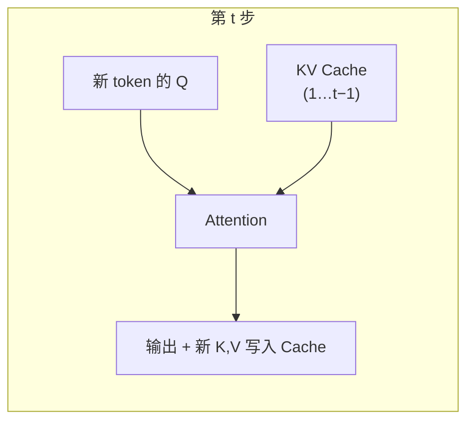

# KV Cache 是什么

> 从 Bit 到 AGI · 第八章：推理（Inference） · KV Cache 显存怎么算

自回归生成时，模型每步只吐一个新 token，却要反复「看」整段历史。KV Cache 把已经算过的 Key/Value 存下来，避免每步重算——这是推理加速的核心基石，也是显存爆炸的主要来源。

## 直觉

你在写长邮件。每敲一个新字，如果都要从第一行重新读一遍全文再决定下一个字，速度会慢到不可用。更合理的做法：读过的段落记在便签上，新字只追加便签、只对新字做注意力。

Transformer 解码阶段正是这样：第 $t$ 步只需要当前 token 的 Query 去和**所有历史** Key 做点积。历史 token 的 K、V 在上一部已经算过，存进 Cache 即可复用。



## 定义

对 **$L$ 层**、隐藏维 **$d$**、**$h_{kv}$** 个 KV 头（GQA/MQA 时 $h_{kv} < h_q$）、每头维 **$d_h$** 的模型，序列长度 **$s$**、精度 **$b$** 字节/元素：

$$
\text{KV Cache 字节} = 2 \times L \times s \times h_{kv} \times d_h \times b
$$

因子 **2** 来自 K 与 V 各一份。若 $h_{kv} \times d_h = d$（全注意力头），可简化为：

$$
\text{KV Cache 字节} = 2 \ L \ s \ d \ b
$$

**Prefill**（提示词阶段）一次性处理 $s$ 个 token，算力 $\propto s^2$；**Decode**（逐 token 生成）每步只算 1 个新 token 的 Q，但 KV Cache 随 $s$ 线性增长。

## 例子

**例 1：Llama 3 8B 量级（FP16）**

| 参数 | 值 |
| ---- | -- |
| 层数 $L$ | 32 |
| 隐藏维 $d$ | 4096 |
| KV 头数 $h_{kv}$ | 8（GQA） |
| 头维 $d_h$ | 128 |
| 精度 | FP16（2 字节） |

每 token KV 体积：

$$
2 \times 32 \times 8 \times 128 \times 2 = 131{,}072 \ \text{字节} \approx 128 \ \text{KiB/token}
$$

| 上下文长度 $s$ | KV Cache 体积 |
| -------------- | ------------- |
| 2,048 | ≈ 256 MiB |
| 8,192 | ≈ 1.0 GiB |
| 32,768 | ≈ 4.0 GiB |
| 128,000 | ≈ 16 GiB |

单卡 24 GiB 的 GPU：权重 8B×FP16 ≈ 16 GiB 后，**长上下文几乎只剩个位数 GiB 给 KV**，batch 一上就 OOM。

**例 2：同一模型 batch = 8**

KV 与 batch 线性相乘：128K 上下文 + batch 8 → KV 约 **128 GiB**，必须靠张量并行拆卡或量化 KV（见[推理量化](/manual/llm/bit-to-agi/08-inference/quantization-inference)）。

```python
def kv_cache_bytes(
    num_layers: int,
    seq_len: int,
    num_kv_heads: int,
    head_dim: int,
    bytes_per_elem: int = 2,  # FP16
) -> int:
    return 2 * num_layers * seq_len * num_kv_heads * head_dim * bytes_per_elem

# Llama-3-8B 风格
for s in [2048, 8192, 32768, 128_000]:
    gib = kv_cache_bytes(32, s, 8, 128) / (1024**3)
    print(f"s={s:>6}: {gib:.2f} GiB (batch=1)")
```

## 量化

- **相对权重的比例**：7B～8B 模型权重 FP16 约 **14～16 GiB**；8K 上下文 KV 约 **1 GiB**（≈ 6%）；128K 上下文 KV 约 **16 GiB**，**与权重同量级**。
- **Decode 瓶颈转移**：短 prompt 时算力 bound；长上下文 + 大 batch 时常变成 **显存带宽 bound**（读整段 KV）。
- **复杂度**：无 Cache 时 decode 第 $t$ 步要重算 $t$ 层 attention，总代价 $\sum_{t=1}^{s} O(t) = O(s^2)$；有 Cache 后每步 $O(s)$，总 decode $O(s^2)$ 但常数项小很多。

::: info

第五章学过 Q、K、V：Cache 只存 K 和 V，因为历史 token 的 Query 不会再参与未来步骤——只有「新来的 Q」需要查表。

:::

## 工程现场：Prefill 与 Decode 的两套账

线上 profile 时务必 **分开看** prefill 与 decode，否则优化会南辕北辙。

**Prefill** 处理整段 prompt（长度 $s_p$）：attention 要对所有 prompt token 两两交互，FLOPs 量级 $\propto s_p^2 \cdot L \cdot d$。用户感受到的是 **TTFT**（首 token 时间）。512 token 的 system prompt 在 8B 模型上常需 **120～200 ms**；4096 token 的 RAG 文档可飙到 **1 s 以上**。

**Decode** 每步只算 1 个新 token，但要对 **全部历史**（$s_p + t$）做 attention，单步 FLOPs $\propto (s_p + t) \cdot L \cdot d$，且每步都要 **读一遍 KV Cache**。生成长答案时，decode 步数 $t$ 可达数百，**E2E 延迟往往 decode 占大头**。

| 阶段 | 主要代价 | 用户指标 | 本章相关优化 |
| ---- | -------- | -------- | ------------ |
| Prefill | $O(s_p^2)$ 算力 | TTFT | Flash Attention、Prefix Caching |
| Decode | $O(s)$ 带宽/步 | ITL（ms/tok） | KV 布局、量化、Continuous Batching |

**Batch 对 KV 的乘法效应**：KV 总字节 $\propto \text{batch} \times \text{seq\_len}$。batch=32、ctx=8K 时，仅 KV 就约 **32 GiB**（8B 模型 FP16 估算）——这就是为什么 serving 栈必须 PagedAttention + 限制 `max_num_seqs`，否则即使用 80G 卡也会瞬间 OOM。

**GQA 与 KV**：Llama 3 **8 KV 头 / 32 Q 头**——KV 体积 **÷4** 相对 MHA；读 spec 时 **分清 $h_{kv}$ 与 $h_q$**，算 cache 别用错头数。

**Streaming 与 Cache 长度**：生成每步 **KV +1**；长对话 **无 sliding window** 时 ctx **无限涨**——产品 **max_context** + **截断策略** 与 KV 公式 **直接挂钩**。

## 常见误区

1. **「KV Cache 只跟层数有关」**——还与 **序列长度、batch、KV 头数、精度** 线性相乘；128K 上下文是产品决策，更是显存决策。
2. **「Prefill 也用 Cache」**——Prefill 可以边算边写 Cache；但 Prefill 的主要代价是 **并行算整个 prompt**，和 decode 的「一步一 token」性能特征（profile）不同。
3. **「MQA 只省权重」**——GQA/MQA 把 $h_{kv}$ 从 32 压到 8，**KV 体积直接 ÷4**，是长上下文推理的关键结构选择。

## 动手试一试

用上面的函数，算你目标模型在 `max_model_len=131072`、`gpu_memory_utilization=0.9` 时，权重占 16 GiB 后还剩多少给 KV；再设 `max_num_seqs=32`，看是否超出 80 GiB 八卡总量。

## 回顾与衔接

自回归推理的 **每一步** 都要读完整段历史的 K/V。第五章 [Self Attention](/manual/llm/bit-to-agi/05-transformer/self-attention) 里，attention 输出依赖所有位置的 V 的加权和；decode 时「所有位置」= 已生成的 prefix。没有 Cache，第 $t$ 步要重算 $1 \ldots t$ 所有 token 的 K/V，总 work $\sum_{t=1}^{T} O(t) = O(T^2)$——1000 token 生成就是 **百万级** 重复矩阵乘。

Cache 之后每步 **只算 1 个新 token 的 Q、K、V**，K/V  append 进 Cache；attention 读 Cache 中 **$t$ 个 K** 与 **$t$ 个 V**，单步 $O(t)$，总计 $O(T^2)$ 但 **常数项从「重算所有层所有 token」变成「读显存 + 算 1 token」**——这就是为什么 8B 模型 decode 能到 **20～30 ms/tok** 而不是秒级。

显存方面，Cache **与 batch 线性**；线上 32 路并发、8K ctx，KV 单独 **32 GiB** 不罕见——超过权重本身。后续 [Paged Attention](/manual/llm/bit-to-agi/08-inference/paged-attention) 解决 **怎么存**，[推理量化](/manual/llm/bit-to-agi/08-inference/quantization-inference) 解决 **用更窄 dtype 存**。

## 读者问答

**问：batch=1 时 KV Cache 还要吗？**
要。单用户 decode 每步仍读 **整段历史 KV**；没有 Cache 就要 **重算历史 K/V**，ITL 随 ctx **平方级恶化**。

**问：KV 和权重谁先做量化？**
通常 **先量化权重**（INT4）解决 **装不下模型**；KV 仍 FP16。若 **长 ctx OOM**，再 **KV FP8**——两步 **独立决策**。

## 速查卡

| 问题 | 第一反应 |
| ---- | -------- |
| KV OOM | 算 $2Lsh_{kv}d_h b$ × batch × ctx |
| 并发低 | PagedAttention + Continuous Batching |
| 首字慢 | Prefix cache + 缩短 prefill |
| ms/tok 高 | 量化 / TP / Speculative |
| 输出太野 | 降 T、降 top_p、或 TopK |

记住：**Prefill 看 TTFT（$O(s^2)$）**，**Decode 看 ITL（带宽 + 步数）**；优化手段 **不对症** 则白费算力。

**本章定位**：Inference 是 **训练权重 → 用户可见 token** 的最后一公里；显存、带宽、调度、采样 **四层叠加**，缺一层都可能 **OOM 或 SLA 违约**。

下一章 GPU 会解释 **HBM 带宽** 如何卡住 ms/tok 下限。本章公式请 **熟记 2Lsh_kv d_h b**。

## 小结

KV Cache = 每层、每 token 存一份 K 和 V；字节数 **$2Lsh_{kv}d_h b$**。长上下文推理的显存大头往往是 KV，不是权重。下一篇看 Paged Attention 如何像操作系统分页一样管理这些块。

→ 下一篇：[Paged Attention](/manual/llm/bit-to-agi/08-inference/paged-attention)
