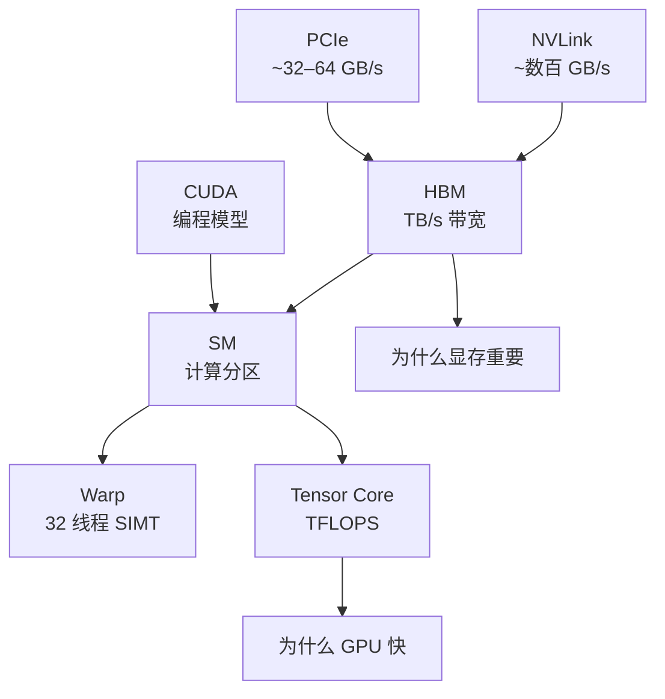

# 第九章总结

> GPU 硬件概念串联：从 CUDA 到显存容量规划

本章从程序员视角拆解了 NVIDIA GPU 如何支撑 LLM 训练与推理。以下是把各篇串成一张「心智地图」的速查——更细的公式与数字请回看对应文章。

## 概念地图

## 关键数字速查

| 概念 | 量级 | 记忆点 |
|------|------|--------|
| HBM 带宽 | 2000–8000 GB/s | 单卡内部数据主干道（A100 到 B200） |
| PCIe 4.0 ×16 | ~32 GB/s | 主机↔GPU；权重应常驻显存 |
| NVLink（H100 / B200） | ~900–1800 GB/s（双向） | 多卡并行必备 |
| Warp | 32 线程 | 分支发散的代价单位 |
| H100 FP16 Tensor | ~989 TFLOPS | 峰值算力，实际更低 |
| 7B FP16 权重 | 14 GB | 参数量 × 2 bytes |
| 70B FP16 权重 | 140 GB | 单卡 80 GB 装不下 |

## 与本专栏其他章节的衔接

- **[第五章 Transformer](/manual/llm/bit-to-agi/05-transformer)**：Attention 与 MLP 的 GEMM 是 Tensor Core 的主战场。
- **[第七章训练](/manual/llm/bit-to-agi/07-training)**：分布式训练、LoRA、梯度累积——在显存与通信约束下做取舍。
- **[第八章推理](/manual/llm/bit-to-agi/08-inference)**：KV Cache、张量并行、PagedAttention——在 GPU 硬件上优化延迟与吞吐。
- **[第十一章工程](/manual/llm/bit-to-agi/11-engineering/vllm)**：vLLM、TensorRT-LLM 等把本章硬件知识封装成生产服务。

## 选型 Checklist

1. **只推理 7B FP16？** 24 GB 消费卡可能够；留 KV 与 runtime 余量。
2. **70B 推理？** INT4 ~35 GB 权重 + KV → 48–80 GB 卡；或张量并行。
3. **70B 训练？** 多卡 H100 + NVLink + 节点间 IB；显存算 optimizer。
4. **本地双 4090？** 无 NVLink，模型并行经 PCIe，预期降低。

## 本章目录回顾

1. [CUDA 是什么](/manual/llm/bit-to-agi/09-gpu/what-is-cuda)
2. [HBM 是什么](/manual/llm/bit-to-agi/09-gpu/what-is-hbm)
3. [NVLink 是什么](/manual/llm/bit-to-agi/09-gpu/what-is-nvlink)
4. [PCIe 是什么](/manual/llm/bit-to-agi/09-gpu/what-is-pcie)
5. [Warp 是什么](/manual/llm/bit-to-agi/09-gpu/what-is-warp)
6. [SM 是什么](/manual/llm/bit-to-agi/09-gpu/what-is-sm)
7. [Tensor Core 与 TFLOPS](/manual/llm/bit-to-agi/09-gpu/tensor-core)
8. [为什么 GPU 这么快](/manual/llm/bit-to-agi/09-gpu/why-gpu-so-fast)
9. [为什么显存这么重要](/manual/llm/bit-to-agi/09-gpu/why-vram-matters)

继续阅读 → [第十章：训练你的 LLM](/manual/llm/bit-to-agi/10-train-your-llm)
