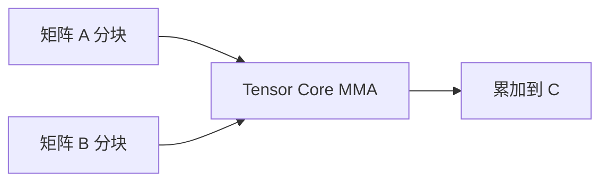

# Tensor Core 与 TFLOPS

> 矩阵乘法专用硬件，以及 TFLOPS 峰值如何换算成真实 LLM 速度

Transformer 的核心是巨型矩阵乘法。NVIDIA 从 Volta 架构起引入 **Tensor Core**：在单个时钟周期内完成小块矩阵（如 $4 \times 4$ 或 $16 \times 8 \times 16$）的乘累加。厂商宣传的 **TFLOPS**（每秒万亿次浮点运算）多半指 Tensor Core 在 FP16/BF16 或 FP8 下的峰值——这是理解「一张 H100 到底能算多快」的关键数字。

2017 年 Volta V100 首次搭载 Tensor Core，专门加速深度学习里的 $GEMM$；此前 GPU 主要靠 FP32 CUDA Core 硬算，训练 ResNet 尚可，到 Transformer 时代算力需求爆炸，Tensor Core 成为数据中心 GPU 的 defining feature。如今没有 Tensor Core 级矩阵单元的卡，很难参与 serious LLM 训练。

## 直觉

普通 CUDA Core 像心算：一次算两个数相乘再加。Tensor Core 像 **算盘上的一个框**：一次性把两块小矩阵「滚」进结果矩阵。LLM 的大矩阵可以拆成许多小块，反复喂给 Tensor Core——cuBLAS、cuDNN、FlashAttention 都在干这件事。



## 定义

- **MMA（Matrix Multiply-Accumulate）**：$D = A \times B + C$，在硬件支持的数据类型与块大小下执行。
- **TFLOPS / TFLOP/s**：$10^{12}$ 次浮点运算/秒。一次 $M \times K$ 与 $K \times N$ 矩阵乘的 FLOPs 约为 $2MNK$（每个输出元素 $K$ 次乘加）。
- **有效 TFLOPS**：实际程序 FLOPs ÷ 运行时间，永远 **≤ 峰值**；LLM 训练常见 40–55% 峰值利用率已属不错。

## 例子

**例子 1：官方峰值 TFLOPS（NVIDIA 数据中心卡，约数）**

| GPU | FP16/BF16 Tensor（稠密峰值） | FP8 Tensor | FP32 CUDA |
|-----|------------------------------|------------|-----------|
| A100 80GB | ~312 TFLOPS | — | ~19.5 TFLOPS |
| H100 SXM | ~989 TFLOPS | ~1979 TFLOPS | ~67 TFLOPS |
| H200 / B200 | ~989 / ~2250 TFLOPS | ~1979 / ~4500 TFLOPS（B200 另支持 FP4 ~9 PFLOPS） | ~67 / ~75 TFLOPS |

注：稀疏（2:4 structured sparsity）模式下峰值可再翻倍——需模型与库支持。

**例子 2：一次 GEMM 用了多少 FLOPs？**

$C = A B$，$A$ 为 $4096 \times 4096$，$B$ 为 $4096 \times 4096$：

$$
\text{FLOPs} = 2 \times 4096^3 \approx 1.37 \times 10^{11} \approx 137 \text{ GFLOP}
$$

若 H100 有效 **500 TFLOPS** FP16：

$$
\text{时间} \approx \frac{137 \times 10^{9}}{500 \times 10^{12}} \approx 0.27 \text{ ms}
$$

同一 GEMM 若只用 FP32 CUDA Core（~67 TFLOPS），约 **2 ms**——Tensor Core 对 LLM 训练提速是数量级差异。

**例子 3：7B 模型一步前向的 FLOPs 粗算**

参数量 $P$ 的前向 FLOPs 常近似 **$2P$**（每个参数一次乘、一次加，见 Megatron 文献）。7B 模型一步：

$$
2 \times 7 \times 10^9 = 1.4 \times 10^{10} \text{ FLOPs} = 14 \text{ GFLOP}
$$

纯算力下限（忽略 memory bound）：H100 989 TFLOPS → $\frac{14}{989} \approx 0.014$ ms——远快于实际，说明 **推理常受 HBM 带宽与 KV Cache 限制**，不是 TFLOPS 不够。

## 量化

- **精度与 TFLOPS**：FP8 > FP16 > FP32；训练常用 BF16/FP16 混合精度；推理量化 INT8/INT4 走不同单元，峰值 TFLOPS 不能直接与 FP16 比较。
- **Roofline**：峰值 TFLOPS 是「天花板」；内存带宽是「斜率」。Attention 在大 sequence 时更偏带宽；大 batch GEMM 更偏算力。
- **MFU（Model FLOPs Utilization）**：训练圈常用指标 = 实际 FLOPs/s ÷ 峰值 FLOPs/s。大模型预训练 H100 集群 MFU 30–50% 已属优秀。

## Transformer Engine 与 FP8

Hopper 引入 **Transformer Engine（TE）**：训练时动态在 FP8 与 FP16/BF16 之间选择，在几乎不损精度的情况下接近 **2× FP16 峰值 TFLOPS**；Blackwell（B200）第五代 Tensor Core 进一步加入硬件级 **FP4 / MXFP4** 微缩放格式。Megatron-LM、NeMo、DeepSeek-V3/V4 等框架与模型深度利用了 FP8/FP4；你需要 Hopper/Blackwell 硬件 + 配套软件栈才能受益。

FP8 两种格式（E4M3、E5M2）分别偏向精度与动态范围——细节由库处理，应用开发者只需知道 **FP8 与 FP4 是 Hopper / Blackwell 相对 A100 的关键算力跃迁**。

## 稀疏 Tensor Core（2:4 结构化稀疏）

Ampere 起支持 **2:4 sparsity**：每 4 个权重中固定 2 个为零，硬件跳过计算，峰值 TFLOPS **名义翻倍**。实际 LLM 需 **剪枝 + 微调** 才能保持精度，部署链路（TensorRT-LLM 等）需显式支持——不如 FP8/INT4 量化普及。

## 从 TFLOPS 到 tokens/s

粗算链路（仅作量级直觉）：

1. 7B decode 每 token ~14 GFLOP（$2P$ 近似）
2. H100 有效 200 TFLOPS（非峰值）→ 算力下限 ~0.07 ms/token
3. 实际 memory-bound 常见 **数十 ms/token**（batch=1）

故 **tokens/s** 与 **TFLOPS 峰值** 不成线性；benchmark 应报 **latency@batch** 与 **throughput@concurrency**，而非只背 spec  sheet。

## 常见误区

::: warning

**误区：「989 TFLOPS = 每秒能训练 989 / 14 ≈ 70 次 7B 前向」** — 14 GFLOP 只是理论算术量；内存访问、通信、kernel launch、非 GEMM 算子都会拉低有效吞吐。

:::

**误区：「买最高 TFLOPS 的卡，推理一定最快」** — 解码小 batch 时 memory latency 主导；HBM 容量不足导致 offload 更慢。

## 动手试一试

```python
import torch, time

def bench_gemm(n, dtype=torch.float16):
    a = torch.randn(n, n, device="cuda", dtype=dtype)
    b = torch.randn(n, n, device="cuda", dtype=dtype)
    for _ in range(5):
        a @ b
    torch.cuda.synchronize()
    t0 = time.perf_counter()
    reps = 20
    for _ in range(reps):
        c = a @ b
    torch.cuda.synchronize()
    t = (time.perf_counter() - t0) / reps
    flops = 2 * n**3 / t / 1e12
    print(f"n={n} {dtype}: {flops:.0f} TFLOPS effective")

bench_gemm(4096)
bench_gemm(8192)
# 增大 n 通常更接近峰值——规模太小喂不饱 Tensor Core
```

```bash
# 查看 GPU 名称与驱动报告
nvidia-smi --query-gpu=name,clocks.max.sm --format=csv
```

## 算力与内存的「屋顶线模型」（Roofline）

在同一图上画两条线：

- **算力屋顶**：峰值 TFLOPS（水平线）
- **带宽斜率**：有效 TFLOPS = 带宽 × AI

Kernel 落在屋顶下「斜线区域」→ memory-bound；顶到水平线 → compute-bound。LLM 不同算子、不同阶段落在不同区域——**没有单一 TFLOPS 数字描述整个 pipeline**。

读 NVIDIA 白皮书时常见 **「dense vs sparse」** 峰值：marketing 取稀疏翻倍数；实际 dense LLM 训练以 **非稀疏** 峰值 × MFU 估算更保守。

## 回顾与自测

**Q：312 TFLOPS（A100）与 989 TFLOPS（H100）差 3 倍，训练是否快 3 倍？**
A：不一定。MFU、通信、数据加载、内存 bound 都会限制；实际常见 **1.5–2.5×** step time 改善。

**Q：INT4 推理 TFLOPS 怎么看？**
A：INT4 常走不同硬件路径，不能与 FP16 Tensor Core TFLOPS 直接对比；看 **tokens/s benchmark** 更可靠。

**Q：cuBLAS 如何开启 Tensor Core？**
A：FP16/BF16/TF32 输入通常自动走 Tensor Core；FP32 纯 CUDA Core，除非 TF32 模式。

**Q：FP64 Tensor Core 对 LLM 重要吗？**
A：几乎不重要。LLM 训练推理以 FP16/BF16/FP8/INT 为主；FP64 是 HPC 科学计算场景。

## 工程师备忘录

- 读 spec 先找 **Tensor Core FP16/BF16 稠密峰值**，勿用 FP32 CUDA Core 峰值代替。
- 训练估时：$\text{时间} \approx \frac{6PT}{GPU\_\text{TFLOPS} \times \text{MFU} \times \text{卡数}}$（$P$ 参数，$T$ token 数，6 为 forward+backward 粗系数）。
- Benchmark GEMM 时 $n \ge 8192$ 更接近峰值；$n=256$ 无参考价值。
- Hopper FP8 需 H100 + 支持 FP8 的软件栈；A100 无硬件 FP8。

本章讨论的 TFLOPS 均指 **Tensor Core 矩阵乘** 路径；Softmax、LayerNorm、激活函数仍大量占用 CUDA Core 与非 GEMM 带宽，因此端到端 LLM 有效算力永远低于 spec 峰值——这是正常现象，不是「显卡买亏了」。

对比卡型时，请固定 **精度（FP16/FP8）**、**是否稀疏**、**batch/seq 形状** 三个变量；官方 peak TFLOPS 只有在「大 GEMM micro-benchmark」条件下才接近，LLM 端到端 tokens/s 才是业务指标。

记住：**TFLOPS 回答「算力天花板」，tokens/s 回答「用户感受到的速度」**——两者通过 memory bound、通信与 batch 策略耦合，不能互相替代。

读 NVIDIA 数据中心 GPU 白皮书时，建议同时记录 **FP16 Tensor TFLOPS** 与 **HBM 带宽** 两行，缺一则无法判断 LLM workload 的瓶颈侧。

## 小结

Tensor Core 是 LLM 时代的 **矩阵乘专用引擎**；TFLOPS 是峰值算力单位，H100 FP16 稠密峰值约 **989 TFLOPS**，FP8 约 **1979 TFLOPS**。读 spec 时区分 **Tensor Core TFLOPS** 与 **CUDA Core FP32**；真实 LLM 速度还受 HBM、并行策略、batch 大小制约。

下一篇：[为什么 GPU 这么快](/manual/llm/bit-to-agi/09-gpu/why-gpu-so-fast)
