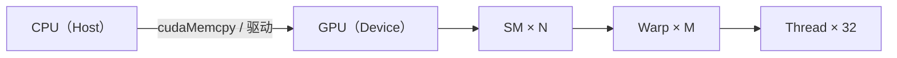

# CUDA 是什么

> 用 C/C++ 在 GPU 上写并行程序的平台与编程模型

你已经在 Python 里调用过 `model.cuda()` 或 `device="cuda"`，但 GPU 上真正跑的是什么？CUDA（Compute Unified Device Architecture）是 NVIDIA 提供的并行计算平台：它让你用扩展过的 C/C++ 写「内核函数」，把成千上万个线程同时派到 GPU 上执行。没有 CUDA（或兼容层如 ROCm），PyTorch 的矩阵乘法就无法直接驱动 NVIDIA 硬件。

2006 年 NVIDIA 发布 CUDA 1.0，降低了 GPGPU（通用 GPU 计算）门槛——此前要用图形 API「伪装」成游戏去算科学计算。如今，几乎所有深度学习框架的 NVIDIA 后端都建立在 CUDA Runtime 与 cuBLAS 之上；读 LLM 论文里的「A100 / H100 / B200 集群」时，底层就是成千上万张卡各自跑着 CUDA kernel。

## 直觉

把 GPU 想象成一家拥有数百名工人的工厂，CPU 是坐在办公室里的经理。经理（CPU）负责拆任务、发指令；工人们（GPU 线程）在同一道工序上各处理一小份数据。CUDA 就是这套「派工规则」——规定怎么写工序说明书（kernel）、怎么把工人编组（grid / block / thread）、以及经理和工人之间怎么传材料（host ↔ device 内存拷贝）。



## 定义

CUDA 包含三层：

1. **硬件抽象**：GPU 被暴露为「设备（device）」，与运行操作系统和 Python 解释器的「主机（host）」分离。
2. **编程模型**：程序员写 `__global__` 内核，启动时用 `<<<grid, block>>>` 指定线程布局。
3. **运行时 API**：`cudaMalloc`、`cudaMemcpy`、`cudaLaunchKernel` 等，负责内存分配与内核调度。

一个典型的 CUDA 程序流程：

```python
# PyTorch 在底层大致等价于：
# 1. 把 tensor 数据 cudaMemcpy 到 GPU
# 2. 启动 CUDA kernel（如 cuBLAS 的 GEMM）
# 3. 结果留在 device 上，或拷回 host
import torch

x = torch.randn(4096, 4096, device="cuda")
y = torch.randn(4096, 4096, device="cuda")
z = x @ y  # 调用 cuBLAS，不经过 Python 循环
```

## 例子

**例子 1：向量加法内核**

```cpp
__global__ void vec_add(float *a, float *b, float *c, int n) {
    int i = blockIdx.x * blockDim.x + threadIdx.x;
    if (i < n) c[i] = a[i] + b[i];
}
// 启动：<<< (n+255)/256, 256 >>>
// 共 n 个线程，每个算 c[i] = a[i] + b[i]
```

若 `n = 1,048,576`（约 100 万元素），CPU 单线程循环需要 100 万次迭代；GPU 一次启动即可让约 100 万个线程并行写 `c[i]`。

**例子 2：PyTorch 与 CUDA 的关系**

| 层级 | 你写的代码 | 实际执行 |
|------|-----------|---------|
| 应用 | `loss.backward()` | PyTorch autograd |
| 框架 | `torch.matmul(A, B)` | cuBLAS / cuDNN |
| 驱动 | CUDA Runtime | kernel 启动 |
| 硬件 | — | SM 上的 Warp 执行 |

你几乎从不手写 CUDA kernel，但每个 `torch` 算子最终都落在 CUDA（或 cuBLAS/cuDNN）上。

## 量化

- **线程规模**：一块 H100 GPU 可同时驻留数十万线程；一次 kernel 启动的线程总数可达 $10^6$ 量级。
- **内存拷贝代价**：PCIe 4.0 ×16 约 32 GB/s（见[PCIe 篇](/manual/llm/bit-to-agi/09-gpu/what-is-pcie)）。把 14 GB 的 FP16 权重从 CPU 拷到 GPU 约需 $\frac{14}{32} \approx 0.44$ 秒——这就是为什么推理时权重应常驻显存。
- **与 CPU 线程对比**：CPU 擅长少量复杂线程 + 大缓存；CUDA 擅长海量简单线程 + 高带宽显存（HBM）。

## 线程层次：Grid、Block、Thread

CUDA 用三维索引组织线程（实践中常用其中一维或二维）：

| 层次 | 含义 | 类比 |
|------|------|------|
| **Grid** | 一次 kernel 启动的全部 block | 整批订单 |
| **Block** | 可协作的线程组（共享 shared memory） | 一个班组 |
| **Thread** | 最小执行单元 | 一名工人 |

Block 大小有限制（通常每 block 最多 1024 线程），Grid 可以非常大（$2^{31}-1$）。这种层次与硬件映射关系是：一个 **block 分配到一个 SM** 上执行（可能与其他 block 共享同一 SM），block 内再划分为 [Warp](/manual/llm/bit-to-agi/09-gpu/what-is-warp)。

Host 与 Device 内存分离是 CUDA 的第一课。你在 Python 里创建的普通 `tensor` 在 CPU 上；`.cuda()` 或 `device="cuda"` 会在 GPU 上 **新分配** 一块 HBM 并拷贝数据。之后两次 `matmul` 若输入已在 device 上，就不再经过 PCIe——这是推理服务把模型 `load` 到 GPU 后常驻的原因。

## CUDA 生态：不止于「写 kernel」

大多数 AI 工程师从不手写 `__global__`，但每天都在用 CUDA 生态：

- **cuBLAS**：Level-3 BLAS（矩阵乘），PyTorch `torch.matmul` 的底层之一。
- **cuDNN**：卷积、RNN、Normalization 等深度学习原语。
- **NCCL**：多 GPU **集合通信**（AllReduce 等），分布式训练的基石。
- **CUDA Graph**：把多次 kernel 启动录制成图，减少 CPU launch 开销——vLLM 等框架大量使用。

从 [第一章 SIMD](/manual/llm/bit-to-agi/01-bits/what-is-simd) 到 CUDA：CPU SIMD 是 **显式** 4/8/16 路向量；CUDA 是 **隐式** 32 路 Warp SIMT。二者哲学不同，但都在回答「如何用一条指令处理多份数据」。

## 常见误区

::: warning

**误区 1：「CUDA = GPU」** — CUDA 是 NVIDIA 的软件栈；AMD GPU 用 ROCm/HIP，Apple 用 Metal。说「放到 CUDA 上」通常指「放到 NVIDIA GPU 上」。

:::

::: warning

**误区 2：「`.cuda()` 之后一切都很快」** — 若数据仍在 CPU 内存，每次前向都要 `cudaMemcpy`，PCIe 会成为瓶颈。应确保模型和张量创建在 `device="cuda"` 上。

:::

**误区 3：「写 CUDA kernel 一定比库快」** — cuBLAS、FlashAttention 等库经过多年优化，手写 kernel 很难超越，除非你有非常特殊的算子。

## 动手试一试

在装有 NVIDIA GPU 的机器上：

```bash
python -c "
import torch
print('CUDA available:', torch.cuda.is_available())
print('Device:', torch.cuda.get_device_name(0))
print('Capability:', torch.cuda.get_device_capability(0))
"
```

观察输出中的 **Compute Capability**（如 9.0 对应 Hopper/H100，10.0/12.0 对应 Blackwell B200/RTX 5090），它决定你能用哪些 Tensor Core 指令。

再试一次最小「真·CUDA」体验（需本机安装 CUDA Toolkit 与 `nvcc`）：

```bash
# 若已安装 samples
cuda-install-samples-12.x.sh ~
cd ~/NVIDIA_CUDA-12.x_Samples/0_Introduction/vectorAdd
make
./vectorAdd
```

输出会显示 GPU 上向量加法耗时远小于 CPU 参考实现——与 PyTorch 高层 API 背后是同一套执行模型。

## 与 LLM 训练推理的对应关系

| 你在 PyTorch 里写的 | CUDA 层发生的事 |
|--------------------|----------------|
| `tensor.cuda()` | `cudaMalloc` + `cudaMemcpy` H2D |
| `torch.matmul` | cuBLAS `cublasGemmEx`（Tensor Core 路径） |
| `DistributedDataParallel` | NCCL AllReduce + 多 stream |
| `torch.cuda.synchronize()` | 等待 device 队列清空 |

理解这一列，debug OOM、慢拷贝、多卡 hang 时才知道该查 **驱动 / NCCL / PCIe / NVLink** 哪一层。

## 回顾与自测

**Q：PyTorch 算子在 GPU 上执行，是否等于写了 CUDA？**
A：是间接的。PyTorch 调用 cuBLAS/cuDNN 等预编译 CUDA 库；只有自定义算子或 `torch.utils.cpp_extension` 才手写 kernel。

**Q：为什么第一次 `cuda()` 慢、后面快？**
A：首次包含 H2D 拷贝与 CUDA context 初始化；后续若 tensor 已在 device，主要只剩 kernel 时间。

**Q：没有 NVIDIA 显卡能学 CUDA 吗？**
A：可以读概念；实践需 GPU 或 Colab。Apple Silicon 用 MPS，语法类似 `device="mps"` 但底层不是 CUDA。

**Q：CUDA 版本和驱动不匹配会怎样？**
A：PyTorch 安装页会指定最低驱动；`nvidia-smi` 右上角驱动版本应 ≥ 要求，否则 kernel 无法加载或性能降级。

## 小结

CUDA 是连接「C/C++ 并行程序」与「NVIDIA GPU 硬件」的桥梁：内核 + 线程层次 + 内存管理。PyTorch、TensorFlow、vLLM 等框架都建立在 CUDA 之上。理解 CUDA 的 host/device 分离，是理解后续 HBM 带宽、Warp 调度、Tensor Core 的前提。

下一篇：[HBM 是什么](/manual/llm/bit-to-agi/09-gpu/what-is-hbm) — 显存为什么比 DDR 快一个数量级。
