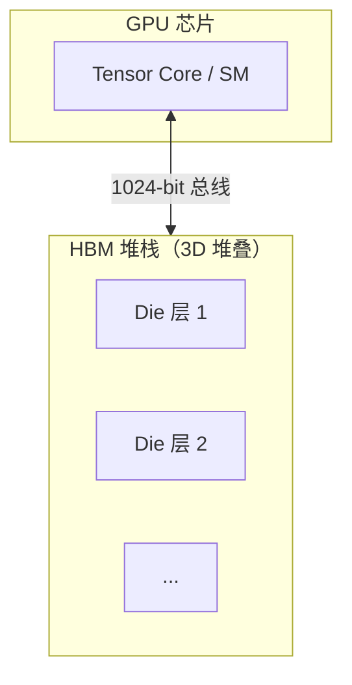

# HBM 是什么

> 高带宽内存如何让 GPU 以 TB/s 级速度喂饱 Tensor Core

矩阵乘法算得再快，如果数据送不进来也是白搭。GPU 显存用的不是普通电脑里的 DDR5，而是 HBM（High Bandwidth Memory）——一种与 GPU 芯片「贴在一起」的堆叠内存，带宽可达每秒数 TB。读不懂 HBM 的 GB/s 数字，就无法理解为什么大模型推理是「带宽 bound」还是「算力 bound」。

HBM 由 SK hynix、三星、美光等厂商生产，与 NVIDIA GPU 通过 CoWoS 封装在一起。你买的「80 GB 显卡」里，那 80 GB 几乎全是 HBM stack，而不是可单独更换的内存条——这也是 GPU 显存扩容只能换更贵卡、无法像 DDR 一样加条的原因。

## 直觉

普通内存（DDR）像一条乡村公路：车道少，但每个路口（CPU 缓存）离仓库很近。HBM 像围绕工厂修建的环形高架：车道极多（1024-bit 甚至更宽的总线），工厂（GPU 计算单元）一伸手就能拿到货，但造这条路非常贵，所以单卡容量通常在 80–192 GB 量级，小于服务器上的 512 GB–2 TB DDR5。



## 定义

HBM 通过 **2.5D/3D 封装** 把多层 DRAM die 垂直堆叠，再用 **硅中介层（interposer）** 与 GPU 芯片互联。关键指标：

| 指标 | 含义 |
|------|------|
| **带宽（GB/s 或 TB/s）** | 单位时间内可读写的字节数 |
| **容量（GB）** | 能存多少权重、激活、KV Cache |
| **位宽（bit）** | 数据通路有多宽；HBM 常见 1024-bit，DDR5 单通道仅 64-bit |

带宽公式（简化）：

$$
\text{带宽 (GB/s)} = \frac{\text{有效频率 (GT/s)} \times \text{总线位宽 (bit)}}{8}
$$

## 例子

**例子 1：常见数据中心的 HBM 规格（约数，随 SKU 略有差异）**

| GPU | HBM 代际 | 容量 | 峰值带宽 |
|-----|---------|------|---------|
| A100 80GB | HBM2e | 80 GB | ~2.0 TB/s（2039 GB/s） |
| H100 80GB SXM | HBM3 | 80 GB | ~3.35 TB/s |
| H100 80GB PCIe | HBM2e | 80 GB | ~2.0 TB/s |
| H200 141GB / B200 192GB | HBM3e | 141 GB / 192 GB | ~4.8 TB/s / ~8.0 TB/s |

注意：同一代 H100，SXM 版 HBM3 带宽显著高于 PCIe 版 HBM2e——封装形态影响内存规格。

**例子 2：带宽够不够用？粗算 LLM 解码**

解码一个 token 时，若模型权重为 FP16、参数量 $P$，每个 token 大约要从显存读取全部权重一次（简化模型）：

$$
\text{所需带宽} \approx P \times 2 \text{ bytes/token}
$$

7B 模型 FP16：$7 \times 10^9 \times 2 \approx 14$ GB/token-read。若 H100 有效带宽 2 TB/s，理论下限延迟 $\frac{14}{2000} \approx 7$ ms/token——实际还有 KV Cache 访问、kernel 开销，所以带宽是解码延迟的关键变量之一。

## 量化

- **与 DDR5 对比**：单条 DDR5-4800 64-bit 约 38 GB/s；8 通道约 300 GB/s。一块 H100 的 HBM 约 **10×** 于整台服务器内存带宽。
- **与 PCIe 对比**：PCIe 4.0 ×16 约 32 GB/s。H100 HBM 约 **100×** 于 PCIe——权重必须在显存里，不能每次算完再从 CPU 内存拉。
- **Roofline 直觉**：若算力峰值 989 TFLOPS（H100 FP16 Tensor Core），一次 $4096 \times 4096$ GEMM 需 $\approx 2 \times 4096^3 / 10^{12} \approx 0.14$ TFLOP。算力很高，但 LLM 推理常因 **内存访问模式不规则**（attention、KV Cache）而更接近带宽上限。

### 自己拖一下

「Roofline 直觉」讲的是一张图上的两条线，但正文一条也没画。下面把它画出来——拖算术强度，看你的算子撞的是算力屋顶还是带宽斜坡：

<Roofline />

**关键一击在「换卡」**：切到 H200，它的 TFLOPS 和 H100 **完全一样**，但带宽从 3.35 涨到 4.8 TB/s，拐点左移、斜坡抬高——同一个 decode 点（算术强度 ≈1）的有效性能跟着涨。这就是为什么「H100/H200 比 A100 快，快在带宽不是算力」：LLM 解码的算术强度只有 1 左右，深陷带宽区，那个 989 TFLOPS 的大数字它几乎用不到（拖到 decode batch=1 看那个百分之零点几的利用率）。

## HBM 为何比 DDR 贵且难扩容

HBM 的每 GB 成本远高于 DDR5，原因包括：3D 堆叠工艺、硅中介层、与 GPU 联合封装（CoWoS）、更低产量。因此 GPU **容量天花板** 长期低于 CPU 内存——2024–2026 数据中心卡常见 80–192 GB（如 H100 80GB、H200 141GB、B200 192GB，下一代 Rubin 架构进一步迈向 HBM4），而 CPU 服务器可达 1–2 TB DDR5。

对 LLM 工程的两条推论：

1. **装不下就必须换策略**：量化（INT4/INT8）、多卡张量并行、CPU/NVMe offload——都是 HBM 容量不足时的补丁。
2. **装得下也可能慢**：权重 fit 在 80 GB 内，但 decode 时 memory-bound，需要高 **带宽** 而非更大 **容量**——HBM3e 升级主要惠及长 context、高并发 KV Cache 场景。

## 带宽单位：GB/s 与 TB/s 怎么读

厂商 spec 有时写 **2039 GB/s**，有时写 **2.039 TB/s**，二者等价（$1\ \text{TB/s} = 1000\ \text{GB/s}$ 在十进制营销语境下；严格 $2^{40}$ 与 $10^9$ 有细微差别，工程估算可忽略）。

心算换算：H100 ~3350 GB/s ≈ **3.35 TB/s**。若 70B INT4 权重 35 GB，「纯带宽下限」读完全部权重需 $\frac{35}{3.35} \approx 10$ ms——实际 decode 还有 attention、采样，但量级说明 **每 token 都要「扫」一遍权重** 时带宽多重要。

## 常见误区

::: warning

**误区：「显存 GB 数 = HBM 带宽」** — 容量和带宽是独立参数。H200 容量 141 GB、带宽 4.8 TB/s；A100 80 GB 带宽 2 TB/s。买卡要看你的瓶颈是「装不下」还是「读太慢」。

:::

**误区：「频率越高带宽越高」** — HBM 有效频率低于 DDR，但位宽极大，总带宽反而更高。

## 动手试一试

用 `nvidia-smi` 查看显存容量与带宽（部分驱动显示 Memory Bus Width）：

```bash
nvidia-smi --query-gpu=name,memory.total,memory.bus_width --format=csv
```

在 PyTorch 中观察一次大矩阵乘是否「吃满」算力：

```python
import torch, time

n = 8192
a = torch.randn(n, n, device="cuda", dtype=torch.float16)
b = torch.randn(n, n, device="cuda", dtype=torch.float16)

# 预热
for _ in range(3):
    a @ b
torch.cuda.synchronize()

t0 = time.perf_counter()
for _ in range(10):
    c = a @ b
torch.cuda.synchronize()
elapsed = (time.perf_counter() - t0) / 10

flops = 2 * n**3 / elapsed / 1e12
print(f"GEMM {n}x{n}: {flops:.1f} TFLOPS (FP16)")
# H100 上理想情况可接近数百 TFLOPS；远低于峰值说明可能未用到 Tensor Core 或规模不够大
```

## Memory-bound vs Compute-bound 判据

算术强度（Arithmetic Intensity）：

$$
AI = \frac{\text{FLOPs}}{\text{Bytes moved from HBM}}
$$

GEMM 块越大，$AI$ 越高，越可能 **compute-bound**（Tensor Core 吃满）。Attention decode、LayerNorm、小 batch GEMM 常 **memory-bound**——再高的 TFLOPS 峰值也闲置，此时升级 HBM 带宽（H100 vs A100）比升级 SM 数量更敏感。

LLM **prefill**（处理 prompt）批量大、GEMM 大 → 偏 compute-bound；**decode**（逐 token）→ 偏 memory-bound。同一模型、同一卡，两阶段瓶颈不同，优化手段也不同（prefill 拼 batch，decode 用量化与 KV 优化）。

## 回顾与自测

**Q：A100 80GB 与 H100 80GB 容量相同，为何 H100 解码常更快？**
A：HBM3 带宽约 3350 GB/s vs A100 约 2039 GB/s；decode 常 memory-bound，带宽差距直接体现为 tokens/s。

**Q：GDDR6X/GDDR7（4090/5090）与 HBM 差在哪？**
A：4090 显存带宽约 1 TB/s 量级，5090（GDDR7）约 1.79 TB/s，仍显著低于 H100/H200/B200 的 HBM；大 batch 训练与长 context KV 场景差距明显。

**Q：如何快速查自己卡的 HBM 带宽？**
A：NVIDIA 官网 spec sheet 或 `nvidia-smi -q` 中的 Product Name 对照白皮书。

**Q：显存带宽和核心频率哪个更重要？**
A：对 LLM 大矩阵乘，两者都重要；decode 小 batch 时带宽往往先成为瓶颈，频率影响次之。

## 工程师备忘录

- HBM **容量** 查 `memory.total`；**带宽** 查白皮书，勿混淆。
- A100 ~2 TB/s，H100 SXM ~3.35 TB/s，H200 ~4.8 TB/s，B200 ~8 TB/s —— 四代量级记忆即可。
- 消费级 GDDR6X 带宽 ~1 TB/s，约为 H100 HBM 的 1/3。
- Roofline：$AI = \text{FLOPs}/\text{Bytes}$；LLM decode 常低 $AI$ → memory-bound。

当你看到 benchmark 写「H100 比 A100 快 2× tokens/s」而 TFLOPS 涨 3× 时，往往是 **HBM 带宽 + FP8** 叠加的效果，而非单一指标 magic。读文章时把 **带宽数字和 TFLOPS 数字成对出现**，判断才完整。

## 小结

HBM 是 GPU 的「高速仓库」：贵、容量有限，但带宽以 **TB/s（即 1000+ GB/s）** 计，是普通内存和 PCIe 无法替代的。读 LLM 硬件规格时，务必同时看 **容量（GB）** 和 **带宽（GB/s）**——下一章的 NVLink 解决的是 **GPU 与 GPU 之间** 的带宽，而 HBM 解决的是 **单卡内部** 的带宽。

下一篇：[NVLink 是什么](/manual/llm/bit-to-agi/09-gpu/what-is-nvlink)
