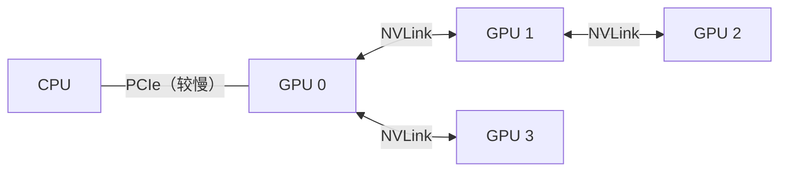

# NVLink 是什么

> GPU 之间的高速互联，多卡张量并行的物理基础

单卡 HBM 装不下 70B 模型的 FP16 权重（约 140 GB），怎么办？把模型切到多张 GPU 上，每张卡算一部分——这就是[张量并行](/manual/llm/bit-to-agi/08-inference/tensor-parallel)。卡与卡之间每秒要交换 GB 级激活值，PCIe 太慢，NVLink 才是多卡训练与推理的「专用高速公路」。

DGX H100 等机器里，NVSwitch 芯片像「GPU 专用交换机」，让 8 张卡任意两两通信都不必经过 CPU。买这类机器时，NVLink 拓扑与 lane 数往往写在采购 spec 里，与「有几张 H100」同等重要——没有 NVSwitch 的 8 卡 PCIe 拓扑，很难发挥 70B 张量并行的设计目标。

## 直觉

PCIe 是 GPU 去 CPU「客厅」借道的公用走廊；NVLink 是 GPU 之间直连的「内部专线电话」。八张 H100 通过 NVSwitch 组成 NVLink 域，任意两张卡之间都能以数百 GB/s 对话，而不用把数据绕回 CPU 内存。



## 定义

NVLink 是 NVIDIA 的 **GPU-to-GPU（以及 GPU-to-CPU 在部分平台）** 高速互联协议，特点：

- **点对点**：多 lane 并行，带宽随代数提升。
- **NVSwitch**：在 DGX 等系统中，交换芯片让 8 卡（或更多）全互联，而非仅相邻卡相连。
- **与 PCIe 互补**：主机↔GPU 仍走 PCIe；卡间大流量走 NVLink。

## 例子

**例子 1：NVLink 带宽数量级（H100 时代，约数）**

| 连接 | 峰值带宽（单向，约） | 备注 |
|------|---------------------|------|
| PCIe 4.0 ×16 | ~32 GB/s | 主机↔单卡 |
| PCIe 5.0 ×16 | ~64 GB/s | 新平台 |
| NVLink 4.0（H100） | ~450 GB/s / 链路 | 多链路聚合更高 |
| H100 / B200 卡间（经 NVSwitch） | ~900 GB/s（NVLink 4） / ~1.8 TB/s（NVLink 5）双向总带宽 | 8 卡或 NVL72 域内 |

具体数字因拓扑（是否经 NVSwitch、链路数）而异，但量级上 **NVLink 比 PCIe 快一个数量级** 是确定的。

**例子 2：张量并行为何依赖 NVLink**

设 70B 模型 4 路张量并行，每卡存约 35 GB 权重。前向时每层 MLP 的 AllReduce 通信量与 batch、hidden size 相关；若每层要传 100 MB、共 80 层，一轮前向通信约 8 GB。
- PCIe 32 GB/s：$\frac{8}{32} = 0.25$ s 仅通信
- NVLink 450 GB/s：$\frac{8}{450} \approx 0.018$ s

多卡 LLM  serving 的延迟，卡间互联往往是第一硬件选型因素。

## 量化

- **扩展定律**：$N$ 卡理想加速比受 **通信/计算比** 限制。NVLink 提高有效带宽 → 提高可接受的并行度。
- **与 InfiniBand 对比**：多 **节点**（多台服务器）训练用 InfiniBand/RoCE（100–400 Gb/s 网络）；单 **节点** 内多卡用 NVLink。8×H100 DGX 是典型的「节点内 NVLink + 节点间 IB」。
- **消费级显卡**：GeForce RTX 4090 / 5090 等 **没有** NVLink，多卡游戏卡做 LLM 并行只能走 PCIe，效率大打折扣——这是数据中心卡贵的原因之一。

## NVLink 代数演进（简表）

| 代际 | 代表产品 | 单链路带宽量级 | 备注 |
|------|---------|---------------|------|
| NVLink 1.0 | P100 | ~40 GB/s | 早期多卡训练 |
| NVLink 2.0 | V100 | ~50 GB/s | |
| NVLink 3.0 | A100 | ~50 GB/s × 多链路 | NVSwitch 全互联 |
| NVLink 4.0 / 5.0 | H100 / B200 | ~900 GB/s / ~1.8 TB/s（双向） | 配合 NVSwitch 3/4 与 NVL72 |

代数提升主要服务 **更大模型、更高并行度**：当单层 AllReduce 从 MB 涨到 GB，PCIe 32 GB/s 先成为天花板。

## 与 CPU 侧 NVLink-C2C

Grace Hopper（GH200）与 Grace Blackwell（GB200 NVL72）等架构还用 NVLink-C2C 连接 **Grace CPU 与 GPU**，让 CPU 内存以约 900 GB/s 带宽参与 GPU 计算——适合超大 embedding、MoE 参数或 KV Cache offload 场景。主流 x86 + PCIe GPU 服务器仍以 **PCIe 连 CPU、NVLink 连 GPU** 为主。

## 工程选型：何时 NVLink 是刚需

| 场景 | NVLink 重要性 |
|------|--------------|
| 单卡 7B 推理 | 低 |
| 8 卡 70B 张量并行 serving | **极高** |
| 多节点 405B 预训练 | 节点内 NVLink + 节点间 IB |
| 双 4090 本地实验 | **无 NVLink**，预期降低 |

## 常见误区

::: warning

**误区：「有两张 GPU 就一定有 NVLink」** — 只有部分专业卡（A100/H100/H200 等 SXM/部分 PCIe 版）支持；消费卡、Apple Silicon 均无 NVLink。

:::

**误区：「NVLink 带宽 = 实际通信带宽」** — AllReduce 算法效率、消息大小、CUDA 版本都会影响有效吞吐；小消息延迟（latency）仍不可忽视。

## 动手试一试

检查 NVLink 拓扑（需多卡 + 驱动支持）：

```bash
nvidia-smi topo -m
# 矩阵中 NV# 表示 NVLink 连接，PIX/PHB 表示经 PCIe 桥
```

```bash
nvidia-smi nvlink --status
```

若只有一张卡，输出会提示无 NVLink——这本身也是学习点：本地 4090 开发环境与 8×H100 集群硬件模型不同。

## 集合通信与 NVLink 的关系

分布式训练常用 **AllReduce** 同步梯度。NCCL 会根据拓扑自动选择：NVLink > PCIe P2P > 经 host 中转。`NCCL_DEBUG=INFO` 可打印选用路径——若误走 PCIe，8 卡训练可能 **几乎不扩展**。

推理侧 **张量并行** 每层 1–2 次 AllReduce（取决于实现），延迟敏感；NVLink 低延迟 + 高带宽直接转化为 **tokens/s**。流水线并行（[第八章](/manual/llm/bit-to-agi/08-inference/pipeline-parallel)）卡间传 activation，同样吃 NVLink。

## 回顾与自测

**Q：两张 A100 PCIe 版之间通信用什么？**
A：部分配置有 NVLink bridge，否则经 PCIe P2P 或 host，带宽远低于 SXM + NVSwitch 方案。

**Q：NVLink 能替代 InfiniBand 吗？**
A：不能。NVLink 是 **单机内** GPU 互联；跨机器必须 IB/RoCE 等网络。

**Q：8 卡训练慢，如何确认是否 NVLink 问题？**
A：`nvidia-smi topo -m` 看拓扑；`NCCL_DEBUG=INFO` 看 AllReduce 路径；对比单卡与 8 卡 step time 扩展比。

**Q：云厂商写的「NVLink 互联」要核实什么？**
A：问清是 SXM + NVSwitch 还是 PCIe 多卡；同样 8×H100，拓扑不同，扩展效率可差数倍。

## 工程师备忘录

- 单卡 7B 推理：NVLink 非刚需。
- 8 卡 70B 张量并行 serving：NVLink + NVSwitch 刚需。
- 消费级 GeForce：无 NVLink，勿做 serious 多卡并行预期。
- 调试：`nvidia-smi topo -m`、`NCCL_DEBUG=INFO`。

采购 8 卡节点时，建议向供应商索要 **拓扑图（topology diagram）**：NVSwitch 全互联 vs PCIe tree 的价格可能接近，但 70B 张量并行的 **p99 延迟** 可差一个数量级。软件栈（NCCL 版本、CUDA 版本）需与硬件代际匹配，否则 NVLink 物理带宽也发挥不出来。

## 小结

NVLink 解决 **GPU↔GPU** 的高速数据交换，是多卡张量并行、流水线并行的物理基础；带宽通常在 **数百 GB/s** 量级，远超 PCIe。单卡问题看 HBM；多卡问题看 NVLink（节点间则再看网络）。消费级显卡缺少 NVLink，是本地多卡跑大模型的主要障碍。

下一篇：[PCIe 是什么](/manual/llm/bit-to-agi/09-gpu/what-is-pcie) — 主机与 GPU 之间的「前门」。
