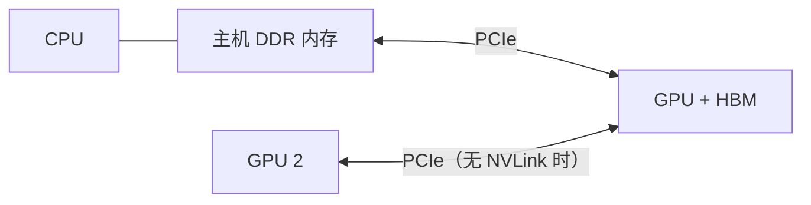

# PCIe 是什么

> GPU 与 CPU/主机内存之间的互联，以及为何它常成为瓶颈

GPU 再快，也得从「外面」拿数据和模型权重。PCIe（Peripheral Component Interconnect Express）是插在主板上的那条高速通道：CPU、SSD、网卡、GPU 都共享这套标准。对大模型来说，PCIe 决定了「第一次把 14 GB 权重拷进显存要多久」，以及「没有 NVLink 的多卡之间能跑多快」。

笔记本上的「外接显卡坞」更是 PCIe 的极端案例：有时仅 ×4 lane，有效带宽再砍半，大模型几乎无法实用——这从反面说明 **带宽与拓扑** 和「有没有 GPU」一样关键。台式机插满 ×16 仍是 LLM 本地开发最常见形态，数字以 ×16 为基准即可。

## 直觉

HBM 是 GPU 芯片旁边的私人仓库（TB/s）；PCIe 是连接办公室（CPU + 主内存）和仓库的 **主干货车道**（几十 GB/s）。你不会在每次乘法前都从办公室运货，但若模型太大装不下、或 GPU 之间只能经 CPU 中转，货车道就会堵死。



## 定义

PCIe 由 **lane** 组成，每 lane 每代协议有固定速率；常见 GPU 插槽为 **×16**（16 条 lane）。

$$
\text{带宽 (GB/s)} \approx \text{lane 数} \times \text{每 lane 速率 (GB/s)} \times \text{编码效率}
$$

| 代数 | 每 lane 速率（约） | ×16 双向合计（约） |
|------|-------------------|-------------------|
| PCIe 3.0 | 1 GB/s | ~16 GB/s |
| PCIe 4.0 | 2 GB/s | ~32 GB/s |
| PCIe 5.0 / 6.0 | 4 / 8 GB/s | ~64 / ~128 GB/s |

表中为 **有效载荷** 量级；标称 GT/s 需考虑 128b/130b 编码开销。

## 例子

**例子 1：首次加载 7B FP16 模型**

7B × 2 bytes = **14 GB** 权重。

| 互联 | 理论传输时间 $\frac{14\ \text{GB}}{\text{带宽}}$ |
|------|--------------------------------------------------|
| PCIe 3.0 ×16 | ~0.9 s |
| PCIe 4.0 ×16 | ~0.44 s |
| PCIe 5.0 ×16 | ~0.22 s |
| NVLink（450 GB/s 量级） | ~0.03 s |

推理服务启动时的一次性加载尚可接受；但若 **每个 batch 都从 CPU 内存读权重**，PCIe 4.0 32 GB/s 意味着每秒最多「过」32 GB 权重——7B FP16 模型每秒仅能完整读取约 2 次，完全不够 token 级解码。

**例子 2：双 4090 无 NVLink 做模型并行**

两张 RTX 4090 只能通过 PCIe 交换中间激活。假设每层需传 50 MB、80 层：

$$
50\ \text{MB} \times 80 = 4\ \text{GB}
$$

经 PCIe 4.0（且可能与 SSD/网卡共享带宽），一轮前向通信就可能数百毫秒——这就是为什么 **消费级多卡不适合 serious 的大模型并行**。

## 量化

- **与 HBM 差距**：H100 HBM ~3350 GB/s vs PCIe 4.0 ~32 GB/s → 约 **100×**。权重、KV Cache 必须 resident 在 HBM。
- **Pinned memory**：`cudaMemcpy` 从 **页锁定（pinned）** 主机内存可接近 PCIe 上限；普通分页内存更慢。
- **GPUDirect / RDMA**：多机训练时，网卡可直接 DMA 到 GPU，减少 CPU 拷贝，但仍是 PCIe/NIC 带宽量级。

## Resizable BAR 与 DMA

现代 BIOS 可开启 **Resizable BAR（SAM）**，让 CPU 一次性映射更大 GPU 显存窗口，减少某些驱动的分段拷贝。对 LLM 影响有限，但游戏与部分 workload 有小幅收益。

**Unified Memory（CUDA Managed Memory）** 让 CPU/GPU 共享虚拟地址，硬件按需 page fault 迁移——方便原型开发，但 LLM 生产路径仍 **显式** 把权重放在 device 上，避免隐式迁移走 PCIe。

## 多 GPU 共享 PCIe 根复合体

主板上多张卡若挂在 **同一 PCIe switch 下**，有效带宽会被 **多卡争抢**。`nvidia-smi topo -m` 里 `PIX`（同一 switch）、`PHB`（跨 bridge）表示 GPU 间经 PCIe 通信的路径，均慢于 NVLink。部署 8 卡机器时，拓扑设计（NVSwitch vs PCIe tree）是采购清单的一部分。

## 与 [HBM](/manual/llm/bit-to-agi/09-gpu/what-is-hbm) 的协同

典型数据路径：

1. 磁盘 → 主机 DDR（NVMe/网络，数 GB/s）
2. 主机 DDR → GPU HBM（PCIe，~32 GB/s）
3. GPU 计算时读写 HBM（~3350 GB/s）

瓶颈常在步骤 2 若 **反复** 发生；步骤 3 若 **算子访存不规则** 则有效带宽低于峰值。优化 LLM 即减少步骤 2 次数、提高步骤 3 数据复用（KV Cache、FlashAttention）。

## 常见误区

::: warning

**误区：「PCIe 5.0 显卡一定比 4.0 快一倍」** — 需主板、CPU 也支持 PCIe 5.0；且 LLM 瓶颈常在 HBM/NVLink，不在主机↔GPU 拷贝（权重加载后）。

:::

**误区：「带宽 32 GB/s = 每秒能算 32 GB 矩阵乘」** — 拷贝与计算是不同路径；拷贝占用 PCIe，不增加 FLOPS。

## 动手试一试

查看 GPU 当前 PCIe 代际与宽度：

```bash
nvidia-smi --query-gpu=pci.bus_id,pcie.link.gen.current,pcie.link.width.current --format=csv
```

测量 host→device 拷贝（需足够大的 buffer 才接近峰值）：

```python
import torch, time

size = 2**30  # 1 GB 元素（float32 = 4 GB 数据）
x = torch.randn(size, pin_memory=True)
y = torch.empty(size, device="cuda")

torch.cuda.synchronize()
t0 = time.perf_counter()
y.copy_(x, non_blocking=True)
torch.cuda.synchronize()
gb = x.numel() * 4 / 1e9
print(f"Host→Device: {gb / (time.perf_counter() - t0):.1f} GB/s")
```

## 典型 LLM 工作流中的 PCIe 流量

| 阶段 | PCIe 流量 | 频率 |
|------|----------|------|
| `from_pretrained` 加载权重 | 整模型 GB 级 | 启动一次 |
| 训练 DataLoader | batch 激活/标签 MB 级 | 每 step |
| 推理 API 请求 | 通常仅 token ids KB 级 | 每请求 |
| CPU offload（bitsandbytes） | 层权重来回 GB 级 | **每 layer 或每 token** |

最后一行说明：**CPU offload 用 PCIe 换显存**，只适合显存不够时的权宜之计，延迟会大幅上升。工程上优先量化、张量并行，而非依赖 PCIe 反复搬运。

Apple Silicon 统一内存架构无 discrete PCIe GPU 路径，M 系列 Mac 上 MPS 后端行为不同——本章数字以 **discrete NVIDIA + PCIe** 为准。

## 回顾与自测

**Q：权重已在 GPU，推理还会用 PCIe 吗？**
A：正常不会传权重；除非 CPU offload、动态换 LoRA、或错误地把 tensor 建在 host 上。

**Q：PCIe 3.0 ×16 能跑 7B 吗？**
A：能，加载慢一些；瓶颈在显存容量与算力，不在 PCIe 代数——前提是权重 resident 在 GPU。

**Q：多卡 4090 比单卡 4090 快吗？**
A：单请求往往不快；多卡需模型并行，PCIe 通信开销大。多卡价值在 **总吞吐**（多实例或多用户并行）。

**Q：Docker 容器里 PCIe 带宽会变吗？**
A：不会物理变窄；但若未正确挂载 GPU 或走虚拟化层，P2P 与 GPUDirect 可能被禁用，等效变慢。

## 工程师备忘录

- PCIe 4.0 ×16 ≈ **32 GB/s**；5.0 ×16 ≈ **64 GB/s**。
- 权重加载后应 **常驻 HBM**；反复 H2D 是反模式。
- CPU offload 用 PCIe 换显存，延迟大幅上升。
- 多卡无 NVLink 时，卡间通信也走 PCIe，争用带宽。

规划机器时，**PCIe lane 分配**（GPU 占 ×16 还是 ×8、是否与 NVMe 共享）写在主板 spec 脚注里，却决定多卡 P2P 是否降速。LLM 训练节点常见「CPU 双路 + 8 GPU 各占 ×16」，正是为避免这条隐形瓶颈。

## 小结

PCIe 是 **CPU/主内存 ↔ GPU** 的标准通道：PCIe 4.0 ×16 约 **32 GB/s**，5.0 约 **64 GB/s**，比 HBM 和 NVLink 慢一个到两个数量级。工程上：权重加载后常驻显存；多卡优先 NVLink；消费级多卡经 PCIe 做模型并行通常不划算。

下一篇：[Warp 是什么](/manual/llm/bit-to-agi/09-gpu/what-is-warp)
