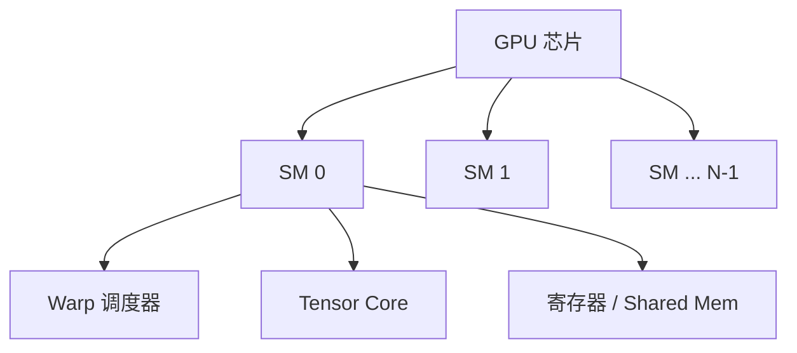

# SM 是什么

> Streaming Multiprocessor——GPU 上真正执行 CUDA 内核的计算单元

一块 GPU 芯片上有几十个 **SM**（Streaming Multiprocessor，流式多处理器）。每个 SM 包含大量 CUDA 核心、Tensor Core、寄存器、共享内存和 Warp 调度器——[Warp](/manual/llm/bit-to-agi/09-gpu/what-is-warp) 在被分配到某个 SM 上之后，由该 SM 的调度器轮流发射指令。SM 数量 × 每 SM 算力 ≈ 整卡 FP32/Tensor Core 峰值。

看 GPU spec 时，「CUDA Cores」是 SM 内 FP32 标量单元数量的营销加总；「Tensor Cores」则是另一套矩阵单元。二者 **不是简单加在一起** 就能当总算力——读 TFLOPS 必须分精度、分单元类型，否则会把 apples 和 oranges 相加。

## 直觉

把 GPU 想成一家连锁工厂：整卡是 **园区**，每个 SM 是 **一条流水线车间**。订单（CUDA block）被派到空闲车间；车间里有多条工位（Warp 调度器）同时运转不同批次。车间越大（SM 内 CUDA Core 越多）、车间越多（SM 总数越高），整厂产能（TFLOPS）越高。



## 定义

每个 SM 通常包含（随架构变化）：

| 组件 | 作用 |
|------|------|
| **CUDA Core** | FP32 / INT32 通用算术 |
| **Tensor Core** | 矩阵乘累加（见[专篇](/manual/llm/bit-to-agi/09-gpu/tensor-core)） |
| **Warp Scheduler** | 选择就绪 Warp 发射指令 |
| **Register File** | 每线程私有寄存器，容量限制 occupancy |
| **Shared Memory / L1** | Block 内线程高速共享（~100 KB 量级/SM） |
| **Load/Store Unit** | 访问 HBM 经 L2 缓存 |

**Grid → Block → Warp → Thread** 映射：一个 kernel 启动形成 grid；grid 切分为 block；block 映射到 SM（一个 SM 可同时驻留多个 block）；block 内线程按 32 划分为 Warp。

## 例子

**例子 1：不同架构的 SM 规模（约数）**

| GPU | SM 数量 | 每 SM CUDA Core（FP32） | 每 SM Tensor Core |
|-----|--------|------------------------|--------------------------|
| A100 | 108 | 64 | 4 |
| H100 SXM | 132 | 128 | 4 |
| RTX 4090 / 5090 | 128 / 170 | 128 | 4（Ada 第 4 代 / Blackwell 第 5 代） |

H100：$132 \times 128 = 16896$ FP32 CUDA Core；峰值 FP32 约 67 TFLOPS（还需乘时钟与利用率）。

**例子 2：Block 如何占用 SM**

启动 `<<<108, 256>>>`（108 block，每 block 256 线程）：

- 理想情况：108 个 SM 各领 1 个 block → **并行度满**。
- 若只有 8 个 block：最多 8 个 SM 忙，其余 SM 空闲—— **launch 配置过小** 无法喂饱 GPU。

LLM 中大批量训练常用大 batch 就是为提高 SM 利用率；推理 batch=1 时 SM 常闲置，故用 Continuous Batching（见 [vLLM 等](/manual/llm/bit-to-agi/11-engineering/vllm)）把多请求拼 batch。

## 量化

- **Occupancy 上限**：每 SM 最多驻留 Warp 数由架构决定（如 64 Warp/SM → 2048 线程/SM）。寄存器每线程用 128 个时，可能只能驻留 32 Warp—— **寄存器压力降低 occupancy**。
- **Shared memory**：每 block 申请 48 KB shared mem 时，同一 SM 能同时放的 block 数变少。
- **L2 缓存**：全卡共享（A100 40 MB、H100 50 MB），跨 SM 复用热点数据；FlashAttention 等算法强调 **SRAM 级（shared/L2）复用** 以减少 HBM 访问。

## SM 与缓存层次

数据访问路径（由快到慢）：

1. **寄存器** — 每 thread 私有，最快，容量最小
2. **Shared Memory** — block 内共享，程序员可控制布局
3. **L1 / L2** — 硬件缓存，L2 全卡共享
4. **HBM** — 容量最大，延迟最高

FlashAttention 的核心思想之一：在 **shared memory / SRAM** 里分块完成 attention，避免 materialize 完整 $N \times N$ attention matrix 到 HBM——这是算法与 SM 片上存储协同的典范。

## 利用率：理论峰值 vs 实际

`nvidia-smi` 显示的 **GPU-Util** 是采样指标，不完全等于 FLOPS 利用率。训练日志里的 **MFU** 更贴近算力吃满程度。推理 decode batch=1 时 GPU-Util 常 **个位数到百分之几十**——不是卡坏了，而是 SM 在等 HBM 与 memory latency。

提高推理利用率的方法：**Continuous Batching**、speculative decoding、增大 batch——都是在软件层「凑够 Warp 让 SM 有活干」。

## Hopper / Blackwell 与消费级架构差异（略）

H100（Hopper）与 B200（Blackwell）SM 强调 **第四/五代 Tensor Core、FP8/FP4、Transformer Engine**；消费级 RTX 4090（Ada）/ RTX 5090（Blackwell）SM 数量可观但 **无 NVLink、显存为 GDDR6X/GDDR7 非 HBM**——带宽与多卡能力完全不同。比较 SM 数量时务必 **同代际、同定位**（数据中心 vs 消费级）。

## 常见误区

::: warning

**误区：「CUDA Core 数量 = Tensor Core TFLOPS」** — FP32 CUDA Core 与 Tensor Core 是不同单元；LLM 训练主要吃 Tensor Core，不是全部 CUDA Core 满载。

:::

**误区：「SM 越多越好、无视时钟与架构」** — 老架构 SM 多但每 SM 弱、无 Tensor Core 4 代指令；比 TFLOPS 要看 **同精度、同代际**。

## 动手试一试

```python
import torch

props = torch.cuda.get_device_properties(0)
print(f"SM count: {props.multi_processor_count}")
print(f"Max threads/SM: {props.max_threads_per_multi_processor}")
print(f"Shared mem/SM: {props.shared_memory_per_multiprocessor / 1024:.0f} KB")
print(f"Regs/SM: {props.regs_per_multiprocessor}")
```

对比不同 batch size 下同一模型的 GPU 利用率（`nvidia-smi dmon -s u`）：batch 增大时 SM 利用率往往上升——直观感受「喂饱 SM」。

## Volta → Ampere → Hopper → Blackwell：SM 进化简史

| 架构 | 代表 | SM 级重要特性 |
|------|------|--------------|
| Volta V100 | 第一代 Tensor Core | FP16 GEMM |
| Ampere A100 | TF32、稀疏 2:4 | 第三代 Tensor Core |
| Hopper H100 / Blackwell B200 | FP8 / FP4、Transformer Engine | 第四 / 第五代 Tensor Core |

每代 SM 并非简单「多加核心」，而是 **Tensor Core 指令集与精度格式** 扩展——老卡无法硬件加速 FP8，即使 SM 数量相近。

## 回顾与自测

**Q：132 个 SM 是否意味着最多 132 个 block 同时跑？**
A：每个 SM 可驻留 **多个** block（受寄存器/shared mem 限制），总并发 block 数可远大于 SM 数。

**Q：为何小模型 GPU 利用率低？**
A：GEMM 规模小，无法占满所有 SM；kernel launch 固定开销占比上升。

**Q：Shared memory 和 L2 有什么区别？**
A：Shared 由程序员显式管理、block 内共享；L2 硬件自动缓存、全卡共享。FlashAttention 主要用 shared。

**Q：SM 和 CPU core 能一一对应比较吗？**
A：不能。SM 是弱多线程 SIMD 机，CPU core 是乱序超标量机；比较应看 workload 实测而非「核数」。

## 工程师备忘录

- H100：**132 SM**；A100：**108 SM**（约数，随 SKU 变）。
- 一个 block 映射到一个 SM 执行；多 block 可共享 SM。
- 提高利用率：增大 batch、Continuous Batching、更大 GEMM。
- FlashAttention = 算法 + SM shared memory 协同。

从程序员角度，你 **不需要** 手动指定 block 映射到哪个 SM——CUDA 驱动负责。但你需要知道：**batch 太小 = SM 吃不饱 = 钱白花**。这也是 inference serving 行业拼 Continuous Batching 与 request 合并的根本原因，而不只是「多线程」那么简单。

下一章 [推理](/manual/llm/bit-to-agi/08-inference) 中的 PagedAttention、Continuous Batching，都可以理解为在 SM 与 HBM 约束下提高 **有效 occupancy** 的软件手段——硬件概念先搞清楚，读软件优化才不会像黑魔法。

SM 是硬件视角的「车间」；Warp 是车间里的「班组」——两者加在一起，才构成完整的 GPU 执行图景。

## 小结

SM 是 GPU 的 **基本计算分区**：Warp 在 SM 上调度，Tensor Core 在 SM 内做矩阵乘。整卡性能 = SM 数量 × 每 SM 吞吐 × 实际利用率。优化 CUDA 程序的核心目标之一，是让 **尽可能多的 SM 同时有活干**。

下一篇：[Tensor Core 与 TFLOPS](/manual/llm/bit-to-agi/09-gpu/tensor-core)
