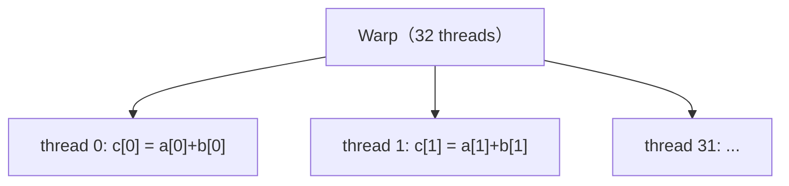

# Warp 是什么

> GPU 上 32 线程同步执行的基本调度单位

CUDA 让你启动「百万线程」，但硬件并不是一条线程一条线程地调度。NVIDIA GPU 以 **Warp** 为单位：固定 **32 个线程** 在同一时刻执行同一条指令，各自处理不同的数据——这就是 SIMT（Single Instruction, Multiple Threads）。理解 Warp，是理解 GPU 分支发散、内存合并访问、以及为何线程数要是 32 倍数的起点。

NVIDIA 文档里常写「一个 Warp 在任一周期执行同一条指令」——这意味着 **没有硬件线程级抢占** 在同一 Warp 内；线程 0 和线程 1 永远步调一致，除非整 Warp 换指令。这与操作系统线程完全不同，是用 GPU 写算法时最容易踩坑的心智模型差异。

## 直觉

Warp 像一列 32 人的划船队：教练喊一声「划！」（一条指令），32 个人同时划，但每人划的是自己的桨（各自的数据索引）。若有人要「左拐」、有人要「右拐」（分支不一致），教练只能 **分两趟** 分别喊口令——这叫 **Warp 发散（divergence）**，效率减半甚至更低。



## 定义

- **Warp 大小**：NVIDIA GPU 上恒为 **32**（自 G80 以来未变）。
- **SIMT 执行**：Warp 内 32 线程共享程序计数器；对 `if (threadIdx.x < 16)` 这类分支，硬件先执行 true 分支的活跃线程，再执行 false 分支—— **两条路径串行**。
- **Warp 与 Block**：一个 thread block 含多个 Warp（如 256 线程 = 8 Warp）。Block 内线程可通过 `__shared__` 共享内存协作。
- **Occupancy**：SM 上同时驻留的 Warp 越多，越能隐藏内存延迟；但寄存器/`shared memory` 用太多会减少驻留 Warp 数。

## 例子

**例子 1：合并访问（coalesced access）**

理想情况：Warp 中 thread `i` 访问地址 `base + i * 4`（连续 float），硬件 **合并成一次或少数几次** 128 字节内存事务。

糟糕情况：thread `i` 访问 `a[i * 128]`（跨步大），32 个线程触发 32 次分散访问——带宽利用率暴跌。

**例子 2：Launch 配置与 Warp 数**

```cpp
// grid=4096, block=256 → 每 block 8 warp，共 4096*8 = 32768 warp
// 每 warp 32 thread → 总线程 1048576
kernel<<<4096, 256>>>(...);
```

| block 大小 | Warp/block | 常见选择理由 |
|-----------|-----------|-------------|
| 128 | 4 | 较小 shared mem 需求 |
| 256 | 8 | 常用默认 |
| 1024 | 32 | 最大 block（架构相关） |

Block 大小应为 **32 的倍数**，否则最后一个 Warp 部分线程闲置。

## 量化

- **分支代价**：若 Warp 内 50% 线程走 `if`、50% 走 `else`，两条路径各执行一次 → 有效吞吐约 **50%**。
- **延迟隐藏**：一次全局内存访问约 **400–800 周期**；若 SM 上只有 4 个 Warp 可切换，难以填满流水线；推荐 **数十 Warp/SM** 交替执行（具体取决于架构与寄存器压力）。
- **与 CPU SIMD 对比**：[SIMD](/manual/llm/bit-to-agi/01-bits/what-is-simd) 是显式向量指令；Warp 是 **隐式** 的——写标量代码，硬件按 32 路打包执行。

## Warp 调度与延迟隐藏

SM 内通常有 **多个 Warp Scheduler**（H100 每 SM 4 个）。当 Warp A 等待 HBM 返回数据时，调度器切换到 Warp B 执行——类似 CPU 超线程。若 **活跃 Warp 太少**（occupancy 低），内存延迟无法被掩盖，SM 会「空转」等数据。

Occupancy 受限于：

- 每 thread 寄存器用量（越多，能驻留的 Warp 越少）
- 每 block shared memory 用量
- block 大小与 grid 大小（能否喂满所有 SM）

LLM kernel 由 cuBLAS/cuDNN/FlashAttention 等库编写，已针对 occupancy 调过；自己写 CUDA 时才需 Nsight Compute 细调。

## 与 CPU 分支预测对比

CPU 遇到 `if` 会 **预测** 分支并投机执行；GPU Warp 遇到分歧则 **串行执行各路径**。因此 GPU 上写 `for (i=0; i<n; i++) if (a[i]>0)` 这类 **数据相关分支** 极慢，而 `if (threadIdx.x < 16)` 这种 **线程索引分支** 通常整 Warp 一致，几乎无代价。

Attention 中的 causal mask、变长 sequence padding 若实现不当，会引入 Warp 发散——FlashAttention 等算法 partly 通过 **分块 + 重排** 减少发散与 HBM 访问。

## 常见误区

::: warning

**误区：「线程越多越快」** — 超过数据并行度后，空线程浪费 Warp 槽位；且 block 过多可能导致 launch 开销上升。

:::

**误区：「`if` 在 GPU 上不能用」** — 可以用，但应保证 **Warp 内分支一致**；按 `threadIdx.x` 划分不同代码路径通常安全，按 `data[i] > 0` 则常发散。

## 动手试一试

观察 block 大小对简单 kernel 的影响（概念验证，绝对时间因 GPU 而异）：

```python
import torch

# PyTorch 元素级操作底层也是 Warp 级 SIMT
n = 10_000_000
a = torch.randn(n, device="cuda")
b = torch.randn(n, device="cuda")

# 分支发散的「模拟」：用 where 比纯加法慢（不严格等价 CUDA 发散，但体现条件计算成本）
c = a + b
d = torch.where(a > 0, a * b, a + b)  # 通常更慢
```

用 Nsight Compute 分析自定义 CUDA kernel 时可查看 **「Warp Execution Efficiency」** 指标——低于 100% 往往意味着发散或闲置线程。

## 历史：为何是 32？

NVIDIA 自 2006 年 G80 架构起 Warp 宽度定为 32，与内存总线宽度（32 字节对齐访问）、SIMT 调度器设计绑定。**AMD GPU 的 wavefront 常为 64**——跨厂商移植 kernel 时需注意 wave/warp 发散模式不同。

对应用开发者：只需记住 **block 大小用 32 的倍数**、尽量让相邻 thread 访问相邻地址，具体 32 还是 64 由硬件抽象层处理。

## 回顾与自测

**Q：PyTorch 里 `a + b` 会 Warp 发散吗？**
A：元素级加法无分支，Warp 内 32 线程各算各的，效率通常很高。

**Q：为什么 attention mask 可能影响性能？**
A：若按元素分支跳过计算，可能造成 Warp 发散；优化实现用矩阵运算表达 mask 而非 per-element if。

**Q：Occupancy 越高越好吗？**
A：不一定。极高 occupancy 可能因寄存器 spill 到 local memory 反而变慢；需 profiling 平衡。

**Q：一个 Warp 里的线程能互相直接读写寄存器吗？**
A：不能跨 thread 读寄存器；block 内协作必须用 shared memory 或 warp shuffle 等显式原语。

## 工程师备忘录

- Warp = **32 线程**，NVIDIA 恒定。
- Block 大小用 **32 的倍数**。
- 避免 **数据相关分支**；用矩阵运算表达 mask。
- Nsight Compute 看 Warp Execution Efficiency。

## 小结

Warp = **32 线程** 的 SIMT 执行包，是 GPU 调度的最小实用单位。合并内存访问、避免 Warp 发散、合理选择 block 大小，是 CUDA 性能优化的基本功。下一篇的 SM 则是容纳许多 Warp 的「车间」。

下一篇：[SM 是什么](/manual/llm/bit-to-agi/09-gpu/what-is-sm)
