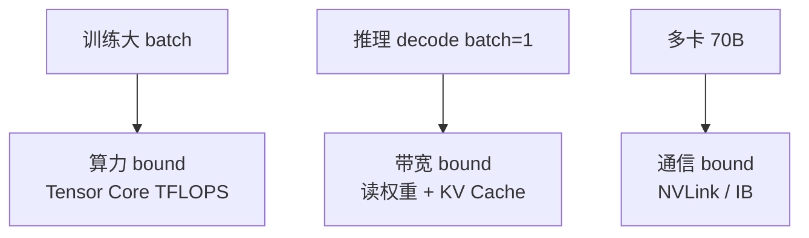

# 为什么 GPU 这么快

> 并行度、内存带宽与专用电路如何叠加成 LLM 训练推理的算力底座

同样做矩阵乘法，CPU 跑几分钟，GPU 可能只要几毫秒——这不是简单「时钟频率更高」，而是 **架构哲学完全不同**。CPU 为低延迟、复杂控制流优化；GPU 为 **吞吐量**：成千上万个线程、TB/s 级 HBM、Tensor Core 专用矩阵单元。三股力量叠加，才撑得起 GPT 级别的训练与推理。

早期 Bitcoin 挖矿用 GPU 是因为 SHA256 高度并行；深度学习用 GPU 是因为反向传播是一连串同构 GEMM。两次「GPU 浪潮」本质相同：**把大量独立、同类型的算术交给 SIMT**，区别只是这次矩阵更大、更久、更贵。

## 直觉

解一道微积分题，CPU 像一个博士生：聪明、能处理分支和复杂逻辑，但一次只能认真算一道。GPU 像一千个小学生同时做 **同一类型的加法题**：每人只做一步，不能临场改题型（Warp 发散会拖慢），但总量巨大。LLM 的前向传播恰好是 **海量同构线性代数**——极适合「小学生军团 + 算盘框（Tensor Core）」。

## 定义

GPU 相对 CPU 的三大优势（在 LLM 工作负载下）：

1. **并行度**：$10^4$+ 活跃线程 vs CPU 的 $10^1$–$10^2$ 硬件线程。
2. **内存带宽**：HBM **2000–8000 GB/s**（A100 到 B200）vs 服务器 DDR **~300 GB/s**。
3. **专用电路**：Tensor Core 对 $GEMM$ 的能效远高于通用 FP32 单元。

综合速度 ≈ min(算力上限， 带宽上限， 实际并行利用率)。

## 例子

**例子 1：同一 GEMM，CPU vs GPU（量级对比）**

$4096 \times 4096$ FP32 矩阵乘，约 **137 GFLOP**。

| 平台 | 有效吞吐（量级） | 耗时（量级） |
|------|-----------------|-------------|
| 单核 CPU | ~0.01 TFLOPS | ~14 s |
| 多核 CPU（OpenBLAS 32 线程） | ~0.5 TFLOPS | ~0.3 s |
| RTX 4090 FP16 Tensor | ~300 TFLOPS | ~0.5 ms |
| H100 FP16 Tensor | ~500–900 TFLOPS | ~0.15–0.3 ms |

CPU 多线程能到「亚秒级」；GPU 是「亚毫秒级」—— **三个数量级** 差距在反复迭代训练中决定 weeks vs months。

**例子 2：为什么 LLM 特别「吃 GPU」**

| 算子 | 计算特征 | CPU/GPU 差距 |
|------|---------|-------------|
| 线性层 / MLP | 大 GEMM | GPU 极大优势 |
| Self-Attention | GEMM + softmax + 不规则访存 | GPU 大优势（FlashAttention 优化访存） |
| LayerNorm / 激活 | 元素级、带宽敏感 | GPU 中等优势 |
| 采样 / 字符串处理 | 分支多、串行 | CPU 往往足够 |

Transformer 层数 × 宽度 × batch × sequence 把 **GEMM 重复百万次**——正是 GPU 甜点区。

**例子 3：三个瓶颈轮流登场**



没有「GPU 永远比 CPU 快」；小模型、小 batch、纯 CPU 推理在边缘设备仍合理。

## 量化

- **Amdahl 定律**：若 10% 串行（数据加载、Python 开销），无限 GPU 最多 **10×** 加速。PyTorch 2 编译、CUDA Graph、C++ serving（vLLM）都在减 serial 部分。
- **能耗**：完成同一训练任务，GPU 数据中心卡 **焦耳/FLOP** 通常优于 CPU——大模型训练几乎总在 GPU 集群上，部分源于 **\$/FLOP 和 J/FLOP**。
- **与 ASIC 对比**：Google TPU、Groq LPU 等进一步专用化；GPU 胜在 **生态（CUDA/cuBLAS）与通用性**。

## CPU 并非一无是处：异构分工

现代 LLM 栈是典型的 **异构计算**：

| 组件 | 常见运行位置 |
|------|-------------|
| Tokenization | CPU |
| 数据加载 / 预处理 | CPU |
| 模型前向 / 反向 | GPU |
| 采样、logits 后处理 | CPU 或 GPU |
| 请求调度、Continuous Batching | CPU（vLLM engine） |

GPU 加速的是 **占时间大头的 GEMM 与 attention**；把全部 pipeline 都塞上 GPU 往往得不偿失（字符串、JSON、网络 I/O）。

## 专用芯片 vs 通用 GPU

| 类型 | 代表 | 优势 | 劣势 |
|------|------|------|------|
| GPU | H100 / B200 | 生态、灵活 | 功耗、成本 |
| TPU | Google TPU v5p / v6e | 大规模训练 MFU | 云绑定 |
| LPU | Groq | 极低 decode 延迟 | 模型/生态限制 |
| NPU | Apple M 系列 | 边缘能效 | 规模上限 |

CUDA + PyTorch 生态使 **GPU 仍是研究与工程默认**；理解 GPU 原理有助于读任何硬件的 spec sheet。

## 能效与 TCO

数据中心采购看 **\$/TFLOPS**、**J/TFLOPS**、**\$/GB HBM**。H100 单卡 TDP 700 W 级，8 卡节点 + CPU 常 **10 kW+**。训练一次 Llama-3 级模型消耗 **数百万美元算力**——[第十章成本估算](/manual/llm/bit-to-agi/10-train-your-llm/cost-estimation) 会把这些数字与业务对齐。

## 常见误区

::: warning

**误区：「GPU 核心数 = CPU 核心数 × 100，所以快 100 倍」** — GPU 「核心」是弱化的 CUDA Core；比较应看 **实测 TFLOPS / 带宽 / 任务类型**。

:::

**误区：「推理一定比训练更需要 GPU」** — 训练要反向传播（约 2–3× 前向 FLOPs）+ 优化器状态；大模型 **训练** 更耗集群。推理单用户可小卡；高并发 serving 仍要 H100 级吞吐。

## 动手试一试

同一代码，对比 CPU 与 GPU（若无 GPU 可跳过 GPU 段）：

```python
import torch, time

n = 2048
a = torch.randn(n, n)
b = torch.randn(n, n)

t0 = time.perf_counter()
for _ in range(3):
    c = a @ b
print(f"CPU: {(time.perf_counter()-t0)/3*1000:.1f} ms")

if torch.cuda.is_available():
    ag = a.cuda().half()
    bg = b.cuda().half()
    for _ in range(5):
        ag @ bg
    torch.cuda.synchronize()
    t0 = time.perf_counter()
    for _ in range(20):
        ag @ bg
    torch.cuda.synchronize()
    print(f"GPU FP16: {(time.perf_counter()-t0)/20*1000:.2f} ms")
```

## 1980–2026：算力需求与硬件的军备竞赛

GPT-2（1.5B）可在单卡消费 GPU 上训练；GPT-3（175B）需要 **数千卡 × 数月**；Llama 3 405B 级预训练是 **集群级 NCCL + NVLink + InfiniBand** 工程。模型参数量每 18 个月约翻一番（经验规律），而单卡 HBM 容量年增远慢于参数量——**多卡与量化不是可选项，是物理约束**。

对你我而言：微调 7B 用 1–2 张 24 GB 卡；推理 70B 用 80 GB + INT4；预训练 70B+ 才需要认真规划 NVLink 域与网络——把任务放进这张地图，就不会用错硬件预算。

## 回顾与自测

**Q：矩阵很小的时候 GPU 反而慢？**
A：是。Kernel launch 与 PCIe 拷贝固定开销主导；$256 \times 256$ GEMM 常在 CPU 上更快。

**Q：为何 LLM 训练几乎不用 CPU 集群？**
A：$2P$ FLOPs × 万亿参数 × 万亿 token → 总 FLOPs 天文数字；只有 GPU 集群 TFLOPS × 能效可完成。

**Q：云 GPU 按小时租，如何估算够不够用？**
A：先算权重 + KV 是否 fit；再查 benchmark tokens/s；最后 × 业务 QPS × 单价 = 月成本。

**Q：边缘设备没有 GPU 怎么办？**
A：用小模型、量化、或 API 调用云端；本地 CPU + INT4 仅适合原型与低 QPS 场景。

## 小结

GPU 快，因为 ** massively 并行 + HBM 高带宽 + Tensor Core 专精矩阵乘**，而 LLM 恰好是矩阵乘的重复堆叠。CPU 并未过时：数据预处理、编排、小算子仍靠 CPU。下一篇把焦点从「算得快」转到「装得下」——显存。

下一篇：[为什么显存这么重要](/manual/llm/bit-to-agi/09-gpu/why-vram-matters)
