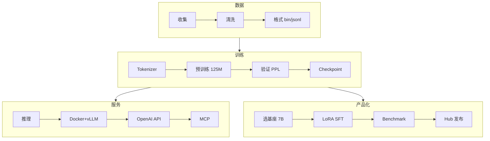

# 第十章总结

> 从 Bit 到 AGI · 第十章：自己训练一个模型 · 本章总结

第十章把「训练一个 LLM」从概念变成了**可复制的命令序列**。你用 `mini-gpt-lab` 项目走完了数据 → Tokenizer → 预训练 → 验证 → Checkpoint → 推理 → 部署 → API → MCP → 微调 → Benchmark → 监控 → 容灾 → 格式 → 硬件 → 成本 → 发布 的全链路。

## 流水线回顾



## 关键数字

| 项目 | 本章实验值 |
| ---- | ---------- |
| 模型参数 | 125M（教学）/ 7B（SFT） |
| 预训练 tokens | 500M |
| 词表 | 32,768 BPE |
| 单卡 | RTX 4090 24 GB |
| 预训练 wall time | 6–12 h |
| 云成本 | < \$10 |
| val PPL 目标 | 20–40 |
| 部署显存 | ~1–2 GB |

## 命令速查

```bash
# 环境
mkdir ~/mini-gpt-lab && cd ~/mini-gpt-lab
python3 -m venv .venv && source .venv/bin/activate

# 数据
python scripts/clean_corpus.py
python scripts/train_tokenizer.py

# 训练
litgpt pretrain tiny --out_dir checkpoints/pretrain \
  --train_data_path data/litgpt/train.bin --tokenizer_dir tokenizer --devices 1

# 推理 & 部署
litgpt generate checkpoints/best --tokenizer_dir tokenizer --prompt "比特是"
docker compose -f deploy/docker-compose.yml up -d

# API
curl localhost:8000/v1/completions -H "Content-Type: application/json" \
  -d '{"model":"checkpoints/best-hf","prompt":"AI is","max_tokens":64}'

# SFT
python scripts/sft_lora.py

# 评估 & 发布
lm_eval --model hf --model_args pretrained=checkpoints/best-hf --tasks piqa --device cuda:0
huggingface-cli upload your-username/mini-gpt-125m checkpoints/best-hf/
```

## 与前后章的关系

- **第六章 Tokenizer**、**第七章 Training** 是本章的理论底座；第十章是它们的工程落地。
- **第八章 Inference** 的 KV cache、采样参数在[跑推理](/manual/llm/bit-to-agi/10-train-your-llm/run-inference)里实操。
- **第九章 GPU** 的显存与带宽在[硬件规划](/manual/llm/bit-to-agi/10-train-your-llm/hardware-planning)里换算成选型。
- **第十一章工程化** 的 LiteLLM、网关、TensorRT 可替换本章 vLLM 部署做生产优化。

## 下一步建议

1. **换中文语料**重训 Tokenizer，观察 bytes/token 与生成质量变化。
2. **把 125M 换成 Qwen2.5-7B + 领域 SFT**，用本章同一套 deploy/API/MCP 链路。
3. **加 DPO**（第七章）在 preference 数据上对齐——数据格式见[数据集格式](/manual/llm/bit-to-agi/10-train-your-llm/dataset-format)。
4. 读[第十一章：工程化](/manual/llm/bit-to-agi/11-engineering)把 demo 级部署升级为 autoscaling 与成本治理。

::: info

自己训练的最小可行路径：**基座 + LoRA SFT + vLLM + Hub 发布**，可在 1 个周末、\$10 预算内完成。从零预训练 125M 的价值在于**理解每一克煤（token）如何驱动引擎（Transformer）**。

:::

## 全章目录

- [收集数据](/manual/llm/bit-to-agi/10-train-your-llm/collect-data)
- [清洗数据](/manual/llm/bit-to-agi/10-train-your-llm/clean-data)
- [训练 Tokenizer](/manual/llm/bit-to-agi/10-train-your-llm/build-tokenizer)
- [预训练模型](/manual/llm/bit-to-agi/10-train-your-llm/pretrain-model)
- [验证模型](/manual/llm/bit-to-agi/10-train-your-llm/validate-model)
- [保存 Checkpoint](/manual/llm/bit-to-agi/10-train-your-llm/save-checkpoint)
- [跑推理](/manual/llm/bit-to-agi/10-train-your-llm/run-inference)
- [部署模型](/manual/llm/bit-to-agi/10-train-your-llm/deploy-model)
- [OpenAI API 兼容](/manual/llm/bit-to-agi/10-train-your-llm/openai-api-compat)
- [MCP 集成](/manual/llm/bit-to-agi/10-train-your-llm/mcp-integration)
- [选择基座模型](/manual/llm/bit-to-agi/10-train-your-llm/pick-base-model)
- [微调 SFT](/manual/llm/bit-to-agi/10-train-your-llm/fine-tune-sft)
- [跑 Benchmark](/manual/llm/bit-to-agi/10-train-your-llm/evaluate-benchmarks)
- [监控训练](/manual/llm/bit-to-agi/10-train-your-llm/monitor-training)
- [从失败中恢复](/manual/llm/bit-to-agi/10-train-your-llm/recover-from-failure)
- [数据集格式](/manual/llm/bit-to-agi/10-train-your-llm/dataset-format)
- [硬件规划](/manual/llm/bit-to-agi/10-train-your-llm/hardware-planning)
- [成本估算](/manual/llm/bit-to-agi/10-train-your-llm/cost-estimation)
- [发布你的模型](/manual/llm/bit-to-agi/10-train-your-llm/publish-your-model)

→ 继续阅读：[第十一章：工程化（Serving）](/manual/llm/bit-to-agi/11-engineering)
