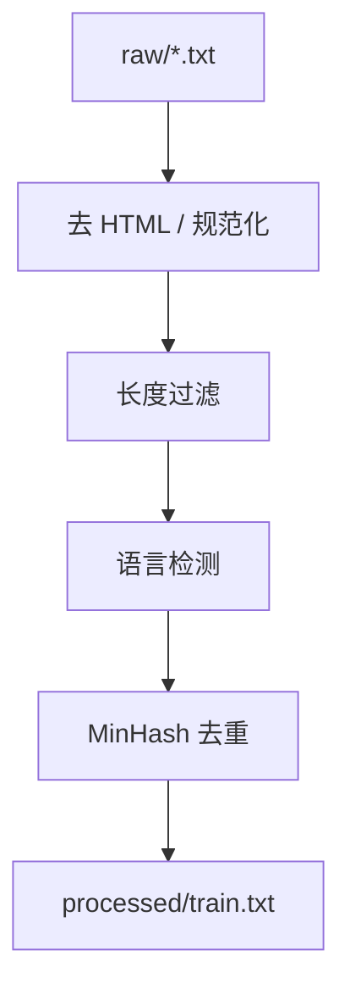

# 清洗数据

> 从 Bit 到 AGI · 第十章：自己训练一个模型 · 清洗数据

原始语料里混着 HTML 标签、乱码、重复段落和低质量短句。清洗的目标是把 `raw/` 变成**一行一条样本、UTF-8、去重、长度过滤**的 `processed/train.txt`，使 Tokenizer 与预训练脚本可以直接消费。

## 直觉：淘金

采矿得到的矿石含大量废石。清洗就是**筛、洗、去重**：筛掉太短或乱码的段落，洗掉 HTML 和 control character，用 MinHash 去掉近重复文档。干净 1 GB 文本的训练效率往往高于脏 3 GB。



## 定义

**数据清洗流水线**通常包含以下可量化步骤：

| 步骤 | 规则示例 | 典型剔除率 |
| ---- | -------- | ----------- |
| 规范化 | NFKC、全角转半角 | 0–2% |
| 长度过滤 | 50 ≤ 字符数 ≤ 100k | 5–15% |
| 语言过滤 | `langdetect` == zh/en | 视来源 |
| 精确去重 | SHA256 行级 | 1–5% |
| 模糊去重 | MinHash Jaccard > 0.85 | 10–30% |

## 例子

**例 1：安装清洗依赖**

```bash
cd ~/mini-gpt-lab && source .venv/bin/activate
pip install ftfy langdetect datasketch tqdm
```

**例 2：完整清洗脚本**

```bash
cat > scripts/clean_corpus.py << 'EOF'
#!/usr/bin/env python3
"""raw/ → processed/train.txt"""
import hashlib, re, sys
from pathlib import Path

import ftfy
from datasketch import MinHash, MinHashLSH
from langdetect import detect, LangDetectException
from tqdm import tqdm

MIN_CHARS, MAX_CHARS = 50, 100_000
LANGS = {"zh-cn", "zh-tw", "en"}
RAW_DIR = Path("raw")
OUT = Path("processed/train.txt")
OUT.parent.mkdir(parents=True, exist_ok=True)

def normalize(text: str) -> str:
    text = ftfy.fix_text(text)
    text = re.sub(r"<[^>]+>", " ", text)          # 去 HTML
    text = re.sub(r"[\x00-\x08\x0b\x0c\x0e-\x1f]", "", text)
    text = re.sub(r"\s+", " ", text).strip()
    return text

def iter_paragraphs():
    for path in sorted(RAW_DIR.glob("**/*")):
        if path.suffix.lower() not in {".txt", ".md", ""}:
            continue
        if not path.is_file():
            continue
        buf = []
        with path.open(encoding="utf-8", errors="ignore") as f:
            for line in f:
                line = line.strip()
                if not line:
                    if buf:
                        yield normalize("\n".join(buf))
                        buf = []
                else:
                    buf.append(line)
        if buf:
            yield normalize("\n".join(buf))

def minhash(text: str, num_perm=128) -> MinHash:
    m = MinHash(num_perm=num_perm)
    for word in text.split():
        m.update(word.encode("utf-8"))
    return m

def main():
    seen_exact = set()
    lsh = MinHashLSH(threshold=0.85, num_perm=128)
    kept = 0
    with OUT.open("w", encoding="utf-8") as out:
        for para in tqdm(iter_paragraphs(), desc="clean"):
            n = len(para)
            if n < MIN_CHARS or n > MAX_CHARS:
                continue
            h = hashlib.sha256(para.encode()).hexdigest()
            if h in seen_exact:
                continue
            try:
                lang = detect(para[:500]).split("-")[0]
                if lang not in {"zh", "en"}:
                    continue
            except LangDetectException:
                continue
            mh = minhash(para)
            if lsh.query(mh):
                continue
            lsh.insert(h, mh)
            seen_exact.add(h)
            out.write(para + "\n\n")
            kept += 1
    print(f"Kept {kept} paragraphs → {OUT}")

if __name__ == "__main__":
    main()
EOF
chmod +x scripts/clean_corpus.py
mkdir -p scripts
python scripts/clean_corpus.py
```

**例 3：检查清洗结果**

```bash
wc -l processed/train.txt
du -h processed/train.txt
head -c 500 processed/train.txt
```

## 量化

假设原始 5 GB、段落 2000 万条：

| 阶段后 | 体积 | 段落数 |
| ------ | ---- | ------ |
| 原始 | 5.0 GB | 20M |
| 长度+语言 | 3.5 GB | 12M |
| 精确去重 | 3.3 GB | 11M |
| MinHash | **2.5 GB** | **8M** |

清洗后压缩比约 **50%**；MinHash 128 permutations 处理 1000 万段落约需 **8 GB RAM、30 分钟**（单核 Python）。

::: info

工业级流水线会用 Spark / datatrove 在集群上跑；本章单机脚本与原理相同，便于理解每一步在删什么。

:::

## 质量指标与验收

清洗完成后打印统计报告：

```bash
python << 'EOF'
from pathlib import Path
text = Path("processed/train.txt").read_text(encoding="utf-8")
paras = [p for p in text.split("\n\n") if p.strip()]
lens = [len(p) for p in paras]
print(f"paragraphs={len(paras)}")
print(f"chars_total={sum(lens):,}")
print(f"avg_len={sum(lens)/len(lens):.0f}")
print(f"p95_len={sorted(lens)[int(len(lens)*0.95)]}")
EOF
```

验收标准（实验级）：

- 段落数 > 100 万（5 GB raw 经清洗后）
- 平均长度 500–2000 字符
- 乱码率 < 0.1%（人工抽检 100 段）

## 加速：多进程与 Rust 工具

Python 单进程清洗 5 GB 约 30 分钟。加速选项：

- `datatrove`（HuggingFace）多 worker pipeline
- `dedupe` 库做 fuzzy match
- 先 `langdetect` 抽样 1% 估语言比例，再决定是否全量过滤

## 常见误区

1. **只做 `strip()`**：HTML 实体、`\\n` 字面量、零宽字符会污染 Tokenizer。
2. **去重粒度过粗**：整文件 hash 会漏掉「一段重复粘贴进多篇文章」的情况；段落级 + MinHash 更稳。
3. **语言检测抽样太短**：少于 50 字符的样本语言检测不准，应先长度过滤。
4. **清洗过度**：删掉所有数字/代码导致 STEM 能力下降。
5. **未保留 rejected 样本**：调试时不知道删了什么；可写 `processed/rejected.log`。

## 动手试一试

对合成语料故意插入重复，验证去重：

```bash
cd ~/mini-gpt-lab
head -n 100 processed/train.txt > /tmp/dup.txt
cat /tmp/dup.txt >> raw/synthetic.txt
python scripts/clean_corpus.py
# 对比清洗前后 wc -l
```

## 端到端实践要点

清洗是训练流水线里**最容易省、最不该省**的一步。许多初学者在 loss 不降时反复调学习率，却发现语料里百分之三十是 HTML 导航栏重复——问题在数据而非优化器。MinHash 的 threshold 0.85 是起点：新闻转载多时可降到 0.80 更激进；学术语料重复少时可升到 0.90 保留引文重复。

语言过滤用 `langdetect` 对短段落不准，务必先做长度过滤。中英混合语料若你的用户全是中文，可以只保留 `zh`；若要做双语模型，按目标比例下采样英文，而不是粗暴删除。清洗后的 `processed/train.txt` 建议做一次**人工 spot check**：随机抽二十段，看是否还有「点击关注」「Cookie 政策」等模板残留。

清洗脚本本身也应版本化：`scripts/clean_corpus.py` 变更后在 inventory 里 bump 版本号，便于复现「同一数据 hash + 同一脚本版本 = 同一 train.bin」。工业界会把清洗变成可配置的 YAML pipeline（datatrove）；本章单脚本的每一步对应 datatrove 的一个 block，读懂脚本等于读懂大厂 pipeline 的缩影。

## 命令流水线复盘

确认 `raw/` 已有文件后：`pip install ftfy langdetect datasketch tqdm`；创建 `scripts/clean_corpus.py`（本篇全文）；`python scripts/clean_corpus.py`；检查 `processed/train.txt` 行数与体积约为 raw 的百分之四十到六十；`head` 与 `tail` 人工看十段；可选对 synthetic 重复段做去重验证。清洗版本号写入 `docs/data-inventory.md`。通过后进入[训练 Tokenizer](/manual/llm/bit-to-agi/10-train-your-llm/build-tokenizer)。若段落数少于十万，回到[收集数据](/manual/llm/bit-to-agi/10-train-your-llm/collect-data)补量。

## 排错速查

清洗后体积为零：检查 `raw/` 路径与后缀过滤。MinHash OOM：减小语料或提高 threshold 到 0.90。语言全被滤掉：短段落先合并再 detect。清洗极慢：用 `multiprocessing` 或 datatrove 并行。输出重复高：降低 MinHash threshold。

## 验收标准

本篇完成后，你应能在终端用一条命令或脚本验证关键产出存在且非空：`test -s` 查文件、`curl` 查 HTTP、`python -c` 查 import 与 shape。把验收命令写进项目 `Makefile` 或 `scripts/verify.sh`，每次改数据或权重后跑一遍，避免带着 silent failure 进入下一篇。全章二十篇都通过验收，即表示你已具备从零训小模型到部署 API 的完整能力。

## 与前后章衔接

本章每篇都假设你已读完第一至九章：比特与文件格式（第一章）解释 `train.bin` 为何是字节流；信息论（第三章）解释为何 PPL 衡量压缩效率；Transformer（第五章）解释预训练在优化什么；Tokenizer（第六章）与本章 BPE 训练一一对应；Training（第七章）给出 loss、LoRA、Checkpoint 理论；Inference（第八章）对应推理与部署；GPU（第九章）对应硬件与显存估算。若某命令报错，先查依赖版本（Python 3.11+、CUDA 驱动、PyTorch 与 vLLM 匹配），再查路径是否与 `mini-gpt-lab` 目录约定一致。整条流水线可在单卡 4090 上于一个周末跑通；失败时回到[从失败中恢复](/manual/llm/bit-to-agi/10-train-your-llm/recover-from-failure)对照症状表，不要跳过日志与 checkpoint 排查。

## 小结

- 清洗 = 规范化 + 过滤 + 精确/模糊去重。
- 输出 `processed/train.txt`：UTF-8、段落分隔、可直接训 Tokenizer。
- 5 GB  raw 通常可得 ~2.5 GB 干净语料。

→ 下一篇：[训练 Tokenizer](/manual/llm/bit-to-agi/10-train-your-llm/build-tokenizer)
