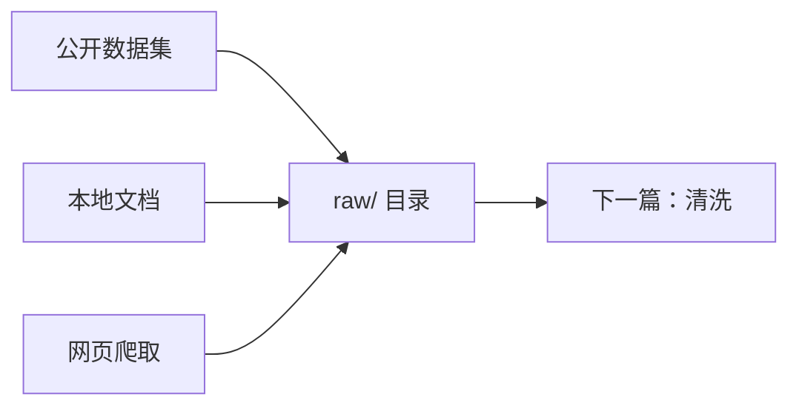

# 收集数据

> 从 Bit 到 AGI · 第十章：自己训练一个模型 · 收集数据

预训练语言模型的第一步不是写代码，而是**拿到足够多、足够干净的文本**。本篇教你从公开语料、本地文件和网页三种来源收集数据，并估算你需要多少 GB 才能训出一个可用的迷你 GPT。

## 直觉：燃料决定航程

训练 LLM 像烧煤开蒸汽船：模型架构是引擎，**数据是煤**。煤太少，船走不远（欠拟合）；煤太脏，引擎会堵（学到垃圾模式）。一个 125M 参数的 GPT，业界经验是至少 **1–10 GB 去重后的纯文本** 才能看到像样的 loss 下降；想要对话能力，后面还要加 SFT 数据。



## 定义

**预训练语料**（pretraining corpus）指用于 next-token prediction 的无标注纯文本集合。常用度量：

| 指标 | 含义 |
| ---- | ---- |
| 原始字节数 | 磁盘占用，含重复与 HTML |
| 去重后 token 数 | 真正参与训练的 token 总量 |
| 领域覆盖 | 代码 / 百科 / 新闻 / 论坛等比例 |

目标规模（本章实验）：

$$
\text{tokens} \approx \frac{\text{bytes}}{\text{bytes per token}} \approx \frac{5\,\text{GB}}{3\,\text{B/token}} \approx 1.7 \times 10^9\ \text{tokens}
$$

## 例子

**例 1：从 HuggingFace 拉取 SlimPajama 子集**

SlimPajama 是 RedPajama 的去重版，约 627 GB；我们只需抽样 5 GB 做实验。

```bash
# 创建项目目录
mkdir -p ~/mini-gpt-lab/{raw,processed,checkpoints,logs}
cd ~/mini-gpt-lab

# 安装依赖
python3 -m venv .venv && source .venv/bin/activate
pip install datasets huggingface_hub tqdm

# 下载并导出为纯文本（约 500 万行，视网络而定）
python << 'EOF'
from datasets import load_dataset

ds = load_dataset(
    "cerebras/SlimPajama-627B",
    split="train",
    streaming=True,
)
out = open("raw/slimpajama_sample.txt", "w", encoding="utf-8")
count, max_bytes = 0, 5 * 1024**3  # 5 GB 上限
for row in ds:
    text = row.get("text", "")
    if not text.strip():
        continue
    out.write(text + "\n\n")
    count += len(text.encode("utf-8"))
    if count >= max_bytes:
        break
out.close()
print(f"Wrote {count / 1024**3:.2f} GB")
EOF
```

**例 2：合并本地 Markdown / PDF 提取文本**

```bash
# 假设你把 ~/docs 下的 .md 都拷到 raw/local/
find ~/docs -name "*.md" -exec cat {} \; >> raw/local_docs.txt

# 统计行数与字节
wc -l raw/local_docs.txt
du -h raw/local_docs.txt
```

**例 3：用 wget 镜像允许爬取的 Wiki 导出**

```bash
# 仅示例：务必遵守 robots.txt 与站点 ToS
wget -r -l 1 -H -k -p -E -nc \
  -A.html \
  -P raw/wiki_mirror \
  "https://example-wiki.org/export/latest/"
```

## 量化

| 规模 | 原始文本 | 约 token 数 | 125M 模型训练步数（seq=2048, batch=32） |
| ---- | -------- | ----------- | --------------------------------------- |
| 玩具 | 100 MB | ~30M | ~460 steps/epoch |
| 实验 | 5 GB | ~1.7B | ~26k steps/epoch |
| 小型产品 | 50 GB | ~17B | ~260k steps/epoch |

存储估算：5 GB UTF-8 文本 + 10% 元数据 ≈ **5.5 GB 磁盘**；建议预留 **20 GB** 给清洗中间文件。

::: warning

爬取网站前必须检查 **robots.txt**、版权与隐私法规。不要用未授权的个人聊天记录、付费内容或泄漏数据库训练模型——法律风险远高于技术风险。

:::

## 动手试一试

```bash
cd ~/mini-gpt-lab

# 快速生成 10 MB 合成语料（无网络时测试流水线）
python << 'EOF'
import random, pathlib
words = ["比特", "向量", "梯度", "Transformer", "token", "GPU", "loss"]
path = pathlib.Path("raw/synthetic.txt")
with path.open("w", encoding="utf-8") as f:
    for _ in range(50_000):
        sent = "".join(random.choice(words) for _ in range(random.randint(5, 20)))
        f.write(sent + "。\n")
print(path.stat().st_size / 1024**2, "MB")
EOF
```

检查 `raw/` 目录结构：

```bash
tree raw/   # 或 ls -lh raw/
```

## 数据来源合规矩阵

| 来源 | 许可证 | 商用 | 备注 |
| ---- | ------ | ---- | ---- |
| SlimPajama | 各子集不同 | 需逐条查 | 含 CommonCrawl |
| Wikipedia dump | CC-BY-SA | 可，需署名 | 每周更新 |
| 自写博客 | 自有 | 是 | 最佳可控 |
| 爬取新闻站 | 多数禁止 ML | 否 | 读 ToS |

下载前在 `docs/data-inventory.md` 记录来源 URL、日期、许可证链接——发布模型时 Model Card 要用。

## 分片与增量采集

大语料分片存储，避免单文件 >10 GB 难以传输：

```bash
split -b 1G raw/slimpajama_sample.txt raw/shard_
ls -lh raw/shard_*
```

增量更新时只追加新 shard，清洗脚本 `glob("raw/shard_*")` 统一处理。

## 常见误区

1. **「数据越多越好」**：未经去重的 100 GB 可能不如去重后的 10 GB；重复样本浪费算力。
2. **混用多种编码**：务必统一 UTF-8；GBK 文件用 `iconv -f GBK -t UTF-8` 转换。
3. **忽略许可证**：CC-BY、ODC-BY 等要求署名；GPL 语料可能影响模型发布策略。
4. **未记录采集日期**：语料会过时；Model Card 应写 `data_cutoff: 2026-07`。
5. **PII 未脱敏**：日志、工单含手机号邮箱；正则或 NER 脱敏后再训。

## 端到端实践要点

收集阶段决定了模型能力的**上限**。再强的 Transformer 也只能从数据里学到统计规律；Garbage In, Garbage Out 在 LLM 时代依然成立。建议建立 `docs/data-inventory.md`：每份语料记录来源、许可证、采集日期、字节数、主题占比。五 GB 英文百科与五 GB 中文论坛训出的模型，下游表现完全不同——前者擅长 factual continuation，后者口语化但可能幻觉更多。

若你计划后续做 SFT，预训练语料不必追求对话格式，但应**覆盖目标领域词汇**。医学模型需要医学预训练或 CPT；仅通用语料 + 医学 SFT，专业术语拼写都会弱。采集时可预留百分之十语料作**永不参与训练的 hold-out**，用于最终 PPL 与生成评估，避免「用测试集洗数据」的泄露。

网络不稳定时，HuggingFace `streaming=True` 优于一次性 `load_dataset` 全量下载：中断后可从断点 shard 继续。本地文档合并后，用 `shasum raw/*` 记录哈希，清洗脚本变更时可对比输出是否变化。最后，`raw/` 目录应进 `.gitignore`，只把清洗脚本与 inventory 进 Git；语料太大且可能有版权争议，不应 push 到公开仓库。

## 命令流水线复盘

从零开始依次执行：`mkdir ~/mini-gpt-lab && cd ~/mini-gpt-lab`；`python3 -m venv .venv && source .venv/bin/activate`；`pip install datasets huggingface_hub tqdm`；运行本篇 SlimPajama 抽样脚本或 `find` 合并本地 md；`wc -l raw/*` 与 `du -h raw/` 确认体积在目标五 GB 附近；记录 `shasum raw/* >> docs/data-inventory.md`。若无 GPU 网络，先用合成语料脚本生成十 MB 占位，保证后续清洗与 Tokenizer 章节可练手。采集完成后再进入[清洗数据](/manual/llm/bit-to-agi/10-train-your-llm/clean-data)，不要跳过体积与许可证检查。

## 与前后章衔接

本章每篇都假设你已读完第一至九章：比特与文件格式（第一章）解释 `train.bin` 为何是字节流；信息论（第三章）解释为何 PPL 衡量压缩效率；Transformer（第五章）解释预训练在优化什么；Tokenizer（第六章）与本章 BPE 训练一一对应；Training（第七章）给出 loss、LoRA、Checkpoint 理论；Inference（第八章）对应推理与部署；GPU（第九章）对应硬件与显存估算。若某命令报错，先查依赖版本（Python 3.11+、CUDA 驱动、PyTorch 与 vLLM 匹配），再查路径是否与 `mini-gpt-lab` 目录约定一致。整条流水线可在单卡 4090 上于一个周末跑通；失败时回到[从失败中恢复](/manual/llm/bit-to-agi/10-train-your-llm/recover-from-failure)对照症状表，不要跳过日志与 checkpoint 排查。

## 小结

- 预训练需要**大规模纯文本**；本章目标 ~5 GB 去重前原始语料。
- 三条路径：HuggingFace 数据集、本地文件、合规爬取。
- 用字节数与 token 数估算训练步数，提前规划磁盘与算力。

→ 下一篇：[清洗数据](/manual/llm/bit-to-agi/10-train-your-llm/clean-data)
