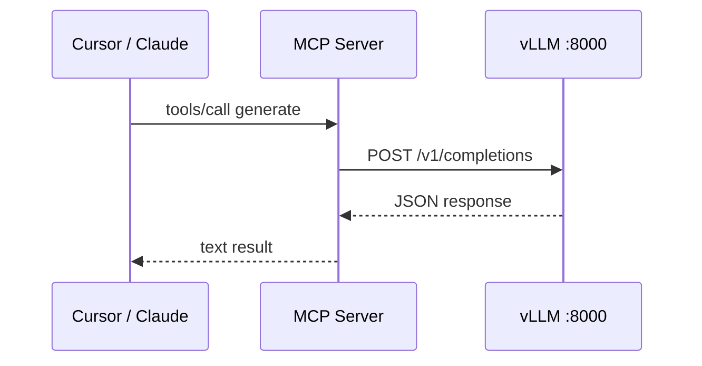

# MCP 集成

> 从 Bit 到 AGI · 第十章：自己训练一个模型 · MCP 集成

Model Context Protocol（MCP）让 Claude、Cursor 等客户端**标准化地调用外部工具与模型**（关于 MCP 协议与 Agent 架构的深入解析，另见[《从 LLM 到 Agent》](https://daiw.org/manual/llm-to-agent/mcp)与[《Claude Code 实战手册》](https://daiw.org/manual/claude-code)）。本篇把你的自训模型包成 MCP Server：客户端通过 MCP 发 prompt，Server 转发到本地 vLLM OpenAI API。

## 直觉：USB-C 集线器

电脑有各种接口（HDMI、USB-A）；MCP 像 **USB-C 集线器**——客户端只需会 MCP，就能连搜索、数据库或**你的 mini-GPT**，不用每个应用写一遍 HTTP 胶水代码。



## 定义

MCP Server 暴露：

| 原语 | 作用 |
| ---- | ---- |
| **Tools** | 可调用的函数（如 `generate_text`） |
| **Resources** | 只读上下文（如模型 card） |
| **Prompts** | 预置模板 |

传输方式：stdio（本地子进程）或 Streamable HTTP（远程服务，替代早期 HTTP+SSE）。本章用 **stdio + Python SDK**。

## 例子

**例 1：安装 MCP SDK**

```bash
cd ~/mini-gpt-lab && source .venv/bin/activate
pip install mcp openai
```

**例 2：编写 MCP Server**

```bash
mkdir -p mcp_server
cat > mcp_server/mini_gpt_server.py << 'EOF'
#!/usr/bin/env python3
"""MCP server → local vLLM OpenAI API."""
import asyncio
from mcp.server import Server
from mcp.server.stdio import stdio_server
from mcp.types import Tool, TextContent
from openai import OpenAI

VLLM_BASE = "http://localhost:8000/v1"
MODEL = "checkpoints/best-hf"

app = Server("mini-gpt")
client = OpenAI(base_url=VLLM_BASE, api_key="sk-local")

@app.list_tools()
async def list_tools():
    return [
        Tool(
            name="generate_text",
            description="Generate text continuation with mini-GPT (125M pretrain)",
            inputSchema={
                "type": "object",
                "properties": {
                    "prompt": {"type": "string"},
                    "max_tokens": {"type": "integer", "default": 128},
                    "temperature": {"type": "number", "default": 0.7},
                },
                "required": ["prompt"],
            },
        )
    ]

@app.call_tool()
async def call_tool(name: str, arguments: dict):
    if name != "generate_text":
        raise ValueError(f"Unknown tool: {name}")
    resp = client.completions.create(
        model=MODEL,
        prompt=arguments["prompt"],
        max_tokens=arguments.get("max_tokens", 128),
        temperature=arguments.get("temperature", 0.7),
    )
    text = resp.choices[0].text
    return [TextContent(type="text", text=text)]

async def main():
    async with stdio_server() as (read, write):
        await app.run(read, write, app.create_initialization_options())

if __name__ == "__main__":
    asyncio.run(main())
EOF
chmod +x mcp_server/mini_gpt_server.py
```

**例 3：Cursor / Claude Desktop 配置**

```bash
# ~/.cursor/mcp.json 或 Claude Desktop config 片段
cat << 'EOF'
{
  "mcpServers": {
    "mini-gpt": {
      "command": "/Users/YOU/mini-gpt-lab/.venv/bin/python",
      "args": ["/Users/YOU/mini-gpt-lab/mcp_server/mini_gpt_server.py"],
      "env": {}
    }
  }
}
EOF
```

将 `YOU` 换成你的用户名；确保 vLLM 已在 `:8000` 运行。

**例 4：命令行测试 MCP（inspector）**

```bash
npx @modelcontextprotocol/inspector \
  python mcp_server/mini_gpt_server.py
```

在 Inspector UI 里调用 `generate_text`，prompt 填 `"比特是"`。

## 量化

| 链路 | 额外延迟 |
| ---- | -------- |
| MCP stdio 序列化 | < 5 ms |
| vLLM 128 tokens | 500–1500 ms |
| **总计** |  dominated by 推理 |

MCP 适合**工具型调用**（短生成）；长文档摘要应直接 HTTP 批处理。

::: warning

MCP Server 以 stdio 运行时**不要** `print` 调试到 stdout——会破坏 JSON-RPC。日志写 stderr 或文件。

:::

## 动手试一试

扩展第二个 tool：`model_info` 返回参数量与上下文长度。

```python
# 在 list_tools 中添加 Tool(name="model_info", ...)
# call_tool 返回 "125M params, ctx=2048, base model (no SFT)"
```

## MCP Resources 与 Prompts 扩展

除 Tools 外，可暴露**只读资源**（模型卡片）：

```python
from mcp.types import Resource, ResourceTemplate

@app.list_resources()
async def list_resources():
    return [Resource(
        uri="mini-gpt://model-card",
        name="Model Card",
        mimeType="text/markdown",
    )]

@app.read_resource()
async def read_resource(uri: str):
    if uri == "mini-gpt://model-card":
        return "125M GPT, ctx=2048, base pretrain, Apache-2.0 data"
    raise ValueError(uri)
```

Cursor 可在对话中 `@mini-gpt` 引用该资源，Agent 先读 card 再决定是否调用 `generate_text`。

## 安全边界

- MCP Server **不应**暴露任意 shell；只暴露白名单 tool。
- vLLM 监听 `127.0.0.1` 而非 `0.0.0.0`，仅本机 MCP 可连。
- 若必须远程，走 SSH tunnel：`ssh -L 8000:localhost:8000 user@server`。

## 常见误区

1. **vLLM 未启动**：MCP 报 connection refused；先 `docker ps` 确认。
2. **路径硬编码**：用环境变量 `MINI_GPT_VLLM_URL` 便于部署。
3. **把 MCP 当训练接口**：MCP 是推理/工具协议，不用于传梯度。
4. **stdout 污染**：logging 必须走 stderr。
5. **未设 timeout**：vLLM  hung 时 MCP 客户端永久阻塞；OpenAI client 设 `timeout=60`。

## 端到端实践要点

MCP 让 Cursor、Claude Desktop 等客户端以**统一协议**调用你的 mini-GPT，而不必每个应用写 HTTP 胶水。stdio 传输最简单：父进程 spawn Python 子进程，JSON-RPC over stdin/stdout。切记 logging 走 stderr，否则破坏协议。

Tool 设计要白名单化：只暴露 `generate_text`，不要暴露任意 shell。vLLM 应监听 127.0.0.1，MCP 同机转发；远程用 SSH tunnel。timeout 必设，避免 vLLM hang 拖死客户端。Resources 可暴露 Model Card，Agent 先读再决定是否调用。

MCP 是推理层协议，不是训练接口。未来第十二章会讨论 MCP 与 tool use 的演进；本章实现是最小可用：**一个 tool + 一个 OpenAI backend**。测试用 `@modelcontextprotocol/inspector` 比反复重启 Cursor 更高效。配置路径用绝对路径或环境变量，避免 teammate clone 后 MCP 起不来。

## 命令流水线复盘

`pip install mcp openai`；写入 `mcp_server/mini_gpt_server.py`；先起 vLLM；`npx @modelcontextprotocol/inspector python mcp_server/mini_gpt_server.py` 调 `generate_text`；通过后写入 `~/.cursor/mcp.json` 绝对路径；重启 Cursor 在 Agent 里试 tool。日志仅 stderr。下一篇若做产品级助手，读[选择基座模型](/manual/llm/bit-to-agi/10-train-your-llm/pick-base-model)与[微调 SFT](/manual/llm/bit-to-agi/10-train-your-llm/fine-tune-sft)。

## 排错速查

Inspector 无响应：vLLM 未起或 URL 错。Cursor 不显示 tool：mcp.json 路径非绝对。stdout 污染：print 改 stderr。连接超时：OpenAI client 设 timeout。Windows 路径：用正斜杠或 raw string。

## 验收标准

本篇完成后，你应能在终端用一条命令或脚本验证关键产出存在且非空：`test -s` 查文件、`curl` 查 HTTP、`python -c` 查 import 与 shape。把验收命令写进项目 `Makefile` 或 `scripts/verify.sh`，每次改数据或权重后跑一遍，避免带着 silent failure 进入下一篇。全章二十篇都通过验收，即表示你已具备从零训小模型到部署 API 的完整能力。

## 与前后章衔接

本章每篇都假设你已读完第一至九章：比特与文件格式（第一章）解释 `train.bin` 为何是字节流；信息论（第三章）解释为何 PPL 衡量压缩效率；Transformer（第五章）解释预训练在优化什么；Tokenizer（第六章）与本章 BPE 训练一一对应；Training（第七章）给出 loss、LoRA、Checkpoint 理论；Inference（第八章）对应推理与部署；GPU（第九章）对应硬件与显存估算。若某命令报错，先查依赖版本（Python 3.11+、CUDA 驱动、PyTorch 与 vLLM 匹配），再查路径是否与 `mini-gpt-lab` 目录约定一致。整条流水线可在单卡 4090 上于一个周末跑通；失败时回到[从失败中恢复](/manual/llm/bit-to-agi/10-train-your-llm/recover-from-failure)对照症状表，不要跳过日志与 checkpoint 排查。

完成本篇后建议把关键命令与输出路径记录到 `docs/run-log.md`，便于复现与团队协作。

## 练习扩展

若时间充裕，尝试修改一个超参或配置项，观察下游指标变化并记录到 `docs/run-log.md`：例如清洗 threshold、词表大小、学习率、save 间隔或 vLLM 的 `max-model-len`。单次只改一处，才能归因。对比实验最好开 W&B 同名 project 下不同 run，用 Notes 字段标注「baseline / variant B」。这些习惯与工业界 ML 实验管理一致，比单纯跑通命令更有长期价值。

建议每篇末尾自检：关键产出文件存在、体积合理、随机抽检内容可读，再点下一篇链接。

遇到问题先查日志与磁盘空间，再查本章排错速查表。

保持 `mini-gpt-lab` 目录结构与命名一致，可显著减少路径类错误。

全章命令均在 bash + Python venv 下验证；Windows 用户请用 WSL2 或调整路径分隔符。

建议 fork 本章 `mini-gpt-lab` 仓库模板，在 README 中勾选已完成篇目，便于跟踪进度。

遇阻可在本章总结页的命令速查中对照当前阶段。

## 小结

- MCP Server 包装 vLLM OpenAI API 为 `generate_text` tool。
- stdio 传输 + Cursor/Claude 配置文件即可接入。
- 延迟主要来自推理；MCP 开销可忽略。

→ 下一篇：[选择基座模型](/manual/llm/bit-to-agi/10-train-your-llm/pick-base-model)
