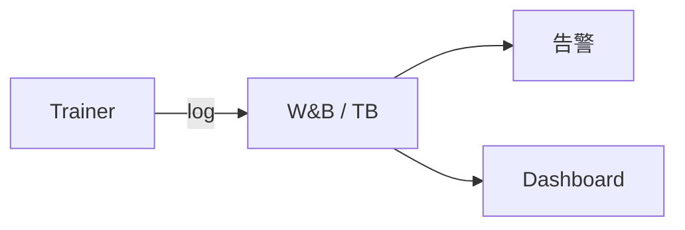

# 监控训练

> 从 Bit 到 AGI · 第十章：自己训练一个模型 · 监控训练

训练跑数小时，你需要**实时看到 loss、学习率、GPU 利用率**，并在异常时收到告警。本篇配置 Weights & Biases（W&B）与 TensorBoard，并列出必须盯住的指标阈值。

## 直觉：飞机仪表盘

飞行员不看一次高度就睡觉——持续看速度、油耗、引擎温度。训练同理：**train loss** 是高度，**grad norm** 是引擎振动，**GPU util** 是油门是否踩满。



## 定义

核心指标：

| 指标 |  healthy 范围 | 异常信号 |
| ---- | ------------- | -------- |
| train loss | 平滑下降 | 突然 ×2 spike |
| grad norm | 0.1–10 | >100 或 NaN |
| learning rate | 按 schedule | — |
| tokens/s | 稳定 | 骤降 → I/O 瓶颈 |
| GPU util | >80% | 低于50% → batch 太小 |
| val loss / PPL | 随 train 降 | train 降 val 升 |

## 例子

**例 1：W&B 登录与项目**

```bash
cd ~/mini-gpt-lab && source .venv/bin/activate
pip install wandb

wandb login   # 粘贴 API key from wandb.ai/authorize
export WANDB_PROJECT=mini-gpt-lab
export WANDB_RUN_NAME=pretrain-125m-v1
```

**例 2：LitGPT 启用 W&B**

```bash
litgpt pretrain tiny \
  --out_dir checkpoints/pretrain \
  --train_data_path data/litgpt/train.bin \
  --tokenizer_dir tokenizer \
  --logger wandb \
  --devices 1
```

**例 3：Transformers + W&B**

```bash
export WANDB_PROJECT=mini-gpt-lab
python scripts/sft_lora.py \
  --report_to wandb \
  --logging_steps 10
```

在 `TrainingArguments` 里设 `report_to="wandb"`。

**例 4：TensorBoard（本地、离线）**

```bash
# LitGPT / PyTorch Lightning 常写 logs/
tensorboard --logdir checkpoints/pretrain --port 6006
# 浏览器打开 http://localhost:6006
```

**例 5：终端 GPU 监控**

```bash
# 另开终端
watch -n 1 nvidia-smi

# 或更详细
pip install nvitop && nvitop
```

## 量化

日志体积：125M 训练 50k steps，每 10 step log 一次 → **5000 点 × ~1 KB ≈ 5 MB**（W&B 云端免费 tier 足够）。

告警规则示例：

| 条件 | 动作 |
| ---- | ---- |
| loss NaN | 立刻 kill；降 lr 或查数据 |
| 30 min GPU util < 40% | 增大 batch 或 num_workers |
| val PPL 连升 3 次 eval | early stop |

::: info

W&B 可设 **Sweep** 搜 lr / batch；教学项目手动 2–3 组对比即可，不必上 Sweep。

:::

## 动手试一试

自定义 callback 记录 tokens/s：

```python
# 在 TrainingArguments 同目录添加
from transformers import TrainerCallback
import time

class ThroughputCallback(TrainerCallback):
    def __init__(self):
        self.t0 = time.perf_counter()
        self.tokens = 0

    def on_log(self, args, state, control, logs=None, **kwargs):
        if logs and "loss" in logs:
            dt = time.perf_counter() - self.t0
            # 估算：batch * seq * steps
            print(f"step={state.global_step} loss={logs['loss']:.4f} elapsed={dt:.0f}s")
```

## W&B Dashboard 推荐面板

在 wandb.ai 项目页添加自定义 Chart：

- **train/loss** vs **val/ppl** 双 Y 轴
- **train/learning_rate** 确认 cosine decay
- **system/gpu.0.gpuUtilization** 应 >80%
- **train/tokens_per_second** 稳定平台

对比两次 run 时固定变量：只改 lr 或只改 batch，否则无法归因。

## TensorBoard vs W&B

| 工具 | 优点 | 缺点 |
| ---- | ---- | ---- |
| TensorBoard | 离线、无账号 | 无团队协作 |
| W&B | 云端、Sweep、告警 | 需网络 |

内网训练可用 `wandb offline`，结束后：

```bash
wandb sync wandb/offline-run-*
```

## 告警脚本示例

```bash
cat > scripts/watch_loss.sh << 'EOF'
#!/bin/bash
LOG=checkpoints/pretrain/logs/train.log
while sleep 60; do
  loss=$(tail -1 "$LOG" | grep -oP 'loss=\K[0-9.]+')
  if [[ "$loss" == "nan" ]]; then
    echo "NaN detected!" | mail -s "training alert" you@example.com
    break
  fi
done
EOF
chmod +x scripts/watch_loss.sh
```

## 常见误区

1. **只 log train loss**：不看 val 会过拟合到不知。
2. **wandb offline 忘记 sync**：`wandb sync wandb/run-xxx`。
3. **多 run 无命名**：`WANDB_RUN_NAME` 含日期与超参。
4. **log 间隔太密**：每 step log 拖慢训练；10–50 step 足够。
5. **GPU 温度不监控**：`nvidia-smi -q -d TEMPERATURE` 持续 >83°C 需清灰或降 power limit。

## 端到端实践要点

监控让你**在 loss 变 NaN 的当机分钟**收到信号，而不是训完八小时才发现白费。W&B 适合团队协作与多 run 对比；TensorBoard 适合离线单机。必看四条曲线：train loss、val PPL、learning rate、GPU utilization。util 长期低于 50% 说明 I/O 或 batch 太小，不是「GPU 在偷懒」而是 pipeline 有瓶颈。

grad norm spike 常先于 NaN：可在 Trainer callback 里 norm>100 自动降 lr 或停训。tokens/s 突然减半可能是磁盘读 bin 变慢或 another process 抢 GPU。告警不必复杂：cron + `tail loss` + 邮件即可；W&B 有内置 email alert。

log 间隔 10–50 step 足够；每 step log 拖慢 5–10%。多 run 命名含 lr、batch、data_version，否则两周后无法分辨哪条曲线对应哪次实验。监控数据 retention：W&B 免费 tier 有限，重要 run  export CSV 备份。

## 命令流水线复盘

`wandb login`；`export WANDB_PROJECT=mini-gpt-lab`；训练命令加 `--logger wandb` 或 Transformers `report_to=wandb`；浏览器打开 project 页；另终端 `watch nvidia-smi`。可选 `tensorboard --logdir checkpoints/pretrain --port 6006`。设 email alert 或 `scripts/watch_loss.sh`。下一篇[从失败中恢复](/manual/llm/bit-to-agi/10-train-your-llm/recover-from-failure)当 loss NaN 或 OOM 时配合 checkpoint 使用。

## 排错速查

W&B 无数据：忘记 `--logger wandb` 或 API key。TensorBoard 空目录：log 写到子目录需指定根。GPU util 0%：DataLoader 阻塞或 CPU 瓶颈。loss 曲线锯齿：batch 太小。offline run 丢失：未 sync 就删本地。

## 验收标准

本篇完成后，你应能在终端用一条命令或脚本验证关键产出存在且非空：`test -s` 查文件、`curl` 查 HTTP、`python -c` 查 import 与 shape。把验收命令写进项目 `Makefile` 或 `scripts/verify.sh`，每次改数据或权重后跑一遍，避免带着 silent failure 进入下一篇。全章二十篇都通过验收，即表示你已具备从零训小模型到部署 API 的完整能力。

## 与前后章衔接

本章每篇都假设你已读完第一至九章：比特与文件格式（第一章）解释 `train.bin` 为何是字节流；信息论（第三章）解释为何 PPL 衡量压缩效率；Transformer（第五章）解释预训练在优化什么；Tokenizer（第六章）与本章 BPE 训练一一对应；Training（第七章）给出 loss、LoRA、Checkpoint 理论；Inference（第八章）对应推理与部署；GPU（第九章）对应硬件与显存估算。若某命令报错，先查依赖版本（Python 3.11+、CUDA 驱动、PyTorch 与 vLLM 匹配），再查路径是否与 `mini-gpt-lab` 目录约定一致。整条流水线可在单卡 4090 上于一个周末跑通；失败时回到[从失败中恢复](/manual/llm/bit-to-agi/10-train-your-llm/recover-from-failure)对照症状表，不要跳过日志与 checkpoint 排查。

完成本篇后建议把关键命令与输出路径记录到 `docs/run-log.md`，便于复现与团队协作。

## 练习扩展

若时间充裕，尝试修改一个超参或配置项，观察下游指标变化并记录到 `docs/run-log.md`：例如清洗 threshold、词表大小、学习率、save 间隔或 vLLM 的 `max-model-len`。单次只改一处，才能归因。对比实验最好开 W&B 同名 project 下不同 run，用 Notes 字段标注「baseline / variant B」。这些习惯与工业界 ML 实验管理一致，比单纯跑通命令更有长期价值。

建议每篇末尾自检：关键产出文件存在、体积合理、随机抽检内容可读，再点下一篇链接。

遇到问题先查日志与磁盘空间，再查本章排错速查表。

保持 `mini-gpt-lab` 目录结构与命名一致，可显著减少路径类错误。

全章命令均在 bash + Python venv 下验证；Windows 用户请用 WSL2 或调整路径分隔符。

建议 fork 本章 `mini-gpt-lab` 仓库模板，在 README 中勾选已完成篇目，便于跟踪进度。

遇阻可在本章总结页的命令速查中对照当前阶段。

## 小结

- W&B 或 TensorBoard 实时看 loss、lr、吞吐。
- `nvidia-smi` / nvitop 看 GPU 是否吃满。
- 设 spike / NaN / val 恶化告警规则。

→ 下一篇：[从失败中恢复](/manual/llm/bit-to-agi/10-train-your-llm/recover-from-failure)
