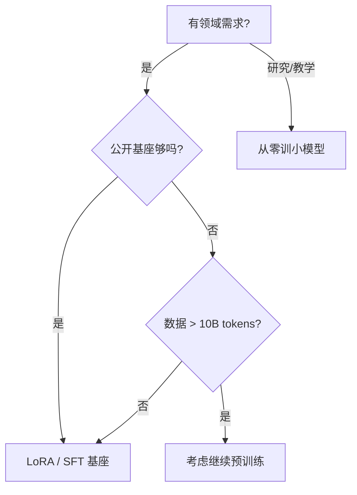

# 选择基座模型

> 从 Bit 到 AGI · 第十章：自己训练一个模型 · 选择基座模型

并非每个任务都要从零预训练。多数场景应在**开源基座**上微调。本篇给出决策树：何时继续训你的 125M、何时换 Qwen3 / Llama 4 / DeepSeek 等主流开源基座（关于前沿大模型的架构对比，另见[《AI 大模型解构》](https://daiw.org/manual/llm-anatomy)、[《Qwen3.8-Max 深度解析》](https://daiw.org/manual/qwen3-8-max)、[《Kimi K3 深度解析》](https://daiw.org/manual/kimi-k3)与[《DeepSeek V4.1 Flash 深度解析》](https://daiw.org/manual/deepseek-v4-flash)），以及如何评估许可证、上下文长度与工具调用能力。

## 直觉：买毛坯还是自建

从零预训练 = 自己烧砖盖房；选基座 = **买精装毛坯做软装**。软装是 SFT/LoRA（下一篇）；只有当你需要新语言、新词表或研究 scaling 时才值得从零烧砖。



## 定义

选型维度：

| 维度 | 问题 | 例子 |
| ---- | ---- | ---- |
| 规模 | 7B vs 70B | 7B 单卡可训 LoRA |
| 许可证 | 商用？ | Apache-2.0 vs LLAMA |
| 上下文 | 4k vs 128k | 长文档用 YaRN 模型 |
| 对齐 | 是否 instruct | `Qwen3-8B` / `Qwen2.5-7B-Instruct` |
| 工具 | function calling | 选已 SFT 工具格式的 |

## 例子

**例 1：列出候选并查许可证**

```bash
pip install huggingface_hub
python << 'EOF'
from huggingface_hub import HfApi
api = HfApi()
for model_id in [
    "Qwen/Qwen3-8B",
    "meta-llama/Llama-3.2-3B",
    "microsoft/phi-4",
]:
    info = api.model_info(model_id)
    tags = info.tags or []
    license_tag = [t for t in tags if "license" in t.lower() or t.startswith("license:")]
    print(f"{model_id}: downloads={info.downloads}, tags={license_tag[:3]}")
EOF
```

**例 2：下载基座到本地**

```bash
hf download Qwen/Qwen3-8B \
  --local-dir checkpoints/base/qwen3-8b
# 注：旧版 CLI 为 huggingface-cli download，--local-dir-use-symlinks 已弃用
```

**例 3：与本章自训 125M 对比**

| 模型 | 参数 | 预训练 tokens（公开） | MMLU（约） |
| ---- | ---- | --------------------- | ---------- |
| 本章 mini-GPT | 125M | 0.5B（实验） | 未测 |
| Qwen2.5-0.5B | 0.5B | ~18T（系列） | ~45 |
| Qwen2.5-7B-Instruct / Qwen3-8B | 7B–8B | ~18T–36T | ~74–80+ |

125M 自训适合**理解流水线**；产品级助手应选 **≥7B Instruct** 做 LoRA。

**例 4：快速能力探针**

```bash
python << 'EOF'
from transformers import AutoModelForCausalLM, AutoTokenizer
import torch

path = "checkpoints/base/qwen2.5-7b-instruct"
tok = AutoTokenizer.from_pretrained(path)
model = AutoModelForCausalLM.from_pretrained(
    path, dtype=torch.bfloat16, device_map="auto"
)
messages = [{"role": "user", "content": "用一句话解释梯度下降。"}]
text = tok.apply_chat_template(messages, tokenize=False, add_generation_prompt=True)
inputs = tok(text, return_tensors="pt").to(model.device)
out = model.generate(**inputs, max_new_tokens=64)
print(tok.decode(out[0], skip_special_tokens=True))
EOF
```

## 量化

| 路径 | GPU 需求 | 时间 | 适用 |
| ---- | -------- | ---- | ---- |
| 125M 从零 | 1×24 GB | 小时级 | 教学 |
| 7B LoRA SFT | 1×24 GB | 小时级 | 领域助手 |
| 7B 继续预训练 | 8×80 GB | 周级 | 新语言/领域 |
| 70B LoRA | 2×80 GB | 天级 | 高质量 |

::: info

**继续预训练**（CPT）在基座上灌入领域语料；**SFT** 教对话格式。多数「让模型懂医学」需求：7B + 医学 SFT 即可，不必 CPT。

:::

## 动手试一试

写决策表：你的场景填「从零 / 基座+LoRA / 基座+CPT」。

```bash
cat > docs/model-choice.md << 'EOF'
| 需求 | 数据量 | 推荐 |
| ---- | ------ | ---- |
| 学习全流程 | 任意 | 125M 从零 |
| 企业内部 FAQ bot | 1万条 QA | Qwen3-8B / Qwen2.5-7B LoRA |
| 低资源语言 | 50B tokens | 基座 CPT + SFT |
EOF
cat docs/model-choice.md
```

## 许可证速查

| 模型 | 许可证 | 商用 |
| ---- | ------ | ---- |
| Qwen2.5 / Qwen3 | Apache-2.0 | 是 |
| Llama 3.x / Llama 4 | Llama Community | 有条件 |
| Mistral | Apache-2.0 | 是 |
| 本章 mini-GPT | 自定 + 数据许可 | 视数据 |

Llama 系列读 [https://llama.meta.com/llama3/license/](https://llama.meta.com/llama3/license/)：月活 >700M 需额外申请。

## 上下文长度与 RoPE 扩展

| 模型 | 原生 ctx | 扩展 |
| ---- | -------- | ---- |
| Qwen2.5-7B | 128k | YaRN |
| Llama 3.2 3B | 128k | 内置 |
| 本章 125M | 2048 | 需插值或继续训长序列 |

长文档 RAG 选 **128k ctx 基座**；短对话 4k 足够。

## 常见误区

1. **越小越快越好**：3B 以下 instruct 逻辑弱，工具调用更弱。
2. **忽视 license**：Llama 系列有附加商用条款，读 `LICENSE` 文件。
3. **Base 当 Chat 用**：未 SFT 的 Base 模型需 Instruct 版或自己 SFT。
4. **下载完整 70B 到笔记本**：磁盘 140GB+；用 `--include` 只下 config 或量化版。
5. **不试 function calling**：Agent 场景先测官方 tool 格式是否匹配。

## 端到端实践要点

选基座是**成本与效果的关键杠杆**。从零预训练 7B 要百万美元级；下载 Qwen3-8B / Qwen2.5-7B-Instruct 做 LoRA 只要几美元 GPU 时间。决策树核心问题：公开权重+你的 SFT 数据能否满足需求？能 → 别从零训。只有新语言、新词表、研究 scaling 或数据不能出境时才考虑 CPT/从零。

许可证影响商业模式：Apache-2.0 商用条款清晰省心；Llama Community 对大 MAU 有限制。上下文长度影响 RAG：128k ctx 模型可减少 chunk 数。Instruct 版已 SFT，直接 LoRA 领域数据即可；Base 版需自己配 chat template 和更多 SFT 数据。

下载 gated model 需 HuggingFace 账号授权；企业用 private mirror 或 air-gapped 拷贝。探针脚本生成一条回答，五分钟内知道基座中文能力与工具格式是否匹配你的栈。125M 自训模型保留价值：**理解数据→Tokenizer→预训练全链路**；产品交付应切换到 7B+ 基座。

## 命令流水线复盘

按顺序执行，每步确认输出再进下一步：① `huggingface-cli download` 或脚本写入 `raw/`；② `python scripts/clean_corpus.py` 得到 `processed/train.txt`；③ `python scripts/train_tokenizer.py` 得到 `tokenizer/tokenizer.json`；④ 转 `data/litgpt/train.bin`；⑤ `litgpt pretrain` 写 `checkpoints/pretrain/`；⑥ `litgpt evaluate` 算 val PPL；⑦ 复制 best 到 `checkpoints/best/`；⑧ `litgpt convert_to_hf`；⑨ `docker compose up` 起 vLLM；⑩ `curl /v1/completions` 与 MCP Inspector 冒烟。任一步失败不要跳到后面——上游错误会在下游放大。完整目录树见[本章 index](/manual/llm/bit-to-agi/10-train-your-llm)。

## 排错速查

403 gated：网页 Agree 后重登 HF。下载慢：用 `huggingface-cli` 断点续传。磁盘不足：7B bf16 约 14GB。license 误读：Llama 附加条款单独页。探针 OOM：3B 以上需 GPU 加载。

## 验收标准

本篇完成后，你应能在终端用一条命令或脚本验证关键产出存在且非空：`test -s` 查文件、`curl` 查 HTTP、`python -c` 查 import 与 shape。把验收命令写进项目 `Makefile` 或 `scripts/verify.sh`，每次改数据或权重后跑一遍，避免带着 silent failure 进入下一篇。全章二十篇都通过验收，即表示你已具备从零训小模型到部署 API 的完整能力。

## 与前后章衔接

本章每篇都假设你已读完第一至九章：比特与文件格式（第一章）解释 `train.bin` 为何是字节流；信息论（第三章）解释为何 PPL 衡量压缩效率；Transformer（第五章）解释预训练在优化什么；Tokenizer（第六章）与本章 BPE 训练一一对应；Training（第七章）给出 loss、LoRA、Checkpoint 理论；Inference（第八章）对应推理与部署；GPU（第九章）对应硬件与显存估算。若某命令报错，先查依赖版本（Python 3.11+、CUDA 驱动、PyTorch 与 vLLM 匹配），再查路径是否与 `mini-gpt-lab` 目录约定一致。整条流水线可在单卡 4090 上于一个周末跑通；失败时回到[从失败中恢复](/manual/llm/bit-to-agi/10-train-your-llm/recover-from-failure)对照症状表，不要跳过日志与 checkpoint 排查。

## 小结

- 教学用 125M 从零；产品用 7B+ 基座 + LoRA/SFT。
- 查 license、上下文、是否 Instruct。
- CPT 仅在大规模领域语料且基座不够时考虑。

→ 下一篇：[微调 SFT](/manual/llm/bit-to-agi/10-train-your-llm/fine-tune-sft)
