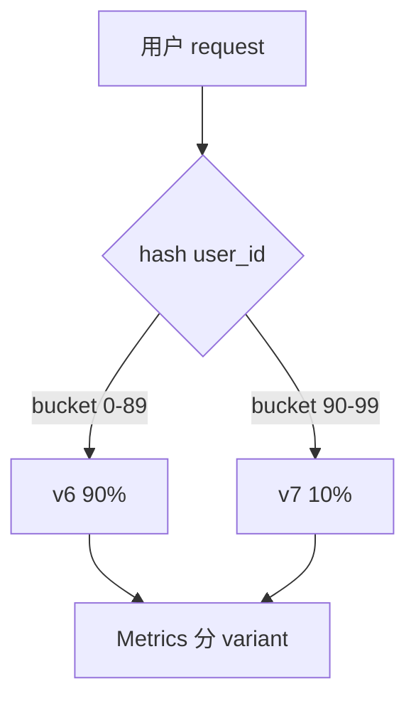

# A/B 测试

> 从 Bit 到 AGI · 第十一章：工程化（Serving） · LLM 模型与策略的在线实验

注册表里的 v7 比 v6 MMLU 高 0.6——但 **线上用户满意度** 会变吗？LLM 的 A/B 测试把流量按 5%～50% 切到新模型/新 prompt/新温度，对比 **业务指标**（点击率、解决率）和 **系统指标**（TTFT、cost/token），统计显著后再全量。Gateway + 注册表 + 可观测性三者在此汇合。

## 直觉

A/B 像**两家相邻奶茶店试卖**：同一条街（用户），一半进 A 店（v6），一半进 B 店（v7），比复购率而非只看「B 店员工说更好喝」（offline benchmark）。LLM 额外难点：同一用户多轮对话必须 **sticky** 到同一 variant，否则前后模型不一致体验崩坏。



## 定义

LLM A/B 实验要素：

| 要素 | 说明 |
| ---- | ---- |
| **Unit** | 通常 `user_id` 或 `session_id`（非 request） |
| **Variant** | 模型版本 / prompt 模板 / `temperature` |
| **Split** | 90/10、50/50；Canary 常用 5→20→50→100 |
| **Metrics** | 主：业务 KPI； guardrail：延迟、错误率、 toxicity |
| **Duration** | 至少 **7 天** 或 **10 K sessions/variant**（取大） |

**统计**：两比例 z-test 或 Bayesian；显著性 **p < 0.05** 且 **MDE**（最小可检测效应）预先定义。

## 例子

**例 1：Gateway Header 路由（Istio）**

```yaml
# VirtualService：10% v7
route:
  - destination: { host: vllm-v6 }
    weight: 90
  - destination: { host: vllm-v7 }
    weight: 10
```

配合 **consistent hash** on `x-user-id`，保证同用户同 variant。

**例 2：实验数据（客服 bot，14 天）**

| Variant | Sessions | 解决率 | 平均 tokens | TTFT P95 | 成本/会话 |
| ------- | -------- | ------ | ----------- | -------- | --------- |
| v6 (control) | 48 200 | 71.2% | 890 | 620 ms | \$0.0042 |
| v7 (treatment) | 5 310 | **74.8%** | 920 | 580 ms | \$0.0044 |

解决率 **+3.6 pp**，95% CI [+1.2, +6.0] → **显著**；成本 +4.8% 在预算内 → **promote v7**。

**例 3：Shadow traffic（零用户风险）**

| 模式 | 用户看到 | 用途 |
| ---- | -------- | ---- |
| A/B | variant 之一 | 业务指标 |
| Shadow | 始终 control | 新模型 **mirror 请求**，output **丢弃**，比 latency/崩溃 |

Shadow 100% 流量 24 h，v7 **OOM 率 0.02%**（v6 0%）→ 修 batch 配置再进 A/B。

## 量化

**样本量**（比例指标，MDE=2 pp，baseline=70%）：

$$
n \approx \frac{2 \times (z_{\alpha/2} + z_{\beta})^2 \times p(1-p)}{\text{MDE}^2}
$$

$p=0.7$，MDE=0.02，power=0.8（$z_{\alpha/2}=1.96$，$z_\beta=0.84$）→ $n \approx$ **~8 200 / variant**，两组共 **~16 K**。只放 10% 流量进实验，就需要 **~165 K total sessions** 才攒得够——对多数团队这不是「跑 7 天」，是**跑一个月**。

**注意分母是 MDE 的平方**，这是全篇最该记住的一件事：

| MDE | $n$ / variant | 相对 |
| --- | --- | --- |
| 4 pp | ~2 060 | 1× |
| 2 pp | ~8 240 | **4×** |
| 1 pp | ~33 000 | **16×** |

**想多测出一半的精度，要付四倍的样本。** 所以 MDE 不是「越小越严谨」——它是你愿意为多大的效应买单。如果 1 pp 的提升对业务无所谓，就别把 MDE 定在 1 pp，那只是在烧流量。

**实验污染**：员工 dogfood、爬虫 bot 应 **exclude**；占流量 **~5%** 时可 skew 结果。

**Rollback SLA**：promote 后若解决率 **24 h 内跌 > 2 pp**，自动切回 v6——Feature flag + registry stage 联动，MTTR **低于 5 min**。

::: info

Prompt A/B（system 模板）比模型 A/B 便宜——无新 pod；但 metrics 需 NLP 评判（LLM-as-judge）或人工标注，噪声更大。

:::

## 常见误区

1. **「offline benchmark 够就全量」**——MMLU +0.6 可能对应解决率 **-1%**（过拟合 benchmark）。
2. **「50/50 永远最优」**——高风险模型先用 **5% Canary** + shadow。
3. **「按 request 随机」**——同用户多轮进不同模型，对话失忆；必须 **sticky session**。

## 实验平台集成

与 [Gateway](/manual/llm/bit-to-agi/11-engineering/gateway) + [可观测性](/manual/llm/bit-to-agi/11-engineering/observability) 联动的最小实验配置：

```python
# 应用层：每个请求打 label
variant = assign_variant(user_id, "exp-v7-202507")
headers = {"x-experiment-variant": variant}
metrics.labels(variant=variant).observe(ttft)

# 分析：按 variant 聚合 7 日 rolling
# Grafana: histogram_quantile(0.95, ttft{variant="treatment"})
```

**Guardrail metrics**（实验必须监控，超阈自动停实验）：

| Guardrail | 阈值 | 动作 |
| --------- | ---- | ---- |
| TTFT P95 | > control × 1.25 | 停 treatment |
| 5xx rate | > 0.3% | 停 treatment |
| toxicity score | > baseline + 0.05 | 停 treatment |
| cost/session | > control × 1.15 | 告警 |

**Sequential testing 警告**：每天偷看结果并提前停止会 inflate false positive——预注册 **固定 14 天** 或 **固定样本量**，中途只查 guardrail。

**Multi-armed bandit**（进阶）：高流量场景用 Thompson sampling 动态调流量，比固定 90/10 平均 **-12% regret**——但工程复杂度显著，建议 QPS **>500** 再上。

## 动手试一试

```python
import hashlib

def assign_variant(user_id: str, experiment: str, split: float = 0.1) -> str:
    h = hashlib.sha256(f"{experiment}:{user_id}".encode()).hexdigest()
    bucket = int(h[:8], 16) / 0xFFFFFFFF
    return "treatment" if bucket < split else "control"

for uid in ["u1", "u2", "u1"]:
    print(uid, assign_variant(uid, "v7-rollout"))
# u1 两次结果相同 → sticky
```

模拟 10 K user_id，统计 treatment 比例是否落在 **split ± 0.5%**——偏差大说明 hash 或 experiment salt 有问题。

## 小结

LLM A/B 需 **sticky user 分流**、**7 天 / 10 K sessions** 量级样本；v7 解决率 **+3.6 pp** 显著方可 promote。Shadow 流量先验 **稳定性**，再开用户-facing 实验。

→ 下一篇：[成本治理](/manual/llm/bit-to-agi/11-engineering/cost-governance)
