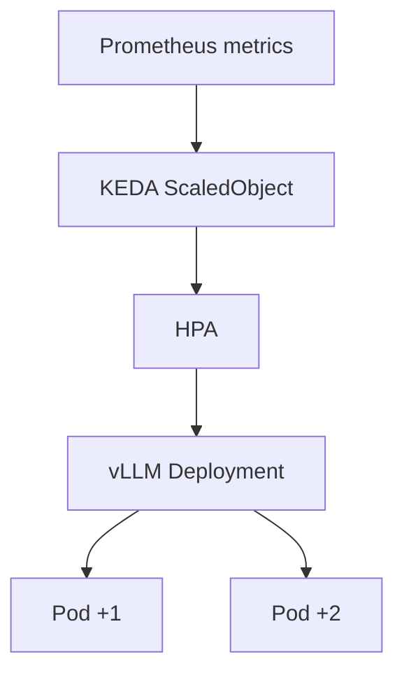

# 自动扩缩容

> 从 Bit 到 AGI · 第十一章：工程化（Serving） · LLM 推理的 HPA 与 GPU 弹性

可观测性告诉你「队列 180、KV 92%」——**自动扩缩容（Autoscaling）** 负责在 5～10 分钟内多加 3 个 vLLM pod，而不是让 SRE 凌晨手动 `kubectl scale`。LLM 的难点是 **GPU 冷启动慢**（load 权重 1～10 min）和 **指标不能绑 CPU**——必须用自定义 QPS、队列深度或 tokens/s。

## 直觉

Autoscaling 像**餐厅加桌**：客人排队超过 10 人（`num_requests_waiting > 10`）就开张新桌（新 GPU pod）。但 LLM「开桌」要 **先搬 16 GB 冰箱（权重）进来**——太慢就要 **预留空桌（minReplicas > 0）** 或 **预测饭点（定时 scale）**。



## 定义

LLM 扩缩容组件：

| 组件 | 作用 |
| ---- | ---- |
| **HPA** | K8s 原生，需 metrics-server 或 custom metrics API |
| **KEDA** | 消费 Prometheus/SQS 等，scale to zero（LLM 慎用） |
| **Cluster Autoscaler** | Node 不够时加 GPU VM |
| **Predictive** |  cron 或 ML 预测流量（饭点、发布会） |

**关键参数**：`minReplicas`、`maxReplicas`、`scaleUpStabilizationWindow`、`scaleDownStabilizationWindow`（LLM 建议 **300 s** 防抖）。

## 例子

**例 1：KEDA + Prometheus（vLLM 队列）**

```yaml
apiVersion: keda.sh/v1alpha1
kind: ScaledObject
metadata:
  name: vllm-scaler
spec:
  scaleTargetRef:
    name: llama3-8b-vllm
  minReplicaCount: 2
  maxReplicaCount: 12
  pollingInterval: 15
  cooldownPeriod: 300
  triggers:
    - type: prometheus
      metadata:
        serverAddress: http://prometheus:9090
        query: |
          sum(vllm:num_requests_waiting)
            + sum(vllm:num_requests_running) * 0.5
        threshold: "24"    # ~1 replica 舒适并发
```

当加权队列 > 24 → +1 replica；< 12 持续 5 min → -1。

**例 2：扩缩容时间线（8B，单 pod ~40 QPS）**

| 时刻 | QPS | replicas | TTFT P95 |
| ---- | --- | -------- | -------- |
| T+0 | 30 | 2 | 380 ms |
| T+1min | 120 突发 | 2 | **2.8 s** |
| T+2min | KEDA 触发 | 3（+1 pending） | 2.1 s |
| T+5min | 新 pod ready | 5 | **520 ms** |
| T+15min | 流量回落 | 5→3（慢缩） | 400 ms |

冷启动 **~3～5 min** 是 TTFT 恶化的主因——**minReplicas=2** 可吸收小突发。

**例 3：Cluster Autoscaler 加 GPU 节点**

| 场景 | 行为 |
| ---- | ---- |
| 12 replica  pending（无 GPU） | CA 启动新 A100 节点 **~5～8 min** |
| 云厂商 GPU 配额满 | Pending forever → 需 **配额告警 + 跨区 fallback** |
| Spot 实例 | 便宜 **~60%**，但 **低于  2 min** 回收 → LLM 仅 offline batch |

## 量化

**Replica 需求估算**：

$$
R = \left\lceil \frac{QPS \times \bar{T}_{\text{e2e}}}{C_{\text{replica}}} \right\rceil
$$

$\bar{T}_{\text{e2e}}$ ≈ 0.6 s（128/64），$C_{\text{replica}}$ ≈ 24 并发 → QPS 100 需 $R = \lceil 100 \times 0.6 / 24 \rceil = 3$，加 **20% headroom** → **4**。

**Scale-down 风险**：缩容时 SIGTERM → vLLM  drain 进行中请求 **~30～120 s**；`terminationGracePeriodSeconds: 180`。

**成本**：夜间 QPS 10 仍跑 5 replica = 浪费 **80% GPU**；定时 scale：

```yaml
# KEDA cron：UTC 14:00 预热（北京 22:00 高峰前）
- type: cron
  metadata:
    timezone: Asia/Shanghai
    start: "0 21 * * *"
    end: "0 2 * * *"
    desiredReplicas: "8"
```

::: info

Serverless GPU（RunPod、Modal）scale 更快（**~60 s**），但单价高 **~30%**；适合 burst overflow，非常驻池。

:::

## 常见误区

1. **「scale to zero 省钱」**——LLM 冷启动 8B **~90 s**，首用户不可接受；`minReplicas ≥ 1`。
2. **「HPA targetCPU 50%」**——GPU bound 时 CPU 10%；用 **custom metrics**。
3. **「扩容越快越好」**——scaleUp 无 stabilization 会在 metrics 噪声下 **狂启 pod OOM 集群**。

## 多集群与 Spot 混部

**Over-provision 策略**：高峰前 **30 min** cron 预热到 `desiredReplicas=8`；低谷 **02:00–08:00** 缩到 `minReplicas=2`，省 **~75%** 夜间 GPU 费（8B 单卡 **~\$2.2/h** × 6 卡 × 6 h ≈ **\$79/夜**）。

**Spot / 抢占式实例**：仅用于 **offline batch**（embedding、摘要 backlog），需 checkpoint 可中断；online serving **禁止** Spot——回收通知 **~30 s** 不够 drain 128 token 流。

**跨 region failover**：Primary region waiting >50 持续 5 min → DNS/ Gateway 切 **20%** 流量到 secondary（需 registry 两区同 version）。Secondary 常态 `minReplicas=1` 保持 warm。

| 策略 | 省成本 | 风险 |
| ---- | ------ | ---- |
| 夜间缩容 | 25～40% | 早高峰冷启动 |
| Spot batch | 60% batch 成本 | 任务重跑 |
| Reserved 1y | 35～45% GPU | 锁定型号 |

## 实战案例：客服高峰

某 SaaS 客服 bot，08:00–20:00 流量 **10→180 QPS** 阶梯上升。初始 2 replica（8B vLLM），08:30 waiting 飙到 **95**，TTFT P95 **4.2 s**。改造：

1. KEDA 阈值从 24 降到 **18**，`minReplicas` 从 2 提到 **3**
2. 加 cron 07:30 预热到 **6 replica**
3. Gateway 全局限流 **200 QPS**

改造后高峰 TTFT P95 **680 ms**，GPU 利用率 **72%**，月 GPU 费 **+\$1 100** 但 NPS **+8 pt**——延迟 SLA 违约从 **12%→0.3%**。

**教训**：autoscaling 不是事后补救；要用 **前一周同时段 QPS** 做 predictive scale，冷启动 **3～5 min** 意味着至少提前 **5 min** 扩容。

## 动手试一试

```bash
kubectl apply -f vllm-scaledobject.yaml
kubectl get hpa -w

# 另一终端压测
python benchmark_serving.py --request-rate 80 --num-prompts 800

# 观察 replica 变化
kubectl get deploy llama3-8b-vllm -w
```

记录 scale-up 触发到 ready 的延迟；若 >8 min，检查是镜像 pull 慢还是 GPU 节点池无空闲——后者需 Cluster Autoscaler 日志。

## 小结

LLM autoscaling 应绑 **vLLM 队列 / tokens/s**，`minReplicas ≥ 2`，scaleDown **cooldown 300 s**；8B 冷启动 **~3～5 min** 决定突发 TTFT。与 Cluster Autoscaler 联动解决 **GPU 节点不足**。

→ 下一篇：[模型注册表](/manual/llm/bit-to-agi/11-engineering/model-registry)
