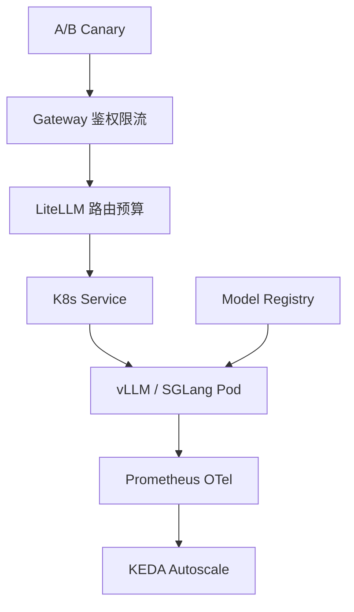

# 第十一章总结

> 从 Bit 到 AGI · 第十一章：工程化（Serving） · 生产部署全景回顾

本章把「能跑的模型」变成「能扛流量的服务」。核心不是某个工具名，而是**可量化的生产尺子**：吞吐（tok/s、QPS）、体验（TTFT、TPOT）、可靠性（P95/P99、错误预算）和经济学（\$/1M tokens）。

## 推理引擎怎么选

| 场景 | 首选 | 典型数字（8B，A100） |
| ---- | ---- | -------------------- |
| 通用高 QPS 对话 | vLLM | ~3 000 tok/s，TTFT ~200 ms |
| RAG / 共享长 prefix | SGLang | prefix 命中 TTFT ~120 ms |
| H100 极致性能、可维护编译 CI | TensorRT-LLM FP8/INT4 | ~5 000～6 800 tok/s |
| 训练栈一体、HF checkpoint 直出 | DeepSpeed FastGen | ~2 900 tok/s |

70B 级通常 **TP=4**，吞吐 **~900～2 200 tok/s**，TTFT **1～1.4 s**（2K input）——容量规划按 **P95 并发** 而非峰值 QPS 估算。

## 编排与平台栈

- **Ray**：多 replica + CPU/GPU 混合 pipeline，3 副本约 **3× QPS** 线性区
- **Kubernetes**：GPU 调度、readiness **≥120 s**（8B load）、70B TP 宜蓝绿
- **LiteLLM + Gateway**：OpenAI 形状统一路由；Gateway 全站限流防 TTFT 崩到 **>8 s**
- **可观测性**：盯 `num_requests_waiting`、`gpu_cache_usage_perc`、TTFT histogram
- **Autoscaling**：绑 vLLM 队列，`minReplicas ≥ 2`，冷启动 **3～5 min**
- **Registry + A/B + 成本**：immutable version、sticky 分流、团队 budget **\$300/月** 级封顶

## 训练并行与 Serving 的衔接

Megatron **TP × PP × DP** 训出 100B+；DeepSpeed **ZeRO-3** 让 70B 全参微调落在 8×A100。Serving 不跑 Megatron——checkpoint **合并 → HF → vLLM/TRT-LLM**，**TP 度数尽量一致**。

## 成本锚点（100 M tokens/月，量级）

| 方案 | \$/1M tokens |
| ---- | ------------ |
| 自托管 8B vLLM（1×A100） | ~\$22 |
| 高阶闭源 API（多轮综合折算） | ~\$150 |
| 混合 80/20 + prefix cache + INT4 | ~\$15～52 |

FinOps 每周看 Top 消耗；组合优化常见 **-60%～70%**。

## 常见坑回顾

1. 用 CPU HPA 扩 GPU 服务 → 排队爆表
2. scale to zero → 冷启动 **90 s** 首请求超时
3. 按 request 做 A/B → 多轮对话失忆
4. log 全量 prompt → 合规与存储双爆
5. offline MMLU +0.6 直接全量 → 线上解决率可能反降

## 下一步

工程化解决「模型怎么稳定便宜地跑」。第十二章 [未来](/manual/llm/bit-to-agi/12-future) 转向 Agent、工具调用、世界模型与 AGI 路线图——Serving 栈是 Agent 系统的底座，延迟与成本会直接约束「能跑多复杂的 agent loop」。

→ 下一章：[第十二章：未来](/manual/llm/bit-to-agi/12-future)
