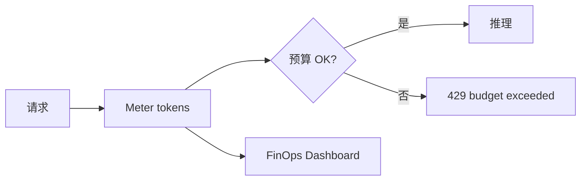

# 成本治理

> 从 Bit 到 AGI · 第十一章：工程化（Serving） · Token 预算、分摊与 FinOps

A/B 通过 v7 时成本/会话只涨了 4.8%——若全站 **日 50 M tokens**，那就是 **\$2 400/月 → \$2 520/月**。成本治理回答：**谁花了多少、上限在哪、如何用 80% 预算拿到 95% 质量**——把 GPU 电费、云 API、存储变成可问责的 **FinOps** 指标，而不是月底一张吓人的账单。

## 直觉

LLM 成本像**水电费按 token 计**：开灯（发 prompt）和开空调（长输出）都计价；自托管是「自家发电（GPU 折旧 + 电）」，OpenAI 是「电网直购」。治理就是 **每户（team）装表、设限额、峰谷电价（路由到便宜模型）**。



## 定义

成本治理三层：

| 层 | 工具 | 产出 |
| -- | ---- | ---- |
| **Metering** | LiteLLM spend logs、vLLM metrics | tokens in/out per user/team |
| **Budget** | 日/月 cap、告警 80% | 硬拒绝或降级 |
| **Optimization** | 路由、量化、缓存 | \$/resolved_ticket |

**单位 economics**：

$$
\text{\$/1K tokens} = \frac{\text{GPU 月租} + \text{电} + \text{运维}}{\text{月产出 tokens / 1000}}
$$

或云 API 标价表直接加总。

## 例子

**例 1：自托管 vs 云 API（8B 级 vs 闭源 API，2026 量级示意）**

| 方案 | 月成本（100 M tok/mo） | \$/1M tokens | TTFT P95 |
| ---- | ---------------------- | ------------ | -------- |
| 1×A100 24/7 自托管 vLLM | ~\$2 200 | **\$22** | ~650 ms |
| 高阶闭源 API（含多轮重试/长上下文折算） | ~\$15 000 | \$150 | ~680 ms |
| 混合 80% 自托管 + 20% 闭源旗舰 | ~\$5 200 | **\$52** | ~520 ms |

自托管 break-even：月 token **> ~15 M** 通常划算（视 GPU 单价）。

**例 2：LiteLLM 团队预算**

```yaml
general_settings:
  max_budget: 1000          # 全局 $/月
  budget_duration: 30d

litellm_settings:
  success_callback: ["langfuse"]

team_settings:
  - team_id: support-bot
    max_budget: 300
    models: ["llama3-8b", "gpt-4o-mini"]
  - team_id: research
    max_budget: 500
    models: ["gpt-5", "claude-sonnet-4-6"]
```

support-bot 超 **\$300** → 403；research 仍可用至 **\$500**。

**例 3：降本杠杆排序（实测影响）**

| 措施 | 成本降幅 | 质量影响 |
| ---- | -------- | -------- |
| INT4 AWQ 8B | **-35% GPU** | MMLU -0.3 |
| Prefix cache (RAG) | **-40% prefill FLOPs** | 无 |
| 路由简单问 → 8B，复杂 → 4o | **-55% API bill** | 复杂题 +2% 失败 |
| max_tokens 512→256  cap | **-18% out tokens** | 长答截断 |
| Prompt 压缩 | **-25% in tokens** | 需 eval |

组合 1+2+3 常见 **-60%～70%** 总成本。

## 量化

**Token 预算告警**：

| 阈值 | 动作 |
| ---- | ---- |
| 70% 月预算 | Slack 通知 |
| 90% | 邮件 + 限流 50% |
| 100% | 硬停或 **仅允许 cheap model** |

**Chargeback**（内部摊销）：

$$
\text{Team A 账单} = \sum (\text{tokens}_i \times \text{rate}_{\text{model}_i}) + \text{GPU 份额} \times \text{util}_A
$$

GPU 份额按 **team A 的 tokens / 全站 tokens** 分摊固定成本。

**FinOps Review 周期**：**每周** 看 Top 10 消耗 user/endpoint；**每月** 调路由策略与 reserved GPU。

::: warning

**hidden cost**：70B 实验 pod 忘关 **\$12/h × 720 h = \$8 640/月**；registry `Archived` + K8s **namespace quota** 强制回收。

:::

## 常见误区

1. **「只看 \$ 不看 tokens」**——GPT-4 与 8B 混用时 \$ 可比性差；统一 **normalized tokens** 或 **quality-weighted cost**。
2. **「自托管一定便宜」**——利用率 **< 30%** 时自托管贵于 API；小流量用 **serverless API**。
3. **「限 max_tokens 就够」**——输入侧 RAG **10 K token** 文档才是大户；治理 **in+out 分开 cap**。

## FinOps 仪表盘与责任制

**每月成本复盘**四象限（Leadership 一页纸）：

| 象限 | 指标 | 行动 |
| ---- | ---- | ---- |
| 总 spend | \$ vs budget | 超 10% 冻结新实验 |
| 单位经济 | \$/1K tok、\$/resolved ticket | 路由优化 |
| 利用率 | GPU avg util | `<40%` 缩 pool |
| Top wasters | user/endpoint rank | 限流或教育 |

**Showback vs Chargeback**：

- **Showback**：只展示账单，不转账——适合早期培养意识
- **Chargeback**：部门预算扣款——适合 **> \$10 K/月** 组织

**Reserved vs On-demand 决策**：月 GPU 小时 **>500**（≈0.7 卡×24×30）买 **1y reserved** 省 **~38%**；波动大用 on-demand + autoscaling，混合 **base reserved + burst on-demand** 最常见。

**Token 定价内部转移价**（示例）：

| 模型 | 内部 \$/1M in | 内部 \$/1M out |
| ---- | ------------- | -------------- |
| llama3-8b 自托管 | \$8 | \$16 |
| gpt-4o-mini | \$120 | \$480 |
| gpt-4o | \$2 000 | \$8 000 |

support-bot 用 8B 即「低成本」；research 用 4o 需 VP 审批 budget。

## 动手试一试

```python
# 估算月费
gpu_hour = 3.0          # $/A100/h
gpus = 2
util = 0.55
tok_per_gpu_s = 2800
seconds_month = 30 * 24 * 3600

monthly_tokens = tok_per_gpu_s * gpus * util * seconds_month
cost = gpu_hour * gpus * 24 * 30
print(f"~{monthly_tokens/1e6:.0f}M tokens/mo, ${cost:.0f}, ${cost/(monthly_tokens/1e6):.2f}/1M tok")
```

改 `util` 从 0.3 到 0.7，观察 \$/1M tok 如何从 **~\$0.99** 降到 **~\$0.43**——**利用率是 FinOps 的核心杠杆**。

**这里有个必须说破的地方**：上面小结那个 **\$22/1M** 和这里的 **\$0.43/1M** 差了 50 倍，它们**并不矛盾**——差的就是利用率本身：

| 场景 | 月 token | 利用率 | \$/1M |
| ---- | -------- | ------ | ----- |
| 100 M tok/月，1×A100 常开 | 100 M | **1.4%** | **\$21.6** |
| 满载 55%，2×A100 | 7 983 M | 55% | **\$0.54** |

**\$22/1M 不是「自托管的价格」，是「把一张 A100 闲置 98.6% 的价格」。** 这正是 break-even 的真相：自托管贵不贵，取决于你喂不喂得饱它——喂饱了，它比高阶闭源 API（\$150/1M 折算）便宜的不是 7 倍，是**近 300 倍**。而喂不饱时，你付的是**空转费**。

**所以「月 token > ~15 M 就该自托管」这条线要连着利用率一起读**：低于它的量级，GPU 大部分时间在等，\$/1M 被空转推高；真正的问题从来不是「够不够量」，而是「**这些量是不是集中到足以填满一张卡**」——同样 100 M/月，均匀分布和集中在工作日 9-18 点，是两笔完全不同的账。

## 小结

成本治理 = **Metering + Budget + Optimization**；100 M tok/月 自托管 8B 约 **\$22/1M**（满载可压至 **~\$0.54/1M**）。Prefix cache、量化、智能路由组合可 **-60%～70%**；团队 budget 与 FinOps 周度复盘（weekly review）防账单失控。

→ 本章总结：[第十一章总结](/manual/llm/bit-to-agi/11-engineering/chapter-summary)
