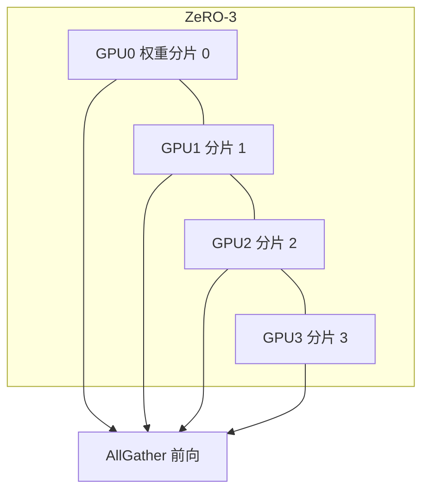

# DeepSpeed

> 从 Bit 到 AGI · 第十一章：工程化（Serving） · 训练与推理一体的 DeepSpeed

第十章你在单卡或多卡上微调过模型——DeepSpeed 是微软开源的**分布式训练与推理**工具箱，用 ZeRO 把 optimizer state 切到多卡，让 **70B 全参微调**从「不可能」变成「8×A100 可跑」。Serving 侧它提供 **DeepSpeed-MII** 和 **DeepSpeed-FastGen**，与 vLLM 同属推理引擎选项，擅长与 Hugging Face 训练栈无缝衔接。

## 直觉

训练大模型时，显存里不只有权重，还有**优化器状态**（Adam 要存 momentum 和 variance，约为 fp32 权重的 2×）和**梯度**。ZeRO 像**分仓库放货**：Stage 1 分 optimizer，Stage 2 再分梯度，Stage 3 连权重也分片——每张卡只保管自家那份，用时 AllGather 凑齐。



## 定义

**DeepSpeed** 核心能力：

| 模块 | 用途 |
| ---- | ---- |
| ZeRO-1/2/3 | 训练显存优化，Stage 3 可训 100B+ |
| DeepSpeed-MII | Model Implementations for Inference，低延迟 serving |
| DeepSpeed-FastGen | 基于 MII + Ragged batching 的高吞吐推理 |
| DeepSpeed-Inference | 注入式 kernel 融合（与 HF 模型集成） |

Serving 关注指标：**latency（MII）** vs **throughput（FastGen）**；训练关注 **max model size / samples per GPU**。

## 例子

**例 1：Llama-2-70B 全参 SFT，8×A100 80GB**

| 配置 | 可训 batch（seq=2048） | 峰值显存/卡 |
| ---- | ---------------------- | ----------- |
| DDP 无 ZeRO | OOM | > 80 GB |
| ZeRO-2 | 1 | ~72 GB |
| ZeRO-3 + offload | 4 | ~58 GB |

ZeRO-3 使 **70B bf16 训练**（权重 140 GB + optimizer）在 8 卡可行——这是 Megatron 之外最常见的微调路径。

**例 2：DeepSpeed-FastGen serving（Llama-3-8B，A100）**

| 指标 | vLLM | DeepSpeed-FastGen |
| ---- | ---- | ----------------- |
| 并发 64 tok/s | ~3 100 | ~2 900 |
| TTFT P50（512 in） | ~260 ms | ~290 ms |
| 与 HF 训练权重热加载 | 需转换 | **原生兼容** |

FastGen 吞吐略低于 vLLM 第一梯队，但**从训练 checkpoint 到 serving 路径最短**——适合研究型团队。

**例 3：MII 低延迟（单请求）**

```python
import torch
import deepspeed
from transformers import AutoModelForCausalLM, AutoTokenizer

model = AutoModelForCausalLM.from_pretrained(
    "meta-llama/Meta-Llama-3-8B-Instruct",
    dtype=torch.bfloat16,
)
model = deepspeed.init_inference(
    model,
    mp_size=1,
    dtype=torch.bfloat16,
    replace_with_kernel_inject=True,
)

tokenizer = AutoTokenizer.from_pretrained("meta-llama/Meta-Llama-3-8B-Instruct")
inputs = tokenizer("你好", return_tensors="pt").to("cuda")
outputs = model.generate(**inputs, max_new_tokens=64)
```

MII kernel inject 对 **单次小 batch** 延迟优化；批量高 QPS 选 FastGen 或 vLLM。

## 量化

**ZeRO 显存公式**（Stage 3，$N$ 卡，Adam，fp16 权重）：

$$
M_{\text{per GPU}} \approx \frac{2\Psi + 2\Psi + K\Psi}{N} = \frac{(4+K)\Psi}{N}
$$

$\Psi$ = 参数量（bytes），$K$ 为额外 buffer 常数（~1.2）。70B fp16：$\Psi \approx 140$ GB，$N=8$ → 每卡 **~88 GB** 理论值，实际 with activation checkpoint 可压到 **~55 GB**。

**FastGen 调度**：Ragged batching + blocked KV，复杂度与 vLLM continuous batching 同级 $O(\text{active})$。

**何时选 DeepSpeed serving**：

| 条件 | 建议 |
| ---- | ---- |
| 已用 DeepSpeed 训练，checkpoint 格式固定 | FastGen |
| 极致 QPS，社区生态 | vLLM |
| 超低单请求延迟 (< 50 ms TPOT) | MII + kernel inject |
| 100B+ 训练 | ZeRO-3 / 与 Megatron 混合 |

::: warning

DeepSpeed 配置 JSON（`ds_config.json`）项数百个，错误组合会导致 silent slowdown（如 unnecessary offload）。生产用 DeepSpeed 官方 `autotuning` 或固定经过压测的配置模板。

:::

## 常见误区

1. **「DeepSpeed 只是训练库」**——MII/FastGen 是正经 serving 方案，只是社区 mindshare 低于 vLLM。
2. **「ZeRO-3 一定比 LoRA 好」**——全参 70B 训 1 epoch 的算力成本可能是 LoRA 的 **50×**；Serving 章讨论的是「能训能推」，不是「应该全参」。
3. **「offload 到 NVMe 免费午餐」**——ZeRO-Infinite 可扩模型，但 step time 可能增加 **3～10×**。

## 训练到 Serving 的一体化路径

典型流水线：**DeepSpeed ZeRO-3 微调** → checkpoint 存 HF 格式 → **FastGen** 或导出 vLLM：

| 阶段 | 工具 | wall time（70B，8×A100） |
| ---- | ---- | ------------------------- |
| SFT 1 epoch | ZeRO-3 | ~36 h |
| 合并 checkpoint | `zero_to_fp32.py` | ~25 min |
| FastGen 上线 | `deepspeed-mii launch` | ~8 min |

对比「合并 → 转 GGUF → 另起 vLLM」路径，DeepSpeed 一体化可省 **~2 h 人工 + 一次格式风险**。

**ZeRO stage 选型表**：

| 模型 | 卡数 | 推荐 stage | 预期显存/卡 |
| ---- | ---- | ---------- | ----------- |
| 8B SFT | 1 | ZeRO-1 或不用 | ~22 GB |
| 8B 全参 | 1 | ZeRO-2 | ~28 GB |
| 70B SFT LoRA | 4 | ZeRO-2 + LoRA | ~38 GB |
| 70B 全参 | 8 | ZeRO-3 | ~55 GB |

## 动手试一试

```bash
# 安装
pip install deepspeed

# FastGen 启动（示例 CLI，版本随包变化）
deepspeed-mii launch \
  --model meta-llama/Meta-Llama-3-8B-Instruct \
  --deployment-name llama3-8b \
  --tensor-parallel 1 \
  --replica_num 1
```

用 `curl` 打 `/generate`，对比 `max_new_tokens=128` 下 P50/P99 延迟。若团队已有 DeepSpeed 训练集群，优先试 FastGen 再决定是否迁移 vLLM。

## 小结

DeepSpeed 的 **ZeRO** 让大模型训练/全参微调落在可负担的 GPU 数上；**MII / FastGen** 提供 serving 路径，FastGen 8B 约 **~2 900 tok/s**，略逊 vLLM 但训练栈一体。下一篇看 **Megatron-LM**——超大规模预训练的行业标准并行范式。

→ 下一篇：[Megatron](/manual/llm/bit-to-agi/11-engineering/megatron)
