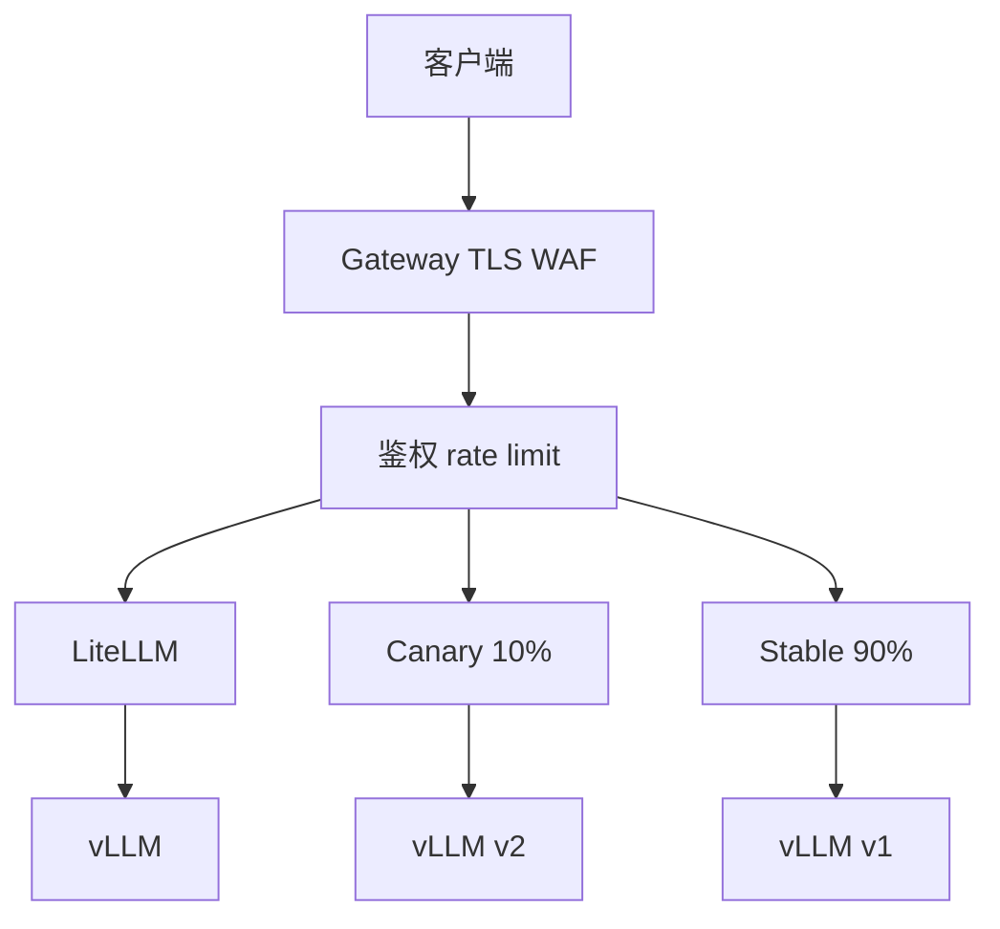

# Gateway

> 从 Bit 到 AGI · 第十一章：工程化（Serving） · LLM API 网关与流量治理

LiteLLM 管模型路由与计费；**API Gateway** 管「谁能调、调多快、调哪条链路」——TLS 终止、JWT/API Key 鉴权、全局限流、WAF、请求/响应改写。生产 LLM 栈常见分层：**Cloudflare / Kong / APISIX / Envoy / Nginx** 在最外（Nginx 网关与反向代理实战详见[《Nginx 完全手册》](https://daiw.org/manual/nginx)），LiteLLM 在内，vLLM 在最里。

## 直觉

Gateway 像**机场安检 + 空管**：先验票（鉴权），再限流（不能 1 秒 1 万人涌向 3 个登机口），最后分配跑道（路由到 canary 或 stable 集群）。没有它，一个泄露的 API key 可以在 10 分钟内烧掉 **\$50 000** 的旗舰模型额度。



## 定义

LLM Gateway 必备能力：

| 能力 | 典型实现 | 目标 |
| ---- | -------- | ---- |
| 鉴权 | API Key / OAuth2 / mTLS | 拒绝未授权 |
| 限流 | 令牌桶 / 滑动窗口 | 防滥用、保护 GPU |
| 路由 | 路径、Header、权重 | A/B、多区域 |
| 超时 | `read_timeout 120s` | 防 hung connection |
| 日志 | 请求 ID、token 数 | 审计与排障 |
| WAF | SQLi、超大 body | 防 prompt 注入辅助层 |

**指标**：Gateway 自身延迟 **低于 5 ms P99**（不含 LLM）；限流精度 **±1 req/s**。

## 例子

**例 1：Kong 限流 + 路由（ declarative 片段）**

```yaml
_format_version: "3.0"
services:
  - name: litellm
    url: http://litellm:4000
    routes:
      - name: chat
        paths: ["/v1/chat/completions"]
        plugins:
          - name: key-auth
          - name: rate-limiting
            config:
              minute: 60          # 每 key 60 req/min
              policy: local
          - name: request-size-limiting
            config:
              allowed_payload_size: 2   # MB，防超大 prompt
          - name: prometheus
```

**例 2：全局限流 vs GPU 容量**

集群 5 pod × 8B vLLM，舒适 **~200 QPS**（128/64）：

| 限流层级 | 阈值 | 作用 |
| -------- | ---- | ---- |
| Gateway 全站 | 180 QPS | 防过载，超返回 429 |
| 每 API Key | 30 req/min | 防单用户刷 |
| LiteLLM 每 team | 500 K tokens/day | 成本封顶 |

无 Gateway 限流时，突发 400 QPS → TTFT P99 **> 8 s**，等价 **软拒绝**。

**例 3：Canary 路由（Envoy/ Istio VirtualService）**

```yaml
http:
  - match:
      - headers:
          x-canary:
            exact: "true"
    route:
      - destination:
          host: vllm-v2
        weight: 100
  - route:
      - destination:
          host: vllm-v1
        weight: 90
      - destination:
          host: vllm-v2
        weight: 10
```

10% 流量走新权重 v2，对比 [可观测性](/manual/llm/bit-to-agi/11-engineering/observability) 指标再扩。

## 量化

**429 与重试风暴**：客户端默认重试 3 次时，有效 QPS 乘 **4**——Gateway 应返回 `Retry-After`，客户端 exponential backoff（初始 **1 s**，max **32 s**）。

**Payload 限制**：128 K token prompt ≈ **~512 KB～2 MB** JSON（视 Unicode）；限制 **2 MB** 可挡 99% 误用，RAG 长文档走 **分片 upload + object storage**。

**延迟预算**（端到端 500 ms P95 目标）：

| 层 | 预算 |
| -- | ---- |
| Gateway + TLS | 5 ms |
| LiteLLM | 3 ms |
| vLLM TTFT | 350 ms |
| 网络 | 20 ms |
| 余量 | 122 ms |

::: info

Cloudflare / EdgeOne 等边缘网络本身可充当第一层 edge gateway，配合源站 Docker 容器与 Nginx / Kong 做鉴权与细粒度限流（注意 **勿缓存 POST** `/v1/chat/completions`）。

:::

## 常见误区

1. **「LiteLLM 替代 Gateway」**——LiteLLM 有 key 管理，但 WAF、DDoS、geo block 仍靠专业 gateway/CDN。
2. **「限流设够大就行」**——LLM 贵在 **token 不是 request**；应限 **tokens/min** 而非仅 req/min。
3. **「streaming 不用改 gateway 超时」**——SSE 长连接需 **idle timeout ≥ 300 s**，否则流式中途断连。

## 实战案例：双 region 网关

某全球化产品：美西 **primary**（5×8B pod），新加坡 **secondary**（2 pod warm standby）。Primary waiting >40 持续 3 min → Cloudflare Load Balancer 切 **30%** 流量到 SG。

| 指标 | 仅 primary | 双 region |
| ---- | ---------- | --------- |
| 美西 TTFT P95 | 520 ms | 480 ms |
| 跨洋用户 TTFT | 1 850 ms | **920 ms** |
| 月 GPU 成本 | \$11 000 | \$14 200 |

亚太用户延迟 **-50%**，额外 **+\$3 200/月**——按亚太 ARPU 算 **2 个月回本**。

**注意**：POST `/v1/chat/completions` **不可 CDN 缓存**；Gateway 只做路由与鉴权，不做 response cache（除非显式 semantic cache 层）。

## Streaming 与 Gateway 配置

LLM 流式响应（SSE）对 Gateway 有特殊要求：

```yaml
plugins:
  - name: response-transformer
    config:
      add:
        headers:
          - "X-Accel-Buffering: no"   # 禁 Nginx 缓冲
  - name: proxy-settings
    config:
      connect_timeout: 5000
      read_timeout: 300000            # 5 min，长生成
      send_timeout: 300000
```

**Token 级限流**（Kong rate-limiting-advanced 或 Envoy local rate limit）：

| 维度 | 阈值 | 说明 |
| ---- | ---- | ---- |
| req/min/key | 60 | 防刷 |
| tokens/min/key | 100 K | 成本主控 |
| concurrent/key | 5 | 防单用户占满 decode slot |

**DDoS 与 LLM 特有攻击**：超大 prompt（**>1 MB JSON**）在 Gateway 层 reject；重复相同 prompt 的 cache poisoning 尝试用 **WAF + rate limit** 挡在 inference 外——一次 128 K prefill 可烧 **~2 s×GPU 全卡**。

## 动手试一试

```bash
# 本地 Kong（docker-compose）
curl -i -X POST http://localhost:8000/v1/chat/completions \
  -H "apikey: test-consumer-key" \
  -H "Content-Type: application/json" \
  -d '{"model":"llama3-8b","messages":[{"role":"user","content":"hi"}]}'

# 快速打 100 次，观察 429
for i in $(seq 1 100); do
  curl -s -o /dev/null -w "%{http_code}\n" ... &
done
```

验证 429 响应体含 `Retry-After` 且客户端 backoff 后成功率恢复。

## 小结

Gateway 提供 **鉴权、限流、路由、WAF**，自身 **低于 5 ms**；全站 **180 QPS** 限流可保护 **5×8B** 集群免于 TTFT 崩坏。与 LiteLLM、K8s 组成三层：**Gateway → Router → Inference**。

→ 下一篇：[可观测性](/manual/llm/bit-to-agi/11-engineering/observability)
