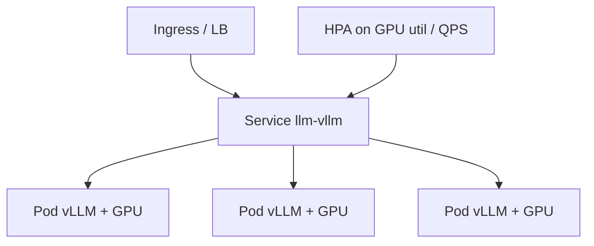

# Kubernetes

> 从 Bit 到 AGI · 第十一章：工程化（Serving） · LLM 服务的 Kubernetes 部署

Ray 解决了应用层编排；**Kubernetes（K8s）** 解决集群层——GPU 节点池、滚动发布、健康检查、Secret、Ingress。生产 LLM 服务几乎都在 K8s（或等价编排）上跑：每个 vLLM pod 申请 `nvidia.com/gpu: 1`，HPA 按自定义指标扩缩，**Pod Disruption Budget** 保证升级时不掉光容量。

## 直觉

K8s 像**数据中心操作系统**：你声明「我要 3 个跑 Llama-8B 的容器，每个要 1 张 A100、64 GB 内存」，Scheduler 找满足条件的 Node 并启动 Pod。节点挂了？Controller 自动在别处重建。要发新版权重？Rolling update 逐个替换，旧 pod  Drain 前仍接流量。



## 定义

LLM on K8s 关键对象：

| 资源 | LLM 场景用法 |
| ---- | ------------ |
| **Deployment** | 无状态 vLLM replica，`replicas: N` |
| **StatefulSet** | 多卡 TP 需固定 pod 身份、RDMA 拓扑时 |
| **Service** | ClusterIP 负载均衡到 pod |
| **Ingress / Gateway API** | TLS 终止、路径路由 |
| **HPA / KEDA** | 按 QPS、队列长度、GPU SM 利用率扩缩 |
| **Device Plugin** | `nvidia.com/gpu` 资源上报 |

**生产指标**：Pod 就绪时间（含模型 load）、**PDB** 允许最小可用副本、滚动更新 `maxUnavailable`。

## 例子

**例 1：vLLM Deployment（8B，单卡）**

```yaml
apiVersion: apps/v1
kind: Deployment
metadata:
  name: llama3-8b-vllm
spec:
  replicas: 3
  strategy:
    type: RollingUpdate
    rollingUpdate:
      maxSurge: 1
      maxUnavailable: 0          # 零停机
  template:
    spec:
      containers:
        - name: vllm
          image: vllm/vllm-openai:v0.8.5
          args:
            - --model=meta-llama/Meta-Llama-3-8B-Instruct
            - --max-model-len=8192
            - --gpu-memory-utilization=0.90
          resources:
            limits:
              nvidia.com/gpu: "1"
              memory: "64Gi"
            requests:
              nvidia.com/gpu: "1"
              memory: "48Gi"
          readinessProbe:
            httpGet:
              path: /health
              port: 8000
            initialDelaySeconds: 120   # 模型 load ~60-90s
            periodSeconds: 10
          livenessProbe:
            httpGet:
              path: /health
              port: 8000
            initialDelaySeconds: 180
            failureThreshold: 3
      nodeSelector:
        gpu-type: a100-80gb
```

**例 2：70B TP=4 StatefulSet**

| 项 | 配置 |
| -- | ---- |
| Pod 数 | 1（4 容器 sidecar 或 1 pod 4 GPU） |
| `nvidia.com/gpu` | 4 |
| 节点 | 单节点 4×A100 + NVLink 全互联 |
| 就绪时间 | **~8～12 min**（权重 140 GB 拉取 + load） |
| 滚动更新 | 需 **second cluster** 蓝绿；单 pod TP 无法 rolling |

**例 3：容量与 SLO**

集群 12×A100，每 pod 1 GPU 跑 8B，3 replica 占 3 GPU：

| 负载 | QPS | 所需 pod | GPU |
| ---- | --- | -------- | --- |
| 低峰 | 30 | 2 | 2 |
| 高峰 | 120 | 5 | 5 |
| 冗余 + 升级 | +1 PDB | 6 | 6 |

剩余 6 GPU 可跑其他模型或 batch job。

## 量化

**Pod 启动预算**：

$$
T_{\text{ready}} = T_{\text{pull image}} + T_{\text{load weights}} + T_{\text{warmup}}
$$

8B 从 ACR/ECR：pull **~2 min**（镜像 8 GB + 权重 16 GB 若 baked in）+ load **~45 s** → readinessProbe `initialDelaySeconds` 设 **≥ 120**。

**网络**：同 AZ Pod 间 **~0.3 ms RTT**；跨 AZ **~2 ms**。TP 多 pod 跨 AZ 灾难性（AllReduce 延迟 ×100）——**TP pod 必须同节点 / 同 NVLink domain**。

**成本**：K8s 本身不省钱；价值在 **利用率**——混部离线推理与在线，node pool 自动缩容非高峰 GPU VM。

::: info

国内站若用腾讯云 + EdgeOne，回源到 K8s Ingress 的 HTTP 路径与第十一章 [Gateway](/manual/llm/bit-to-agi/11-engineering/gateway) 层配合做限流与鉴权。

:::

## 常见误区

1. **「HPA 默认 CPU 指标够用」**——LLM pod CPU 常 < 10%（GPU bound）；用 **KEDA + Prometheus**（vLLM `avg_generation_tokens_per_s`）或 **DCGM GPU 利用率**。
2. **「readiness=进程起来」**——必须等 `/health` 返回 200 且能完成一次 dummy inference，否则流量打到 half-loaded 模型。
3. **「70B 像 8B 一样 rolling update」**——TP 多卡单 pod 更新=全中断；用 **双池蓝绿** 或 **新 Deployment 并行** 再切流量。

## GPU 节点池与拓扑

生产集群按 **GPU 型号 + 互联** 分 node pool：

| Node Pool | 用途 | 标签 |
| --------- | ---- | ---- |
| a100-80gb-nvlink-4 | 70B TP=4 | `gpu-type=a100-tp4` |
| a100-80gb-single | 8B 单卡 | `gpu-type=a100-1` |
| l40s-single | 小模型 / embedding | `gpu-type=l40s` |

**Topology Manager**（K8s 1.33+ / GPU Operator）：TP pod 申请 `resources.limits["nvidia.com/gpu"]` 时声明 **preferred topology**——4 GPU 必须同一 PCIe switch 下，否则 NCCL AllReduce 带宽从 **600 GB/s** 跌到 **64 GB/s**。

**Disruption 预算**：

```yaml
apiVersion: policy/v1
kind: PodDisruptionBudget
metadata:
  name: llama3-8b-pdb
spec:
  minAvailable: 2
  selector:
    matchLabels:
      app: llama3-8b-vllm
```

集群升级时至少 **2 pod** 存活，保证 **~70 QPS** 底线。

## 动手试一试

```bash
# minikube / kind 无 GPU 时可 dry-run
kubectl apply --dry-run=client -f llama3-8b-vllm.yaml

# 有 GPU 集群
kubectl apply -f llama3-8b-vllm.yaml
kubectl rollout status deployment/llama3-8b-vllm
kubectl top pods -l app=llama3-8b-vllm
```

记录从 `apply` 到 `READY 3/3` 的 wall time。若 >180 s，检查镜像是否 baked 权重（省 pull）或改用节点本地 cache。

## 小结

K8s 为 LLM 提供 **GPU 调度、零停机发布、HPA 基础**；8B vLLM Deployment 需 **~120 s readiness**，70B TP=4 宜 **StatefulSet + 蓝绿**。下一篇 **LiteLLM** 在 K8s 之上统一多模型、多厂商 API。

→ 下一篇：[LiteLLM](/manual/llm/bit-to-agi/11-engineering/litellm)
