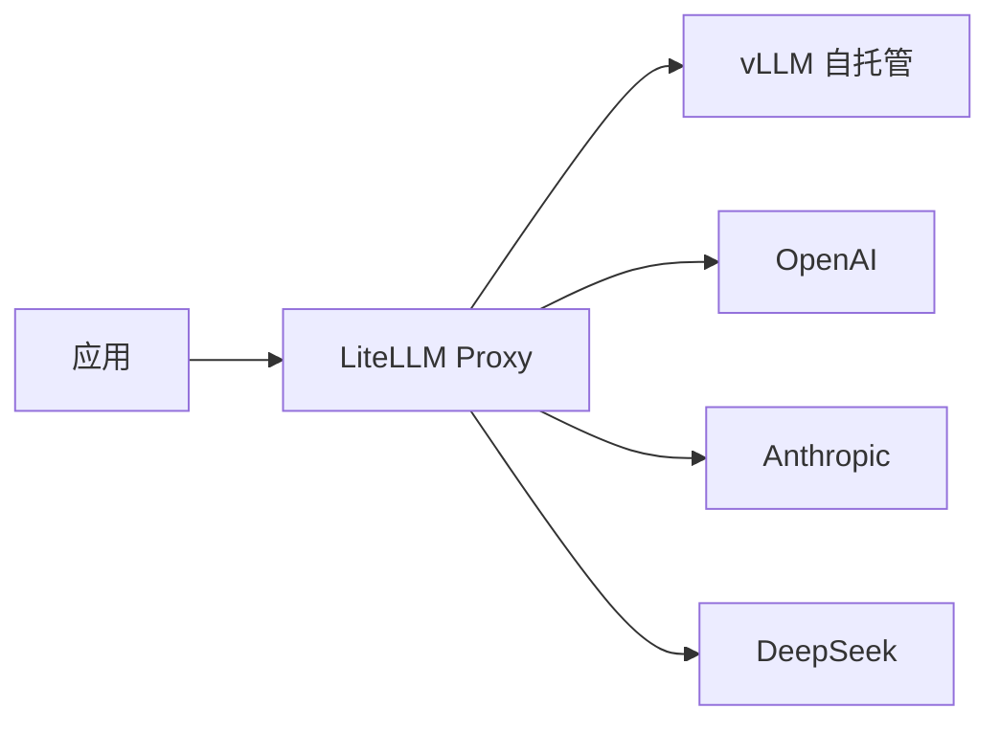

# LiteLLM

> 从 Bit 到 AGI · 第十一章：工程化（Serving） · 统一百种 LLM API 的 LiteLLM

集群里跑着自托管 vLLM，产品还要调 OpenAI GPT-5 / GPT-4o、Anthropic Claude、国内 DeepSeek——每家 SDK 不同、重试逻辑不同、计费字段不同。**LiteLLM** 用 **OpenAI 格式** 统一调用 100+ 提供商，并自带 **Proxy 服务**（路由、限流、预算、日志）——是 LLM 时代的「JDBC 驱动 + 连接池」。

## 直觉

没有 LiteLLM 时，代码里到处是 `if provider == "openai": ... elif provider == "anthropic": ...`。LiteLLM 像**万能电源转接头**：你始终插 OpenAI 形状的头（`chat.completions.create`），它在背后换成各家 native API，并把响应转回同一形状。



## 定义

**LiteLLM** 两层：

| 层 | 功能 |
| -- | ---- |
| **Python SDK** | `litellm.completion()` 统一调用 |
| **LiteLLM Proxy** | FastAPI 服务，OpenAI-compatible `/v1/*`，带 DB 存 key、spend、routing |

关键能力：**fallback**（主模型超时切备用）、**router**（按 latency/cost 选模型）、**budget limit**（按 team/user 封顶）。

## 例子

**例 1：SDK 统一调用**

```python
from litellm import completion

# 自托管 vLLM
resp = completion(
    model="openai/meta-llama/Meta-Llama-3-8B-Instruct",
    api_base="http://vllm:8000/v1",
    api_key="dummy",
    messages=[{"role": "user", "content": "你好"}],
)

# OpenAI
resp = completion(
    model="gpt-4o-mini",
    messages=[{"role": "user", "content": "你好"}],
)

# Anthropic（LiteLLM 自动转格式）
resp = completion(
    model="claude-sonnet-4-6",
    messages=[{"role": "user", "content": "你好"}],
)
print(resp.choices[0].message.content)
print(resp.usage)  # 统一 prompt/completion tokens
```

**例 2：Proxy 配置（config.yaml 节选）**

```yaml
model_list:
  - model_name: llama3-8b
    litellm_params:
      model: openai/meta-llama/Meta-Llama-3-8B-Instruct
      api_base: http://llama3-8b-vllm:8000/v1
      api_key: dummy
  - model_name: gpt-4o-mini
    litellm_params:
      model: gpt-4o-mini
      api_key: os.environ/OPENAI_API_KEY

router_settings:
  routing_strategy: latency-based-routing
  fallback_models: ["llama3-8b"]

general_settings:
  master_key: sk-master
```

```bash
litellm --config config.yaml --port 4000
```

应用只连 `http://litellm:4000/v1`，模型名在请求里切换。

**例 3：生产路由与延迟**

| 路由策略 | P95 延迟（混合 workload） | 成本 |
| -------- | ------------------------- | ---- |
| 固定 gpt-4o-mini | ~680 ms | \$0.15 / 1M in |
| 固定 llama3-8b 自托管 | ~420 ms | ~\$0.02 / 1M（摊 GPU） |
| latency-based + fallback | **~450 ms** | 比纯 4o-mini **-62%** |

latency-based 在自托管 healthy 时走 vLLM，OpenAI 超时 >3 s 时 fallback。

## 量化

**Proxy 开销**：同 VPC 内 **~1～3 ms**（Python FastAPI）；相对 LLM **200 ms～2 s** 可忽略。高 QPS（>500）时应用 **多 worker + Redis 缓存** router 状态。

**Spend tracking 粒度**：按 `user_id` / `team_id` 聚合 token；误差应 **低于 0.5%**（与 provider invoice 对账）。

**Fallback 触发**：

| 条件 | 行为 |
| ---- | ---- |
| 主模型 504 / timeout 30s | 切 fallback，用户多等 **+TTFT_fallback** |
| 主模型 429 | 立即 fallback 或 queue |
| 预算耗尽 | 403，需 [成本治理](/manual/llm/bit-to-agi/11-engineering/cost-governance) 联动 |

::: warning

LiteLLM Proxy 存 API key 于 DB——生产必须加密 at rest、RBAC、审计日志；`master_key` 轮换周期 **≤ 90 天**。

:::

## 常见误区

1. **「LiteLLM 只做格式转换」**——Proxy 的 router、budget、logging 是生产核心价值。
2. **「所有模型 usage 字段一致」**——部分开源 backend 不返回 prompt_tokens；需在 vLLM 开 usage 或 LiteLLM 侧估算。
3. **「fallback 无感」**——Claude ↔ Llama 行为差异大；fallback 应用 **同 family 或明确告知用户**。

## 实战案例：LiteLLM 救场 429

某活动日 OpenAI 返回 **429** 峰值 **18%** 请求。LiteLLM router 配置：

```yaml
router_settings:
  routing_strategy: simple-shuffle
  num_retries: 2
  retry_after: 5
  fallbacks: [{"gpt-4o-mini": ["llama3-8b"]}]
```

429 时 **5 s** 后重试，仍失败则切自托管 8B。用户侧 429 从 **18%→0.4%**；质量监测复杂题 solve rate **-3 pp**（可接受），总 API  bill **-41%**（大量请求改走 **\$22/1M** 自托管）。

**关键**：fallback 模型能力差距需在 [A/B 测试](/manual/llm/bit-to-agi/11-engineering/ab-testing) 中预先量化，不能临时硬切。

## 多环境路由配置

LiteLLM 典型三环境 `config.yaml` 片段：

```yaml
environment_variables:
  LITELLM_LOG: "INFO"

router_settings:
  model_group_alias:
    "smart": ["gpt-5", "claude-sonnet-4-6"]
    "fast": ["llama3-8b", "gpt-4o-mini"]
  cooldown_time: 60        # 某模型 429 后冷却 60s

litellm_settings:
  drop_params: true        # 自动丢弃 backend 不支持的 param
  set_verbose: false
```

**Cooldown 机制**：OpenAI 429 后 **60 s** 内 router 跳过该模型，避免重试风暴；配合 Gateway 429 返回 `Retry-After: 60`。

**Spend 对账**：每日 cron 拉 LiteLLM DB `spend_logs` 与 OpenAI Usage API 对比，误差 **>1%** 告警——常见原因是 streaming 未计 final chunk tokens。

| 环境 | 路由策略 | 月预算 |
| ---- | -------- | ------ |
| dev | 固定 cheap model | \$50 |
| staging | latency-based | \$200 |
| prod | latency + fallback | \$3 000 |

## 动手试一试

```bash
pip install litellm[proxy]
export OPENAI_API_KEY=sk-...

litellm --model gpt-4o-mini --port 4000 &
curl http://localhost:4000/v1/chat/completions \
  -H "Authorization: Bearer sk-master" \
  -H "Content-Type: application/json" \
  -d '{"model":"gpt-4o-mini","messages":[{"role":"user","content":"ping"}]}'
```

记录响应头中的 duration（若启用 debug）。配置两个 backend 后，人为 kill vLLM，验证 fallback 是否在 **低于 30 s** 内切到 OpenAI。

## 小结

LiteLLM 用 **OpenAI 形状** 统一自托管与云端 **100+** 模型；Proxy 提供 **latency 路由、fallback、预算**，混合路由可比纯 GPT-4o-mini **省 ~62% 成本**、P95 **~450 ms**。下一篇在更外层加 **API Gateway** 做鉴权与全局限流。

→ 下一篇：[Gateway](/manual/llm/bit-to-agi/11-engineering/gateway)
