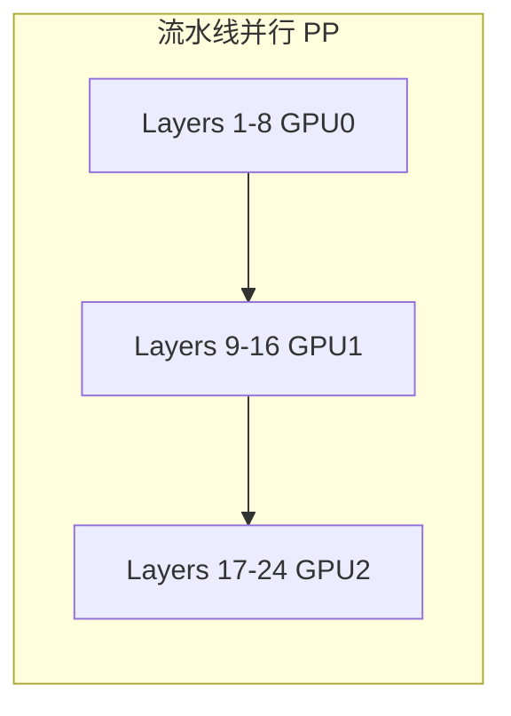

# Megatron

> 从 Bit 到 AGI · 第十一章：工程化（Serving） · 超大规模并行的 Megatron-LM

DeepSpeed 的 ZeRO 适合「在几十张 GPU 上微调 70B」。当你要**从零预训练 100B～500B+**，算力预算按 **千卡** 计，业界默认栈是 **Megatron-LM**（NVIDIA）——张量并行（TP）、流水线并行（PP）、序列并行（SP）、专家并行（EP）的组合拳，把 GPT-3 规模训练变成可编程问题。

## 直觉

单卡放不下整个模型，就像一本字典太厚——**TP** 把每一页横着撕开，每人拿几列字（Attention head / FFN 列切分）；**PP** 把字典按章节分人，第 1 人算第 1～8 层，算完传给第 2 人算 9～16 层（流水线）；**EP** 在 MoE 模型里把不同专家分到不同卡——来客路由到对应「专科医生」GPU。



## 定义

**Megatron-LM / Megatron-Core** 提供：

| 并行维度 | 切什么 | 典型规模 |
| -------- | ------ | -------- |
| **TP**（Tensor Parallel） | Attention / MLP 矩阵按列或行切 | 2～8 卡一组 |
| **PP**（Pipeline Parallel） | 层间切分 | 4～16 stage |
| **DP**（Data Parallel） | 数据 batch 复制 | 与 TP/PP 正交 |
| **SP**（Sequence Parallel） | LayerNorm / Dropout 沿 seq 切 | 减 activation |
| **EP**（Expert Parallel） | MoE 专家分卡 | Mixtral、DeepSeek-V2/V3/V4、Kimi K3、Qwen3-MoE |

总 GPU 数：$N = \text{TP} \times \text{PP} \times \text{DP}$（EP 另计）。

## 例子

**例 1：GPT-3 175B 级预训练（公开 recipe 量级）**

| 配置 | 数值 |
| ---- | ---- |
| GPU | 992×A100 80GB |
| TP × PP × DP | 8 × 16 × 8 |
| 全局 batch | ~1 536 sequences |
| 吞吐 | ~380 TFLOPS/GPU（~45% MFU） |
| 训练 300B tokens | ~34 天 |

**MFU**（Model FLOPs Utilization）= 实际 FLOPS / 峰值 FLOPS，生产目标 **40%～55%** 即优秀。

**例 2：Llama-3-70B 预训练规模估算（1024×H100）**

| 项 | 值 |
| -- | -- |
| 参数量 | 70B |
| 训练 tokens | 15T |
| 总 FLOPs ≈ $6ND$ | $6 \times 70 \times 10^9 \times 15 \times 10^{12} \approx 6.3 \times 10^{24}$ |
| H100 fp16 峰值/卡 | 989 TFLOPS |
| 1024 卡理论峰值 | ~1.01 EFLOPS/s |
| @ MFU 50%， wall time | **~14 天**（不含 checkpoint / 故障） |

**例 3：Megatron 推理导出 → TensorRT-LLM**

训练 checkpoint（Megatron 分片格式）→ 合并 → `convert_checkpoint.py` → TRT engine。Serving 不直接跑 Megatron 训练代码，但 **并行切分策略**（TP=4）常延续到推理集群。

```bash
# 训练侧（示意，需 megatron-lm 仓库）
torchrun --nproc_per_node=8 pretrain_gpt.py \
  --tensor-model-parallel-size 4 \
  --pipeline-model-parallel-size 2 \
  --num-layers 80 \
  --hidden-size 8192 \
  --num-attention-heads 64 \
  --micro-batch-size 1 \
  --global-batch-size 1024 \
  --seq-length 4096
```

## 量化

**通信开销**：TP 每层 2 次 AllReduce，消息量 $\propto batch \times seq \times hidden$。PP 有 **bubble**（流水线空泡），理想加速比：

$$
S_{\text{PP}} \approx \frac{p}{1 + (p-1)/m}
\qquad\text{等价地}\qquad
\text{bubble 占比} = \frac{p-1}{m + p - 1}
$$

$m$ = micro-batch 数，$p$ = pipeline stage 数。$m=8, p=16$ 时 bubble 占掉 $15/23 = $ **65%**，$S \approx$ **5.6**（而非理想的 16）——**十六张卡只跑出五张半的效果**。

$m$ 是核心解药：同样 $p=16$，把 $m$ 从 8 提到 32 → bubble 降到 32%，$S$ 升到 **10.9**。这就是为什么 PP 的 micro-batch 数通常要开到 stage 数的 **4 倍以上**（关于 MoE 专家并行与现代旗舰架构的工程权衡，另见[《DeepSeek V4.1 Flash 深度解析》](https://daiw.org/manual/deepseek-v4-flash)、[《Kimi K3 深度解析》](https://daiw.org/manual/kimi-k3)与[《Qwen3.8-Max 深度解析》](https://daiw.org/manual/qwen3-8-max)）。

**与 DeepSpeed 关系**：Megatron 管**模型并行**，DeepSpeed ZeRO 管**数据并行 + 显存**；大训练常 **Megatron-Core + DeepSpeed** 混用（3D 并行）。

**Serving 衔接**：

| 训练产出 | Serving 路径 |
| -------- | ------------ |
| Megatron TP=4 checkpoint | 合并 HF → vLLM `--tensor-parallel-size 4` |
| 同 | 合并 → TensorRT-LLM build TP=4 |
| MoE EP=8 | 专用 EP runtime（SGLang / TRT-LLM MoE 插件） |

::: info

第七章 [梯度累积](/manual/llm/bit-to-agi/07-training/gradient-accumulation) 与 Megatron 的 micro-batch 是同一思想在不同并行维度上的体现。

:::

## 常见误区

1. **「Megatron 用于线上 serving」**——训练框架；线上用 vLLM/TRT-LLM，但 **TP 度数**应一致以减少 weight 转换错误。
2. **「TP 越大越好」**——TP>8 时 AllReduce 成为瓶颈；70B 常见 **TP=4 或 8**，再大用 PP。
3. **「千卡 MFU 60% 很容易」**——数据加载、checkpoint、straggler 会让 MFU 掉到 30%；需要 **NVIDIA NCCL 调优 + 共置存储**。

## 动手试一试

无法千卡实验时，用 **Megatron-LM 小模型模拟**（125M，4 卡 TP=2 PP=2）：

```bash
git clone https://github.com/NVIDIA/Megatron-LM.git
# 按官方 README 跑 GPT-124M 预训练 100 iter
# 记录 iteration time、throughput (tokens/sec/GPU)
```

观察 PP bubble：micro-batch 从 1 增到 8，iteration time 如何下降。记录 MFU 是否随 micro-batch 线性提升——若 plateau 在 **~45%**，瓶颈可能在数据加载而非算力。

## Checkpoint 到 Serving 转换

Megatron 训练产出与线上格式不同，标准转换链：

```bash
# 1. Megatron → HF（NVIDIA 脚本）
python tools/checkpoint/convert.py \
  --model-type GPT \
  --loader megatron \
  --saver huggingface \
  --load-dir ./checkpoints/iter_0001000 \
  --save-dir ./hf-llama70b \
  --target-tensor-parallel-size 1

# 2. HF → vLLM（TP 与训练一致时最稳）
python -m vllm.entrypoints.openai.api_server \
  --model ./hf-llama70b \
  --tensor-parallel-size 4
```

**常见转换坑**：TP 合并时 head 数对不齐 → 输出乱码；合并后务必跑 **10 条 golden prompt** 对比 logprob，差异应 **低于 0.01**。

**Serving 并行度决策**：训练 TP=8、推理 NVLink 仅 4 卡互联时，推理宜 **TP=4 + 2 replica** 而非强行 TP=8——AllReduce 跨 NUMA 延迟可能增加 **+15 ms/层**。

## 小结

Megatron 定义了 **TP × PP × DP** 的大规模训练语言；175B 级需 **数百～上千 GPU**、MFU **~45%**。Serving 侧继承其 TP 切分，checkpoint 合并后交 vLLM / TensorRT-LLM。下一篇 **Ray** 把这些模型包成可扩缩的分布式服务。

→ 下一篇：[Ray](/manual/llm/bit-to-agi/11-engineering/ray)
