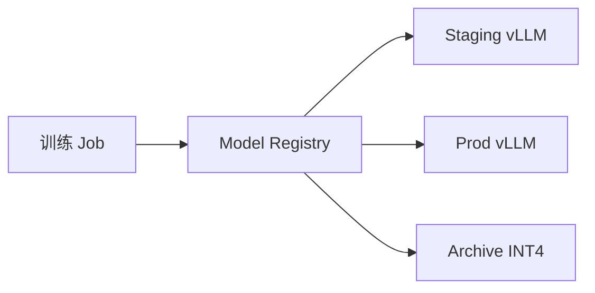
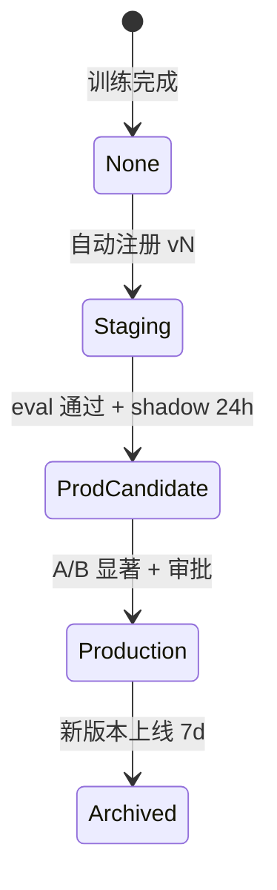

# 模型注册表

> 从 Bit 到 AGI · 第十一章：工程化（Serving） · 模型版本、权重与元数据管理

Autoscaling 扩的是 **同一个** Llama-3-8B v2.3 权重；当你同时维护 **基座、SFT、DPO、量化 INT4** 四个版本，还要回答「线上跑的是哪次 commit 训出来的？」——需要 **模型注册表（Model Registry）**。它是 LLM 的 **Git + Docker Hub**：存 artifact、打 tag、追踪 lineage、控制 promotion（staging → prod）。

## 直觉

没有注册表时，权重散落在 S3 `s3://bucket/model_final_v3_real_final/` 和某工程师硬盘。注册表像**图书馆编目系统**：每本书（模型）有 ISBN（version ID）、作者（训练 run）、书架位置（S3 URI）、借阅状态（staging/prod/archived）。



## 定义

注册表核心实体：

| 实体 | 字段示例 |
| ---- | -------- |
| **Model** | name: `llama3-8b-customer-bot` |
| **Version** | `v20250709-dpo-r2`, artifact_uri, sha256 |
| **Stage** | `None` → `Staging` → `Production` → `Archived` |
| **Metadata** | base_model, dataset_hash, eval MMLU, quant type |
| **Lineage** | parent_version, training_job_id |

常见实现：**MLflow Model Registry**、**Hugging Face Hub（private）**、**AWS SageMaker MR**、自建（PostgreSQL + S3）。

## 例子

**例 1：MLflow 注册与 promotion**

```python
import mlflow

mlflow.set_tracking_uri("https://mlflow.internal")
mlflow.set_experiment("llama3-8b-sft")

with mlflow.start_run(run_id="abc123") as run:
    mlflow.log_params({"lr": 2e-5, "epochs": 3, "dataset": "v4"})
    mlflow.log_metrics({"mmlu": 62.4, "humaneval": 41.0})
    mlflow.transformers.log_model(
        transformers_model={"model": model, "tokenizer": tokenizer},
        artifact_path="model",
        registered_model_name="llama3-8b-customer-bot",
    )

client = mlflow.tracking.MlflowClient()
client.transition_model_version_stage(
    name="llama3-8b-customer-bot",
    version=7,
    stage="Staging",
)
```

K8s init container 从 `models:/llama3-8b-customer-bot/Staging` 拉权重 mount 到 vLLM。

**例 2：版本对比（生产决策）**

| Version | Stage | MMLU | TTFT P50 (vLLM) | 大小 | 备注 |
| ------- | ----- | ---- | --------------- | ---- | ---- |
| v6 | Production | 61.8 | 280 ms | 16 GB bf16 | 当前 |
| v7 | Staging | 62.4 | 275 ms | 16 GB bf16 | +DPO |
| v7-int4 | Staging | 61.9 | 260 ms | 5 GB | AWQ |

v7 MMLU **+0.6**，延迟持平 → 可进 [A/B 测试](/manual/llm/bit-to-agi/11-engineering/ab-testing)。

**例 3：存储与拉取时间**

|  artifact | 大小 | 同 AZ 拉取 | 跨 region |
| --------- | ---- | ---------- | --------- |
| 8B bf16 | 16 GB | ~45 s | ~8 min |
| 70B bf16 | 140 GB | ~6 min | ~45 min |
| 8B INT4 | 5 GB | ~18 s | ~3 min |

Pod `initContainer` 超时设 **≥ 2× 拉取时间**；大模型用 **节点本地 NVMe cache** 或 **预烘焙 AMI**。

## 量化

**Registry API 延迟**：元数据查询 **低于 50 ms**；权重下载不占 API——走 S3/OSS 并行 **multipart**。

**保留策略**：

$$
N_{\text{versions}} \times S_{\text{model}} \times R_{\text{replica}}
$$

10 版本 × 16 GB × 3 环境 = **480 GB**；Archived 转 Glacier，Production 只保留 **当前 + 上一 rollback**。

**完整性**：每个 version 存 `sha256`；vLLM load 前校验，防 **partial upload** 导致 silent 乱码输出。

::: warning

**勿把 API key 写进 model metadata**——registry 权限常宽于 production secret；用 `training_job_id` 链接 Vault。

:::

## 常见误区

1. **「HF Hub 就是 registry」**——Hub 擅长公开分享；企业需 **stage、ACL、audit、lineage**，MLflow/SageMaker 更完整。
2. **「version 号用日期就够」**——还要链 **dataset hash + config yaml**；否则无法复现 v7。
3. **「Staging 权重可直接覆盖 Production URI」**——应用 **immutable version**；prod 永远 pin `version=6` 直到显式 promotion。

## 实战案例：一次错误的 Production 覆盖

某团队将 Production URI 直接指向 `s3://models/latest/`（可变路径）。一次误上传 **未合并的 TP shard** 导致线上输出乱码 **47 min**，影响 **~12 K sessions**。

事后改进：

1. Registry **immutable version**：Production 只 pin `version=12`，init container 拉 `models:/bot/12`
2. Promotion 需 **两人审批** + 自动 golden prompt 回归
3. 保留 **version=11** artifact 30 天，`kubectl rollout undo` 写进 runbook

**量化损失**：47 min × **~4 QPS** × 平均 **\$0.004/会话** ≈ **\$47** 直接成本 + 品牌 trust 不可计——registry  discipline 是便宜保险。

## Promotion 工作流

标准 **Staging → Production** 流程（需人工 + 自动化 gate）：



| Gate | 条件 | 自动/人工 |
| ---- | ---- | --------- |
| → Staging | MMLU 不低于 v(N-1) −0.5 | 自动 |
| → ProdCandidate | shadow OOM=0、TTFT ±10% | 自动 |
| → Production | 解决率 +≥2 pp、$p < 0.05$ | 人工 |

**Rollback**：Production 保留 **v(N-1) artifact 30 天**；K8s Deployment 维护 `canary` 与 `stable` 两套 manifest，回滚 `kubectl rollout undo` **低于 3 min**。

**合规**：metadata 存 `dataset_version`、`license`、`PII_scan_passed`——金融/医疗客户审计常查此三项。

## 动手试一试

```bash
pip install mlflow
mlflow server --host 0.0.0.0 --port 5000 &
# 注册一个小模型（distilgpt2）走通 flow
python scripts/register_dummy_model.py
mlflow models list
```

走通 None → Staging → Production 三次 `transition_model_version_stage`，记录每步 API 延迟与 artifact 下载耗时。

## 小结

模型注册表管理 **版本、stage、lineage、eval 指标**；8B 权重 **16 GB**、同 AZ 拉取 **~45 s**。Promotion Staging → Prod 前接 **A/B** 与回滚预案。

→ 下一篇：[A/B 测试](/manual/llm/bit-to-agi/11-engineering/ab-testing)
