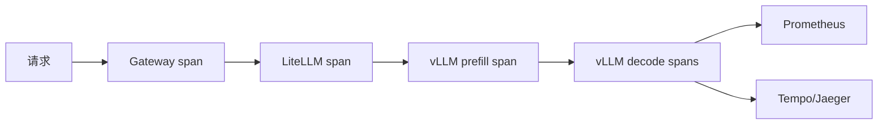

# 可观测性

> 从 Bit 到 AGI · 第十一章：工程化（Serving） · LLM 服务的指标、追踪与日志

Gateway 限住流量后，你怎么知道 vLLM 是 **GPU 满了** 还是 **网络抖了**？LLM 可观测性不能只看 CPU/内存——必须盯 **TTFT、TPOT、tokens/s、KV cache 使用率、队列深度**，并把 **trace_id** 从 Gateway 贯穿到 GPU kernel 外的最后一层 Python。

## 直觉

传统 Web 服务看「200 率 + 100 ms」就够。LLM 一次请求可能 **流式 60 s**、消耗 **8 000 tokens**——中间任何一步（prefill 慢、decode 抖动、排队 200 人）用户感受完全不同。可观测性像**飞行黑匣子**：Metrics 看趋势，Logs 查个案，Traces 看全链路哪段耗了 1.8 s。



## 定义

LLM Serving **黄金信号**（Google SRE 改编）：

| 信号 | LLM 指标 | 告警阈值示例 |
| ---- | -------- | ------------ |
| 延迟 | TTFT P95、TPOT P95、E2E | TTFT P95 > 2 s |
| 流量 | QPS、tokens/s（in/out） | — |
| 错误 | 5xx、timeout、OOM | 5xx > 0.5% |
| 饱和度 | GPU SM%、KV pool%、队列长度 | KV > 85% |

**三大支柱**：Metrics（Prometheus + Grafana）、Logs（Loki/ELK）、Traces（OpenTelemetry → Jaeger/Tempo）。关于 Prometheus、Grafana 与 OpenTelemetry 的完整生产落地体系，另见[《可观测性工程》](https://daiw.org/manual/observability)专栏。

## 例子

**例 1：vLLM 暴露的 Prometheus 指标**

```yaml
# 关键 metric 名称（vLLM 0.6+）
vllm:time_to_first_token_seconds_sum
vllm:time_to_first_token_seconds_count
vllm:time_per_output_token_seconds_sum
vllm:num_requests_running
vllm:num_requests_waiting
vllm:gpu_cache_usage_perc
vllm:avg_generation_throughput_toks_per_s
```

Grafana 面板：

| 面板 | PromQL 思路 | 正常范围 |
| ---- | ----------- | -------- |
| TTFT P95 | histogram_quantile(0.95, ...) | < 800 ms |
| 排队 | num_requests_waiting | < 20 |
| KV 使用 | gpu_cache_usage_perc | 60%～85% |
| 吞吐 | rate(generation_tokens_total[1m]) | ~3000/GPU |

**例 2：OpenTelemetry 追踪（LiteLLM 开启）**

```yaml
# litellm config
litellm_settings:
  success_callback: ["otel"]
  open_telemetry_config:
    exporter: otlp_http
    endpoint: http://otel-collector:4318/v1/traces
```

单次请求 trace 片段：

| Span | 耗时 |
| ---- | ---- |
| gateway.auth | 2 ms |
| litellm.router | 4 ms |
| vllm.prefill | 280 ms |
| vllm.decode (128 tok) | 1 540 ms |
| **total** | **1 826 ms** |

一眼看出 decode 占 **84%**——优化方向是 TPOT 或投机解码，不是 Gateway。

**例 3：事故排查时间线**

某晚 22:00 TTFT P95 从 400 ms → 3.2 s：

| 时间 | 观测 | 根因 |
| ---- | ---- | ---- |
| 22:00 | `num_requests_waiting` ↑ 180 | Marketing 推送 |
| 22:05 | GPU SM 99%，KV 92% | 饱和 |
| 22:10 | HPA 未扩容 | 指标绑错 CPU |
| 22:25 | 手动 +3 pod | 恢复 |

MTTR **25 min**；若有正确 HPA + 告警，可压到 **低于 8 min**。

## 量化

**采样率**：Trace 100% 在 QPS > 200 时存储爆炸；生产 **10% 随机 + 100% 慢请求（>3 s）+ 100% 5xx**。

**日志体积**：流式响应若 log 全量 output，**1 条 ~2 KB × 100 QPS = 17 GB/天**；只 log hash + token count + 前 100 字符。

**SLO 与错误预算**（30 天）：

$$
\text{Error Budget} = 1 - \text{SLO}
$$

SLO：TTFT P95 < 1 s 占 **99%** → 预算 **7.2 h/月** 超标时间。

**成本**：Prometheus + Grafana 自建 **~\$200/月**（VM）；Datadog LLM Observability **~\$0.01/1K spans**——10 M spans/月 **~\$100**。

::: warning

**勿在 log/trace 存完整 prompt**——PII 与 prompt 注入 payload 进 SIEM 是合规雷区；存 `prompt_token_count` + salted hash。

:::

## 常见误区

1. **「GPU 利用率 100% = 健康」**——可能是 **bad batching** 或 **过长 seq** 导致高 util 但低 tok/s。
2. **「只看 E2E 延迟」**——E2E 含客户端网络；服务端优化看 **vLLM span 内 TTFT/TPOT**。
3. **「告警越多越好」**——LLM 延迟天然长尾；P99 抖动应 **5 min 窗口 + 同比**，避免半夜 paging。

## SLO Dashboard 模板

Grafana 生产面板最小集（按 variant / model 分）：

| Row | 面板 | 告警 |
| --- | ---- | ---- |
| 用户体验 | TTFT P50/P95/P99 | P95 > 1 s 5 min |
| 用户体验 | TPOT P95 | > 50 ms 5 min |
| 容量 | num_requests_waiting | > 30 2 min |
| 容量 | gpu_cache_usage_perc | > 90% 3 min |
| 质量 | 5xx rate | > 0.5% 1 min |
| 成本 | tokens/s in vs out | out/in > 3 异常 |

**On-call runbook 片段**：waiting ↑ + KV ↑ + tok/s ↓ → **饱和**，扩 replica；waiting ↑ + KV 低 + 5xx → **模型/OOM**，查 pod restart；TTFT ↑ + waiting 低 → **prefill 变长**，查 prompt 分布漂移。

**Synthetic probe**：每 **60 s** 发固定 prompt（`"ping"`，max_tokens=1），独立告警 TTFT **>2 s**——比等用户投诉早 **~5 min** 发现退化。

## 动手试一试

```bash
# vLLM 开 metrics
python -m vllm.entrypoints.openai.api_server \
  --model meta-llama/Meta-Llama-3-8B-Instruct \
  --port 8000 &
curl -s localhost:8000/metrics | grep vllm:

# 压测后看 waiting
watch -n1 'curl -s localhost:8000/metrics | grep num_requests_waiting'
```

配置 Prometheus scrape + 简单 Grafana 面板，验证压测时 waiting 曲线与 TTFT histogram 同步上升。

## 小结

LLM 可观测性核心：**TTFT、TPOT、tokens/s、KV%、队列**；Prometheus + OTel trace 定位 **prefill vs decode vs 排队**。事故常见根因是 **饱和未扩容**——指标必须驱动 [自动扩缩容](/manual/llm/bit-to-agi/11-engineering/autoscaling)。

→ 下一篇：[自动扩缩容](/manual/llm/bit-to-agi/11-engineering/autoscaling)
