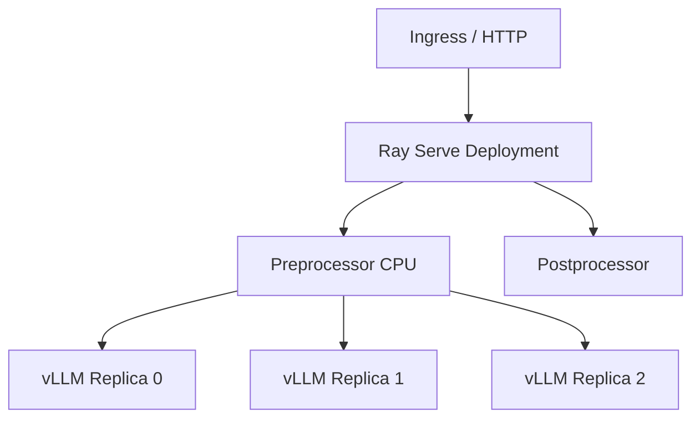

# Ray

> 从 Bit 到 AGI · 第十一章：工程化（Serving） · 分布式 serving 框架 Ray Serve

单机 vLLM 能扛 **~3 000 tok/s**，但产品要上多模型、多版本、CPU 预处理 + GPU 推理混合流水线，就需要**分布式应用框架**。**Ray Serve** 把 Python 服务变成可跨节点调度、自动扩缩的 deployment graph——LLM 工程里常作 vLLM/SGLang 之上的**编排层**。

## 直觉

Ray 像**城市公交系统**：每辆 GPU 上的 vLLM 是一个「线路终点站」；Ray Serve 是调度中心——哪个站有车、哪条线路该加开班次、乘客（请求）该转哪条线，全由它协调。你写 `@serve.deployment` 装饰器定义站点，Ray 负责把 HTTP 请求路由过去。



## 定义

**Ray** = 分布式 Python 运行时；**Ray Serve** = 其上的 model serving 层：

| 概念 | 含义 |
| ---- | ---- |
| Deployment | 一个可扩缩的服务单元（含 replica） |
| Replica | 运行实例，可绑 1 张 GPU |
| Ingress | HTTP/gRPC 入口 |
| Autoscaling | 基于 QPS / 队列深度自动增减 replica |

与纯 vLLM 多进程的区别：Ray 提供**跨节点** placement、**异构** pipeline（CPU embedding + GPU generate）、**A/B 路由**（与下一章 gateway 配合）。

## 例子

**例 1：3 副本 vLLM，8B 模型，各 1×A100**

| 指标 | 单副本 | 3 副本 Ray Serve |
| ---- | ------ | ---------------- |
| 最大 QPS（128 in / 64 out） | ~45 req/s | **~128 req/s** |
| TTFT P95 @ 80 QPS | ~1.8 s | **~520 ms** |
| TTFT P95 @ 130 QPS | OOM/超时 | ~980 ms |

线性扩展在 **~2.5×** 左右（调度 + 网络开销）。

**例 2：Ray Serve 包装 OpenAI 兼容 vLLM**

```python
from ray import serve
from starlette.requests import Request
import httpx

@serve.deployment(
    num_replicas=3,
    ray_actor_options={"num_gpus": 1},
    autoscaling_config={
        "min_replicas": 1,
        "max_replicas": 8,
        "target_ongoing_requests": 10,
    },
)
class VLLMProxy:
    def __init__(self):
        # 每个 replica 内嵌启动 vLLM 子进程，或连 sidecar
        self.base = "http://127.0.0.1:8000/v1"

    async def __call__(self, request: Request):
        body = await request.json()
        async with httpx.AsyncClient(timeout=120) as client:
            r = await client.post(
                f"{self.base}/chat/completions", json=body
            )
        return r.json()

app = VLLMProxy.bind()
```

```bash
serve run serve_vllm:app --host 0.0.0.0 --port 8080
```

**例 3：RAG pipeline（CPU + GPU）**

| 阶段 | 资源 | 延迟 |
| ---- | ---- | ---- |
| Embedding（BGE-large） | CPU 4 核 | ~25 ms |
| 向量检索（Milvus） | CPU | ~8 ms |
| LLM generate（vLLM 8B） | GPU | TTFT ~200 ms + decode |

Ray 把 embedding deployment 设 `num_cpus=2`，LLM 设 `num_gpus=1`，**端到端 P95 ~380 ms**（无 Ray 时串行单进程 ~450 ms，因 CPU/GPU 无法 overlap）。

## 量化

**Ray Serve 开销**：同机房内额外 **~2～5 ms** HTTP 跳转；跨 AZ **+10～30 ms**。相对 LLM 秒级 TTFT 通常可忽略。

**Autoscaling 响应**：默认 **~30 s** 冷启动新 replica（含模型 load **~45～90 s** for 8B）。生产要设 `min_replicas ≥ 1` 避免缩到零后首请求超时。

**资源公式**：

$$
\text{replicas} \approx \left\lceil \frac{\text{QPS} \times \text{avg\_latency}}{\text{concurrency\_per\_replica}} \right\rceil
$$

8B vLLM 每 replica 舒适并发 **~16～32**（512/128），目标 100 QPS、latency 0.5 s → replicas $\lceil 100 \times 0.5 / 24 \rceil = 3$。

::: warning

Ray 集群需独立运维（GCS、dashboard、对象存储 spilling）。小团队 **低于  3 模型** 时 K8s + 原生 Deployment 可能更简单；**> 5 模型 + 复杂 DAG** 时 Ray 价值凸显。

:::

## 常见误区

1. **「Ray 替代 vLLM」**——Ray 是 orchestrator，推理仍靠 vLLM/SGLang/TRT-LLM backend。
2. **「autoscaling 秒级生效」**——LLM replica 冷启动慢；用 **predictive scaling** 或 **queue-based** 提前扩容。
3. **「num_replicas=GPU 总数」**——每 replica 若独占 70B TP=4，需 **4 GPU/replica**；8 卡集群最多 2 replica。

## 多模型 Deployment Graph

Ray Serve 适合 **>3 模型** 或 **DAG 预处理** 场景。示例：客服系统三模型路由：

```python
@serve.deployment
class Router:
    async def __call__(self, request):
        intent = classify(request)  # 小模型 CPU
        if intent == "faq":
            return await faq_model.remote(request)
        return await llm_model.remote(request)

faq = FAQDeployment.bind()
llm = VLLMProxy.bind()
app = Router.bind(faq, llm)
```

| 路径 | 模型 | P95 延迟 | 占比 |
| ---- | ---- | -------- | ---- |
| FAQ | 1B CPU | 45 ms | 60% |
| LLM | 8B GPU | 520 ms | 40% |

加权平均 P95：**~0.6×45 + 0.4×520 ≈ 235 ms**，比全走 8B **快 55%**。

**Ray 集群 sizing**：Head 节点 4 vCPU 8 GB 即可；Worker 按 GPU 数；GCS 故障时 Serve 只读模式可维持 **~15 min**——生产 GCS 需 HA。

## 动手试一试

```bash
pip install "ray[serve]" httpx

# 本地 1 卡模拟
serve run serve_vllm:app --num-replicas 2

# 压测
hey -n 500 -c 32 -m POST -d '{"model":"x","messages":[{"role":"user","content":"hi"}]}' \
  http://127.0.0.1:8080/
```

对比 replica=1 与 replica=2 的 P95 延迟曲线。若线性度 低于1.8×，检查 Ray head 是否 CPU 饱和（`ray dashboard` → Node view）。

## 小结

Ray Serve 在 vLLM 之上提供 **多副本、异构 pipeline、autoscaling**；3×8B 副本可将 **~45 QPS** 扩到 **~128 QPS**，TTFT P95 从 **~1.8 s** 降到 **~520 ms**。下一篇用 **Kubernetes** 把 replica 变成集群级基础设施。

→ 下一篇：[Kubernetes](/manual/llm/bit-to-agi/11-engineering/kubernetes)
