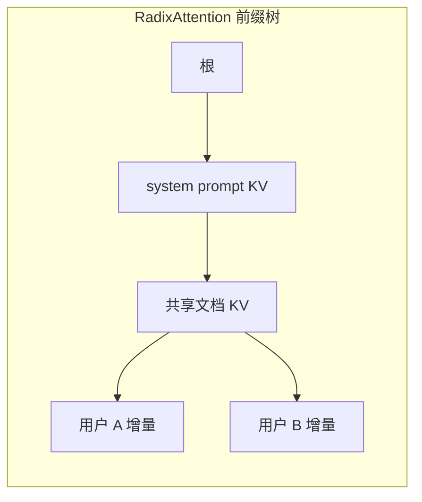

# SGLang

> 从 Bit 到 AGI · 第十一章：工程化（Serving） · 结构化生成与高 prefix 复用的 SGLang

vLLM 把通用对话吞吐做到了极致，但生产里还有两类场景它不够「顺手」：**多步结构化程序**（先分类再抽取 JSON 再校验）和 **大量共享 system prompt**（RAG 检索块相同、用户问题不同）。SGLang 用 RadixAttention 做前缀树缓存，配合前端 DSL，在这两类 workload 上常比 vLLM 再快 **1.5～3×**。

## 直觉

RAG 服务里，90% 的 prompt 是同一套「你是助手 + 检索到的 3 000 token 文档」。传统引擎每个请求都重新算一遍这 3 000 token 的 KV Cache——像每次点外卖都重新做一遍「腌好的泡菜」。SGLang 把已算过的 KV 存成**前缀树（radix tree）**：新请求只要前缀匹配，直接从树里「接枝」，只算用户新增的那几十 token。



## 定义

**SGLang**（Structured Generation Language）= 推理运行时 + 前端编程语言：

| 层 | 功能 |
| -- | ---- |
| **SRT**（SGLang Runtime） | RadixAttention、连续批处理、TP/EP、OpenAI API |
| **SGL Frontend** | Python DSL：`@sgl.function` 描述多步生成、分支、并行 |
| **RadixAttention** | 自动 prefix 缓存与跨请求 KV 共享 |

核心指标与 vLLM 相同：**TTFT、TPOT、tok/s**；额外关注 **prefix cache hit rate**（命中率）。

## 例子

**例 1：RAG 场景，Llama-3-8B，A100 80GB**

共享 prefix 3 500 token，用户问题平均 80 token，输出 200 token，并发 64：

| 引擎 | TTFT P50 | 吞吐 tok/s | prefix 命中后 TTFT |
| ---- | -------- | ---------- | ------------------ |
| vLLM（无 prefix cache） | ~2.1 s | ~2 400 | — |
| SGLang（RadixAttention） | ~2.0 s | ~3 800 | **~120 ms** |

命中时 TTFT 从秒级降到百毫秒——用户感觉「秒开」。

**例 2：结构化多步程序（SGL Frontend）**

```python
import sglang as sgl

@sgl.function
def extract_entity(s, text, schema):
    s += sgl.system("你是信息抽取助手，只输出 JSON。")
    s += sgl.user(f"文本：{text}\n schema：{schema}\n")
    s += sgl.assistant(sgl.gen("json_out", max_tokens=256,
                                 regex=r'\{.*\}'))  # 约束 JSON 形态

# 后端连接 SRT
sgl.set_default_backend(sgl.RuntimeEndpoint("http://127.0.0.1:30000"))

state = extract_entity.run(
    text="张三 2024 年入职阿里云，职位架构师。",
    schema='{"name": str, "company": str}',
)
print(state["json_out"])
```

同一 `@sgl.function` 多次调用时，system 段 KV 自动复用；`regex` 约束在 runtime 内与投机解码配合，减少无效 token。

**例 3：启动 SRT 服务**

```bash
python -m sglang.launch_server \
  --model-path meta-llama/Meta-Llama-3-8B-Instruct \
  --port 30000 \
  --mem-fraction-static 0.88 \
  --chunked-prefill-size 8192
```

OpenAI 兼容端点：`http://127.0.0.1:30000/v1/chat/completions`。

## 量化

**Prefix cache 收益**：

$$
\text{TTFT}_{\text{saved}} \approx T_{\text{prefill}}(\text{shared\_prefix})
$$

3 500 token prefill 在 8B 上约 **~1.8 s**（单请求 A100）；64 并发共享后摊薄到 **~30 ms/请求** 量级——这是 RadixAttention 的核心价值。

**内存开销**：前缀树节点存储 KV 指针 + 引用计数；命中率 70%、平均 prefix 4K token 时，额外显存通常 **低于 15%** 总 KV 池（需监控 `cache_hit_rate` 与 `eviction_count`）。

**与 vLLM 选型对比**：

| 场景 | 推荐 |
| ---- | ---- |
| 通用高 QPS 对话 | vLLM（生态更成熟） |
| RAG / 共享 system prompt | SGLang |
| 复杂 agent 多步 + 约束解码 | SGLang Frontend |
| 纯 OpenAI 代理、最少改造 | vLLM |

::: warning

SGLang 迭代极快，API 与 CLI  flag 版本间可能有 breaking change。生产 pin 版本号，升级前在 staging 跑同一套 benchmark_serving。

:::

## 常见误区

1. **「SGLang 全面替代 vLLM」**——通用 chat 两者接近；SGLang 优势在 prefix 共享与结构化 workflow，无共享 prefix 时差距缩小到 **10%～20%**。
2. **「RadixAttention 不占显存」**——缓存的 KV 仍占 HBM；需配置 `max_total_tokens` 与 eviction 策略，否则长文档堆积 OOM。
3. **「Frontend DSL 只是语法糖」**——DSL 让 batch 内多分支、并行 fork 可静态优化；手写 HTTP 循环调 OpenAI API 无法获得同等调度。

## 生产 Checklist

SGLang 部署额外关注 prefix 生命周期：

1. **命中率监控**：导出 `cache_hit_rate`；RAG 场景应 **> 60%**，低于 40% 检查文档是否过度个性化导致 prefix 无法共享。
2. **Eviction 策略**：长文档场景配置 `max_total_tokens` 与 LRU；避免单租户占满 radix tree。
3. **Chunked prefill**：超长首次 prefill（>8 K）开 `chunked-prefill-size`，防止单次 prefill 阻塞 decode 队列 **>5 s**。
4. **Frontend 与 SRT 版本**：pin 同一 release tag；DSL `@sgl.function` 变更需回归结构化输出 schema。
5. **与 vLLM 并存**：Gateway 按路径分流——`/rag/*` → SGLang，`/chat/*` → vLLM，各跑最适合的 workload。

**何时从 vLLM 迁到 SGLang**：当 profile 显示 **>50% TTFT 花在重复 prefix prefill** 且文档库低于 10 K 固定模板时，迁移 ROI 突出。

## 动手试一试

```bash
# 终端 1：启动 SRT
python -m sglang.launch_server \
  --model-path meta-llama/Meta-Llama-3-8B-Instruct --port 30000

# 终端 2：同一 4K prefix 发 100 次不同后缀
python scripts/rag_prefix_bench.py \
  --base-url http://127.0.0.1:30000 \
  --shared-prefix-tokens 3500 \
  --num-requests 100 \
  --concurrency 32
```

对比第一次（冷）与第 50～100 次（热）的 TTFT 分布。若热 TTFT 仍 >500 ms，检查 `--mem-fraction-static` 是否过低导致 cache 被驱逐。

## 小结

SGLang 用 **RadixAttention** 把共享 prefix 的 KV 变成可复用资产，RAG 场景 TTFT 可从 **~2 s 降到 ~120 ms**；Frontend DSL 适合 agent 多步结构化生成。通用 serving 仍可与 vLLM 并存——按 workload 分流。

→ 下一篇：[TensorRT-LLM](/manual/llm/bit-to-agi/11-engineering/tensorrt-llm)
