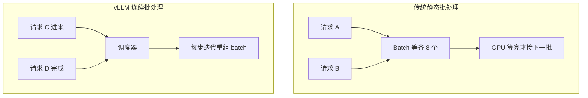

# vLLM

> 从 Bit 到 AGI · 第十一章：工程化（Serving） · 高吞吐 LLM 推理引擎 vLLM

你在第十章用 Hugging Face 跑过单卡推理——一次一个请求，GPU 大部分时间在等。生产环境要同时服务成百上千用户，需要**连续批处理**和**显存高效**的 KV Cache 管理。vLLM 是广泛采用的开源推理引擎之一，用 PagedAttention 把显存利用率从 20% 拉到 80% 以上，单机 QPS 可提升 10～24 倍。

## 直觉

把 GPU 显存想象成停车场。传统做法：每辆车（请求）独占固定大小的车位，车走了车位空着也不能给别人——浪费。vLLM 的 PagedAttention 像**按需分配、可合并的小块车位**：KV Cache 切成 16 KB 左右的「页」，不同请求共享物理块，用完即回收。调度器像交通协管员，不断把新请求塞进正在计算的 batch，这就是 **continuous batching**（也叫 iteration-level scheduling）。



## 定义

**vLLM** 是 UC Berkeley 开源的 LLM 推理与服务框架，核心组件：

| 组件 | 作用 |
| ---- | ---- |
| PagedAttention | KV Cache 分页存储，按 token 动态分配/释放 |
| Continuous Batching | 每个 decode 步重新组 batch，不等慢请求 |
| OpenAI-compatible API | `/v1/chat/completions` 等标准端点 |
| Tensor Parallelism | 多卡切分单模型（`--tensor-parallel-size`） |

**关键指标**（生产必盯）：

- **TTFT**（Time To First Token）：首 token 延迟，用户感知「开始回复」的速度
- **TPOT**（Time Per Output Token）：后续每个 token 间隔，决定「打字速度」
- **QPS / 吞吐**：每秒完成的请求数或生成的 token 数（tokens/s）

## 例子

**例 1：Llama-3-8B-Instruct，单张 A100 80GB，vLLM 0.6+**

| 场景 | 并发 | TTFT P50 | TPOT P50 | 吞吐 |
| ---- | ---- | -------- | -------- | ---- |
| 短问答（128 in / 64 out） | 32 | ~180 ms | ~12 ms | ~2 800 tok/s |
| 长上下文（4K in / 256 out） | 8 | ~650 ms | ~14 ms | ~900 tok/s |
| 高并发压测 | 128 | ~420 ms | ~18 ms | ~4 200 tok/s |

对比 Hugging Face `generate()` 同硬件：**~200 tok/s**，vLLM 约 **14～21×** 吞吐提升（社区与 NVIDIA 基准常见量级）。

**例 2：启动 OpenAI 兼容服务**

```bash
# 单卡 8B
python -m vllm.entrypoints.openai.api_server \
  --model meta-llama/Meta-Llama-3-8B-Instruct \
  --dtype bfloat16 \
  --max-model-len 8192 \
  --gpu-memory-utilization 0.90 \
  --port 8000

# 4 卡张量并行 70B
python -m vllm.entrypoints.openai.api_server \
  --model meta-llama/Meta-Llama-3-70B-Instruct \
  --tensor-parallel-size 4 \
  --max-model-len 4096 \
  --port 8000
```

客户端与 OpenAI SDK 完全兼容：

```python
from openai import OpenAI

client = OpenAI(base_url="http://localhost:8000/v1", api_key="dummy")
resp = client.chat.completions.create(
    model="meta-llama/Meta-Llama-3-8B-Instruct",
    messages=[{"role": "user", "content": "解释 PagedAttention"}],
    max_tokens=128,
)
print(resp.usage)  # prompt_tokens, completion_tokens
```

**例 3：Llama-3-70B，4×A100 TP=4**

| 指标 | 数值 |
| ---- | ---- |
| 并发 16，512 in / 128 out | TTFT P50 ~1.2 s，~1 100 tok/s |
| 并发 64 | TTFT P99 ~3.8 s，~950 tok/s（排队加剧） |

## 量化

**显存估算**（8B bf16 权重 ≈ 16 GB）：

$$
\text{KV 显存} \approx 2 \times L \times n_{\text{kv}} \times d_{\text{head}} \times \text{seq\_len} \times \text{batch} \times \text{bytes}
$$

开头的 2 是 K 和 V 各一份。注意 $n_{\text{kv}} \times d_{\text{head}}$ 才是每层每 token 的 KV 宽度——**别再乘一次 $d_{\text{model}}$**：$d_{\text{model}} = n_{\text{heads}} \times d_{\text{head}}$，重复相乘会把结果放大 $d_{\text{head}}$ 倍还多。

Llama-3-8B：$L=32$，GQA $n_{\text{kv}}=8$，$d_{\text{head}}=128$（注意不是 $d_{\text{model}}=4096$），bf16（2 B）：

- 每 token 每层：$2 \times 8 \times 128 \times 2 = 4$ KB → 32 层共 **128 KB/token**
- 单请求 seq=4096：$128\,\text{KB} \times 4096 \approx$ **0.5 GB** KV
- 权重 16 GB 之外，24 GB 卡还剩 ~6 GB → 约 **12 个** 4K 请求；80 GB 卡可到 **~100 个**
- PagedAttention + 共享 prefix 可显著降低碎片与重复占用

**GQA 省了多少**：若不用 GQA（$n_{\text{kv}} = n_{\text{heads}} = 32$），同样的账是 **2 GB/请求**——4 倍。这就是 GQA 存在的全部理由：它换来的不是算力，是并发数。

**调度复杂度**：每 decode 步 $O(\text{active\_requests})$ 重组 batch；PagedAttention 使 KV 分配从 $O(\text{max\_seq} \times \text{batch})$ 固定预分配变为按需 $O(\text{actual\_tokens})$。

**生产 SLO 参考**（对话类产品）：

| 等级 | TTFT P95 | TPOT P95 |
| ---- | -------- | -------- |
| 交互式 | < 800 ms | < 40 ms |
| 批处理 / 摘要 | < 3 s | < 80 ms |

::: info

第八章讲过 [Paged Attention](/manual/llm/bit-to-agi/08-inference/paged-attention) 的原理；vLLM 是该思想的首个生产级实现，现已成为事实标准。

:::

## 常见误区

1. **「vLLM 只支持 NVIDIA」**——官方以 CUDA 为主，ROCm（AMD）与 Intel 扩展在快速跟进；生产选型前查当前版本的硬件矩阵。
2. **「开满 `gpu-memory-utilization 1.0` 更快」**——留 5%～10% 给 CUDA context 与临时 buffer，否则 OOM 导致整批重算。
3. **「TP 越大越好」**——张量并行有通信开销；70B 在 4 卡通常甜点，8 卡可能因 NVLink 拓扑反而变慢。
4. **「吞吐高 = 用户体验好」**——高并发下 TTFT 暴涨；需在 QPS 与 P95 延迟间做容量规划。

## 生产 Checklist

上线 vLLM 前逐项核对：

1. **压测基线**：用真实 prompt 长度分布（P50/P95/P99）跑 `benchmark_serving`，记录 TTFT P95、tok/s；留 **20% GPU headroom** 应对突发。
2. **参数**：`max-model-len` ≥ P99 prompt + max output；`gpu-memory-utilization` 设 **0.85～0.90**；`max-num-seqs` 与显存联动，OOM 时先降此项而非盲目加卡。
3. **健康检查**：readiness 必须等权重 load 完成；liveness 间隔 ≥ 30 s，避免 decode 长流式被误杀。
4. **多租户**：不同业务线用独立 Deployment 或 `--served-model-name` 隔离，防止某客户 128 K 上下文拖垮共享 KV 池。
5. **升级**：镜像 pin digest；Rolling 时 `maxUnavailable: 0`，新 pod ready 后再摘旧 pod。
6. **监控**：接入 `vllm:num_requests_waiting`、`gpu_cache_usage_perc`；waiting > 30 持续 2 min 触发扩容。

**容量速算**：8B 单 A100 舒适 **~35 QPS**（128 in / 64 out）；目标 140 QPS → **4 pod** + 1 冗余 = 5 GPU。

## 动手试一试

```bash
# 压测（需安装 vllm bench 或 hey/ab）
python -m vllm.entrypoints.openai.api_server \
  --model meta-llama/Meta-Llama-3-8B-Instruct &
sleep 30

# 并发 32，各发 128 token 输出
python benchmarks/benchmark_serving.py \
  --backend vllm \
  --model meta-llama/Meta-Llama-3-8B-Instruct \
  --num-prompts 320 \
  --request-rate 32
```

观察 `median TTFT`、`P99 TPOT`、`output throughput (tok/s)` 三项，记录 `max-num-seqs`（默认 256）对延迟的影响。将 `--request-rate` 从 8 提到 64，画 TTFT–QPS 曲线找拐点——拐点以左即推荐运行点。

## 小结

vLLM = PagedAttention + 连续批处理 + OpenAI API；单卡 8B 在 A100 上可达 **~3 000 tok/s**、TTFT **~200 ms** 量级。它是大多数团队生产推理的默认起点。下一篇看 SGLang——在结构化输出与 prefix 共享上进一步压榨性能。

→ 下一篇：[SGLang](/manual/llm/bit-to-agi/11-engineering/sglang)
