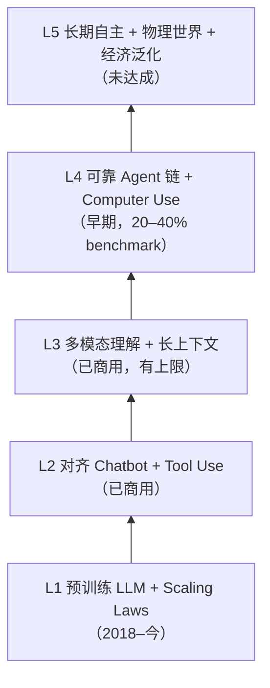

# AGI 路线图

> 从 Bit 到 AGI · 第十二章 · 缩放、Agent、多模态与具身——拼图如何拼，以及 2026 仍缺什么

「AGI」在媒体里是倒计时，在实验室里是**没有统一 operational definition 的标签**。作为工程师，更有用的是一张**能力拼图路线图**：哪些块已工程化、哪些块只有 demo、哪些块缺科学而不仅是缺算力。本章前文各篇是块；本篇说明**如何拼**、**拼完仍不是什么**。

## 直觉

把 AGI 想成「能胜任**绝大多数** economically valuable 认知工作」的系统（常见 operational 定义之一，仍争议）。2026 进展路径大致五层：

不是严格「等级通关」——各层并行推进；**L4→L5** 的 gap 被认为**大于** L1→L2（**qualitative** 争议，无证明）。

## 定义

**AGI**（Artificial General Intelligence）无单一定义。评测常用**代理指标**（每个都有漏洞）：

| 指标 | 测什么 | 2026 强模型量级 | 距「人类一般劳动者」 |
| ---- | ------ | --------------- | -------------------- |
| MMLU / GPQA | 学科问答 | **~85–90%** / **~65–80%+** | 选择题 ≠ 工作 |
| SWE-bench Verified | 修真实 GitHub issue | **~55–75%+** | 需环境、测试、多文件 |
| ARC-AGI | 抽象推理网格 | **~30–85%**（随集变） | 专门 benchmark，可过拟合 |
| WebArena | 多步 Web 任务 | **~30–45%** | 远低于白领日常 |
| 机器人开放家务 | 真实物理 | **无 credible 百分比** | 演示 ≠ 产品 |

**路线图共识（研究/工业界，非承诺）**：

1. **继续 scale** 预训练 + 推理时 compute（test-time compute，如 o3 / DeepSeek-R1 等推理模型）
2. **Multimodal** 统一 token 化（文本/图/音/视频）
3. **Agent 栈**：[Memory](/manual/llm/bit-to-agi/12-future/memory) + [Tool](/manual/llm/bit-to-agi/12-future/tool-use) + [MCP](/manual/llm/bit-to-agi/12-future/mcp-future) + eval
4. **World Model + Robotics** 闭环数据 flywheel
5. **Alignment** 随能力 scaling（见下一篇）

## 例子

**例 1：Scaling Laws 外推的边界**

第五章 [缩放定律](/manual/llm/bit-to-agi/05-transformer/scaling-laws-intro)：loss ↓ 随 compute/data/parameters 幂律下降。但：

- **数据**可能 2027 附近 touch 高质量文本 ceiling（估计 **10¹³–10¹⁴ token** 量级已部分重复）
- **Benchmark 饱和** ≠ 真实任务饱和（Goodhart）
- **推理 compute** 换 intelligence 也有 diminishing returns

粗算：GPT-4 级训练 **~10²⁵ FLOPs**；若 AGI 需 **10²⁷–10²⁸ FLOPs**（纯猜测），是 **100–1000×**——可行但非「再训一次就完」。

**例 2：Agent 路线图时间线（能力，非日历）**

| 阶段 | 特征 | 瓶颈 |
| ---- | ---- | ---- |
| A | 单工具、短链 | schema 设计 |
| B | 多工具 + RAG | 检索 + 多步 $p^n$ |
| C | Computer Use + 人审 | 延迟、成功率 |
| D | 自主 8h 知识工作 | **目标漂移、责任、eval** |
| E | 物理 + 数字统一 | 数据、安全、法规 |

2026 产品在 **A–C**，**D–E 未验证**。

**例 3：缺的不是「再一个大模型」**

- **持续学习**在线更新权重而不 catastrophic forgetting
- **可验证推理**（形式化、程序正确性）
- **真实经济 eval**（非 leaderboard gaming）
- **社会/legal** 主体与责任链

## 量化

- **人类认知任务宽度**：O*NET 列 **~800+** 职业任务类型；当前 Agent **无**全面通过率数据
- **Autonomy horizon**：可靠自主时长以**分钟**计（Computer Use demo）；人类岗位以**小时～月**计
- **双曲线 hype vs 线性工程**：benchmark +5%/年 vs 产品「完全替代岗位」叙事——**数量级错位**

::: info

「Bit 到 AGI」本书路径：Bit → 训练 → 推理 → 工程 → **Agent/具身**。走完技术栈后应明白：**AGI 不是单一发布事件**，而是多能力乘积；任一块接近 0 则整体接近 0。

:::

## 常见误区

1. **「GPT-N 发布 = AGI」**——每代提升集中在 measurable bench；**未测能力**可能仍为零（如可靠 self-correction 数天项目）。
2. **「开源追上闭源 = AGI 民主化」**——权重开放 ≠ 安全、≠ 算力、≠ 数据 flywheel（尤其机器人）。
3. **「超级对齐先解决再 scale」** vs **「scale 再对齐」**——工业界多后者；**无实验共识**哪条对。

## 动手试一试

选一个你日常真实任务（如「给仓库提 PR 修 bug + 写 release note + 回复 review」），分解子步骤数 $n$、需工具数 $m$、允许错误率 $\epsilon$。

粗估成功率 $\approx (1-\epsilon)^n$（过于悲观但说明问题）。与 SWE-bench 单 issue 对比——理解 **roadmap 缺的是系统集成与 eval**，不只是 IQ 分数。

## 深入：Test-time compute 与「思考更长」

OpenAI o1/o3、DeepSeek-R1 等 **推理时扩展**：采样多条 chain-of-thought，选高 reward 路径。Inference FLOPs 从 **1× → 10–100×**，换 MATH/GPQA 上 **10–30** 百分点提升——**不自动**转化为 Web Agent 成功率，因瓶颈常在 tool 与环境而非单步 IQ。

路线图 implication：**训练 scale** 与 **test-time compute** 与 **Agent 工程** 三条线独立投资；只堆一条会出现「博士级做题、实习生级办事」。

## 经济视角：哪些工作先被 augment

| 类别 | 自动化难度 | 原因 |
| ---- | ---------- | ---- |
| L1 客服脚本 | 中 | 已有 chatbot；复杂 escalation 仍需人 |
| L2 代码补全 | 中高 | Copilot 已 augment；全自主 PR **未达标** |
| L3 白领 multi-app | 高 | Computer Use 成功率低 |
| L4 物理操作 | 很高 | 数据 + 安全 + 法规 |

**Augment**（人+AI）先于 **Automate**（无人）是 2026 产品现实；AGI 叙事常混淆二者。

## 时间线为什么不写日历

媒体常写「2027 AGI」——**无科学基础**。Scaling law 外推在数据耗尽、benchmark 饱和处失效；监管可能冻结某些部署；黑天鹅（新架构、算法突破）不可 schedule。负责任路线图谈 **capability milestones**（「Computer Use 在 WebArena >60%」）而非 **日期**。你作为工程师，应用 **eval 门槛** 驱动采购：模型升级必须过内部 task suite，而非追发布会。

OpenAI、Anthropic、Google DeepMind 对 AGI 的内部定义互不公开；**不要**把 vendor marketing 与 operational milestone 混为一谈。你的团队应维护 **10–50 个** 代表真实业务的 private eval case——这比任何公开 leaderboard 更能预测「能不能上线」。

最后提醒：**AGI 不是本手册的终点线**。即便所有 benchmark 饱和，仍可能有整类认知工作依赖 institutional context、 bodily presence 或 legal personhood——技术路线图覆盖不全。保持 **humility** 与 **eval 驱动**，比押注发布日期更专业。

## 小结

AGI 路线图 = **Scale + 多模态 + Agent + World Model/具身 + 对齐** 五线并行；2026 商用处于 Agent 早期，物理与经济泛化**无验收**。下一篇：能力越强，**对齐与安全**越不能后置。

→ 下一篇：[安全与对齐](/manual/llm/bit-to-agi/12-future/safety-and-alignment)
