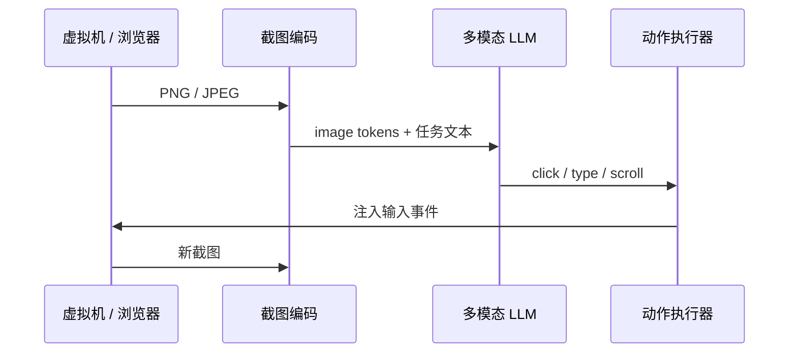

# Computer Use

> 从 Bit 到 AGI · 第十二章 · 看屏幕、点鼠标——GUI Agent 的感知-动作链与可靠性天花板

API 覆盖不了 legacy 软件、游戏、复杂表单。**Computer Use** 让模型直接消费**屏幕像素**（或无障碍树），输出**鼠标键盘动作**——像远程桌面里的操作员。Anthropic Claude Computer Use、OpenAI Operator / CUA 等 2024–2026 产品验证了可行性，但**分钟级延迟、两位数成功率**仍是常态，离「替人上班」很远。

## 直觉

Tool Use 是调 `get_weather(city="北京")`；Computer Use 是：

1. **截图** 1920×1080 RGB
2. 模型看图中「搜索框在哪」
3. 输出 `click(x=450, y=120)` → `type("北京 天气")` → `key("Enter")`
4. 再截图，读结果

没有 DOM、没有 REST——**通用**但**极慢、极脆**（分辨率、主题、弹窗、验证码）。



## 定义

**Computer Use Agent** 核心组件：

| 组件 | 说明 |
| ---- | ---- |
| **Perception** | 屏幕截图、可选 a11y DOM、OCR 叠加 |
| **Policy** | 多模态 VLM（视觉 + 语言），输出结构化 UI 动作 |
| **Action space** | 离散：`click`、`double_click`、`type`、`key`、`scroll`；坐标或元素 ref |
| **Sandbox** | 隔离 VM / 容器，限制网络与文件系统 |

与 [Tool Use](/manual/llm/bit-to-agi/12-future/tool-use) 对比：Tool 走**符号 API**；Computer Use 走**像素 → 坐标**，信息带宽高、歧义大。

单帧 1080p PNG 未压缩 ≈ **1920×1080×3 ≈ 6.2 MB**；送模型通常 resize + JPEG + vision encoder → **数百～数千 image tokens/帧**。

## 例子

**例 1：OSWorld / WebArena 量级（公开 leaderboard，2025–2026）**

| Benchmark | 任务示例 | SOTA 成功率（量级） |
| --------- | -------- | ------------------- |
| WebArena | 电商下单、论坛发帖 | **~30–45%** |
| OSWorld | 改系统设置、装软件 | **~25–45%** |
| 简单单页表单 | 填 5 字段 | **~60–80%**（受布局影响大） |

**例 2：单任务成本粗算**

- 20 步 GUI 操作，每步 1 截图 + 1 次 VLM 调用
- 每帧 1500 vision tokens + 500 text → 2000 token/步
- 20 步 ≈ **40K input token** + 20 × 推理延迟（**3–10 s/步**）→ **1–3 分钟/任务**
- API 费用 **\$0.5–5/任务**（模型与分辨率依赖）

**例 3：失败案例（常见）**

- 按钮与背景对比度低 → 误点
- Cookie 横幅遮挡 → 循环无效 click
- 加载 spinner 未结束 → 过早 type
- 2FA / CAPTCHA → **硬停止**（不应绕过）

## 量化

- **感知分辨率**：常用 **1280×720 或更低** 送模型；全像素推理成本 ∝ 像素数
- **动作精度**：1080p 下 1 pixel 误差对按钮可接受；4K 缩略图后 **±5–15 px** 漂移可导致 miss
- **逐步误差累积**：与 Agent 相同，$n$ 步成功率 $\approx p^n$；GUI 的 $p$ 通常 **低于** API Tool（**0.7–0.9**）
- **安全**：Computer Use 等同**远程代码执行 + 全账号权限**；必须 VM 快照、网络 egress 白名单、人工确认写操作

::: warning

国内站部署若依赖境外 VLM API，延迟与合规需单独评估；**运行时不得**偷偷加载境外 CDN 脚本（见项目 CLAUDE.md 国内可访问性约束）。

:::

## 常见误区

1. **「Computer Use 能替代 RPA」**——RPA 录制的 selector  brittle 但**单路径**可靠；GUI Agent **泛化**强但**单任务**更贵更慢。
2. **「无障碍树总是可用」**——Electron 杂牌应用、Canvas 游戏常无 DOM；只剩像素。
3. **「多模态 = 看懂屏幕 = 理解业务」**——能点「提交」不等于懂财务合规；**领域错误**与文本幻觉同样存在。

## 动手试一试

不接入真实 VM，用静态 PNG + 标注 bbox 模拟：

```python
# 假：模型返回归一化坐标 (0–1)
def denorm_click(nx, ny, width=1920, height=1080):
    x, y = int(nx * width), int(ny * height)
    print(f"click at {x},{y}")
    # 与 ground-truth 按钮 bbox 算 IoU 或中心距

denorm_click(0.23, 0.11)  # 人工对照截图验证
```

体会：**同一 UI 换主题/语言/缩放，坐标全变**——为何需要每步重感知。

## 深入：Set-of-Marks 与 DOM 混合

纯像素 Agent 贵且脆。**Set-of-Marks（SoM）**：在截图上给可交互元素标号 `[1][2][3]`，模型输出 `click(7)` 而非坐标——降低 spatial 精度要求。若 a11y tree 可用，先 **DOM 优先、视觉兜底**：有 `aria-label` 的按钮不走 OCR。

混合 pipeline 在 WebArena 类任务上可提 **5–15** 百分点，但维护 selector 与 SoM 标注 pipeline 增加工程。Enterprise RPA 常走 DOM；Computer Use 产品走视觉，因**跨应用**通用性才是卖点。

## 延迟优化

- **降分辨率**：720p → 480p，vision token **~减半**，误点率略升
- **差分截图**：仅发送与上帧 diff 区域（运动检测），省带宽
- **动作缓存**：「登录流程」固化为 macro，LLM 只在异常时介入
- **本地 VLM**：Edge 部署 7B VLM，省 RTT，需 **8–16 GB** VRAM

无免费午餐：优化项各自引入新 failure mode（差分漏检小 spinner、macro 遇 UI 改版失效）。

## 可访问性与法律

Computer Use 绕过屏幕阅读器路径，对依赖 a11y 的软件可能 **违反** 无障碍最佳实践（若替代而非 augment 人类操作）。自动化登录、抢票、 scraping 可能触犯 **ToS** 或 CFAA 类法规——产品需法律 review，不能假设「AI 点的不算 bot」。验证码存在即说明站点 **拒绝** 此类 Agent；试图绕过属于对抗而非能力展示。

部署 Computer Use 时，建议 **专用低权限 OS 用户**：无 sudo、无 SSH key、浏览器 profile 空——与日常办公机隔离。单次任务结束 **快照回滚** VM，防止下载恶意 payload 持久化。这些 ops 实践与模型智商无关，却决定 **P0 安全**。

Human-in-the-loop 并非「不够 AI」：对转账、删库、发公告等 **irreversible** 操作，行业最佳实践仍是 **显式确认**——Computer Use 的 autonomy 上限应由产品 policy 设定，而非模型自行决定。

Benchmark 分数随 UI 主题、语言、分辨率变化而波动 **5–15** 百分点——部署时应对目标站点做 **domain-specific finetune 或 few-shot**，不能照搬 leaderboard 叙事。

Vision encoder 的 **token 预算** 常与文本抢窗口：一帧 1500 token + 20 步历史 40K text，128K 窗口并不宽裕。实践上需 **关键帧采样**（只在 UI 变化后截图），而非固定 1 Hz 盲拍——否则任务未完成 token 已耗尽。

评估 Computer Use 系统时，除成功率外还应记录 **每任务美元成本** 与 **人工接管次数**——商业 viability 由二者与成功率共同决定。

## 小结

Computer Use = **截图 → VLM → 鼠标键盘** 的通用 GUI Agent；突破 API 限制，付出 token、延迟、可靠性三重代价。公开 benchmark 成功率多在 **20–45%** 区间。下一篇：把动作从屏幕搬到**物理世界**——Robotics。

→ 下一篇：[Robotics](/manual/llm/bit-to-agi/12-future/robotics)
