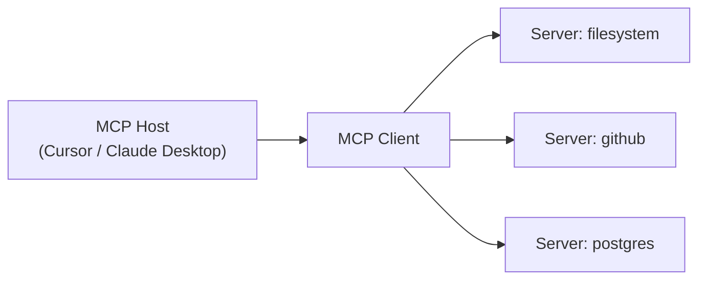

# MCP

> 从 Bit 到 AGI · 第十二章 · Model Context Protocol——工具与数据源的 USB-C，以及生态现状

每个 SaaS 各写一套 Agent 插件，接口重复、鉴权混乱。**MCP**（Model Context Protocol，Anthropic 2024 开源）试图成为 Agent 与外部世界的**统一插口**：主机（Cursor、Claude Desktop）通过标准 JSON-RPC 连接 MCP Server，暴露 Tools、Resources、Prompts。它是布线标准，不是魔法——连上 MCP 不等于任务能自动完成。

## 直觉

USB-C 不提高硬盘速度，但让你**少带一堆线**。MCP 类似：

- **MCP Host**：跑 LLM 的应用（IDE、Chat 客户端）
- **MCP Client**（在 Host 内）：维护与 Server 的连接
- **MCP Server**：封装 GitHub、Postgres、Slack、本地文件等

换 Host 不必重写 GitHub 集成；换 Server 不必改 Host 的 UI——**若**双方都遵守协议。



## 定义

MCP 基于 **JSON-RPC 2.0**，常见传输：

| 传输 | 场景 |
| ---- | ---- |
| **stdio** | 本地子进程，Server 以命令行启动 |
| **Streamable HTTP**（及早期 HTTP+SSE） | 远程 Server，支持流式事件与 OAuth 2.1 |

三类能力：

1. **Tools**：可调用函数（类似 function calling）
2. **Resources**：可读 URI 资源（`file://`、`db://` 等）
3. **Prompts**：预置 prompt 模板

生命周期：`initialize` → `tools/list` → `tools/call` → （可选）`resources/read`。

协议**不规定** LLM 如何用这些能力——推理、规划仍在 Host 的 Agent 逻辑里。

## 例子

**例 1：stdio Server 配置片段（概念）**

```json
{
  "mcpServers": {
    "filesystem": {
      "command": "npx",
      "args": ["-y", "@modelcontextprotocol/server-filesystem", "/Users/me/project"]
    }
  }
}
```

Host  spawn 子进程，经 stdin/stdout 交换 JSON-RPC。

**例 2：与裸 Tool Use 对比**

| 维度 | 应用内硬编码 Tool | MCP Server |
| ---- | ----------------- | ---------- |
| 复用 across Host | 否 | 是 |
| 进程隔离 | 看实现 | stdio 子进程可隔离 |
| 延迟 | 低（同进程） | +进程 IPC **~1–5 ms** 级 |
| 版本管理 | 随应用发布 | Server 独立升级 |
| 安全审计 | 单点 | 需审查每个 Server 权限 |

**例 3：能力边界**

- MCP **不提供** LLM 推理、不提供向量检索算法、不保证 Agent 规划正确
- 恶意 Server 可 exfiltrate 文件——**与安装浏览器扩展同级风险**
- 2026 年生态：官方 + 社区 Server **数百个**，质量参差；无 App Store 级统一审核

## 量化

- **消息开销**：单次 `tools/call` JSON-RPC 包裹 **~0.5–2 KB**（不含 payload）；大文件应走 Resource 分块，不应塞进 tool 参数
- **并发连接**：Host 常支持 **5–20** 个 Server；每 Server 一个进程，内存 **~20–100 MB** 典型
- **与第十章关系**：[第十章 MCP 集成](/manual/llm/bit-to-agi/10-train-your-llm/mcp-integration) 侧重自建 Server；本章侧重**协议角色**与 Agent 拓扑

::: warning

MCP 标准化「插口」，不标准化「插头质量」。`server-filesystem` 若挂载 `/`，一次错误 tool call 仍可能删库——权限 scoped 在 Server 配置层，必须人工收紧。

:::

## 常见误区

1. **「上了 MCP 就是 Agent 平台」**——只是 IO 层；记忆、规划、eval 仍需自建。
2. **「MCP 会取代 OpenAI function calling」**——实际是 MCP Server → 适配层 → 各厂商 tool 格式；短期是**并存**。
3. **「远程 MCP 无延迟」**——跨区 HTTP 加鉴权，单次 call **100 ms–1 s** 很常见，不适合高频 tick 级控制（见 Robotics）。

## 动手试一试

阅读任意 MCP Server 的 `tools/list` 返回，数：

1. 工具个数 $M$
2. 各工具 description 的 token 估计（字符数 / 2）
3. 若全注入 128K 上下文，占窗口百分比

思考：是否需要**动态工具路由**只暴露 Top-5 相关工具。

## 深入：鉴权与多租户

MCP Server 常持有 OAuth token（GitHub、Google Drive）。Token 存在 Server 进程内存，Host **不应**把 token 再塞进 LLM 上下文。多用户 SaaS 场景：每个 tenant 独立 spawn Server 实例，或 Server 内按 session 隔离 credential——协议层 2026 仍在演进，**无统一最佳实践**。

stdio 本地模式下，Server 继承用户 OS 权限——与「运行 `curl | bash`」同级信任。企业部署应使用 signed Server 包 + 权限 manifest（哪些 path、哪些 env var 可读）。

## 与 A2A、OpenAPI 生态

Google **A2A**（Agent-to-Agent）协议关注 Agent 间互操作；MCP 关注 Agent 与**数据/工具**。OpenAPI 描述 REST；MCP Tool 可自动生成自 OpenAPI spec 的 adapter，但 REST 的 pagination、rate limit、429 retry 仍需手写。**三套标准并存**，集成商短期逃不掉 adapter 层。

## 调试与可观测性

MCP 消息可 dump 为 JSONL trace，对齐 OpenTelemetry span：`tools/list` → `tools/call` → latency breakdown。常见故障：**stdio 缓冲**导致 deadlock（需 line-buffered）、**Streamable HTTP / SSE 断连**未重连、**schema 漂移**（Server 升级而 Host cache 旧 list）。

## 自建 MCP Server 最小骨架

Server 需实现 `initialize`、`tools/list`、`tools/call` 三件套。Python 官方 SDK 用 decorator 注册 tool；编译为 stdio 入口供 Host 启动。一个只暴露 `ping()` 的 Server **~50 行**，是验证 Host 集成的第一步——先于接真实数据库。第十章 [MCP 集成](/manual/llm/bit-to-agi/10-train-your-llm/mcp-integration) 会展开训练管线侧用法；本章强调 **运行时拓扑**。

企业内网部署时，HTTP MCP 需 mTLS + 短生命周期 token；stdio 适合单用户桌面。**不要**把 production DB credential 写进 Server 源码——用环境变量 + secret manager，与 Twelve-Factor 一致。

Host 与 Server 版本协商在 `initialize` 完成；major 版本不匹配应 **fail fast** 而非 silent 降级。维护 internal MCP registry（名称、owner、权限 tier、最后安全 audit 日期）是 **50+ Server** 规模时的最低治理——否则无人知道哪个进程能读 payroll 表。

Cursor、Claude Desktop、VS Code 等 Host 对 MCP 的支持深度不同：有的仅 Tools，有的含 Resources 预览。**移植 Server 前**先在目标 Host 跑通 `ping` tool，再接入生产数据——避免「本地通、IDE 不通」的集成债务。

协议仍在快速演进（2024-11 首发后经 2025–2026 多次 revision）；锁死某一 SDK minor 版本并读 changelog，是避免 Host 升级 overnight 挂掉的保守策略。

Resources 适合 **大文档懒加载**（`resources/read` 按 URI 分页），Tools 适合 **有副作用** 的操作——混用会导致把 10 MB log 塞进 tool result。读 [Tool 篇](/manual/llm/bit-to-agi/12-future/tool-use) 的 payload 预算原则同样适用于 MCP。

Prompts 类型常被忽视：MCP 可 ship **预置 prompt 模板**（如「code review 检查清单」），Host 一键注入——减少每个应用重复维护 system prompt 的 drift。Prompts 不含 secrets，适合版本管理与 code review。

当组织内部 MCP Server 超过 **10 个** 时，应指定 **platform team** 维护共享 SDK、鉴权与 audit 标准——否则每个业务线各自 spawn 进程，桌面端会变成权限无法审计的「工具动物园」。

学习 MCP 高效的方式是 **读一个官方 Server 源码**（filesystem 或 fetch）并 tcpdump stdio 消息——比只读 spec 更快建立 JSON-RPC 直觉与独立排障能力，实操很有用。

## 小结

MCP = Agent 生态的**标准化连接协议**（Tools / Resources / Prompts）。降低重复集成成本，不解决模型能力、安全与多步可靠性。下一篇：从 API 调用到**看屏幕、点鼠标**——Computer Use。

→ 下一篇：[Computer Use](/manual/llm/bit-to-agi/12-future/computer-use)
