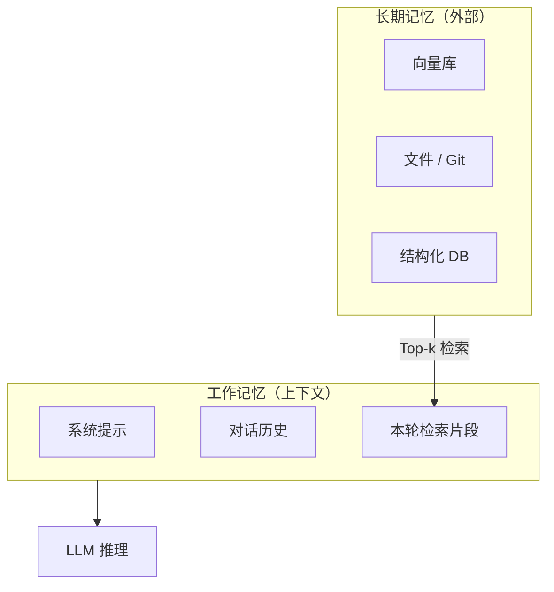

# Memory

> 从 Bit 到 AGI · 第十二章 · 上下文、RAG 与长期记忆——Agent 能记住多少、忘得有多快

LLM 权重里存的是**训练数据的统计压缩**，不是你的聊天记录。Agent 要「记住」用户偏好、上周的代码决策、公司文档，必须额外设计 **Memory** 层。本章区分三种记忆，并给出字节数与检索精度的硬边界。

## 直觉

人脑有**工作记忆**（约 7±2 项，秒～分钟级）和**长期记忆**（年为单位，但提取会失真）。LLM 类似：

- **工作记忆** = 当前 prompt 里的 token（含 [KV Cache](/manual/llm/bit-to-agi/08-inference/what-is-kv-cache) 覆盖的范围）
- **长期记忆** = 外部存储：向量数据库、文件、SQL——需要时再**检索**进上下文

没有长期记忆，每次对话都是从零开始；只有上下文，则对话一长必然「遗忘」中间细节。



## 定义

| 类型 | 存储位置 | 典型容量 | 写入方式 |
| ---- | -------- | -------- | -------- |
| **短期 / 会话** | 内存中的 messages 数组 | 4K–200K token（模型依赖） | 每轮 append |
| **语义长期** | 向量 DB（Embedding 索引） | 10⁶–10⁹ chunk，受磁盘与预算限制 | 离线切块 + embed |
| **程序性 / 状态** | 键值存储、Todo 列表、代码变量 | 任意，但模型未必正确读写 | 编排器维护 |

**RAG**（Retrieval-Augmented Generation）：查询 $q$ → 检索 Top-$k$ 文档块 $\{d_i\}$ → 拼入 prompt → LLM 生成。检索质量上限由 **Recall@k** 决定，与 embedding 模型、分块策略、$k$ 值相关。

记忆写入的**信息论视角**：上下文窗口 $W$ token 最多承载 $W \cdot \log_2 |\mathcal{V}|$ bit 量级信息（$|\mathcal{V}|$ 为词表）；超出部分必须丢失或外置。

## 例子

**例 1：100 页 PDF 手册进 RAG**

| 步骤 | 参数 | 量级 |
| ---- | ---- | ---- |
| 分块 | 512 token/chunk，20% overlap | ≈ 400 chunks |
| Embedding | text-embedding-3-small，1536 维，fp32 | 400 × 1536 × 4 B ≈ **2.4 MB** |
| 检索 | Top-5 chunks × 512 token | +2560 token/查询 |
| 全塞进 128K 上下文？ | 400 × 512 = 204K token | **塞不下**——必须检索，不能 brute-force |

**例 2：会话摘要压缩**

20 轮对话共 40K token，接近 128K 窗口的 30%。工程策略：

```python
if count_tokens(messages) > 80_000:
    summary = llm.summarize(messages[:-4])  # 摘要旧历史
    messages = [
        {"role": "system", "content": f"Earlier summary:\n{summary}"},
        *messages[-4:],  # 保留最近 2 轮
    ]
```

摘要是有损压缩：数字、否定词（negation）、条件分支易丢——**不能**假设摘要等价于原文。

## 量化

- **上下文窗口（2026 常见）**：128K token（≈ 中文 8–12 万字）；旗舰模型可达 1M+，但**长上下文注意力**仍带来延迟与「中间迷失」（lost-in-the-middle）——中间段落召回率可比首尾低 **20–40%**（公开长文 benchmark）。
- **向量检索**：百万 chunk、768 维、HNSW 索引，单次查询 **1–50 ms**（硬件依赖）；Recall@10 在域内文档常 **85–95%**，跨域或 paraphrase 可跌至 **60%** 以下。
- **记忆幻觉**：模型可能「记得」从未写入检索结果的内容——RAG 降低但不消除幻觉；需 citation 与拒答策略。
- **成本**：每轮把 100K token 历史送入旗舰闭源 API（未命中 prompt cache 时），仅输入即可达 **\$0.2–\$2/轮**（价格随供应商与缓存命中率变动）——Memory 设计直接决定账单。

::: warning

「无限记忆」在物理上不成立：要么受窗口限制，要么受检索误差限制，要么受摘要失真限制。三者至少占其一。

:::

## 常见误区

1. **「Fine-tune 一下就能永久记住用户」**——微调更新的是权重快照，不是在线追加事实；个人数据用 RAG 或 LoRA 适配更合适，且都有遗忘与冲突问题。
2. **「向量库 = 完美记忆」**——检索不到就等于不存在；同义词、表格数字、多跳推理是弱项。
3. **「上下文越大越好」**——128K 全满时，模型对早期内容的利用效率下降；**精选检索**常优于**整库灌入**。

## 动手试一试

用本地 JSON 文件模拟「长期记忆」：

```python
import json, math

memory = json.load(open("user_facts.json"))  # {"name": "...", "prefs": [...]}

def retrieve(query: str, k=3):
    # 玩具版：按词重叠打分，生产应用 embedding
    scores = [(f, sum(w in query for w in str(f).split()))
              for f in memory["prefs"]]
    return sorted(scores, key=lambda x: -x[1])[:k]

print(retrieve("咖啡偏好"))
```

把检索结果拼进 system prompt，对比「不检索直接问」的回答差异。

## 深入：记忆写入与冲突

长期记忆不是 append-only。用户先说「我不吃香菜」，三周后说「最近开始尝试香菜了」——系统需要**更新**而非堆叠两条矛盾 fact。工程上常见：

1. **时间戳 + 最新优先** metadata
2. 定期用 LLM **合并** fact 表（类似 git merge，仍有冲突）
3. 显式问用户确认（高 stakes 场景）

向量库本身不做逻辑推理；**冲突消解**仍依赖上层 Agent 或规则。Personalization 产品里，错误记忆比无记忆更糟——用户会感到「被模型冤枉」。

## GraphRAG 与多跳记忆

纯向量 Top-k 对「A 的公司 B 投资了 C，C 的 CEO 是谁？」类 **multi-hop** 弱。Microsoft GraphRAG 等方案在索引期用 LLM 抽实体关系建图，查询时走子图检索。构建成本：每文档 **1–3 次 LLM 调用**；索引时间比 flat RAG 长 **10–50×**；适合静态 CORPUS，不适合毫秒级更新的聊天 log。

## 上下文预算分配

128K 窗口的典型 Agent 分配：system **2K**、tools schema **5K**、RAG **8K**、历史 **20K**、生成 reserve **8K**——合计 43K，看似宽裕，但长代码库 Agent 单文件 diff 即可 **10K+**。需要 **优先级队列**：用户显式 @ 的文件 > 检索 > 旧历史。无预算算法时，模型会在 silent truncation 下工作，表现像「突然变笨」。

KV Cache 对 Memory 的经济影响：第八章指出 cache 避免重复算 attention；Agent 每轮 append 新 token 仍要算新行，历史越长 **边际成本线性增**。摘要虽损真，却是 **控费** 必要手段。

## 小结

Memory 分**上下文工作记忆**与**外部长期存储**；RAG 是连接两者的桥梁。容量、精度、成本三角不可同时极致。Agent 的下一能力：不只回忆，还要**对外行动**——Tool。

→ 下一篇：[Tool](/manual/llm/bit-to-agi/12-future/tool-use)
