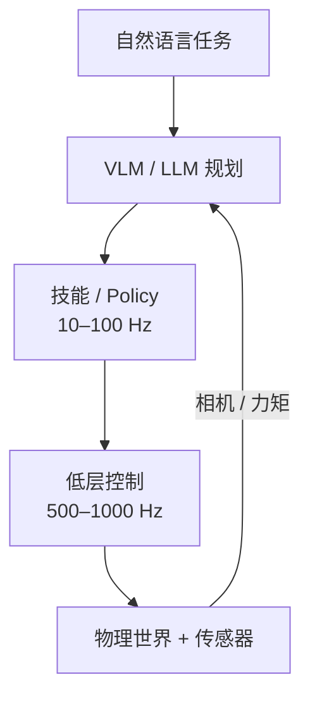

# Robotics

> 从 Bit 到 AGI · 第十二章 · 从 LLM 到机械臂——具身智能的 sim-to-real 鸿沟与毫秒级控制

屏幕上的 click 错了可以 Undo；机械臂撞桌没有 Ctrl+Z。**Robotics** 把 [Agent](/manual/llm/bit-to-agi/12-future/what-is-agent) 的决策接到**力、位姿、传感器**上：视觉语言动作模型（VLA）说「拿起红杯子」，底层 PID / MPC 在 **1 kHz** 跟踪轨迹。LLM 的「慢思考」与控制的「快 reflex」是两套时钟——硬拧在一起，是当前核心工程挑战之一。

## 直觉

三层蛋糕：

1. **高层**：LLM / VLM 理解指令「把脏碗放进洗碗机」→ 子目标序列
2. **中层**：技能库（pick、place、open_door）或 diffusion policy
3. **低层**：电机扭矩、关节角，**毫秒级**闭环

ChatGPT 写代码 **秒级** 可接受；机械臂抖动 **10 ms** 就可能摔杯。LLM **不适合**直接输出每毫秒扭矩——需要中间表示（waypoints、技能 token、latent plan）。



## 定义

**Embodied AI / Robot Foundation Model** 常见架构：

| 模块 | 输入 | 输出 | 频率 |
| ---- | ---- | ---- | ---- |
| VLA（如 RT-2、OpenVLA、$\pi_0$、GR00T） | RGB + 语言 | 离散动作 token 或 7-DoF delta | 1–5 Hz |
| Diffusion Policy | 点云 / 图像 | 动作序列 chunk | 10–50 Hz |
| 经典控制 | 关节状态 | 扭矩 | 500+ Hz |

**Sim-to-real gap**：仿真里训练的 policy 到真实 friction、latency、传感器噪声 上，成功率常**腰斩**。Domain randomization、真实数据 fine-tune 可缓解，不能消除。

## 例子

**例 1：Pick-and-place 任务量级**

| 指标 | 仿真（理想） | 真实实验室（2025–2026 SOTA 量级） |
| ---- | ------------ | ---------------------------- |
| 单物体抓取成功率 | 95%+ | **70–90%**（物体/光照依赖） |
| 未见物体 zero-shot | 80%+ | **40–70%** |
| LLM 开放指令「清理桌子」 | 分解可对 | **全链路低于 30%**（多步 + 失败恢复） |

**例 2：数据与算力**

- Open X-Embodiment 等开源集合：**~1M+ episode**，仍远小于 LLM 的 **trillion token**
- 单 episode：30 s × 10 Hz → 300 步 × 7-DoF ≈ **2.1K 浮点/episode**；1M episode ≈ **2 GB** 级（不含视频）
- 视频观测：720p@30fps，1 min ≈ **3.3 GB 未压缩**——机器人数据比文本**贵几个数量级**

**例 3：与 Computer Use 对比**

| | Computer Use | Robotics |
| --- | --- | --- |
| 动作延迟容忍 | 秒级 | **毫秒～百毫秒** |
| 状态可逆性 | 高 | 低 |
| 传感器 | 2D 屏 | 3D、力、触觉 |
| LLM 直接控制 | 勉强可行 | **不可行**（需分层） |

## 量化

- **控制频率**：力控接触 **500 Hz–1 kHz**；VLA 推理 **1–3 Hz**（GPU 上 ~100–500 ms/步）→ 中间必须**动作 chunking**（一次预测 0.5–2 s 轨迹）
- **定位精度**：桌面抓取需 **±1–5 mm**；纯 RGB 深度误差常 **±1–3 cm**——需深度相机 / 多视角 / 标定
- **LLM 在环延迟**：若每子步都问 GPT-4 级 VLM，**RTT 1–5 s** → 无法抓抛掷物体；**规划与执行分离**是必选项
- **安全**：ISO 10218 / 协作机器人标准；LLM 幻觉 → **物理伤害**；硬件急停、工作空间限位、力矩上限不可省略

::: info

[World Model](/manual/llm/bit-to-agi/12-future/world-model) 在机器人里指「预测物理后果」的 learned simulator，可用于 plan in latent space，但 2026 年仍难替代 MuJoCo / Isaac 的精确 contact。

:::

## 常见误区

1. **「人形机器人 + GPT = 通用管家 imminent」**——演示视频经剪辑；长尾 household 任务成功率未公开、通常**很低**。
2. **「端到端一个大模型搞定」**——数据效率与实时性不支持；**分层**仍是主流。
3. **「仿真够了」**——sim 不含电缆磨损、人闯入、透明物体；**必须**真实数据闭环。

## 动手试一试

用 PyBullet 或 MuJoCo（若已安装）读关节角，理解频率：

```python
# 概念：1000 步仿真 @ 240 Hz ≈ 4.2 s
for _ in range(1000):
    torques = pd_controller(target_q, current_q, current_dq)
    sim.step(torques)  # 每步 < 1 ms CPU
# 若每 240 步调用一次 VLM（1 Hz），规划与执行已脱耦
```

无仿真环境时，记录人类「拿杯子」子步骤数量（通常 **>10** 个 motor 决策/秒），对比 LLM **1 token/20 ms** 的量级差。

## 深入：数据 flywheel 与 teleoperation

特斯拉式 **data flywheel**：部署 → 收集失败 clip → 标注/自动标注 → 重训 → 再部署。机器人公司雇佣 **teleoperator** 戴 VR 遥操作采集 demonstration，小时成本 **\$25–80**（地区差异），每小时 **200–500** 有效 episode 取决于任务。

LLM 可辅助标注（「这段失败因为 grasp slip」），但物理 label（力矩峰值、slip 时刻）需传感器。**文本数据飞轮（flywheel）的规模定律**不能直接 copy 到机器人——这是 [AGI 路线图](/manual/llm/bit-to-agi/12-future/agi-roadmap) 里具身智能 lag 的核心原因之一。

## 法规与部署

公共场所人形机器人面临 **产品 liability**、隐私（相机）、劳工法规（「替代岗位」叙事）。仓库固定基座机械臂商业化更成熟，因环境 **partially structured**。家庭 **unstructured** 环境是 research demo 主战场，**量产**时间表 industry 普遍 **不承诺**。

## 传感与 SLAM 基础

LLM 规划「去厨房」之前，机器人需知 **自己在哪**。SLAM（同时定位与建图）用 LiDAR / 视觉 odometry 维护 pose，漂移 **0.1–1%/米** 行走（消费级）。语义地图（「这是厨房」）来自 VLM 标注，与 metric map 对齐误差可导致 **抓错物体**。硬件栈（相机标定、时间同步）占项目工程 **30–50%** 工时——纯调 prompt 无法替代。

力控夹爪抓取易碎物需 **触觉** 或力矩反馈闭环；纯视觉 VLA 对 contact-rich 任务成功率再降 **10–20** 百分点。这是为何人形 demo 多 pick **刚性** 物体。

电池、热管理、MTBF（平均无故障时间）决定机器人 **实际可工作小时数**；算法 demo 忽略 **2–4 小时** 换电与过热降频。向管理层报「机器人 ROI」时，分母应是 **有效 uptime × 成功率**，不是实验室单次 clip。

开源硬件（ROS2、MoveIt、cheap arm）降低了 **入门** 门槛，但不降低 **长尾** 难度——厨房、医院、工地仍是 research frontier。先在小范围 structured 环境 prove ROI，再谈「通用人形」。

LLM 生成的 **自然语言 plan** 必须映射到 **有限技能库**——开放词汇动作空间在真实硬件上不可控，这是系统设计的硬约束而非临时妥协。

## 小结

Robotics = **语言规划 + 中频 policy + 高频控制**；LLM 位于顶层，不能替代实时回路。Sim-to-real、数据成本、安全使具身智能**显著难于**纯软件 Agent。下一篇：在脑子里（或 GPU 里）**模拟世界**——World Model。

→ 下一篇：[World Model](/manual/llm/bit-to-agi/12-future/world-model)
