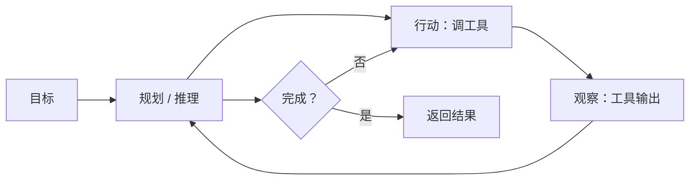

# Agent 是什么

> 从 Bit 到 AGI · 第十二章 · LLM 加循环：规划、行动、观察，以及为何仍远非自主智能体

Chatbot 一问一答；**Agent** 则把 LLM 放进一个循环里：根据目标决定下一步、调用工具、读回结果、再决定再下一步（完整的代码级实现详见[《从 LLM 到 Agent》](https://daiw.org/manual/llm-to-agent)专栏）。这是当前颇具代表性的「能办事的 AI」产品形态——但 2026 年的 Agent 仍是**脆弱的脚本编排器**，不是电影里的自主机器人。

## 直觉

把 LLM 想成一位只带手机、不能亲手动手的实习生。你给他任务「查北京明天天气并写入表格」：他先**想**该搜什么（规划），再**发**搜索请求（行动），**看**返回的 JSON（观察），最后**写**进 Google Sheet（再行动）。若某步失败，他应重试或换策略——这就是 Agent 循环。



与单次补全不同，Agent **状态随轮次累积**：每轮把工具输出追加进上下文，再喂给模型。

## 定义

**Agent**（在此指 LLM Agent）通常包含四件组件：

| 组件 | 作用 |
| ---- | ---- |
| **Policy（策略）** | 通常是预训练 + 对齐后的 LLM，输出文本或结构化「工具调用」 |
| **Tools（工具集）** | 搜索、代码执行、HTTP API、数据库等可调用接口 |
| **Memory（记忆）** | 对话历史 + 可选的外部向量库（见下一篇） |
| **Orchestrator（编排器）** | 解析模型输出、执行工具、处理错误、控制循环次数 |

经典模式 **ReAct**（Reason + Act）：每步先生成 `Thought`（推理片段），再生成 `Action`（工具名 + 参数），环境返回 `Observation`。

一次 Agent 运行的**成本**近似：

$$
\text{总 token} \approx \sum_{t=1}^{T} (\text{prompt}_t + \text{completion}_t), \quad T = \text{循环轮数}
$$

若每轮上下文线性增长（全历史保留），第 $T$ 轮 prompt 长度 $\propto T$，总 token **$O(T^2)$**——长任务很快撞[上下文窗口](/manual/llm/bit-to-agi/08-inference/what-is-kv-cache)与账单上限。

## 例子

**例 1：最小 ReAct 伪代码**

```python
tools = {"search": web_search, "calc": safe_eval}
messages = [{"role": "user", "content": "2024 年诺贝尔物理学奖得主是谁？奖金多少美元？"}]

for step in range(10):  # 硬上限，防死循环
    reply = llm.chat(messages, tools=tools)
    if reply.tool_calls:
        for call in reply.tool_calls:
            obs = tools[call.name](**call.args)
            messages.append({"role": "tool", "content": str(obs)[:4000]})
    else:
        break  # 模型认为可以回答了
print(messages[-1]["content"])
```

**例 2：能力边界（实测量级，非承诺）**

| 场景 | 典型成功率（公开 benchmark / 产品报告） | 主要失败模式 |
| ---- | ---------------------------------------- | ------------ |
| 代码仓库修 Bug（SWE-bench Verified） | ~50–75%+（强模型 + 多步脚手架） | 跨文件副作用、环境配置、幻觉 API |
| 多步 Web 购物（WebArena） | ~10–30% | 页面变化、验证码、长上下文遗忘 |
| 开放式「帮我运营公司」 | 不可靠 | 目标模糊、无持久记忆、无责任链 |

::: info

第八章的 [KV Cache](/manual/llm/bit-to-agi/08-inference/what-is-kv-cache) 在 Agent 里每轮都要重算或追加；10 轮 × 8K 上下文 ≈ 80K token 仅输入，latency 与费用随轮次陡增。

:::

## 量化

- **循环深度**：生产系统常见硬限 **5–20 步**；超过则强制停止或摘要历史。
- **延迟**：每步 1 次 LLM 调用；GPT-4 级模型单步 **2–15 s**（视长度）；10 步任务可能 **30 s–3 min**。
- **可靠性**：无形式化验证时，$n$ 步任务粗略成功率 $\approx p^n$（$p$ 为单步成功率）。$p=0.9, n=10$ → **≈35%**；$p=0.7$ → **≈2%**。
- **与 AGI 的距离**：Agent 不会自主扩展目标、不会从物理世界直接学习、多数无持续数月的状态——仍是**任务脚本 + 大模型**。

### 自己拖一下

「单步 90%」听起来很高，但它要连乘。拖一下就懂了——这和第一章「基数是乘法」是同一个数学：

<AgentReliability />

单步 90% 的 Agent，10 步任务只有 35% 成功；单步 70% 则只剩 2%——**单步差 20%，端到端差 17 倍**。这就是为什么 Agent 难落地：可靠性是能力的**连乘**，不是平均。两条出路都在图里：把单步做得更准（$p$ 从 0.9 到 0.99，10 步从 35% 跳到 90%），或把步数砍短（计划-执行分离、子 Agent 分工）。这也是本章后面反复出现的那个 $p^n$——它是整章核心的硬量化主张。

## 常见误区

1. **「Agent = 自主 AGI」**——当前 Agent 需要人类写工具、定目标、设预算；模型不会自己发明新工具链。
2. **「更多步数总是更好」**——步数增加误差累积与上下文膨胀；工程上常用**计划-执行分离**或子 Agent 分工。
3. **「Thinking 越长越聪明」**——推理 token（如 o1 类）提高单步质量，但不解决工具幻觉与外部世界漂移。

## 动手试一试

用任意支持 function calling 的 API，实现「只允许 `add(a,b)` 和 `mul(a,b)` 两个工具，计算 $(3+4)\times(5+6)$」：

```python
# 期望轨迹：add(3,4)→7, add(5,6)→11, mul(7,11)→77
# 若模型一步口算出 77 而跳过工具，说明它在「作弊」——生产环境应强制走工具链以便审计
```

记录实际步数与总 token；与「单轮直接问答案」对比费用。

## 深入：单 Agent 还是多 Agent？

当任务可分解为「研究员 + 程序员 + 审稿人」时，**Multi-Agent** 架构让多个 LLM 实例（或不同 system prompt 的同一模型）通过消息总线协作。OpenAI Agents SDK（原 Swarm）、MetaGPT、AutoGen 等框架提供角色分工模板。

优势：每个子 Agent 上下文更短，工具集更小 → 单步 $p$ 可能从 0.75 提到 0.88。劣势：Agent 间通信本身消耗 token；**责任模糊**——出错时难追溯是哪一步决策；协调开销使简单任务反而更慢。

经验法则：步骤 **低于 5** 且工具 **低于 10** 时用单 Agent；跨仓库、跨角色项目再考虑 Multi-Agent，并务必加**共享黑板**（结构化状态，而非纯自然语言传话）以防电话游戏式失真。

## 与训练栈的衔接

Agent 能力不只在推理循环里。**SFT** 阶段可注入 tool trajectory 示范；**RLHF/DPO** 可偏好「先查再答」而非瞎编。未见过某种工具 schema 的 base model，零样本 function call 准确率可能比 instruction-tuned 低 **20–40%**。因此「Agent 产品」往往绑定特定模型版本与 prompt 套件，换模型需回归 eval。

## 生产 checklist

上线 Agent 前至少确认：**(1)** 最大步数与 timeout；**(2)** 每步 token 预算上限；**(3)** 工具 allowlist 与写操作确认；**(4)** trace 日志可回放；**(5)** 失败时 graceful degrade（返回部分结果 + 人工接管入口）。缺任何一项，demo 到生产的距离会以 **P0 事故** 形式提醒。

## 小结

Agent = **LLM + 工具 + 循环编排**；ReAct 是常见模式。能力受单步准确率、上下文长度、工具覆盖三者乘积约束，**多步任务成功率指数下降**。下一篇解决循环里「记住什么」：Memory。

→ 下一篇：[Memory](/manual/llm/bit-to-agi/12-future/memory)
