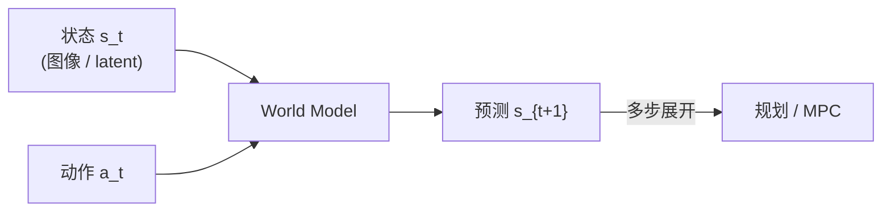

# World Model

> 从 Bit 到 AGI · 第十二章 · 学习模拟器——视频预测、latent 规划与「真懂物理吗」的检验

人类靠「想象」评估后果：松手杯子会落。AI 的 **World Model** 试图在神经网络里学一个**可滚动的环境**：给定状态 $s_t$ 与动作 $a_t$，预测 $s_{t+1}$。用于机器人规划、游戏、视频生成——但 2026 年的 world model **不等于**牛顿力学引擎：长期 rollout 会糊、会违物理，**不能**当唯一安全依据。

## 直觉

两类「世界模型」常被混谈：

1. **预测型**（Dreamer、Sora、Genie 2/3、NVIDIA Cosmos 类 video/world model）：学 $p(s_{t+1}|s_t,a_t)$ 或 $p(\text{next frames}|\text{past frames})$
2. **表征型**（LeCun JEPA / V-JEPA 2）：学抽象 state，预测**表征**而非像素，避免逐像素幻觉

就像天气预报：短期可用，**第 10 天**误差爆炸。Agent 若在 imagined rollout 里规划，horizon 必须短，或 frequent **replan** 用真实观测校正。



## 定义

形式化：**World model** 是环境转移的可学习近似 $\hat{T}(s_{t+1}|s_t,a_t)$ 或生成模型 $\hat{p}(o_{t+1}|o_{\le t},a_t)$（$o$ 为观测）。

训练目标常见：

- **视频预测**：MSE / perceptual loss on pixels（易模糊）
- **Latent dynamics**：在 $z_t = enc(o_t)$ 上预测 $z_{t+1}$（DreamerV3）
- **扩散 / flow**：对下一帧分布建模（质量高、采样慢）

**Planning**：在 $\hat{T}$ 里搜索动作序列 $\max_a \mathbb{E}[\sum r_t]$（MPC）或训练 policy on imagined trajectories（**model-based RL**）。

与 [Scaling Laws](/manual/llm/bit-to-agi/05-transformer/scaling-laws-intro) 的关系：video world model 同样吃 **data + compute**，但**每帧信息**远大于 token，数据效率仍是瓶颈。

## 例子

**例 1：Dreamer 类 latent rollout**

| 步数 | 训练环境 | 预测质量（经验量级） |
| ---- | -------- | -------------------- |
| 1–5 | 训练分布内 | latent 合理，可用于 plan |
| 15–50 | 分布内 | 奖励预测仍可用，像素若解码已糊 |
| 50+ | 分布外 | **崩溃**——物体消失、违反守恒 |

**例 2：Sora / 视频生成作为「弱 world model」**

- 输入文本 + 可选首帧 → 生成 5–20 s 视频
- **不接收** arbitrary 动作 序列；**不是**交互式 simulator
- 物理错误（人穿模、液体倒流）在长片常见——**娱乐级**而非 **engineering-grade**

**例 3：机器人中的用法**

1. 用 10k 真实 episode 训 $\hat{T}$
2. MPC：采样 256 条 imagined 轨迹 × horizon 15 → 选最优首动作
3. 执行 1 步 → **真实传感器**更新 → 再 plan（receding horizon）

单步 plan 若 VLM+WM **200 ms**，控制频率上限 **5 Hz**——与 [Robotics](/manual/llm/bit-to-agi/12-future/robotics) 低层 1 kHz 仍需 decoupling。

## 量化

- **参数与数据**：OpenAI Sora 级未公开细节；学术 video model **~100M–10B** 参数，训练 **10⁶–10⁸** 视频 clip 量级
- **单步预测 FLOPs**：与分辨率成正比；256×256 小模型 **~1–10 GFLOPs/步**；1080p 扩散 **~100 GFLOPs+**
- **误差累积**：若每步像素误差 $\epsilon$，$H$ 步 rollout 误差 **$O(H\epsilon)$ 至 $O(\epsilon^H)$**（混沌系统后者）
- **与 AGI**：world model 提供「反事实推理」的一块，但**缺因果干预验证**、**缺开放域物体恒常性**——远未覆盖人类物理直觉

::: warning

不要用 video model 的「看起来对」替代碰撞检测、力矩限位。**安全关键**路径必须走解析物理或实测反馈。

:::

## 常见误区

1. **「学会生成视频 = 理解物理」**——相关性 ≠ 因果；模型可 memorise 训练 clip 模式。
2. **「World model 可以无限想象」**——horizon 受 compounding error 限制；长规划需分层抽象（符号 + 连续）。
3. **「一个 WM 通吃所有环境」**——Office / Kitchen / Highway 转移函数不同；**泛化**仍弱于 LLM 文本域。

## 动手试一试

用随机游走模拟 compounding error：

```python
import random

def rollout(steps, noise=0.05):
    x = 1.0
    traj = [x]
    for _ in range(steps):
        x = x * (1 + random.gauss(0, noise))  # 相对误差累积
        traj.append(x)
    return traj

for H in [5, 20, 100]:
    finals = [rollout(H)[-1] for _ in range(1000)]
    print(f"H={H}, std(final)={__import__('statistics').pstdev(finals):.3f}")
```

观察 $H$ 增大时预测 spread——理解为何 robot MPC horizon 常 **低于 20**。

## 深入：JEPA 与「不生成像素」

Yann LeCun 倡导的 **JEPA**（Joint Embedding Predictive Architecture）在 abstract representation 空间预测，避免 pixel-level 幻觉消耗容量。直觉：规划「车会不会撞墙」只需 latent 里 **碰撞布尔**，不必渲染每帧车漆反光。

Tradeoff：latent 人类不可读，debug 难；与 LLM 文本 world knowledge 如何 **fuse** 仍是开放问题。Sora 路线偏 **generative video**；JEPA 路线偏 **planning-centric**——2026 年两条线都在投，无胜负。

## 世界模型 + LLM 分工

常见架构：LLM 做 **high-level subgoal**（「先开门再进厨房」），world model 在 latent 里 **rollout 5 步** 选手势，低层 policy 执行。LLM 不应每步参与——否则 [Robotics](/manual/llm/bit-to-agi/12-future/robotics) 延迟瓶颈再现。

文本 LLM 的 world knowledge（「冰会化」）与 learned WM 的 **视觉动力学** 可能 **矛盾**（模型按统计画冰不化）。融合策略：**WM 优先物理**，LLM 优先语义任务分解——冲突时以传感器为准（reality check）。

## 评测：世界模型测什么

Video prediction 常用 FVD（Fréchet Video Distance），数值越低越好，但与 **下游 plan 成功率** 相关性 **中等**——好看不等于好用。机器人界更看 **model-based RL return** 或在 imagined rollouts 里 goal reach rate。报告 world model 论文时，读者应问：**horizon 几步？分布内还是外？** 无 downstream 数字的 pixel MSE 几乎无工程意义。

游戏引擎（Unreal/Unity）提供 **oracle simulator**；真实世界没有。用引擎 pretrain 再 sim-to-real 仍是 2026 主流 pipeline，引擎 license 与 **domain gap** 是 hidden cost。

World model 研究热点还包括 **可干预性**（do-operator：「若推这个方块会怎样」）——需要 interventional 数据，纯观察视频不够。因果与统计预测的分野，是 world model **能否支撑 counterfactual 规划** 的分水岭；当前多数 video model 仍在统计拟合侧。

对工程师：在选用 world model 前问三个问题——**(1)** horizon 几步仍可信？**(2)** 是否支持 action conditioning？**(3)** 有无 downstream task 数字？三问缺一则更像 demo 而非 production component。

与 [Computer Use](/manual/llm/bit-to-agi/12-future/computer-use) 的像素输入相比，latent world model 省 token 但损可解释性——团队需在 **debuggability** 与 **sample efficiency** 之间选型，无 universally best。

训练 world model 的数据标注成本常被低估：视频 clip 需对齐 action label（关节角、键盘事件），每秒 **10–50 维** 连续标签；纯文本 pretrain 那套 scrape-scale  playbook **不能直接复制**。

## 小结

World model 不是 AGI 的充分条件：婴儿也靠物理互动学因果，但还靠语言与社会反馈——WM 只是 [AGI 拼图](/manual/llm/bit-to-agi/12-future/agi-roadmap) 中的一块，且目前工程成熟度仍较低。

World Model 学环境的**可预测近似**，支撑 imagined planning 与 video 生成。短期 rollout 有用，长期与分布外**不可靠**；与 LLM 文本世界知识互补，不能单独支撑 AGI 级物理推理。下一篇：把这些拼图放进**时间线**——AGI 路线图（含诚实的能力缺口）。

→ 下一篇：[AGI 路线图](/manual/llm/bit-to-agi/12-future/agi-roadmap)
