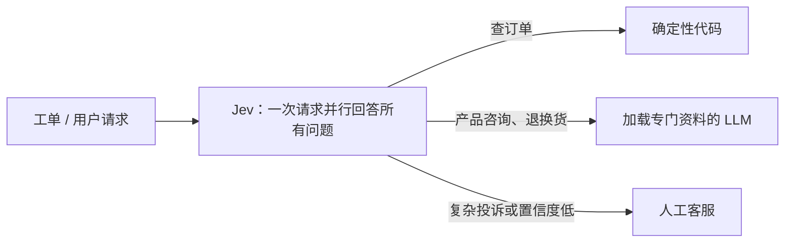

# 应用：从分类路由到玩 Doom

> 官方文档、合作方与早期用户公开的 Jev 用例：工单分诊与意图路由、Agent 动作审查与模型路由、检索重排与邮件分类，以及 Doom 和维基竞速两个实时演示。

医院门口的分诊台不看病，只做几个很快的判断：挂哪个科、急不急、要不要马上叫医生。判断错了代价不小，所以分诊护士拿不准时会多问一句，或者直接请医生来看。

Jev 公开的用法，大多是在软件里当这个分诊台：一件事进来，先由它在零点几秒内给出“归哪类、有多急、有没有风险、有几成把握”，再由代码决定交给谁。这一篇把官方文档、合作方和早期用户公开的例子按用途过一遍。厂商自己报的数字标“官方口径”，用户自测的标“客户口径”，二者都还没有独立复现。

## 官方的用例地图

文档的用例页把适用场景归成五大类 [1]：

- **AI 自动化软件**：把 AI 嵌进可靠的软件流程，在后台跑上百万次也不需要人盯着；控制流归代码，语义判断归 Jev。
- **实时应用**：约 150 毫秒的判断速度，快到可以编程玩游戏，或嵌进用户界面。
- **大数据上的 AI 版 MapReduce**：便宜 100 倍意味着可以在海量语料上搜索、分类、抽取特征。
- **通用校验**：检查其他 AI 的输入提示、抽取结果、推理轨迹和工具调用，找出越狱、引用错误和幻觉。
- **改进 Agent 外壳**（harness）：模型路由、语义检索、LLM 出错检测与护栏、推理轨迹分类。

同一页还按行业列了十几个方向（客服、保险理赔、金融犯罪、法务合规、内容审核、招聘、电商、广告、游戏等），并把能交给 Jev 的决策归纳成十种形状：分类、检测、打分、路由、搜索、检索、排序、校验、为传统机器学习模型抽取特征、结构化数据抽取 [1]。发布博客的说法更直白：它是一种“智能 if 语句”，凡是手写规则太脆弱、需要分类、路由、打分、抽取或分支的地方都能用 [2]。下面挑已有公开细节的几类展开。

## 分诊台：工单与意图路由

文档里最完整的例子都围绕客服工单，常用的套路有三个 [3][4]：

- **投机式扇出**（speculative fan-out）：把后面可能用到的问题一次问完。智能家居演示里，“把全屋的灯关掉”这句话被同时问“是哪类请求”“针对哪个区域”“哪类设备”“对灯做什么”。最后一题假定了对象是灯，却在还不知道时就问了，用不上的答案由代码丢掉。文档指出，按顺序一题一题问虽然题数最少，却更慢也更贵。
- **意图路由**：先分类，再把查订单这类请求交给确定性代码，把产品咨询、退换货交给加载了不同资料的专门 LLM，把复杂投诉或分类没把握的请求交给人。
- **置信度门控**：同一系统里，不同动作用不同门槛。语音银行的例子中，任何意图的置信度低于 0.6 都转人工；查余额达到 0.6 即可执行，批准转账则要高于 0.85，否则先向用户确认。



智能家居演示还展示了 Jev 与 LLM 的配合：一道是非题判断用户是否一句话里提了几个要求，是的话才让 LLM 拆句；判断为闲聊或打听信息时，再交给对话 LLM 生成回复 [4]。

## Agent 的刹车片：动作审查、模型路由与事后复盘

编程 Agent 能自己执行命令，每一步执行前要不要拦一下，是一个高频、要快、答案有限的判断，正好落在 Jev 擅长的范围里。Vercel 宣布接入 Jev 时举的例子也大多围绕 Agent：在循环里选下一个工具或子 Agent，决定继续、重试、询问用户还是停止，在动作前给紧急度或风险打分，以及校验模型输出、执行护栏 [5]。已经公开的做法有三类。

**Vercel 的 fx**。fx 是 Vercel Labs 开源的编程 Agent。它默认的 auto 权限模式会对规则没覆盖到的动作做一次自动审查，审查提出异议或无法完成时就扣住这个动作。文档写明，把 `review_model` 设为 `"typesafeai/jev"`，审查就改由 Jev 完成，返回带类型的“放行 / 警示”判断以及校准概率和置信度；在 Vercel AI Gateway 上，9 月中旬查阅时默认审查模型是 `moonshotai/kimi-k3` [6]。TechCrunch 报道称，Vercel 用 Jev 替换原来的审查模型后结果快了 5 到 18 倍、也更准 [8]；Vercel 工程师 Pranit Sharma（X 账号自述为 fx 的开发者）本人贴出的是一次基准对比（客户口径）[7]：

| 审查模型 | 准确率（70 条样例 × 3 次） | 中位延迟 | p95 延迟 |
| --- | --- | --- | --- |
| Jev | 207/210（98.6%） | 312 毫秒 | 374 毫秒 |
| gpt-5.6-luna（fx 当时的首选） | 203/210（96.7%） | 1,458 毫秒 | 6,583 毫秒 |

他的总结是：中位快 4.7 倍、p95 快 17.6 倍；70 条样例三次结果完全一致，LLM 则有一次前后不一。

**LangChain 的中间件**。`langchain-typesafe` 除了通用的 `TypeSafeClassifier`，还带两个实验性中间件：`ModelRouterMiddleware` 让 Jev 按请求难度在便宜模型和强模型之间挑一个，`AutoModeMiddleware` 在工具执行前检查风险、拦下危险调用 [9]。后者的用法只有几行，原样摘自 LangChain 官方博客：

```python
from langchain.agents import create_agent
from langchain_typesafe.experimental.middleware import (
    AutoModeMiddleware,
)

guardrail = AutoModeMiddleware(tools=["bash"])

agent = create_agent("openai:gpt-5.6-luna", middleware=[guardrail])
```

LangChain 在文中说，Claude、Codex、Cursor 这类编程工具早就有“动作执行前先分类”的一步（比如本站介绍过的 [Claude Code auto 模式](https://daiw.org/manual/claude-code/commands-model-permissions)），只是一直藏在闭源部分；有了又快又便宜的分类模型，任何 Agent 都能照做 [9]。权限闸门本身怎么设计，可参考[从 LLM 到 Agent · 权限系统](https://daiw.org/manual/llm-to-agent/permissions)。模型路由也被外部开发者看好：Earendil 的 CTO Armin Ronacher 对 TechCrunch 说，预判一个任务该用哪个模型很有用，但用 LLM 来预判太贵，Jev 的速度和价格让这种实时分流成为可能 [8]。

**事后复盘与护栏**。TypeSafe 公开的四个评测工作流之一“Agent 轨迹可观测性”（Agent Trace Observability），是在客服 Agent 跑完一单后读取它的指令、对话、每次工具调用和最终回复，决定自动关闭、判为非缺陷、转人工、优先复核、提交问题还是呼叫值班：先查每个不可撤销的动作有没有越权，越权就直接呼叫值班；再分别判断任务是否完成、用户是否满意，据此分成健康、预期落差、明显失败、静默失败四种情况处理 [10]。据 TechCrunch，Almeida 认为用 Agent 去监控 Agent 很快就会变得昂贵，换成 Jev 才划算，他设想用户用它跟踪 LLM Agent 的执行轨迹、拦截越狱 [8]。官方的护栏示例则对进出 LLM 的每条消息各筛一遍：一次请求里问几道是非题（是否越狱、是否涉及伤害或犯罪、是否在要诊断或剂量、是否涉及自伤），再加一道“照做会造成多大伤害”的打分题，按阈值决定放行、复核、拦截或转入危机支持 [11]。

## 批量处理：检索重排与邮件分类

单次判断便宜到一定程度，就可以把判断铺到每一条数据上。

**检索重排**（官方口径）。在 CLERC 法律数据集的 3,565 段判决书里，先用 BM25 关键词检索给 40 个查询各筛出 30 个候选，再让 Jev 对每个“查询—候选”对单独打分、重新排序：正确段落排在第一的比例从 5% 升到 18%，进入前十的比例从 38% 升到 62% [12]。

**邮件分类**（客户口径）。Bryo AI 的联合创始人兼 CTO Nikhil Mudholkar 在 9 月 17 日发了一组针对首发版 `jev-1.13.0` 的测试 [13]：1,565 封来自工业供应商的德、英文商务邮件（1,201 封真实邮件，外加 364 封为罕见类别补写的 AI 邮件，以德语为主），分进订单、询价、发票争议等 10 个类别，三个模型用同样的邮件和类别说明。

| 指标 | Jev（`1.13`） | Gemini 3.5 Flash-Lite | Gemini 3.8 Flash |
| --- | --- | --- | --- |
| 总体准确率 | 96.4% | 97.5% | 98.5% |
| 各类别等权的准确率 | 92.0% | 94.6% | 96.9% |
| 每千封邮件成本 | 0.08 美元 | 0.80 美元 | 1.79 美元 |

也就是说，**Gemini 更准，Jev 便宜得多**：两款 Gemini 分别贵约 10 倍和 22 倍；他还提到 Jev 单次从未超过 1.3 秒。他最看重的是置信度：置信度不低于 99% 的 737 条全部与参考标签一致，最有把握的 85.5% 一条没错，置信度低于 70% 的则将近一半是错的，错误集中在它自己说“没把握”的地方。他也列了当时的保留意见：附件因为 9 月首发时的 Jev 不支持非文本输入而被排除，他认为这是上生产的最大障碍（注：10 月 14 日发布的 `jev-1.14.0` 已加上 PNG/JPEG 图像支持，并专门提升了德语等非英语语言的准确率，但 PDF 等文档附件仍需先转文本或转图片）；此外参考标签大多由 AI 生成。TechCrunch 的转述是“Gemini 略准，但贵 10 到 20 倍”[8]。

## 实时演示：Doom 与维基竞速

发布博客里，团队最得意的是两个游戏演示 [2]。

**Doom**。9 月首发演示里，喂给 Jev 的不是画面，而是用数据结构加文字描述的游戏状态，由它实时判断下一步怎么做（10 月 14 日更新日志则把新增的图像输入能力戏称为“Dreamer-ready”，并配上了直接看画面与 UI 边界框的视觉能力）。负责的工程师原本担心每秒调用 10 次太贵，算下来约每小时 7 美元，团队反倒觉得比预想的低（按标价粗算，相当于每次调用四五千个输入 token，本文推算）。博客也承认，不用 AI 的 Doom 机器人可以玩得更好；他们想要的是一个能适应不同状态表示、并且会听指令的机器人，还打算发布详细教程、办活动让大家一起改。The Register 干脆把标题写成“为机器设计的模型会玩 Doom”，但也指出它更可能被用在客服工单这类业务流程上 [14]。

**维基竞速**（Wikiracing）。从一个维基百科页面出发，只点页面里的链接，比谁先到达目标页面。每一步要在几百到几千个链接里选，既考“每秒的智力”，也考在大量选项中不出错。Jev 的一道选择题最多 255 个选项，链接更多时分两步：先对每个链接单独打分，再在高分者里明确选择，所以偶尔会慢一点。博客提醒，这里对比的 LLM 大多关了推理（Astra 用的是最低推理档），所以提速幅度比其他演示小，而 Jev 往往用更少的步数到达（官方口径）；LLM 开了推理会好得多。

社区也很快做出了自己的版本。例如一个开源的 Minecraft 实验项目让 Jev 每次从一组原子动作里选一个（移动 250 毫秒、转 30 度、瞄准、挖一块、放一块等），由 Mineflayer 执行；观察值、候选坐标和合法性检查都由代码提供，作者强调这是“结构化世界状态控制，不是看截图”[15]。

## 这些用例的共同点

放在一起看，Jev 适合的活儿有几个共性（本文归纳）：

1. **答案空间事先已知**：部门、风险等级、放行与否、下一个链接、画面里的目标框，都能定义成固定类型的输出。
2. **量大或要快**：每条消息、每个动作、每一帧都要判断，LLM 的延迟和账单扛不住。
3. **需要知道自己没把握**：拿不准的可以交给人或更强的模型。Bryo 的测试者最看重的就是这一点，fx 的审查记录里也会留下校准概率和置信度。
4. **控制流在代码里**：Jev 只回答问题，做什么由代码决定。

这些例子都来自厂商、合作方和早期用户，还没回答两个问题：在独立、大规模的测试里它到底有多准？哪些事它做不好？下一篇专门谈。👉 [局限与展望](/manual/llm/jev/limits-outlook)

## 参考文献

- [1] TypeSafe 文档. “Example use cases.” [docs.typesafe.ai](https://docs.typesafe.ai/concepts/use-case-map) —— 五大类场景、行业清单与十种决策形状。
- [2] TypeSafe AI（Diogo Almeida）. “Introducing System One Models & Jev.” 2026-09-15. [typesafe.ai/blog](https://typesafe.ai/blog/introducing-system-one-models-and-jev) —— “智能 if 语句”的定位，Doom 与维基竞速演示及其说明。
- [3] TypeSafe 文档. “Speculative fan-out”“Intent routing”“Confidence-gated routing.” [fan-out](https://docs.typesafe.ai/patterns/fan-out)、[intent-routing](https://docs.typesafe.ai/patterns/intent-routing)、[confidence-routing](https://docs.typesafe.ai/patterns/confidence-routing) —— 三种路由套路与示例阈值。
- [4] TypeSafe 文档. “Smart home assistant demo.” [docs.typesafe.ai](https://docs.typesafe.ai/demos/smart-home) —— 投机式扇出的例子，以及与 LLM 的配合。
- [5] Vercel（Rohan Taneja 等）. “TypeSafe AI's Jev now available on AI Gateway.” 2026-09-16. [vercel.com/changelog](https://vercel.com/changelog/typesafe-ai-jev-now-available-on-ai-gateway) —— 面向 Agent 的用例清单。
- [6] Vercel Labs. fx 文档 “Permissions” 与项目首页. [fx.sh/docs](https://fx.sh/docs/configure-fx/permissions)、[fx.sh](https://fx.sh/) —— auto 模式的自动审查、`review_model` 设置与默认审查模型。
- [7] Pranit（@fazxes）. X 帖子及附图. 2026-09-16. [x.com/fazxes](https://x.com/fazxes/status/2100300097695232164) —— fx 安全审查分类器的对比数字（客户口径）。
- [8] Tim Fernholz（TechCrunch）. “A new kind of AI model from a ChatGPT inventor is thrilling developers.” 2026-09-18. [techcrunch.com](https://techcrunch.com/2026/09/18/a-new-kind-of-ai-model-from-a-chatgpt-inventor-is-thrilling-developers/) —— 二手来源：Vercel 与 Bryo 测试的转述，Almeida、Ronacher 的说法。
- [9] Sydney Runkle, Hunter Lovell（LangChain）. “Building a Harness with Jev.” 2026-09-17. [langchain.com/blog](https://www.langchain.com/blog/building-a-harness-with-jev) —— `langchain-typesafe` 与两个中间件，代码原样摘录。
- [10] TypeSafe. “Workflow evals · Agent Trace Observability.” [evals.typesafe.ai](https://evals.typesafe.ai/agent_trace_observability) —— Agent 轨迹复盘工作流的输入、输出与步骤。
- [11] TypeSafe 文档. “Guardrails for LLMs”（cookbook）. [docs.typesafe.ai](https://docs.typesafe.ai/cookbooks/llm_guardrails) —— 进出 LLM 的消息筛查设计。
- [12] TypeSafe 文档. “Re-ranking”（cookbook）. [docs.typesafe.ai](https://docs.typesafe.ai/cookbooks/rerank_typesafe) —— CLERC 重排实验与第一名、前十命中率（官方口径）。
- [13] Nikhil Mudholkar（@nikhilmudholkar，Bryo AI 联合创始人兼 CTO）. X 帖子串及附图. 2026-09-17. [x.com/nikhilmudholkar](https://x.com/nikhilmudholkar/status/2100604560335139083) —— 邮件分类测试的数据、成本与保留意见（客户口径）。
- [14] Thomas Claburn（The Register）. “TypeSafe AI debuts model for machines that plays Doom.” 2026-09-16. [theregister.com](https://www.theregister.com/ai-and-ml/2026/09/16/typesafe-ai-debuts-model-for-machines-that-plays-doom/5296711) —— 二手来源：Doom 演示与“更可能用于业务流程”的判断。
- [15] ellistev. “typesafe-minecraft-demo” 仓库 README. [github.com/ellistev](https://github.com/ellistev/typesafe-minecraft-demo) —— 社区实验项目：Jev 选择原子动作控制 Minecraft 角色。
