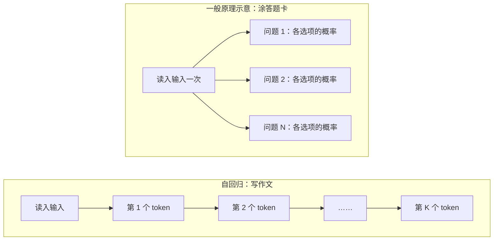

# 原理一：一次给出全部答案的并行采样

> LLM 为何只能逐个 token 地写，并行生成有哪些公开路线；TypeSafe 对“并行采样器”说了什么、没说什么，“不会幻觉”又该怎么理解。

考试有两种题：作文和选择题。作文只能一个字一个字往下写，后一句要接着前一句；选择题则不同，读完材料，你可以一口气把答题卡上的圆圈全部涂完——每道题的选项早就印在卷子上，你只是在里面挑。

今天的大语言模型（LLM）做什么都像在写作文，哪怕你只想让它做一道选择题。Jev 的思路是：既然答案只在几个选项里挑，那就按“涂答题卡”的方式来。TypeSafe 管这叫并行采样（parallel sampling），发布博客说它为此配了一个“追求极致效率的并行采样器”[1]。

这一篇分三步：先讲自回归为什么慢；再讲“并行输出”在公开研究里有哪几条路；最后对照 TypeSafe 公开了什么、没公开什么，以及“输出空间预先定义，所以不会幻觉”这句话的含义与边界。

## 自回归：为什么逐 token 生成慢

LLM 生成文本的方式叫自回归（autoregressive）：每次只预测下一个 token（词元，模型处理文字的最小单位），把它接到已有内容后面，再预测下一个。写成公式：

$$
p(y_1,\dots,y_T \mid x)=\prod_{t=1}^{T} p\left(y_t \mid y_1,\dots,y_{t-1},\, x\right)
$$

$x$ 是输入，$y_1$ 到 $y_T$ 是依次生成的 token。白话：整段输出的概率，等于每一步“在前文已经写定的条件下，下一个 token 是什么”的概率连乘。第 $t$ 步必须等第 $t-1$ 步写完才能开始。站内的[为什么 GPT 可以预测下一个 Token](https://daiw.org/manual/bit-to-agi/03-information/why-gpt-predicts-next-token) 讲过这件事的来龙去脉。

这带来一个硬约束：生成 K 个 token，就要把模型串行地跑 K 遍 [2]。Google 的一篇推理工程论文把一次推理拆成两段 [3]：

- **预填充**（prefill）：输入在开头就全部已知，所有输入 token 可以在一次前向计算里并行处理；
- **解码**（decode）：输出只能一个一个地生成，每一步都是一次完整的前向计算，而且每一步都要把模型权重和 KV 缓存从显存搬到计算单元一遍。

这篇论文在 PaLM 540B 上把小批量解码做到每个 token 约 29 毫秒 [3]。照这个量级粗算，写 1000 个 token 就要约半分钟：要写的越多，串行的步数就越多。推理模型还要先写一大段“思考”，延迟更长。KV 缓存是什么，见站内的 [KV Cache 是什么](https://daiw.org/manual/bit-to-agi/08-inference/what-is-kv-cache)。

## 让输出并行起来：公开研究里的四条路

### 路线一：非自回归生成

2017 年，Gu 等人提出非自回归翻译（Non-Autoregressive Translation）：一次并行地输出整句译文，推理延迟降低一个数量级，代价是翻译质量（BLEU 分数）最少只掉约 2 分 [4]。难点被他们称为“多峰问题”（multimodality problem）：英文 `Thank you` 可以译成德文 `Danke.`、`Danke schön.` 或 `Vielen Dank.`；如果每个位置的词各选各的，模型就可能拼出 `Danke Dank.` 这种四不像，因为“各位置相互独立”的分布表达不了“这几个词必须一起出现”[4]。

### 路线二：扩散语言模型

扩散模型原本用来生成图像。2021 年的 D3PM 把它推广到文字这类离散数据，其中一种“吸收态”（相当于把 token 换成遮罩）的做法，把扩散模型和遮罩式生成联系了起来 [5]。直觉上，它像“先打一张全是空格的草稿，再分几轮把空格成批填上”：每一轮都并行地填很多位置，总轮数远少于 token 数。

- 2024 年的 MDLM 表明，简单的遮罩扩散比此前以为的强得多，在语言建模基准上逼近自回归模型的困惑度 [6]。
- 2025 年的 LLaDA 从头训练了一个 80 亿参数的扩散语言模型，在上下文学习上与 LLaMA3 8B 相当 [7]。
- 2025 年，Inception Labs 发布商用扩散模型 Mercury：据第三方机构 Artificial Analysis 的评测，其代码模型 Mini 与 Small 在 H100 上分别达到每秒 1109 与 737 个 token，平均比为速度优化过的前沿模型快最多 10 倍 [8]。

这条路仍然在生成自由文本，只是用更少的轮数写完。

### 路线三：投机解码

还有一种思路不改模型本身：先让一个小模型快速“猜”出几个 token，再让大模型一次性并行验证，猜对的直接收下。它能保证输出分布与原模型完全一致，论文在 T5-XXL 上报告提速 2 到 3 倍 [2]。站内见 [Speculative Decoding](https://daiw.org/manual/bit-to-agi/08-inference/speculative-decoding)。

### 路线四：答案本来就是有限集合，那就不用“生成”

如果答案只是事先给定的几个选项之一，根本不必逐字写出来：

- **分类头**：BERT 取序列开头 `[CLS]` 位置的向量，乘上一个 `K×H` 的矩阵再做 softmax，一次前向计算就得到 K 个标签上的分布 [9]。
- **给候选打分**：GPT-3 论文做选择题评测时，把每个选项接在题目后面，比较模型给各个选项的似然（按 token 数归一化），取最高的那个 [10]。选项是现成的，算它的似然只要把“题目加选项”整段送进模型做一次前向计算，和预填充一样可以并行 [3]，不需要逐 token 生成；各个选项之间也互不依赖。
- **共享的输入只算一次**：多个候选共用同一段前缀时，前缀对应的 KV 缓存可以复用；vLLM 就支持在请求内部和请求之间共享 KV 缓存 [11]。站内见 [Prefix Caching](https://daiw.org/manual/bit-to-agi/08-inference/prefix-caching)。

这条路绕开了路线一的多峰问题：每道题的答案是一个完整的选项，不存在“拼出四不像”的可能。代价同样清楚：模型只能在你给的选项里挑，写不出选项以外的东西。

::: info

以上四条是公开的一般方法。Jev 用的是其中一条、几条的组合，还是全新的东西，官方尚未公开。

:::

## TypeSafe 公开了多少

### 官方说过的

| 官方说法（译述） | 出处 |
| --- | --- |
| 为自动化重做了整套技术栈：新的模型架构、追求极致效率的并行采样器、新的训练方法 RLCD | 发布博客 [1] |
| 采样方式是“并行”的：一次查询生成全部输出，效率极高且“硬件感知”（hardware-aware）；LLM 则是一次生成一个 token 的“顺序”采样 | 发布博客 [1] |
| 并排演示里，Jev 并行输出全部概率，而不是逐 token 自回归生成 | 发布博客 [1] |
| 用并行计算取代顺序生成，一次请求回答多道结构化问题 | 官网 FAQ [12] |
| 状态只读入一次，所有问题在此基础上并行评估 | 文档 [13] |
| 每道题独立评估，互不影响；增加题目几乎不增加响应时间，也不会造成“上下文腐烂”（context rot，指无关内容越多、判断越差） | 文档 [14][15] |
| Score 的每一档是分开评估的，模型看不到档位编号，也看不到相邻的档位 | 文档 [16] |
| 一道 Choice 题最多 255 个选项；维基百科跳转演示遇到更多候选时分两阶段，先独立打分，再显式做一次选择，官方说这是演示偶尔变慢的原因 | 文档 [17]、发布博客 [1] |
| 不追求“同样输入必得同样输出”的确定性，而追求一致性：意思相近的输入给出相近的答案 | 官网 FAQ [12] |
| Jev 既不小，也不是 LLM | 发布博客 FAQ [1] |

还有两处值得注意的细节。第一，所谓“采样器”确实带随机性：官方的并行提问示例把 13 道题各重复 5 次，其中 11 道每次结果完全相同，另外 2 道有很小的波动（标准差约 0.005 到 0.008），官方称之为“采样噪声”[18]。同一个示例也给出了并行的收益：13 道题一次问完用时 0.27 秒、花费 0.000497 美元；拆成 13 次单独调用，时间累计 2.71 秒、花费 0.006090 美元，而且答案没有变化 [18]。第二，返回结果里仍然有 `output_tokens` 计数（例如一道三选一的 Choice 题记 34 个）[17]，官方没有解释这些“输出 token”在并行采样里对应什么；按定价，这部分不收费 [13]。

### 官方没说的

- 参数量、层数、是不是 Transformer、是否在某个开源模型基础上改造、训练算力与推理硬件：都没有公开。官网、发布博客和文档都没有用“Transformer”来描述 Jev 的架构。
- “并行采样器”的具体算法：没有公开。
- 上面那些行为描述（选项之间互不可见、题目之间互相独立、共享的状态只读一次）和路线四的一般做法有相通之处，但相通不等于相同。Jev 内部怎么实现，官方尚未公开。

### 二手说法互相打架

- TechCrunch 称 Jev 是“基于 Transformer 的模型”，同时说 Almeida 对架构守口如瓶，外界有人怀疑它建立在某个开源权重 LLM 之上 [19]。
- DataCamp 的解读则说，Jev 在架构上与 Transformer LLM 截然不同 [20]。
- MindStudio 把它称为“非自回归”模型 [21]——这是外界的归纳，官方的用词是“并行采样”。

几种说法都没有给出官方出处，本专栏不替任何一方下结论。

## 速度数字的前提

官方的几组速度数字（见[第 1 篇](/manual/llm/jev/what-is-jev)的表格）都是官方口径，待独立验证。结合上面的原理，读它们时要带上这几个前提：

1. **比的是“做同一道判断题”的端到端时间**。对手 LLM 往往要先推理，再把答案一个 token 一个 token 地写出来；在官方的工作流评测里，LLM 还要通过官方适配器把每个选项的概率也写出来，官方承认这比只给答案更慢、更贵 [1]。Jev 不写字，所以对手越爱“想”、要写的越多，倍数越大。发布博客在维基百科跳转游戏（Wikiracing）演示的注释里也承认：那里的对手用的是非推理模式，加速就小得多 [1]。
2. **题目要是“System One 形状”的**。40–200 倍的说法限定在这类查询、且智能水平相当的前提下 [1]。需要长推理的题，本来就不该交给 Jev（见[上一篇](/manual/llm/jev/system-one)）。
3. **演示会挑对自己有利的输入**。首页并排演示里 Jev 用时 0.114 秒，对手用时 8.566 秒 [12]；据 The Register，对手是 OpenAI 的 GPT-5.6 Terra [22]。发布博客在介绍并排演示时说明：对手是默认推理档位的 GPT-5.6 Terra，输入是一段短而密的材料，官方自己承认这让 Jev 显得更有优势 [1]。
4. **测量地点和网络也算在内**。官方说他们的公开评测大多是在美国西海岸的笔记本电脑上跑的，服务目前也部署在那里 [1]。从别处调用，还要加上网络往返。
5. **快不等于准**。官方工作流评测以 GPT-6 Astra 与 Claude Fable 5.1 高推理档位的平均答案作参照 [23]；从官方图表上读，Jev 的准确率（与参照答案一致的比例）约 68%，处在成本最低的一端，但不是最高的那个点（约 74%）[1]。

## “输出空间预先定义，所以不会幻觉”

### 这句话在说什么

官方口径是：Jev“不会幻觉”，也不会犯类型错误；博客说后者“在数学上不可能”，图表里 Jev 的 0% 不是实测出来的，而是由构造保证的 [1]。前提是：所有可能的答案都由你事先定义，模型只在这些选项上分配概率，不会返回选项之外的值 [15]。

作为对比，官方图表里 LLM 的结构化输出错误率从 0.58% 到 45.5% 不等，工具调用错误率从 0.67% 到 17.0% 不等；这些 LLM 数字来自 OpenRouter 的线上数据，官方自己也承认有偏差，因为更复杂的请求可能被路由到了更强的模型 [1]。

### 边界在哪里

1. **不会编造选项，但会选错**。官网 FAQ 写得很直白：Jev 保证的是答案的形状，不保证每个决定都对；给它一份类别清单，它发明不出清单以外的类别，但可能挑错 [12]。学术界通常把幻觉定义为“无意义或与给定来源不一致的生成内容”[24]，或“看似合理却不符合事实的内容”[25]——按这个意义，挑错一个选项和幻觉是同一类错误，只是被限制在了选项之内。
2. **正确答案不在选项里时，它也只能在选项里挑**。所以官方建议在清单可能不全时加一个 `other` 或“以上都不是”选项 [17]。
3. **类型安全不是独门绝技**。约束解码同样能让 LLM 的输出严格符合 JSON Schema [26][27]。Jev 的差别在于不逐字生成、直接给出概率，而不在于“能保证格式”本身（详见[上一篇](/manual/llm/jev/system-one)）。
4. **题目之间的概率不保证自洽**。题目彼此独立评估的代价，是跨题目的逻辑关系没人负责。官方举过例子：对同一张工单分别问“客户是在要求退款吗”和“客户是在要求退款以外的东西吗”，两道是非题的概率是 0.72 和 0.47，加起来 1.19 [28]。这和路线一的多峰问题是一个道理，只是从“词与词之间”挪到了“题与题之间”（这是本专栏的类比）。
5. **会被材料带偏**。官方承认，如果状态里混进了刻意操纵的内容，比如注入的指令、误导性的框架、替自己的分类辩护的文字，答案可能被带偏 [28]。

媒体也有冷静的声音。The Register 认为，拿“零幻觉”和 LLM 比并不公平，因为 Jev 的输出本来就不是自然语言，而带概率的结构化输出并不排除出错 [22]。开源模型框架 Pi 背后的公司 Earendil 的 CTO Armin Ronacher 对 TechCrunch 说，这在某种程度上是把“幻觉问题”交给了用户：50% 的结果就当抛硬币，95% 才拿来用 [19]。

既然最终要靠概率来做决定，那这些概率可信吗？下一篇讲 Jev 的训练方法 RLCD 和“校准”。👉 [原理二：RLCD 与概率校准](/manual/llm/jev/rlcd)

## 参考文献

- [1] Diogo Almeida（TypeSafe AI）. “Introducing System One Models & Jev.” 2026-09-15. [typesafe.ai/blog](https://typesafe.ai/blog/introducing-system-one-models-and-jev) —— 并行采样器、对比表里的“顺序与并行”、并排演示及其注释、维基百科跳转演示的两阶段做法与注释、速度口径与测量条件、LLM 经官方适配器写出概率、幻觉与类型错误图表及注释、工作流评测图。
- [2] Yaniv Leviathan, Matan Kalman, Yossi Matias. “Fast Inference from Transformers via Speculative Decoding.” 2022-11. [arXiv:2211.17192](https://arxiv.org/abs/2211.17192) —— 生成 K 个 token 需要串行运行 K 次；投机解码提速 2 到 3 倍且输出不变。
- [3] Reiner Pope 等. “Efficiently Scaling Transformer Inference.” 2022-11. [arXiv:2211.05102](https://arxiv.org/abs/2211.05102) —— 预填充与解码两阶段、每步都要从显存搬运权重与 KV 缓存、PaLM 540B 每 token 约 29 毫秒。
- [4] Jiatao Gu 等. “Non-Autoregressive Neural Machine Translation.” 2017-11. [arXiv:1711.02281](https://arxiv.org/abs/1711.02281) —— 并行输出、延迟降低一个数量级、最少约 2 BLEU 的代价、多峰问题与 Danke 的例子。
- [5] Jacob Austin 等. “Structured Denoising Diffusion Models in Discrete State-Spaces.” 2021-07. [arXiv:2107.03006](https://arxiv.org/abs/2107.03006) —— D3PM，吸收态把扩散与遮罩式生成联系起来。
- [6] Subham Sekhar Sahoo 等. “Simple and Effective Masked Diffusion Language Models.” 2024-06. [arXiv:2406.07524](https://arxiv.org/abs/2406.07524) —— MDLM，逼近自回归模型的困惑度。
- [7] Shen Nie 等. “Large Language Diffusion Models.” 2025-02. [arXiv:2502.09992](https://arxiv.org/abs/2502.09992) —— LLaDA 8B 与 LLaMA3 8B 相当。
- [8] Inception Labs 等. “Mercury: Ultra-Fast Language Models Based on Diffusion.” 2025-06. [arXiv:2506.17298](https://arxiv.org/abs/2506.17298) —— 商用扩散模型的吞吐量与“最多快 10 倍”（据 Artificial Analysis 的评测）。
- [9] Jacob Devlin 等. “BERT: Pre-training of Deep Bidirectional Transformers for Language Understanding.” 2018-10. [arXiv:1810.04805](https://arxiv.org/abs/1810.04805) —— `[CLS]` 表示加分类层。
- [10] Tom B. Brown 等. “Language Models are Few-Shot Learners.” 2020-05. [arXiv:2005.14165](https://arxiv.org/abs/2005.14165) —— 选择题评测时比较各选项的似然。
- [11] Woosuk Kwon 等. “Efficient Memory Management for Large Language Model Serving with PagedAttention.” 2023-09. [arXiv:2309.06180](https://arxiv.org/abs/2309.06180) —— vLLM 在请求内与请求间共享 KV 缓存。
- [12] TypeSafe AI. 官网首页（含 FAQ）. [typesafe.ai](https://typesafe.ai/) —— “用并行计算取代顺序生成”、确定性与一致性、“保证形状不保证正确”、并排演示的耗时与花费。
- [13] TypeSafe AI. “Models.” 官方文档. [docs.typesafe.ai](https://docs.typesafe.ai/models) —— 状态只读入一次、所有问题并行评估；按输入 token 计费、输出免费。
- [14] TypeSafe AI. “Introduction.” 官方文档. [docs.typesafe.ai](https://docs.typesafe.ai/introduction) —— 所有问题并行、隔离地评估，增加问题几乎不增加响应时间，不会造成上下文腐烂。
- [15] TypeSafe AI. “Primitives (Questions).” 官方文档. [docs.typesafe.ai](https://docs.typesafe.ai/primitives) —— 每道题独立评估；答案只会落在你提供的选项里。
- [16] TypeSafe AI. “Score.” 官方文档. [docs.typesafe.ai](https://docs.typesafe.ai/primitives/score) —— 每一档分开评估，模型看不到档位编号与相邻档位。
- [17] TypeSafe AI. “Choice.” 官方文档. [docs.typesafe.ai](https://docs.typesafe.ai/primitives/choice) —— 最多 255 个选项、建议加 `other` 选项、响应里的 `output_tokens` 示例。
- [18] TypeSafe AI. “Parallel questions.” 官方文档 cookbook. [docs.typesafe.ai](https://docs.typesafe.ai/cookbooks/parallel_questions) —— 13 道题重复 5 次的波动、合并调用与单独调用的耗时与花费。
- [19] Tim Fernholz. “A new kind of AI model from a ChatGPT inventor is thrilling developers.” TechCrunch, 2026-09-18. [techcrunch.com](https://techcrunch.com/2026/09/18/a-new-kind-of-ai-model-from-a-chatgpt-inventor-is-thrilling-developers/) —— 二手来源：“基于 Transformer”、架构保密、外界怀疑基于开源权重 LLM、Armin Ronacher 的评论。
- [20] Matt Crabtree. “Jev: TypeSafe's System One Model Explained.” DataCamp, 2026-09-16. [datacamp.com](https://www.datacamp.com/blog/system-one-models-jev) —— 二手来源：称 Jev 在架构上与 Transformer LLM 截然不同。
- [21] Luis Chavez-Mattos（编辑）. “Jev Explained: Typesafe AI's Non-Autoregressive System-1 Model.” MindStudio, 2026-09-18. [mindstudio.ai](https://www.mindstudio.ai/blog/jev-system-one-model-launch) —— 二手来源：“非自回归”的说法。
- [22] Thomas Claburn. “TypeSafe AI debuts model for machines that plays Doom.” The Register, 2026-09-16. [theregister.com](https://www.theregister.com/ai-and-ml/2026/09/16/typesafe-ai-debuts-model-for-machines-that-plays-doom/5296711) —— 二手来源：并排演示的对手是 GPT-5.6 Terra、对“零幻觉”说法的质疑。
- [23] TypeSafe AI. “Workflow evals.” 官方评测站. [evals.typesafe.ai](https://evals.typesafe.ai/) —— 参照答案取 GPT-6 Astra 与 Claude Fable 5.1 高推理档位的平均，其他模型用默认推理档位。
- [24] Ziwei Ji 等. “Survey of Hallucination in Natural Language Generation.” 2022-02. [arXiv:2202.03629](https://arxiv.org/abs/2202.03629) —— 幻觉的常用定义。
- [25] Lei Huang 等. “A Survey on Hallucination in Large Language Models.” 2023-11. [arXiv:2311.05232](https://arxiv.org/abs/2311.05232) —— “看似合理却不符合事实”的定义。
- [26] OpenAI. “Structured model outputs.” OpenAI API 文档. [developers.openai.com](https://developers.openai.com/api/docs/guides/structured-outputs) —— 结构化输出保证符合 JSON Schema。
- [27] Brandon T. Willard, Rémi Louf. “Efficient Guided Generation for Large Language Models.” 2023-07. [arXiv:2307.09702](https://arxiv.org/abs/2307.09702) —— 用有限状态机约束生成。
- [28] TypeSafe AI. “Jev 1.13 jaggedness.” 官方文档，2026-09-17 复核. [docs.typesafe.ai](https://docs.typesafe.ai/model-jaggedness/jev-1.13) —— 退款与“退款以外”两题概率之和 1.19、对抗性内容会带偏答案。
