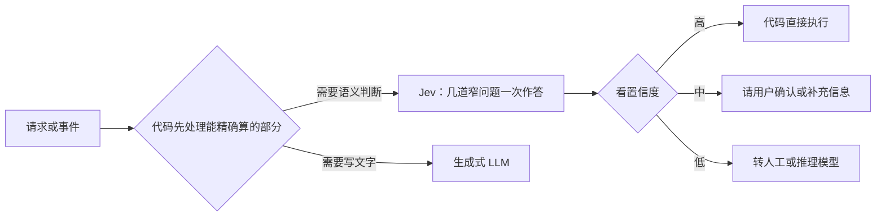

# System One：快思考模型

> 从卡尼曼的“系统 1 / 系统 2”讲起：System One 模型是什么，它和 LLM 怎么分工，与 JSON 模式、传统分类器、嵌入模型有何不同。

先做一道小题，别想太久：一个球拍加一个球一共 1.10 美元，球拍比球贵 1 美元，球多少钱？

多数人脑子里先冒出来的是“10 美分”。可如果球是 10 美分，球拍就得是 1.10 美元，加起来是 1.20 美元——正确答案是 5 美分。心理学家 Shane Frederick 拿这道题考过大学生：普林斯顿有 50%（47/93）、密歇根大学有 56%（164/293）的学生答错了 [1]。

2002 年诺贝尔经济学奖得主丹尼尔·卡尼曼 [2] 在获奖演讲里用这道题说明：人脑里有一个飞快、自动冒出答案的系统，还有一个慢一些、负责检查的系统，而后者的检查往往相当松懈 [1]。TypeSafe 给自己的模型类别起名“System One”，借的就是这个说法。

## 卡尼曼的两套系统

心理学家把人的两类思维过程分别叫作系统 1（System 1）和系统 2（System 2）。这对名字是 Stanovich 和 West 在 2000 年起的，卡尼曼让它们广为人知 [1][5]。他在诺贝尔奖演讲里列了一张对照表 [1]：

| 维度 | 系统 1（直觉） | 系统 2（推理） |
| --- | --- | --- |
| 速度 | 快 | 慢 |
| 方式 | 并行 | 串行 |
| 控制 | 自动 | 受控 |
| 费力程度 | 不费力 | 费力 |
| 运作 | 联想式 | 遵循规则 |
| 可塑性 | 学得慢 | 灵活 |

2011 年出版的《思考，快与慢》（Thinking, Fast and Slow）把这套框架讲给了大众读者；书的简介概括为：系统 1 快速、直觉、带情绪，系统 2 更慢、更审慎、更讲逻辑 [3]。

演讲里还有两句话值得记住，后面会用到：一是不确定性在直觉里表现得很差；二是“怀疑”属于系统 2 [1]。换句话说，人的快思考擅长给出一个答案，却不擅长同时告诉你“我有几成把握”。

## TypeSafe 借用的是哪层意思

TypeSafe 在发布博客的 FAQ 里说，System One 模型这个类名就来自卡尼曼对快速直觉的系统 1 与缓慢审慎的系统 2 的区分 [4]；文档补充说，这里强调的是快速、聚焦的判断 [5]。

官方对“好问题”的标准也很像系统 1：一个知识丰富的人拿到合适的材料后，几秒钟、甚至一秒钟内就能做出的判断，文档称之为“直觉检查”（gut-check）式的判断 [6][7]。例如“这条消息表达了紧急情绪吗？”是好问题；“分析这条消息并决定最佳处理方案”就不是——那需要慢推理，应该拆成几道小题，再在代码里组合 [7]。

有意思的是，TypeSafe 自己也承认“系统 1 思维”向来带着“容易出错”的意味，并说他们相信 System One 模型可以做得比其他方案更可靠，理由“以后再讲”[4]。对照卡尼曼那两句话，可以这样理解他们的野心：既要系统 1 的速度，又要一样系统 1 本来不擅长的东西——对自己有几成把握的诚实估计，也就是[第 4 篇](/manual/llm/jev/rlcd)要讲的“校准”。这是本专栏的解读，不是官方表述。

::: info

名字只是比喻。卡尼曼的两套系统描述的是人类认知；System One 模型是一种软件接口加一种训练目标的组合，官方没有声称 Jev 模拟了人脑的系统 1。

:::

## System One 模型到底是什么

按官方文档的定义 [5]：

- System One 模型是一类为软件做快速、结构化决策的 AI 模型：读入一个状态（state，即要判断的文本或图像材料），返回带类型的答案和概率。
- 它和 LLM 一样能理解自然语言（自 10 月更新起也支持理解图像），但不写回复、不写代码，也不生成推理过程的解释。可能的答案由你用 Choice（选择）、Score（打分）、Noul（是非）、Box（图像边界框，`jev-1.14.0` 新增）四种原语事先定义。
- 它的概率是对照真实结果优化过的，用来反映不确定性；但校准是在一批预测上衡量的，不保证任何单个答案正确。
- 目前官方公开的 System One 模型家族只有 Jev（含 `jev-1.14.0` 与 `jev-1.13.0`）[5][8]。

那它是不是一个“小号 LLM”？官网首页 FAQ 的回答是否定的：Jev 的效率来自为另一种任务做优化，它理解语言，但不生成自由文本，也不当聊天机器人 [9]。发布博客的 FAQ 说得更干脆：Jev 既不小，也不是 LLM [4]。内部到底是什么架构，官方没有公开，见[下一篇](/manual/llm/jev/parallel-sampler)。

## 和 LLM 怎么分工

TypeSafe 把软件分成三种架构 [10]：

1. **传统软件**：由简单、可靠的原语搭成的复杂决策树。
2. **LLM 智能体**：模型读指令、自己决定下一步；有人盯着时好用，但每多一轮循环，就多一次跑偏的机会。
3. **AI 驱动的软件**：代码掌握控制流、负责确定性的工作；模型只出现在需要“可编程常识”或需要解读非结构化数据的地方，每个 AI 任务都保持原子化、有约束。

System One 模型瞄准的是第三种。顺着卡尼曼的比喻，擅长长链推理和生成文字的 LLM 更像系统 2；Jev 的“已知短板”文档也直接把需要更多层间接推理的任务叫作 System Two 任务，建议别交给 Jev [11]。把官方文档里的分工串起来，大致是：

- **代码做能精确计算的事**：数数、算术、日期比较一律放在代码里，别问模型 [11]。
- **Jev 做窄而快的判断**：分类、路由、打分、核查。官网 FAQ 说它擅长常识判断，而复杂数学、类似下棋的规划这类需要长推理的任务，更适合大型推理模型 [9]。
- **LLM 做生成和深推理**：Jev 不生成文本，需要写回复、从自由文本里抽取内容时，交给生成式模型 [11]。
- **人和推理模型兜底**：置信度低时不要行动，转人工、请用户澄清，或者交给别的系统 [12]；用官方的话说，由你的代码决定何时行动、何时升级给人或推理模型 [5]。

官方文档里有几种典型的组合方式：

- **意图路由**：Jev 先当一个又快又便宜的分类器，判断请求属于哪类、有多复杂，再分给确定性代码、专门的 LLM 或人工 [13]。
- **级联抽取**：便宜的小 LLM 先从文档里抽取字段，Jev 对每个字段问一句“这个值是不是源文档里没有的”之类的是非题，有字段亮红灯才升级给昂贵的推理模型 [14]。
- **LLM 护栏**：LLM 应用的每条输入和输出都先过一遍 Jev，用一组是非题判断是否越狱、是否涉及伤害，再用一道打分题评估危害程度，阈值写在你自己的代码里 [15]。

## 它和这几样东西有什么不同

### 与 JSON 模式、结构化输出

LLM 厂商早就提供了“让模型按格式输出”的功能。以 OpenAI 为例：JSON 模式只保证输出是合法的 JSON；结构化输出（Structured Outputs）更进一步，保证符合你给的 JSON Schema，不会漏掉必填字段，也不会“幻觉”出一个不合法的枚举值 [16]。技术上，这类功能靠约束解码（constrained decoding）：模型每写一个 token（词元，模型处理文字的最小单位），都先把不符合语法的候选屏蔽掉；开源库 Outlines 就用有限状态机实现了这个思路 [17]。

所以“类型安全”本身并不是 Jev 独有的。差别在别处：

- 结构化输出里的模型仍然是逐个 token 写出答案。OpenAI 文档也提醒，结构化输出仍可能包含错误；遇到拒答或触到输出长度上限时，还可能拿不到符合格式的结果 [16]。
- 它默认只给一个答案，不给每个选项的概率。
- TypeSafe 认为，把 LLM 硬塞进格式里会浪费掉一部分智能 [9]。一项 2024 年的研究确实发现，格式限制会明显削弱 LLM 的推理能力，而且限制越严，下降越多 [18]；不过这是单项研究，结论与任务和提示方式有关。

Jev 则从训练开始就只做结构化决策，直接返回每个选项的概率 [9]。

### 与传统分类器

以 BERT 为代表的做法，是在预训练模型的输出上接一个分类层：取序列开头 `[CLS]` 位置的向量，乘上一个 `K×H` 的矩阵（K 是标签数），再用标注数据微调 [19]。站内有 [BERT 与 GPT 的区别](https://daiw.org/manual/bit-to-agi/05-transformer/bert-vs-gpt)可以参考。这类模型又快又便宜，但标签集合在训练时就固定了：换一套标签，就得重新收集数据、重新训练。它输出的“概率”也未必可信——现代深度网络往往比老网络更准，却更过度自信，这一点第 4 篇细说 [20]。

Jev 的选项则是每次请求时用自然语言现写的，一道 Choice 题最多 255 个选项 [21]。官方说 Jev 不针对单个客户微调，所有账户共用同一套权重，领域知识通过请求里的状态、指令和选项描述注入 [8]。换句话说，你把分类器的“训练”换成了“把选项描述写清楚”。

### 与嵌入模型

嵌入模型（embedding model）把一句话变成一个向量，意思相近的句子向量也相近。Sentence-BERT 让“在 1 万个句子里找出最相似的一对”从用 BERT 的约 65 小时缩短到约 5 秒 [22]。站内见 [Embedding 是什么](https://daiw.org/manual/bit-to-agi/05-transformer/what-is-embedding)。

但嵌入只告诉你“有多像”，不回答“是不是”“选哪个”。余弦相似度 0.83 算不算“是退款请求”，得你自己定阈值，甚至再训练一个分类器；相似度本身也不是概率。两者可以搭配：官方的重排序示例先用传统关键词检索 BM25 为每个法律检索问题挑出 30 段候选，再让 Jev 对每个“问题—候选”对逐一判断，官方报告首位命中率从 5% 提升到 18% [23]。

### 一张表收尾

| 对比项 | 输出 | 选项何时确定 | 有没有概率 |
| --- | --- | --- | --- |
| JSON 模式、结构化输出 | 逐 token 生成、受格式约束的文本 | 每次请求（写在 Schema 里） | 默认没有 |
| 传统分类器 | 固定标签上的分布 | 训练时 | 有，但常需额外校准 |
| 嵌入模型 | 向量 | 不需要选项 | 没有，相似度不是概率 |
| Jev | 你定义的选项上的分布（或边界框）与置信度 | 每次请求 | 有，官方称已校准 |

System One 的“快”到底从哪里来？官方给的答案是“并行采样”。下一篇讲这件事背后的一般原理，以及 TypeSafe 到底公开了多少。👉 [原理一：一次给出全部答案的并行采样](/manual/llm/jev/parallel-sampler)

## 参考文献

- [1] Daniel Kahneman. “Maps of Bounded Rationality: A Perspective on Intuitive Judgment and Choice.” 诺贝尔奖演讲，2002-12-08. [nobelprize.org（PDF）](https://www.nobelprize.org/uploads/2018/06/kahnemann-lecture.pdf) —— 球拍与球的题及答错比例、系统 1 / 系统 2 的命名来源与对照表、“不确定性在直觉里表现很差”“怀疑属于系统 2”。
- [2] Nobel Prize Outreach. “Daniel Kahneman – Facts.” [nobelprize.org](https://www.nobelprize.org/prizes/economic-sciences/2002/kahneman/facts/) —— 2002 年诺贝尔经济学奖及获奖理由。
- [3] Daniel Kahneman. Thinking, Fast and Slow（中译《思考，快与慢》）. 2011. [Penguin Random House 书目页（有声书版，2011-10-25）](https://www.penguinrandomhouse.com/books/89308/thinking-fast-and-slow-by-daniel-kahneman/) —— 出版年份与对两套系统的概括。
- [4] Diogo Almeida（TypeSafe AI）. “Introducing System One Models & Jev.” 2026-09-15. [typesafe.ai/blog](https://typesafe.ai/blog/introducing-system-one-models-and-jev) —— FAQ：名字来自卡尼曼、承认“系统 1”有易错的含义、Jev 既不小也不是 LLM。
- [5] TypeSafe AI. “System One.” 官方文档. [docs.typesafe.ai](https://docs.typesafe.ai/concepts/system-one) —— System One 模型的定义、四种原语、与 LLM 的区别、校准只对一批预测成立、名字来自卡尼曼普及的概念、何时升级给人或推理模型。
- [6] TypeSafe AI. “Introduction.” 官方文档. [docs.typesafe.ai](https://docs.typesafe.ai/introduction) —— “直觉检查”式判断、把复杂问题拆开。
- [7] TypeSafe AI. “Primitives (Questions).” 官方文档. [docs.typesafe.ai](https://docs.typesafe.ai/primitives) —— 好问题与坏问题的例子、一秒钟内能做出的判断。
- [8] TypeSafe AI. “Models.” 官方文档. [docs.typesafe.ai](https://docs.typesafe.ai/models) —— 当前模型列表（`jev-1.14.0` 与 `jev-1.13.0`）、所有账户共用一套权重、不做客户微调。
- [9] TypeSafe AI. 官网首页（含 FAQ）. [typesafe.ai](https://typesafe.ai/) —— “是不是小号 LLM”“和 JSON 模式有何不同”“擅长与不擅长什么”三问的官方回答。
- [10] TypeSafe AI. “How to build with TypeSafe.” 官方文档. [docs.typesafe.ai](https://docs.typesafe.ai/concepts/how-to-build-with-system-one) —— 三种软件架构、代码掌握控制流。
- [11] TypeSafe AI. “Model jaggedness.” 官方文档. [docs.typesafe.ai](https://docs.typesafe.ai/model-jaggedness) —— 数数、算术、日期放在代码里；System Two 任务；不擅长生成文本。
- [12] TypeSafe AI. “Confidence.” 官方文档. [docs.typesafe.ai](https://docs.typesafe.ai/confidence) —— 高、中、低三档置信度对应的系统行为。
- [13] TypeSafe AI. “Intent routing.” 官方文档. [docs.typesafe.ai](https://docs.typesafe.ai/patterns/intent-routing) —— 先分类，再分给确定性代码、专门的 LLM 或人工。
- [14] TypeSafe AI. “SDE cascade.” 官方文档 cookbook. [docs.typesafe.ai](https://docs.typesafe.ai/cookbooks/sde_cascade) —— 小模型抽取、Jev 逐字段核查、再升级给推理模型。
- [15] TypeSafe AI. “Guardrails for LLMs.” 官方文档 cookbook. [docs.typesafe.ai](https://docs.typesafe.ai/cookbooks/llm_guardrails) —— 用是非题和打分题筛查 LLM 的输入与输出。
- [16] OpenAI. “Structured model outputs.” OpenAI API 文档. [developers.openai.com](https://developers.openai.com/api/docs/guides/structured-outputs) —— JSON 模式与结构化输出的区别、结构化输出仍可能出错、拒答与长度上限等边界情况。
- [17] Brandon T. Willard, Rémi Louf. “Efficient Guided Generation for Large Language Models.” 2023-07. [arXiv:2307.09702](https://arxiv.org/abs/2307.09702) —— 用有限状态机约束文本生成（Outlines）。
- [18] Zhi Rui Tam 等. “Let Me Speak Freely? A Study on the Impact of Format Restrictions on Performance of Large Language Models.” 2024-08. [arXiv:2408.02442](https://arxiv.org/abs/2408.02442) —— 格式限制削弱推理能力。
- [19] Jacob Devlin 等. “BERT: Pre-training of Deep Bidirectional Transformers for Language Understanding.” 2018-10. [arXiv:1810.04805](https://arxiv.org/abs/1810.04805) —— `[CLS]` 表示加分类层、`K×H` 的分类权重。
- [20] Chuan Guo 等. “On Calibration of Modern Neural Networks.” 2017-06. [arXiv:1706.04599](https://arxiv.org/abs/1706.04599) —— 现代神经网络校准变差。
- [21] TypeSafe AI. “Choice.” 官方文档. [docs.typesafe.ai](https://docs.typesafe.ai/primitives/choice) —— 一道 Choice 题最多 255 个选项。
- [22] Nils Reimers, Iryna Gurevych. “Sentence-BERT: Sentence Embeddings using Siamese BERT-Networks.” 2019-08. [arXiv:1908.10084](https://arxiv.org/abs/1908.10084) —— 句向量加余弦相似度，找最相似句对从约 65 小时降到约 5 秒。
- [23] TypeSafe AI. “Re-ranking.” 官方文档 cookbook. [docs.typesafe.ai](https://docs.typesafe.ai/cookbooks/rerank_typesafe) —— BM25 初筛加 Jev 重排序，首位命中率 5% 到 18%（官方报告）。
