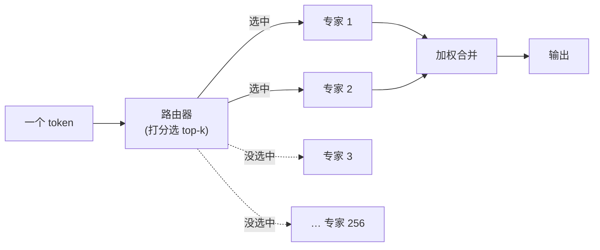

# 稠密 vs 稀疏 · MoE 为什么突然统治了大模型

> 把一个巨大的前馈层拆成几百个“专家”，每个 token 只激活其中几个——于是 671B 的 DeepSeek-V3 每步只算 37B，2.8T 的 Kimi K3 每步只算 104B。讲清 MoE 的核心思想：把“总参数（知识容量）”和“激活参数（每步算力）”解耦，以及它省的是算力不是显存。

第二条主线，和注意力并列的另一个主战场：**前馈层到底用稠密还是稀疏（MoE）**。

先说结论：今天几乎所有**前沿规模**的开源大模型——从 2024–2025 年的 DeepSeek-V3、Llama 4、Qwen3 的大杯、GLM-4.5、Kimi K2，到 2026 年的 [DeepSeek V4.1-Flash](https://daiw.org/manual/deepseek-v4-flash)、[Qwen3.8-Max](https://daiw.org/manual/qwen3-8-max)、[Kimi K3 / K3.1 Pro](https://daiw.org/manual/kimi-k3)——**清一色是 MoE**。稠密只在中小模型里守着。这一章讲清：MoE 到底解决了什么，以及它“省”的到底是什么。

## 稠密模型的天花板

回忆 nanoGPT：每个 token 都要**老老实实流过每一个参数**——每一层的注意力、每一层的前馈，一个都不落。这叫**稠密（dense）**。

稠密有个死结：**算力和参数量绑死了。** 参数翻倍，每个 token 的计算量也翻倍，训练和推理成本跟着翻倍。可我们又知道“参数越多、见识越广、模型越强”。于是矛盾来了：

> **想要更多参数（更强），又不想要更多计算（更贵）——稠密做不到，鱼和熊掌不可兼得。**

MoE 就是来拆这个死结的。

## MoE 的核心：把前馈层拆成一堆专家

还记得 nanoGPT 里那个 `MLP` 吗？一个 Block 的参数，**大头（约三分之二）在前馈层**，不在注意力。MoE 动的正是这块最肥的肉。

做法是：把原来**那一个**大前馈层，换成**一排小前馈层**——每个叫一个**专家（expert）**——外加一个**路由器（router / gating）**。每个 token 进来：

1. **路由器先打分**：给这个 token 挑出最合适的 $k$ 个专家（比如 256 个里挑 8 个）；
2. **只让被选中的 $k$ 个专家干活**，其余几百个**这一步压根不算**；
3. 把这 $k$ 个专家的输出按路由权重加权合并，继续往下走。

**关键就在那句“其余几百个这一步压根不算”。** 模型**拥有**几百个专家的参数（知识容量巨大），但每个 token **只激活**其中几个（计算量很小）。

## 一句话：把“容量”和“算力”解耦

这就是 MoE 最本质的一点，值得单独拎出来：

> **稠密模型里，“参数量” = “每 token 计算量”，绑死。MoE 把这两者解耦：总参数决定“知道多少”，激活参数决定“每步算多少”。**

看几个从 2024 到 2026 年的真实数字就懂了：

| 模型 | 总参数 | 每 token 激活 | 激活占比 |
| --- | --- | --- | --- |
| **DeepSeek-V3**（2024） | 671B | **37B** | ~5.5% |
| **Llama 4 Maverick**（2025） | 400B | **17B** | ~4.3% |
| **Qwen3 235B-A22B**（2025） | 235B | **22B** | ~9.4% |
| **DeepSeek V4.1-Flash**（2026） | 552B（主干，连同 99B Engram 共 651B） | **31.4B**（预填充）/ **22.9B**（解码） | ~5.7% / ~4.1% |
| **Qwen3.8-Max**（2026） | **2.4T**（2400B） | **95B** | ~4.0% |
| **Kimi K3 / K3.1 Pro**（2026） | **2.8T**（2800B） | **104B** | ~3.7% |

DeepSeek-V3 有 671B 参数的“见识”，但每生成一个 token，只付 37B 的“算力账单”；到了 2026 年，Qwen3.8-Max 和 Kimi K3 更是把总参数推上 **2.4T–2.8T**，每 token 却只激活约 **4%** 的参数。这就是 MoE 让“参数堆到天上、推理还算得起”成为可能的原因，也是它统治前沿的直接动力。

## 别搞混：MoE 省的是算力，不是显存

这是最容易被误解的一点，务必掰清楚：

- **省算力（FLOPs）：是的。** 每步只算几个专家，计算量小。这利好训练吞吐、推理速度。
- **省显存（VRAM）：不。** 那几百个专家**全都得在显存里待命**——你不知道下一个 token 会路由到谁，所有专家必须随时可用。所以 **671B 或 2.8T 的总参数，该占的显存一分不少**（除非搭配 FP4/MXFP4 权重量化，或像 DeepSeek 的 Engram 那样把静态记忆表卸载到主机内存）。

换句话说：**MoE 让你能用“大模型的脑子、小模型的算力”，但你还是得有能装下“大模型脑子”的机器。** 它降低的是“每 token 计算成本”，不是“部署门槛”。这也是为什么超大 MoE 是“数据中心级”的玩法，而手机端、边缘端更爱小稠密模型或小体积 MoE。

## MoE 不是新东西，但“现在”才成主流

MoE 的思想可以追到很早：

- **Shazeer et al.（2017）** 的“Sparsely-Gated Mixture-of-Experts”把 MoE 塞进 LSTM，做出了千亿级参数；
- **GShard（2020）**、**Switch Transformer（2021）** 把它搬进 Transformer，Switch 甚至简化到“每个 token 只选 1 个专家（top-1）”，训出万亿参数。

可为什么直到 **2024 年起**才满街都是？几个现实原因凑齐了：

1. **稠密撞墙**：头部模型的稠密路线遭遇边际递减，继续堆稠密参数越来越不划算；
2. **工程成熟**：分布式训练、专家并行、负载均衡的工程被磨顺了（这正是后面两章要讲的）；
3. **DeepSeek 打样**：DeepSeek-V2/V3 用**极低的成本**训出顶尖 MoE，把“MoE 能在大规模上又好又省”从论文变成了行业共识。

::: warning

一个边界要划清：**MoE 通常只替换前馈层，注意力仍是稠密、全体共享的。** 注意力负责跨位置的信息交换，天然需要全局一致，不适合按 token 分流。稀疏化主要发生在“逐位置深加工”的前馈那一半。此外，很多模型**头几层仍保持稠密**，原因下下章讲。

:::

思想讲清了，但“拆成几百个专家”这件事，魔鬼全在细节里：**该拆多少个？每个 token 激活几个？要不要留个“万金油”专家？** 各家在这几个旋钮上拧出了截然不同的风格。下一章，我们把这几个旋钮一个个拧给你看。👉 [MoE 的三个旋钮：专家数、激活数、共享专家](/manual/llm/llm-anatomy/moe-knobs)

## 参考文献

- [1] Shazeer et al. “Outrageously Large Neural Networks: The Sparsely-Gated Mixture-of-Experts Layer.” ICLR 2017. arXiv:1701.06538. —— 现代 MoE 的奠基。
- [2] Lepikhin et al. “GShard: Scaling Giant Models with Conditional Computation and Automatic Sharding.” 2020. arXiv:2006.16668. —— MoE 进入 Transformer 与分布式扩展。
- [3] Fedus et al. “Switch Transformers: Scaling to Trillion Parameter Models with Simple and Efficient Sparsity.” JMLR 2022. arXiv:2101.03961. —— top-1 路由，万亿参数。
- [4] Dai et al. “DeepSeekMoE: Towards Ultimate Expert Specialization in Mixture-of-Experts Language Models.” 2024. arXiv:2401.06066. —— 细粒度专家 + 共享专家。
- [5] DeepSeek-AI. “DeepSeek-V3 Technical Report.” 2024. arXiv:2412.19437. —— 671B/37B 的大规模 MoE。
