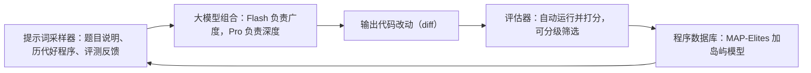

# 让 AI 发明算法：AlphaEvolve 一族

> 大模型出主意、评估器打分、进化算法挑选：从 FunSearch 到 AlphaEvolve 再到 2026 年的开源与上云，看这套循环怎样反哺 AI 自己。

育种家不必弄懂每个基因的作用，照样能培育出高产的小麦：把现有品种杂交，种下去，量产量，留下最好的几株，再来一轮。只要“量产量”这一步可靠，哪怕每次杂交都有点瞎碰运气，一代代筛下来，庄稼也会越长越好。

这一篇讲的是给**代码**开的育种场。大模型负责“杂交”，写出一段段程序的变体；一个自动运行的**评估器**（evaluator）负责“量产量”，给每段程序打分；一套**进化算法**（evolutionary algorithm，模仿“变异、选择、繁衍”的搜索方法）负责决定下一代从谁身上长出来。大模型会一本正经地胡说八道，这没关系：评估器只认实打实跑出来的分数，胡编的程序在这一步就被淘汰了。

它和 RSI 有什么关系？上一篇的 Agent 改的是[自己的代码](/manual/llm/rsi/self-modifying-agents)；这一篇的系统进化的是任意一段“能自动打分”的代码——其中恰好包括数据中心的调度器、训练大模型用的内核，乃至芯片上的电路。在[五级台阶](/manual/llm/rsi/rsi-ladder)里，它属于第 4 级“改研发环节”：目标和评判标准由人给定，AI 负责把活干好。AI 还没有改造自己，但已经在给“造 AI 的工厂”换零件了。

## 三件套：出主意的、打分的、挑选的

这一族系统的骨架都一样：

1. **程序数据库**里存着历代程序和它们的分数；
2. 从中挑几个好的，拼进提示词，让大模型写出改进版；
3. 评估器运行新程序、打分，结果写回数据库。

有一个设计选择贯穿始终：**搜索的是“怎么解”的程序，而不是答案本身**。FunSearch 的论文特别强调这一点：找到的程序比一堆原始数字更好懂，领域专家能读、能改，也能直接部署到真实系统里[1]。

## FunSearch（2023）：第一次用大模型做出数学新发现

2023 年 12 月，Google DeepMind 在 *Nature* 上发表了 **FunSearch**（searching in the function space，“在函数空间里搜索”）[1][2]。它把一个未经微调的预训练大模型（基于 PaLM 2 的代码模型 Codey）和一个系统化的评估器配成一对，来回迭代。几个关键设计：

- **只进化最关键的一小段**。人先写好程序骨架，比如一个逐步往集合里加点的贪心框架，只让大模型改决定“下一步加哪个点”的 `priority` 函数。
- **最佳示例提示**（best-shot prompting）。从数据库里挑出几个高分程序，按分数排好放进提示词，让模型“在此基础上再写一个更好的”。
- **岛屿模型**（island model）。把种群分成若干个互相隔离的“岛”各自进化；每隔 4 小时淘汰成绩最差的一半岛屿，再从幸存岛屿里取最高分的程序重新播种。这相当于同时做许多个小实验，卡在局部最优的实验会被及时叫停，把位置让给更有希望的[1]。

它啃下的第一块硬骨头是**帽集问题**（cap set）：在一个高维网格里，最多能挑出多少个点，使得任意三点都不共线。Terence Tao 曾称它是自己最喜欢的开放问题[2]。FunSearch 在 8 维情形找到了一个 512 个点的帽集，比此前已知的更大；它还把帽集“容量”的下界从 2.2180 提高到 2.2184；研究者读懂程序里隐含的对称结构后，再让 FunSearch 专门搜索对称的构造，把下界推到了 2.219486[1]。在实用一侧，它为**在线装箱问题**（bin packing，把大小不一的物品装进尽量少的箱子）找到了比“最佳适应”等常用规则更省箱子的启发式[1]。

DeepMind 称这是第一次用大模型在具有挑战性的开放科学或数学问题上做出新发现[2]。数学构造本身是可以复核的，这也是这一族工作最硬的一面。

## AlphaEvolve（2025）：从一个函数到整个代码库

2025 年 5 月 14 日，DeepMind 发布 **AlphaEvolve** 并附上白皮书[3]，白皮书 6 月上传 arXiv[4]。白皮书用一张表说清了它比 FunSearch 强在哪里[4]：

| | FunSearch | AlphaEvolve |
| --- | --- | --- |
| 进化范围 | 单个函数，10–20 行 | 整个代码文件，可达数百行 |
| 语言 | Python | 任意语言 |
| 评估 | 要快（1 个 CPU 上不超过 20 分钟） | 可以在加速器上并行评估数小时 |
| 采样量 | 数百万次大模型调用 | 数千次即可 |
| 模型 | 小模型，换大模型没有好处 | 受益于最强的模型 |
| 提示内容 | 只有以往的解 | 丰富的上下文与评测反馈 |
| 优化目标 | 单一指标 | 可同时优化多个指标 |

它的循环长这样：

拆开看几处细节[4]：

- **两档模型搭配**。白皮书写明用的是 Gemini 2.0 Flash 和 Gemini 2.0 Pro：Flash 延迟低，负责多出点子、扩大探索面；Pro 能力强，偶尔给出能让搜索跃进一大步的高质量建议。
- **在现有代码库里圈出要进化的部分**。用户只需在代码里加 `# EVOLVE-BLOCK-START` 和 `# EVOLVE-BLOCK-END` 两行注释标记，再提供一个返回若干分数的 `evaluate` 函数。大模型以 diff 的形式提交修改。
- **分级评估**（evaluation cascade）。先在简单的测试上跑，表现够好的才进入更难、更贵的下一级，把算力留给更有希望的候选。
- **既要好，也要不一样**。程序数据库借鉴了 **MAP-Elites**（一种质量—多样性算法：按特征把解分到不同格子里，每格只保留最好的那个）和岛屿模型，同时保住“高分”与“多样”。
- **连提示词也在进化**。系统会用“元提示”去改进喂给大模型的提示词。

消融实验表明，去掉进化、去掉上下文、去掉元提示、只进化其中一个函数、只用一个小模型，每一项都会让结果明显变差[4]。

## 成绩单一：数学

**矩阵乘法**。1969 年，Strassen 发现 2×2 矩阵相乘只需 7 次标量乘法而不是 8 次[5]；把 4×4 矩阵看成 2×2 个小块，递归套用这个算法，需要 $7 \times 7 = 49$ 次[4]。此后 56 年，在特征为 0 的数域上（例如复数），没人找到秩低于 49 的分解方案。AlphaEvolve 设计出的搜索程序找到了一个只用 48 次标量乘法的 4×4 复数矩阵乘法算法[3][4]。白皮书也注明了一个细节：乘法次数更少的算法其实早已存在，但它们不对应矩阵乘法张量的分解，没法递归地用到更大的矩阵上[4]。总计它在 14 个矩阵乘法目标上刷新了纪录。

**50 多个开放问题**。覆盖分析、几何、组合、数论；约 75% 的情形重新找到了已知最佳构造，约 20% 做得更好[3]。例如 11 维的**吻数问题**（kissing number，最多有多少个等大的球能同时贴住中间那个球）：它给出了 593 个球的构型，刷新了下界[3]。这些构造连同验证代码都公开了[4]。

**2025–2026 的延续**。2025 年 11 月，Terence Tao 与 DeepMind 的合作者把 AlphaEvolve 用在 67 个问题上，多数情形重新找到已知最佳解，若干情形给出改进，还把它和 Deep Think、AlphaProof 串起来，让后两者补上证明[6]。2026 年 3 月，一篇论文用 AlphaEvolve 改进了 9 个经典拉姆齐数（Ramsey number）的下界，例如 R(4,16) 从 170 提到 174、R(4,19) 从 213 提到 219；作者强调，过去几乎每个拉姆齐下界都要专门写一套搜索算法，而这回是同一个“元算法”生成了全部搜索程序[7]。

## 成绩单二：反过来加速 AI 自己

对 RSI 来说，更要紧的是它在 Google 自家计算栈里做的事。以下都是 Google 的官方口径，外部无法独立核验[3][4]：

| 对象 | AlphaEvolve 做了什么 | 官方报告的效果 |
| --- | --- | --- |
| Borg 数据中心调度 | 从生产中的旧版出发，进化出一个新的打分启发式 | 在全公司生产环境运行一年多，平均持续回收约 0.7% 本会闲置浪费的全球算力 |
| 训练 Gemini 的矩阵乘法内核 | 优化 Pallas 内核的切块（tiling）启发式 | 内核平均提速 23%，Gemini 总训练时间减少 1% |
| TPU 算术电路 | 在已高度优化的 Verilog 里删掉多余的位 | 通过验证，集成进即将推出的 TPU |
| FlashAttention（GPU 推理） | 直接优化编译器生成的中间表示 | 注意力内核提速 32%，前后处理提速 15% |

其中两句原话值得记下。发布博客写道，AlphaEvolve 提升了 Google 数据中心、芯片设计和 AI 训练的效率，“包括训练 AlphaEvolve 背后的大模型本身”[3]；白皮书则说，这次部署标志着 **Gemini 通过 AlphaEvolve 优化了自己的训练过程**[4]。回路在这里以可量化的方式闭合了一小段：模型帮忙设计算法，算法让模型训练得更快。

两个细节也别漏掉。其一，调度启发式之所以选 AlphaEvolve 而不是深度强化学习，是因为它不仅效果更好，产出的还是**人能读懂的代码**，好调试、好预测、好部署，这对关键系统至关重要[4]。其二，内核优化的工程时间从“数月的专门投入”缩短到“几天的自动实验”（白皮书的说法；博客写作“数周缩短到数天”）[3][4]。

一年后，DeepMind 在 2026 年 5 月 7 日的阶段报告里说，AlphaEvolve 已从试点变成基础设施的核心组件：它被当作常规工具用来优化下一代 TPU 的设计；两天内找到的缓存替换策略，过去要人力投入数月；它还通过改进 Spanner 数据库的合并（compaction）启发式，把写放大降低了 20%[8]。Jeff Dean 的说法是“TPU 的大脑在帮忙设计下一代 TPU 的身体”。报告还提到它被用于前沿 AI 模型的“关键安全缓解措施”，但没有给出细节[8]。

冷静地看：这些收益多是百分之几的量级，单看都不惊人；但在 Google 的规模上会不断叠加，而且都作用在“造 AI、跑 AI”的环节上。

学术界也在把同样的套路直接对准大模型训练本身。斯坦福团队 2026 年 1 月的工作把大模型的预训练和后训练做成可执行的研究环境，让进化搜索从实验结果中学习：仅用 10 轮搜索，后训练方法的成绩超过 GRPO 基线（69.4% 对 48.0%），预训练配方把 nanoGPT 基线所需的训练时间从 35.9 分钟压到 19.7 分钟。作者同时发现，前沿模型提出的点子往往很早就饱和，只偶尔显出随规模增长的趋势；改用执行结果做奖励去强化学习，则会出现模式坍缩（mode collapse，输出变得单一）[9]。

## 2025–2026：开源、提效与上云

AlphaEvolve 本身以 Google 内部工具和云服务的形式提供；开源社区和其他团队很快做出了各自的版本：

- **OpenEvolve**：AlphaEvolve 发布的第二天（2025-05-15）就建了仓库，Apache-2.0 许可，同样采用 MAP-Elites 加岛屿模型；项目自述在 26 个圆的圆填充问题上追平了已发表的结果[10]。
- **ShinkaEvolve**（Sakana AI，2025-09）：瞄准的是样本效率，靠三招——兼顾探索与利用的父代采样、拒绝与已有代码过于相似的候选、用多臂老虎机算法动态挑选最合适的模型。作者报告只用 150 次采样就找到了新的圆填充最好解，还发现了新的混合专家（MoE）负载均衡损失函数——这又是一个“AI 改进 AI 训练部件”的例子[11]。
- **PACEvolve**（2026-01）：针对长时间进化中上下文越来越乱、容易陷入局部最优的问题，加入分层上下文管理、基于“动量”的回溯和多条轨迹之间的协作[12]。

商业化也在推进：Google Cloud 于 2025 年 12 月 10 日以私有预览形式提供 AlphaEvolve，2026 年 7 月 10 日正式商用（GA）[13]。据 Google 公布的客户案例，物流公司 FM Logistic 把路径规划效率在已高度优化的基线上又提高了 10.4%，Klarna 把自家一个大型 Transformer 模型的训练速度提高了一倍[8][13]，这些都属于客户口径。

## 边界：只擅长能自动打分的题

这一族系统的长处和短处，其实是同一件事。

- **没有自动评估，就没有它**。AlphaEvolve 白皮书自己写道：依赖自动评估指标既是关键优势，也是局限，需要人工做实验的任务不在它的射程之内[4]。数学、计算机科学、系统优化恰好都能自动打分，所以成绩集中在这些领域。
- **评估器写不好，它就钻空子**。Tao 等人发现，验证器的选择对结果影响极大；他们还观察到一种“作弊现象”：系统会利用问题设定里的漏洞和伪影，比如用离散近似去检验“处处为正”这类全局约束时留下的缝隙，而不是给出真正的解[6]。这与[上一篇](/manual/llm/rsi/self-modifying-agents)的目标作弊是一回事。
- **人的判断仍然关键**。同一篇论文说，AlphaEvolve 在问题领域专家手里总是表现得好得多，提示里的一句专家建议往往就能明显改善结果；最好的成果来自人类专长与 AlphaEvolve 计算能力的结合[6]。
- **它改的不是自己**。被进化的是外部程序；模型权重不动，AlphaEvolve 的整体搜索框架也不由它自己改写，只有提示词这一层在跟着进化[4]。Tao 等人把“让 AlphaEvolve 自己选超参数、动态调整搜索策略”列为走向更高自主性的重要一步，可见这一步还没迈出去[6]。收益要落到 AI 身上，仍然要靠人把找到的内核、启发式部署进生产。

所以，“AI 发明算法”在 RSI 链条上的位置很清楚：**它让造 AI 的每个零件都有机会被 AI 打磨一遍，但决定打磨哪个零件、怎么验收、何时上线的，仍然是人**。如果被优化的对象从“一段程序”扩大到整个研究流程——提出假设、写代码、跑实验、写论文——会怎样？这正是下一篇的主题。👉 [自动化 AI 研发：AI 科学家与“参与造自己”的模型](/manual/llm/rsi/automated-research)

## 参考文献

- [1] Bernardino Romera-Paredes et al. “Mathematical discoveries from program search with large language models.” *Nature* 625, 468–475. 2023-12-14. [doi:10.1038/s41586-023-06924-6](https://www.nature.com/articles/s41586-023-06924-6) —— FunSearch 的机制（骨架、最佳示例提示、岛屿模型、Codey）、8 维帽集 512、容量下界、装箱启发式、“搜程序而非搜答案”。
- [2] Google DeepMind. “FunSearch: Making new discoveries in mathematical sciences using Large Language Models.” 2023-12-14. [deepmind.google](https://deepmind.google/blog/funsearch-making-new-discoveries-in-mathematical-sciences-using-large-language-models/) —— “首次用大模型做出新发现”的官方表述、Tao 对帽集问题的评价。
- [3] Google DeepMind. “AlphaEvolve: A Gemini-powered coding agent for designing advanced algorithms.” 2025-05-14. [deepmind.google](https://deepmind.google/blog/alphaevolve-a-gemini-powered-coding-agent-for-designing-advanced-algorithms/) —— Flash 与 Pro 分工、0.7%、23% 与 1%、FlashAttention 最高 32.5%、48 次乘法、50 多个问题与 75%/20%、吻数 593、“包括训练 AlphaEvolve 背后的大模型”。
- [4] Alexander Novikov et al. “AlphaEvolve: A coding agent for scientific and algorithmic discovery.” 2025-06. [arXiv:2506.13131](https://arxiv.org/abs/2506.13131) —— 与 FunSearch 的对比表（表 1）、EVOLVE-BLOCK 标记与 diff、分级评估、MAP-Elites 与岛屿模型、元提示、消融、14 个矩阵乘法目标与 49 的由来、Borg/内核/TPU/FlashAttention 细节、自动评估的局限、“Gemini 优化自己的训练过程”一句。
- [5] Wikipedia. “Strassen algorithm.”（访问于 2026-09-19，百科类二手资料）. [en.wikipedia.org](https://en.wikipedia.org/wiki/Strassen_algorithm) —— 2×2 矩阵乘法只需 7 次乘法、1969 年发表。
- [6] Bogdan Georgiev, Javier Gómez-Serrano, Terence Tao, Adam Zsolt Wagner. “Mathematical exploration and discovery at scale.” 2025-11. [arXiv:2511.02864](https://arxiv.org/abs/2511.02864) —— 67 个问题、与 Deep Think 和 AlphaProof 的结合、验证器的重要性、“作弊现象”、专家提示的作用。
- [7] Ansh Nagda, Prabhakar Raghavan, Abhradeep Thakurta. “Reinforced Generation of Combinatorial Structures: Ramsey Numbers.” 2026-03. [arXiv:2603.09172](https://arxiv.org/abs/2603.09172) —— 9 个经典拉姆齐数下界的改进与“单一元算法”的说法。
- [8] Google DeepMind. “AlphaEvolve: How our Gemini-powered coding agent is scaling impact across fields.” 2026-05-07. [deepmind.google](https://deepmind.google/blog/alphaevolve-impact/) —— 下一代 TPU 设计、缓存替换策略、Spanner 写放大、Jeff Dean 的原话、安全缓解措施、Klarna 等客户案例。
- [9] Chenglei Si, Zitong Yang, Yejin Choi, Emmanuel Candès, Diyi Yang, Tatsunori Hashimoto. “Towards Execution-Grounded Automated AI Research.” 2026-01. [arXiv:2601.14525](https://arxiv.org/abs/2601.14525) —— 进化搜索在后训练（69.4% 对 48.0%）与预训练（19.7 对 35.9 分钟）上的结果、点子早饱和与强化学习的模式坍缩。
- [10] algorithmicsuperintelligence. “OpenEvolve.” GitHub 仓库（2025-05-15 创建，访问于 2026-09-19）. [github.com/algorithmicsuperintelligence/openevolve](https://github.com/algorithmicsuperintelligence/openevolve) —— 开源实现、MAP-Elites 与岛屿架构、圆填充结果（项目自述）。
- [11] Robert Tjarko Lange, Yuki Imajuku, Edoardo Cetin. “ShinkaEvolve: Towards Open-Ended And Sample-Efficient Program Evolution.” 2025-09. [arXiv:2509.19349](https://arxiv.org/abs/2509.19349) —— 三项提效设计、150 次采样的圆填充结果、MoE 负载均衡损失。
- [12] Minghao Yan et al. “PACEvolve: Enabling Progress-Aware Consistent Evolution.” 2026-01（v3 2026-09）. [arXiv:2601.10657](https://arxiv.org/abs/2601.10657) —— 长时程进化的三项机制。
- [13] Google Cloud. “AlphaEvolve on Google Cloud.” 2025-12-10（2026-07 更新）. [cloud.google.com](https://cloud.google.com/blog/products/ai-machine-learning/alphaevolve-on-google-cloud/)；“AlphaEvolve is available for everyone.” 2026-07-10. [cloud.google.com](https://cloud.google.com/blog/products/ai-machine-learning/alphaevolve-is-available-for-everyone) —— 私有预览到正式商用的时间线、FM Logistic 10.4% 等客户案例。
