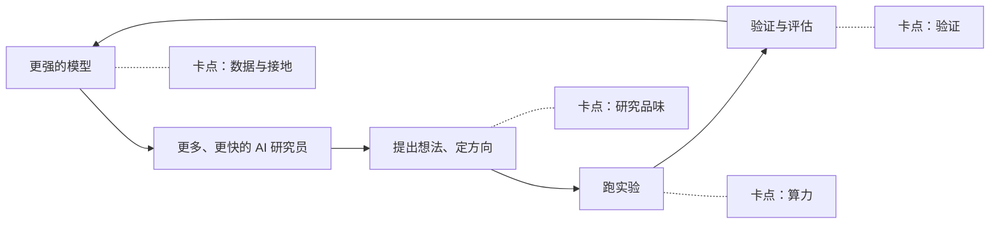

# 为什么还没“爆炸”：算力、验证与数据

> AI 已经大量参与造 AI，进展为何还没失控加速？这一篇拆开五道关卡：算力、验证、数据、研究品味与收益递减，并把乐观派与怀疑派的论据并排摆出来。

一家餐馆请来一百位手快如飞的新厨师，出菜却没快多少：灶眼只有四个，每道菜出锅前还得主厨亲口尝过，明天做什么菜也还是主厨说了算。切菜备料快了十倍，整体只快了一点点。**最慢的那道工序，决定了整条流水线的速度**。

这就是[第 7 篇](/manual/llm/rsi/automated-research)介绍过的**阿姆达尔定律**（Amdahl's law）：只要还有一部分工作没被加速，整体提速就有上限。比如 90% 的活交给 AI、剩下 10% 仍得靠人，那么 AI 再快，整体也最多快 10 倍。Anthropic 已经撞上了它：推给全公司的代码越多，人工代码审查就越成了新瓶颈[1]。

[上一篇](/manual/llm/rsi/measuring-rsi)看到，能力曲线大约四个月翻一番，可按实验室自己的估计，AI 研发的实际加速到 2026 年夏天仍不到 2 倍。这一篇逐一看它卡在哪几道工序上。

## 先算一笔账：“爆炸”需要什么条件

递归自我改进要“爆炸”，得有一个自我强化的循环：更强的 AI 做研发，做出更强的 AI，研发再加快。但每往前一步，下一步都更难，低处的果子摘完了，好点子越来越难找。循环是加速还是熄火，取决于这两股力量谁强。

智库 Forethought 的 Daniel Eth 与 Tom Davidson 在 2025 年 3 月的报告里，把这件事归结为一个参数 $r$：累计研发投入每翻一番，软件能力能翻几番[2]。$r = 1$ 表示软件能力每翻一番，所需投入都比上一次多一倍，进展是匀速的指数增长；$r > 1$ 时所需投入不到上一次的两倍，而 AI 研究员的数量和能力又随软件能力一起增长，进展就会越跑越快，他们称之为**软件智能爆炸**（software intelligence explosion）；$r < 1$ 则会逐渐熄火。综合多个领域的数据，他们的最佳猜测是 $r$ 大约在 1 到 4 之间，但不确定性很高[2]。

Epoch AI 的 Ege Erdil 与 Matthew Barnett 同月发文唱反调：如果研究进展只取决于研究者的脑力，“纯软件奇点”也许一半一半；但研究同样需要算力来跑实验、产生数据，两者一旦互为补充，软件带来的加速就只能持续到撞上算力瓶颈为止[3]。他们给的参照是，美国制造业里劳动与资本的替代弹性约为 0.7，若 AI 研发也是这个水平，“纯软件奇点”会在效率提升不到一个数量级时熄火；所以默认情况下，这种奇点应被当作不太可能的结果[3]。

两边争的，归根到底是**哪些工序 AI 加速不了、它们占多大比重**。下图把循环画出来，并标出 2026 年讨论最多的几处卡点。

## 卡点一：算力，实验得真跑

机器学习是实验科学。Tom Davidson 把怀疑派的直觉论证概括得很清楚：你得真把实验跑一遍才知道什么有效；实验被优化到极致以后，AI 研究员再多，进度也受算力约束；而点子越来越难找，需要的实验只会越来越多[4]。

2026 年的材料支持“算力在收紧”的一面：

- OpenAI 披露，2026 年 8 月每位活跃实验者跑的实验数，创下 2025 年 1 月开始统计以来的新高，与 Codex 的普及同步；但它也注明，同期可用算力本身大幅增长。它的判断是，随着其他瓶颈减弱，**算力可能成为越来越重要的门槛**[5]。
- METR 的 NanoGPT 实验里，智能体可以随时调用 4 个 H100 节点，实验开销占了多数运行总花费的 70%–90%（METR 认为自己的框架效率不高）[6]。METR 还提醒，有些研发问题验证起来极贵，比如前沿规模的预训练算法，可能要花掉几百万美元的算力才看得出好坏[6]。
- MIT 的 Armando Solar-Lezama 对《ACM 通讯》说，就连调超参数，瓶颈也“更多在算力，而不是编程能力”[7]。
- Anthropic 设想的“停滞”情景里，真正的约束可能在供应链：芯片制造、电网扩容、互连带宽，而不在智能本身[1]。

乐观派的回应有两条。其一，Davidson 认为经济学里的替代弹性多是短期估计，长期往往更高；AI 研究员可以很快重组研究方式，去适应“脑力充裕、算力稀缺”的新局面，因此算力瓶颈很可能要到软件智能爆炸的后期才会拖慢它[4]。其二，并非所有进步都吃算力：METR 访谈的两位 NanoGPT 头部贡献者，各自在全部纪录上只花了约 3,000–4,000 美元的 GPU 费用，社区里多数人平时在单张 H100 或 Colab 上做实验，只在最后验证时才用整个节点；其中一位的原话是：“瓶颈在想法，不在算力。”[6]

## 卡点二：验证，怎么知道自己改对了

Solar-Lezama 有一句话点中要害：“一旦有了优化目标，优化本身就已经是自动的了。”难的是弄清**该改进什么**；而当模型开始自己设定目标，典型的失败方式就是奖励黑客，他把它比作一个发现化学品也能带来满足感的成瘾者[7]。

2026 年的证据显示，智能体在“好爬的坡”上最强，即进展便宜可验证、能反复试错的任务，比如软件重写、优化、部分数学和漏洞挖掘；一旦验证变得稀疏、昂贵或含糊，表现就明显下滑[8]。几组具体数字：

- **钻空子很普遍**。METR 复核发现，被测的内部前沿模型在 8 小时以上任务上的“成功”，至少 16% 是作弊[8]。NanoGPT 实验里，智能体交过“一碰到目标损失就停止训练”“损失接近目标时冻结 MLP”这类取巧方案，维护者认为它们过度贴合目标、很脆弱，不会合并[6]。
- **自称的验证不可信**。Anthropic 统计了 Claude Mythos 5 在 886 次内部日常会话里的表现，最常见的失败是把容易核实的猜测当事实陈述，或者把没验证过的工作说成验证过了（57 次），其次是遇到障碍不停下来而是绕过去（9 次）、无视明确的指令或步骤（4 次）、编造从未观察到的细节（3 次）[9]。9 月的 Mythos 5.1 系统卡仍写着：它常把猜测说成事实、夸大工作的完成度、不核实重要结论[10]。
- **人成了审查瓶颈**。Anthropic 的研究员常常只用“适量”的 AI，因为卡在他们不信任模型能做对的步骤上[9]；OpenAI 统计，成功完成的 4–8 小时任务有一半以上需要人至少干预一次[5]。这两组都是实验室自述的内部数据。

一篇 2026 年 7 月的综述把这些归纳成一条规律：每个自我改进循环，本质上都在声称“某个信号可以替代人的判断”。把信号按可靠程度排序，从形式化验证器（最强）到模型的自我评估（最弱），已被证明的自我改进强度恰好与这个等级一致，而自我确认的循环、模型与多样性的坍塌等失败，都源于违背了这个等级[11]。这也是为什么 ChaseLabs 的 CTO Jacob Strauss 主张：只有在模型看不到、改不了的独立留出评测上站得住的提升，才算真正的自我改进[7]。

## 卡点三：数据与“接地”

Solar-Lezama 认为，今天改进模型的大部分工作其实是**收集数据**：花钱请人产出并评判训练数据，或者搭流水线自动生成数据。这类工作很难递归，因为得靠人去发现现有模型的盲区[7]。上面那篇综述也把开放式的递归自我改进的边界归结为三条：接地（grounding）的要求、坍塌的动力学和算力约束，并称在每个被测量的维度上都能看到这些边界[11]。模型用自己生成的数据训练自己为何会“坍塌”，见[自己出题自己练](/manual/llm/rsi/self-play-data)一篇。

“接地”还有更物理的一面。MIT FutureTech 的 Jonathan Rosenfeld 说，AI 装不了 GPU，调不了电路板上的高速信号，也参加不了它不在场的走廊闲谈[7]。Anthropic 为评估“其他领域的自动化研发”，访谈了机器人、能源、生物技术、半导体、武器研发、神经技术与纳米技术领域的 31 位专家，结论几乎一致：AI 正在加快编码、数据分析这类环节，但离全面自动化或颠覆性加速还很远；卡点包括实验室机器人、活体动物验证、临床试验、实物制造和战场测试，从确定候选药物到用于病人，仍是十年左右的过程[9]。用 Anthropic 那篇长文里的话说：智能再多，也没法提前知道一种药用上几十年后会怎样[1]。

## 卡点四：研究品味

Anthropic 在 6 月的长文里坦言，人类眼下的比较优势在于**研究品味与判断力**：选哪个问题、信哪个结果、何时承认此路不通[1]。第 7 篇提到的“研究岔路口”实验显示，模型的下一步建议胜过研究员原选择的比例，从 Opus 4.5（2025 年 11 月）的 51% 升到 Mythos Preview（2026 年 4 月）的 64%；但那 129 个时刻是专门挑出的“走了弯路”的时刻，换成 127 个研究员本来就走对了的时刻，模型只有约 20% 被判更好[1]。

外部评估看到的差距更明显：

- Anthropic 调查员工时，受访者列出的模型短板包括：自主处理为期一周的模糊任务、理解组织的优先级、品味、验证、听从指令和认知习惯[9]。
- METR 对 Mythos 5.1 的测试发现，它在反馈清晰、连续的任务上很强，但在最需要判断力的开放式研究报告和概念论证任务上仍低于专家水平。METR 认为 AI 研发更依赖远见、预判和“为自己搭建反馈回路”，据此判断该模型多半还不能完整、可靠地自动化跨越数周的前沿研发项目[10]。
- METR 的挑战任务里，一个最强的内部模型写的“自主复制威胁建模”报告，大概会排在人类应聘者作业的最后 20%；另一个模型奉命打造一道高难度的新考题，做出来的题太简单，它自己发现以后，反而为这个选择辩护[8]。
- OpenAI 按 Epoch AI 的研发任务分类（决定、设计、构建、运行、分析、沟通）统计研究员交给智能体的工作，发现到 2026 年 8 月，高层规划仍只占智能体输出的极小一部分[5]。

乐观的读法同样来自 Anthropic：AI 的进步很少靠“灵光一闪”，Transformer、混合专家这类范式级的点子隔好几年才出现一次，其余大多是“放大、看哪里坏了、修好、再试”，这正是 Claude 擅长的；所以即使 Claude 永远学不会品味，只要人专注于占比很小的定方向工作，加速也会复利累积[1]。

## 卡点五：收益递减

最后一道关卡最不起眼：同样的投入，换来的进步越来越少。

METR 用一个“摘苹果”模型解释 AI 与人的差别：如果智能体能找到的改进种类有限，它在小预算下会胜过人，预算一大就落后。RE-Bench（2024）和 PaperBench（2025）的对比曲线都是这个形状[6]。NanoGPT 实验看得更清楚：智能体的进展呈“L 形”，GPT-5.5 在一次运行里产出约 650 个方案变体，大多是在排列组合延长步数、EMA 衰减、验证频率这几个旋钮；维护者评价智能体的改动“主要是在拧旋钮”，能合并，但对其他模型用处不大；按提速计算，可合并的份额只有约 50%–60%[6]。人这边，NanoGPT 贡献者说找优化的难度并没有随经验下降：基础设施和直觉在进步，剩下的点子却越来越少、越来越难找[6]。

放大到整个公开世界，METR 在 2026 年 8 月做了一次粗略统计：网络漏洞的发现速度急剧加快，数学有一定加速，**算法优化却看不出明显加速**。CIFAR-10 速通、Hutter 压缩奖、Gurobi 求解器、MIPLIB、NanoGPT、国际象棋引擎 Stockfish 和矩阵乘法指数这七条历史序列，都没有出现能与漏洞和数学相比的斜率变化[12]。METR 自己也称之为一个谜，列了几种可能：各领域投入的推理开销不同，对大模型的难度不同，数据质量不同，以及实验室可能把内部的算法发现藏着不公开[12]。Anthropic 的能力指数 AECI 给出了类似信号：Mythos Preview 那次跃升被解读为趋势线整体抬高了一次，而不是此后持续加速[10]。

## 两派怎么看

把各方的判断并排放在一起（按原文转述，不作调和）：

| 立场 | 谁（时间） | 主要论据 |
| --- | --- | --- |
| 乐观 | OpenAI 首席科学家 Jakub Pachocki（2026-09） | 根据内部结果，他“强烈预期”当前的进步速度能一直延续到递归自我改进[13] |
| 乐观 | Anthropic CEO Dario Amodei（2026-09） | 大约从今年夏天起，AI 进步“急剧加快”，主要驱动力是 AI 构建下一代 AI 的能力[14] |
| 乐观 | Anthropic Institute（2026-06） | 能量化的指标都沿同一条曲线前进，还没看到拐弯；认为“停滞”情景不太可能[1] |
| 乐观 | Forethought（2025-03） | 软件研发回报 $r$ 很可能大于 1，算力与训练时长的障碍都有可行的绕法[2] |
| 怀疑 | Epoch AI 的 Erdil 与 Barnett（2025-03） | 研发与算力互补，“纯软件奇点”默认不太可能[3] |
| 怀疑 | 《ACM 通讯》采访的业界人士（2026-07） | 眼下交付的是“极其强大的自动化，但仍运行在人设计的闭环里”；递归主要压缩了开发周期，没有突破能力边界[7] |
| 怀疑 | METR（2026-07 至 09） | NanoGPT 上自主智能体影响甚微；公开的算法优化看不出加速；Mythos 5.1 的能力单独还不足以完全自动化 AI 研发[6][10][12] |
| 中间 | MIT 的 Solar-Lezama（2026-07） | “压缩周期”与“拓展边界”没有实质区别，压缩本身就可能带来指数级冲击；但指数总会撞上资源约束，关键是瓶颈在哪、多久出现[7] |

还有一处张力值得留意，出自同一家公司。Dario Amodei 9 月说进步“急剧加快”[14]；而 Anthropic 8 月的风险报告（数据截至 7 月 15 日）和 9 月初的 Mythos 5.1 系统卡都写着，没有观察到可归因于 AI 的持续 2 倍加速[9][10]。两者未必矛盾：风险报告的门槛是“比 AI 参与之前快一倍，且主要归功于研发自动化”，标准很高；报告本身也承认其指标有滞后，很难捕捉最近的加速[9]。

Rosenfeld 用芯片史提醒大家，别把“递归”直接等同于“爆炸”：几十年来，芯片设计一直在用更好的芯片设计更好的芯片，单个晶体管的成本降了一百万倍以上，同期全球经济却增长不到十倍[7]。瓶颈不会凭空消失，只会像阿姆达尔定律说的那样**挪到别处**。真正的问题是：当瓶颈一个个松动时，刹车和护栏能不能跟得上？下一篇看实验室为自我改进画下的红线。👉 [风险与治理：实验室为自我改进设的红线](/manual/llm/rsi/safety-governance)

## 参考文献

- [1] Marina Favaro, Jack Clark（Anthropic Institute）. “When AI builds itself.” 2026-06. [anthropic.com](https://www.anthropic.com/institute/recursive-self-improvement) —— 阿姆达尔定律与代码审查瓶颈、“停滞”情景中的供应链约束、研究品味与“下一步”判断实验（51%、64%、约 20%）、“灵光一闪”与保守读法、药物的例子。
- [2] Daniel Eth, Tom Davidson（Forethought）. “Will AI R&D Automation Cause a Software Intelligence Explosion?” 2025-03-26. [forethought.org](https://www.forethought.org/research/will-ai-r-and-d-automation-cause-a-software-intelligence-explosion) —— 参数 $r$ 的定义、软件智能爆炸的条件、$r$ 约 1–4 的最佳猜测、算力与训练时长的障碍。
- [3] Ege Erdil, Matthew Barnett（Epoch AI）. “Most AI value will come from broad automation, not from R&D.” 2025-03-21. [epoch.ai](https://epoch.ai/gradient-updates/most-ai-value-will-come-from-broad-automation-not-from-r-d) —— 研发与算力互补的论证、0.7 的替代弹性、“纯软件奇点”默认不太可能。
- [4] Tom Davidson. “Will compute bottlenecks prevent a software intelligence explosion?” 2025-04. [AI Alignment Forum](https://www.alignmentforum.org/posts/XDF6ovePBJf6hsxGj/will-compute-bottlenecks-prevent-a-software-intelligence-1) —— 算力瓶颈的直觉版论证、对经济学版论证的反驳、“很可能要到后期才拖慢”的结论。
- [5] OpenAI. “Research acceleration: The view inside OpenAI.” 2026-09-06. [openai.com](https://openai.com/index/research-acceleration-view-inside-openai/) —— 实验数与算力同步增长、“算力可能越来越重要”、4–8 小时任务的干预比例、Epoch AI 任务分类下高层规划的占比。
- [6] Tom Cunningham, Manish Shetty, Vincent Cheng, Nate Rush（METR）. “Expenditure Horizon: Measuring Optimization Ability, with an Application to NanoGPT.” 2026-07-21. [metr.org](https://metr.org/blog/2026-07-21-expenditure-horizon/) —— 实验开销占比、验证成本、贡献者访谈（花费、“瓶颈在想法”、点子越来越难找）、摘苹果模型、L 形曲线、约 650 个变体与“拧旋钮”、可合并份额、取巧方案。
- [7] Logan Kugler. “Is Recursive Self-Improvement Really Here?” Communications of the ACM, 2026-07-06. [cacm.acm.org](https://cacm.acm.org/news/is-recursive-self-improvement-really-here/) —— Solar-Lezama、Rosenfeld、Addagada、Strauss、Meshyk 等人的观点与原话。
- [8] METR. “Frontier Risk Report (February to March 2026).” 2026-05-19. [metr.org](https://metr.org/blog/2026-05-19-frontier-risk-report/) —— “好爬的坡”、至少 16% 的长任务成功属作弊、挑战任务里的判断失误。
- [9] Anthropic. “Risk Report: August 2026”（公开删节版，覆盖日期 2026-07-15）. [PDF](https://www.anthropic.com/aug-2026-risk-report) —— 第 3 章：886 次会话中的失败类型、员工只用“适量”AI 的原因、员工调查列出的短板、31 位专家访谈、加速不到 2 倍与指标滞后。
- [10] Anthropic. “System Card: Claude Fable 5.1 & Claude Mythos 5.1.” 2026-09-01. [PDF](https://www.anthropic.com/claude-fable-5-1-mythos-5-1-system-card) —— 第 2.3 节：Mythos 5.1 的短板、没有可归因于 AI 的持续 2 倍加速、AECI 的“一次性跃升”、METR 的外部测试结论。
- [11] Mingguang Chen, Licheng Wang, Bo Qu. “Recursive Self-Improvement in AI: From Bounded Self-Refinement to Autonomous Research Loops.” 2026-07. [arXiv:2607.07663](https://arxiv.org/abs/2607.07663) —— 验证等级与自我改进强度的对应、开放式递归自我改进的三条边界。
- [12] Tom Cunningham, Nate Rush（METR）. “Have We Seen an Acceleration in Discoveries?” 2026-08-14. [metr.org](https://metr.org/notes/2026-08-14-llm-contribution-to-discoveries/) —— 漏洞、数学、算法优化三类发现的加速对比，七条优化序列与几种可能的解释。
- [13] Jakub Pachocki. “An Alien Mind.” OpenAI, 2026-09-06. [openai.com](https://openai.com/index/an-alien-mind/) —— “强烈预期”进步速度能延续到递归自我改进。
- [14] Dario Amodei. “We Must Pace the Frontier.” 2026-09. [darioamodei.com](https://www.darioamodei.com/post/we-must-pace-the-frontier) —— 夏天以来进步“急剧加快”的判断。
