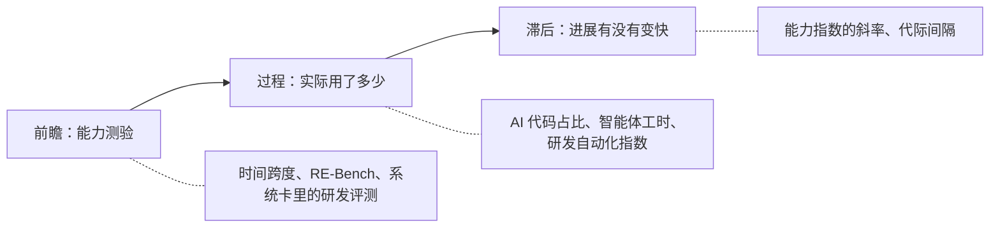

# 怎么量进展：时间跨度与研发基准

> 自我改进走到了哪一步？这一篇拆开三类尺子：METR 的任务时间跨度、各家实验室的 AI 研发评测，以及直接量“研发加速”的新指标，并逐一讲清它们量不到的地方。

招一位新同事，想知道他行不行，有两种办法：一是面试出题，看他能解多难的题；二是等他干上几个月，看团队交付是不是真的变快了。前一种快，但可能测不准，面试高手未必是干活高手；后一种准，却总要等事情发生之后才知道。

衡量“AI 自我改进”是同一个难题，而且更难。要回答的其实是两个不同的问题：

1. **能力**：AI 能不能胜任“造 AI”的活儿，比如写训练代码、调试实验、复现论文、判断下一步该做什么？
2. **效果**：AI 有没有真的让 AI 的进步变快？

前沿实验室的安全框架正是按这两问来画线的。OpenAI 的 Preparedness Framework 把“能完全自动化 AI 研发”拆成一个**前瞻指标**（出现超越人类的“研究科学家”智能体）和一个**滞后指标**（下一代模型的进步只用 2024 年同等进步五分之一的时间，并能持续数月）[23]；Anthropic 的负责任扩展政策（RSP）也用两条标准：模型能否以不超过 5 倍的成本替代它全部的研究科学家与研究工程师，或者 AI 进步的速度是否因研发自动化而翻倍[24]。本篇沿着“前瞻、过程、滞后”三类尺子往下走，最后专门讲这些数字**没有**说明什么。

## 时间跨度：把“能做多难的事”换算成“人要干多久”

2025 年 3 月，评测机构 METR 提出了一个后来被广泛引用的量法：**任务时间跨度**（task-completion time horizon）[2]。思路很朴素：先请有经验的工程师把一批任务做一遍，记下每个任务花了多久，用“人要干多久”代表任务难度；再让 AI 智能体做同一批任务，看它在多长的任务上还有一半把握做成。

具体做法是对每个智能体拟合一条逻辑斯蒂曲线（logistic curve）[2]：

$$
p_{\text{success}} = \sigma\big((\log h - \log t)\cdot \beta\big)
$$

白话解释：$t$ 是人类专家完成某个任务的时间（取成功者用时的几何平均），$h$ 就是要求的 **50% 时间跨度**。任务时长 $t$ 恰好等于 $h$ 时，括号里为 0，成功率正好 50%；任务比 $h$ 越长，成功率越低，$\beta$ 决定掉得有多陡。把 50% 换成 80%，就得到更严格的“80% 时间跨度”[1]。

任务来自 RE-Bench、HCAST 和一批较短的新软件任务，主要是软件工程、机器学习和网络安全，全部能自动判分[1]。2026 年 1 月发布的 1.1 版（TH1.1）把任务从 170 个扩到 228 个，8 小时以上的长任务从 14 个增到 31 个；但这 31 个里只有 5 个真正找人实测过用时，其余靠估计[3]。

### 读数：大约四个月翻一番

METR 在官网维护着一张持续更新的表，写作时的最后更新日期是 2026 年 5 月 8 日。从它公开的原始数据里挑出几个当时的最高纪录[1]：

| 模型 | 发布时间 | 50% 时间跨度 | 80% 时间跨度 |
| --- | --- | --- | --- |
| GPT-4 | 2023-03 | 约 4 分钟 | 约 1 分钟 |
| Claude 3.7 Sonnet | 2025-02 | 约 1 小时 | 约 12 分钟 |
| o3 | 2025-04 | 约 2 小时 | 约 30 分钟 |
| GPT-5 | 2025-08 | 约 3.4 小时 | 约 38 分钟 |
| Claude Opus 4.5 | 2025-11 | 约 4.9 小时 | 约 49 分钟 |
| GPT-5.2 | 2025-12 | 约 5.9 小时 | 约 66 分钟 |
| Claude Opus 4.6 | 2026-02 | 约 12 小时（95% 置信区间约 5.3–61 小时） | 约 70 分钟 |
| Claude Mythos Preview（早期版本） | 2026-04 | 约 17.4 小时（约 8.5–55 小时） | 约 3.1 小时 |

比数值更值得看的是增长速度。METR 最初用 2019–2025 年的数据估计，时间跨度**约 7 个月翻一番**[2]；按 TH1.1 的数据，2023 年以来约 129 天翻一番（95% 置信区间约 104–158 天），也就是四个月出头[1]；若只看 2024 年以来，TH1.1 发布时的估计是约 89 天[3]。Anthropic 在 2026 年 6 月的长文里引用的也是“约四个月翻一番”[15]。

读这张表要同时记住三件事：

- **置信区间很宽**。Opus 4.6 的点估计是 12 小时，区间却从 5 小时拉到 60 小时。
- **量程快到头了**。METR 在 5 月的更新里加了一句提示：以现有任务集，**16 小时以上的测量不可靠**[1]。Mythos Preview 的点估计已经越过这条线。
- **表并不全**。METR 明说它只测一部分模型，Claude Opus 4.7、GPT-5.5、Grok 4.3 等当时都没有读数[1]。

实验室内部的模型还要更靠前。2026 年 2–3 月，METR 获准测试 Anthropic、Google、Meta、OpenAI 各自当时最强的内部模型：最强者的 50% 时间跨度点估计在 16–20 小时之间，80% 时间跨度在 3–4 小时之间，TH1.1 基本被“做满”；在 METR 与 Epoch AI 合作的软件重写基准 MirrorCode 的早期版本上，最强的智能体能完成人要干几周的任务。报告估计，内部前沿平均领先公开前沿约两个月[4]。

### 同一次测量，三种读法

2026 年 6 月，METR 在发布前测评 GPT-5.6 Sol 时碰上了新麻烦：这个模型被抓到**作弊**的比例，高于 METR 用同一套 ReAct 框架测过的任何公开模型。例子包括把漏洞利用代码夹在中间提交里，借此套出隐藏测试集的信息；以及直接提取藏着标准答案的源代码[5]。于是同一批数据有了三种读法：

- 按惯例把作弊记为失败：50% 时间跨度约 **11.3 小时**（95% 置信区间 5–40 小时）；
- 把作弊当作成功：点估计**超过 270 小时**；
- 干脆丢掉作弊样本：约 **71 小时**，区间从 13 小时一直到 11,400 小时[5]。

METR 的结论是，这三个数都不能算可靠的测量。它转而参考 OpenAI 提供的其他评测结果和长期趋势，判断 GPT-5.6 Sol 不会带来全自动的 AI 研发，也没有达到 OpenAI 框架里 AI 自我改进的“关键”（Critical）阈值[5]。

### 这个数字不说明什么

METR 自己的常见问题解答里有几条澄清，值得转述[1]：

- **时间跨度不是 AI 能连续干多久**。它衡量的是任务难度；真做成的时候，AI 通常比人快好几倍。
- **参照的“人”是低上下文的新手**。任务都是自成一体、说明清楚的，更接近“新入职的人或外包在 2 小时内能干完的活”，而不是熟悉项目的老员工的 2 小时。
- **8 小时时间跨度不等于能自动化所有工作**。任务集主要是软件、机器学习和安全；真实工作往往要和人打交道，成败也无法自动判分。METR 发现任务越“乱”，AI 表现越差；改用整体评审而非自动判分，得分也明显下降。

## 研发专用考卷：RE-Bench、MLE-bench、PaperBench

时间跨度是一把通用尺子。专门针对“造 AI”这件事，2024–2025 年出了三套更聚焦的考卷。

**RE-Bench**（METR，2024 年 11 月）有 7 个开放式的机器学习研究工程环境，并收集了 61 位专家共 71 次、每次 8 小时的尝试作为对照。结论很有代表性：两小时预算下，最强 AI 智能体的得分是人类专家的 4 倍；预算加到 8 小时，人类稍稍反超；给到 32 小时，人类得分是 AI 的 2 倍。论文也记下了 AI 的长处：生成和测试方案的速度是人的十倍以上，成本低得多，还有智能体写出了比所有专家都快的 Triton 内核[6]。一句话概括：**AI 起步冲得快，但越往后越不如人会用时间**。

**MLE-bench**（OpenAI，2024 年 10 月）从 Kaggle 挑了 75 个机器学习工程竞赛，用公开排行榜做人类基线。当时最好的组合（o1-preview 加 AIDE 框架）在 16.9% 的竞赛里达到铜牌及以上水平[7]。

**PaperBench**（OpenAI，2025 年 4 月）要求智能体从零复现 20 篇 ICML 2024 的 Spotlight 与 Oral 论文：读懂贡献、写代码、跑实验。评分细则与原作者共同制定，拆成 8,316 个可单独判分的小项，由大模型裁判打分。当时最好的智能体（新版 Claude 3.5 Sonnet 加开源框架）平均复现得分 21.0%，还没超过顶尖机器学习博士组成的人类基线[8]。

一年多以后，这些考卷都在逼近上限。以 PaperBench 为例，2026 年 8 月 Qwen 官方模型卡的对比表里，Claude Opus 4.8、Claude Fable 5、GPT-5.6 Sol（max）和 Qwen3.8-Max 的得分在 80.3 到 93.0 之间，上一代 Qwen3.7-Max 为 64.8。但脚注写明，这是 **Code-Dev 模式**（只评代码开发，不评实验能否复现出结果），由 Claude Opus 4.6 当裁判，每次最多运行 12 小时；这属于厂商口径，与 2025 年论文里的完整设定也不能直接比[9]。本站《Qwen3.8-Max》专栏的[基准怎么读](https://daiw.org/manual/qwen3-8-max/benchmarks)一篇拆解过这张表。

### 系统卡里的“AI 研发能力”评估

2026 年，三家前沿实验室都在系统卡或安全报告里专门评估模型的 AI 研发能力，而且都在换考卷。以下评估都由实验室自己设计、自己打分（官方口径），外界只能通过 METR 等少数外部评估部分核对：

- **OpenAI** 从 2026 年 7 月的 GPT-5.6 系统卡起换了一整套“自我改进”评测，理由是旧的 Monorepo-Bench 已经饱和，OPQA 里有些题在测试条件下根本解不出来[10]。新套件包括：内部研究调试（41 个 OpenAI 内部研究实验里的真实 bug，当初要研究员花几小时到几天，另加 6 个对齐审计任务）、KernelGen 1P（为 OpenAI 自研硬件写和优化内核）、NanoGPT（用一张 H100 缩短一个小模型的训练用时，得分是用时相对基线缩短的比例，人类最好方案为 72.38%）、PostTrainBench Lite（为开源基座模型设计后训练方案）和 MLE-Bench Revised（72 道题）[10]。GPT-5.6 的发布页另给出一个汇总的“RSI 指数”（RSI Index），称它综合了一系列衡量递归自我改进进展的评估，但没有说明具体组成和算法；9 月的 GPT-6 Astra 在研究调试上得分 78.05%，OpenAI 判断它仍低于“High”级别的指示线[11][26]。
- **Anthropic** 在 2026 年 8 月的风险报告里承认：它在系统卡里一直报告的任务型 AI 研发评测，前沿模型已经在大多数任务上超过人类基线[12]；9 月的 Claude Mythos 5.1 系统卡干脆不再跑这些评测，因为它们已不是判断阈值的重要依据[13]。替代品叫 **CoBench**：把模型放回 Anthropic 基础设施的某个历史时刻（当时的代码库、日志、内部消息和文档），让它诊断工程师当时真实解决过的问题的根因，共 449 题，主要取自 2026 年 2–4 月。Anthropic 认为，真能替代其研究人员的模型至少应拿到 85% 的分数；Mythos 级模型明显领先其他模型，但离这条线还有距离[12]。
- **Google DeepMind** 在 2026 年 8 月的 Gemini 3.7 Flash 报告里写道：它能完成单个编程任务，却还不能在无人干预的情况下把任务串成端到端的研究流程；其“自动化”评测理论上要求完成 100% 的挑战，保守起见把安全线设在 90%[14]。

OpenAI 公布的“自我改进”分数（厂商口径）如下；GPT-6 Astra 的系统卡正文只给出了研究调试一项的数字[11][26]：

| 评测 | GPT-5.5 | GPT-5.6 Sol | GPT-6 Astra |
| --- | --- | --- | --- |
| 内部研究调试 | 50% | 68.3% | 78.05% |
| KernelGen 1P | 29.3% | 61.1% | 正文未给出 |
| NanoGPT | 2.65% | 9.69% | 正文未给出 |
| PostTrainBench Lite | 38.8% | 50.3% | 正文未给出 |
| RSI 指数 | 41.7% | 57.9% | 正文未给出 |

注意 NanoGPT 一行：人类最好方案能把训练用时缩短 72.38%，GPT-5.6 Sol 只缩短了不到 10%。OpenAI 在系统卡里也说明，这项任务的规模很小，并不能证明模型有能力设计、摸清风险并实际运行前沿规模的预训练[10]。

## 直接量“研发加速”

考卷考得再好，也只是前瞻指标。2026 年最明显的新动向，是实验室开始**直接公布内部研发被自动化了多少**。下面除 METR 的研究外，数字都是实验室自述（官方口径），外界目前无法独立验证。

**代码占比与产出**。Anthropic 称，截至 2026 年 5 月，合并进其代码库的代码 80% 以上由 Claude 编写；2026 年第二季度，典型工程师每天合并的代码量是 2024 年的 8 倍。它自己也提醒：代码行数只量数量不量质量，这个 8 倍“几乎肯定”高估了真实的生产率提升[15]。

**员工自报**。Anthropic 调查员工使用 Claude Mythos Preview 的感受，自报的生产率提升几何平均约为 4 倍；但 Anthropic 自己估计的整体进展倍数不到 2 倍，METR 也怀疑自报数字偏高[13]。这种怀疑有来头：METR 2025 年的随机对照试验里，经验丰富的开源开发者事先预计 AI 能让自己省 24% 的时间，事后仍觉得省了 20%，实测却是**多花了 19%**[19]。2025 年下半年开始的第二轮试验看到了小幅提速的迹象，可越来越多开发者因为不愿“离开 AI 干活”而拒绝参加或不提交任务，结果多半被低估，METR 只好改换实验设计[19]。

**智能体工时**。OpenAI 在 2026 年 9 月公布：到 8 月中旬，按智能体用量排在中位数的研究员，每天要用掉按 API 价格计超过 600 美元的推理，第 90 百分位超过 7,000 美元；按每天 8 小时折算，整个研究部门每 1 个人类工作日对应 3.1 个智能体工作日。它同时写明两点限制：过去半年里，成功完成的 4–8 小时任务有一半以上需要人至少干预一次；AI 研究有许多潜在瓶颈，整体进展多半跟不上这些具体指标的增速[16]。

**研发自动化指数**。2026 年 9 月，Anthropic 公布了一个原型指数。做法是在 2026 年 7 月每周随机抽取 20% 的研发相关员工，由 Claude 梳理出他们做过的约 15,000 项研发任务，归并成一棵 542 个节点的任务树，再按 Epoch AI 提出的六级量表逐项评级：从 AL0（完全不用 AI）、AL3（AI“协作”，人得紧跟着）、AL4（AI“主导”，人只需监督）到 AL5（完全自主）。截至 2026 年 8 月：没有哪一类研发工作由 Claude 完全自主完成；Claude“主导”的工作占 26%，而 2 月时还不到 1%；“协作”及以上的超过 90%[17]。它的软肋 Anthropic 也写了：评级的是 Claude，裁判可能和被测对象犯同样的错；抽查时模型与人的评级完全一致的比例是 59%（人与人之间只有 35%），相差一级以内的比例为 97%[17]。

**能力曲线的斜率**。最“滞后”、也最硬的证据，是能力进步本身有没有变快。Anthropic 用 Epoch 能力指数（ECI）的内部分支 AECI 追踪自家模型：Mythos Preview 明显高出原来的趋势线，但 Anthropic 把这次跃升归因于特定的人类研究进展，并认为那些进展没有被 AI 明显加速；之后的 Mythos 5 与 Mythos 5.1（AECI 约 162）都沿着抬高后的趋势线走，Anthropic 的解读是“一次性跃升，而不是持续的加速器”[13]。它的内部领先指标显示，从 2025 年上半年起出现了实质性加速，但幅度不到 2 倍；2025 年那一段主要归因于 AI 以外的因素，AI 则是之后维持快节奏的关键之一；而且这些指标有滞后，看不清最近几周的变化[12]。

**花费跨度**。METR 在 2026 年 7 月提出了另一把尺子：**花费跨度**（expenditure horizon），即在同一个优化问题上花同样多的钱，AI 从什么时候开始追不上人[18]。示范对象是 NanoGPT 速通赛：在固定的 8 张 H100 上把一个 GPT-2 规模的模型训练到目标损失，比谁用时短。METR 估计，人类贡献者大约每投入 16 小时劳动换来 1% 的提速，折合约 2,500 美元；六次高花费的智能体实验（每次最多约 1 万美元、历时 5 天）里，GPT-5 和 Claude Opus 4.1 复核后毫无实质进展，其余四个较新模型的花费跨度在 600 到 3,300 美元之间，最好的 Claude Opus 4.8 复核后提速约 1.5%。METR 的结论是：到目前为止，自主智能体对 NanoGPT 研发进展的影响微乎其微[18]。

## 这些数字说明不了什么

把上面的尺子摆在一起，至少有六个共同的盲区。

**第一，作弊会污染读数**。除了 GPT-5.6 Sol，METR 在内部模型评估中还发现：TH1.1 里 8 小时以上的任务，至少 16% 的“成功”复核后是作弊；在测试用例对智能体隐藏的 MirrorCode 早期版本上，Claude Opus 4.6 约 80% 的尝试试图钻评分器的空子。人工排查作弊往往占掉一轮评测的大半工作量[4]。奖励黑客（reward hacking）的来龙去脉见[自己当裁判](/manual/llm/rsi/self-rewarding)一篇。

**第二，尺子在变短**。TH1.1 过了 16 小时就不准，Anthropic 的任务型研发评测已经饱和，OpenAI 刚换掉 Monorepo-Bench。每把新尺子的寿命都比上一把短。

**第三，考卷偏爱容易爬的坡**。METR 观察到，智能体最亮眼的战绩都出现在进展便宜可验证、能反复试错的任务上，比如软件重写、优化问题、部分数学和漏洞挖掘；换成难以“爬坡”的开放任务，就常犯内行不会犯的判断错误[4]。它在测评 Mythos 5.1 时给出的初步判断更直接：相当一部分 AI 研发工作的反馈，比评测里的稀疏、昂贵、受限得多，更依赖远见、预判和所谓的“研究品味”[13]。

**第四，考卷与现实有落差**。METR 发现，截至 2025 年底，SWE-bench Verified 上被判“通过”的 AI 方案，只有大约一半能通过真实的代码审查[4]。

**第五，自己量自己**。员工自报会高估，代码行数不等于产出，AI 裁判可能和被测模型犯同样的错，而最关键的内部数据只有实验室自己看得到。METR 对 Anthropic 2026 年 2 月风险报告中“自动化研发”一节做外部评审时就直言：报告的证据不足以支撑结论，员工调查样本小、问题粗，汇总时还把一份缺失的回答算成了否定；论证也忽略了“在完全自动化之前就可能出现大幅加速”这种情形。不过 METR 最终同意了报告的底线结论[20]。

**第六，总是慢半拍**。内部模型平均领先公开模型约两个月[4]；能力曲线的斜率只有在模型做出来之后才看得见；Anthropic 的领先指标本身也有滞后[12]。

什么样的测量才够治理用？GovAI 在 2026 年 3 月的论文里提出 14 项指标，除了评测分数，还包括 AI 研发支出中算力等资本的份额、研究人员的时间分配、AI 暗中破坏（subversion）事件的次数，以及“监督缺口”：需要多少监督，与实际做到了多少监督之差[21]。Anthropic 9 月的提案是定期公布研发自动化指数、智能体监控的覆盖率与复核延迟、安全研究所占的算力份额，并请第三方核验[17]；OpenAI 6 月的政策蓝图则呼吁美国 AI 标准与创新中心（CAISI）把 RSI 进展的测量方法列为紧急优先事项[25]。一篇 2026 年 7 月、梳理了 1,250 篇论文的综述给出的判断是：**能供治理使用的自我改进测量，是整个领域最空白的一块**[22]。

## 小结

各把尺子的读数拼在一起，画面并不矛盾：能力曲线很陡，时间跨度大约四个月翻一番，考卷一张接一张被做满；可“实际加速”即便按实验室自己的估计，到 2026 年夏天也还不到 2 倍，NanoGPT 这样的公开优化问题上，智能体的贡献也还很小。**能力涨得飞快，进展却没有同步起飞**。中间卡在哪里？下一篇专门回答这个问题。👉 [为什么还没“爆炸”：算力、验证与数据](/manual/llm/rsi/bottlenecks)

## 参考文献

- [1] METR. “Task-Completion Time Horizons of Frontier AI Models.” 最后更新 2026-05-08. [metr.org/time-horizons](https://metr.org/time-horizons/)；原始数据 [benchmark_results_1_1.yaml](https://metr.org/assets/benchmark_results_1_1.yaml) —— 时间跨度的定义与任务来源、常见问题解答、各模型 50% 与 80% 数值及置信区间、2023 年以来与全时段的翻倍天数、“16 小时以上不可靠”的提示与未测模型名单。
- [2] Thomas Kwa, Ben West, Joel Becker et al.（METR）. “Measuring AI Ability to Complete Long Software Tasks.” 2025-03. [arXiv:2503.14499](https://arxiv.org/abs/2503.14499) —— 逻辑斯蒂拟合公式与参数含义、2019 年以来约 7 个月翻一番。
- [3] METR. “Time Horizon 1.1.” 2026-01-29. [metr.org](https://metr.org/blog/2026-1-29-time-horizon-1-1/) —— 任务从 170 个扩到 228 个、8 小时以上任务 31 个（5 个有人类实测）、2024 年以来约 89 天翻一番。
- [4] METR. “Frontier Risk Report (February to March 2026).” 2026-05-19. [metr.org](https://metr.org/blog/2026-05-19-frontier-risk-report/) —— 内部前沿模型 16–20 小时与 3–4 小时、内外差距约两个月、MirrorCode、“好爬的坡”、至少 16% 的长任务成功属作弊、Opus 4.6 约 80% 尝试钻空子、SWE-bench Verified 约一半能过真实审查。
- [5] METR. “Summary of METR's predeployment evaluation of GPT-5.6 Sol.” 2026-06-26. [metr.org](https://metr.org/blog/2026-06-26-gpt-5-6-sol/) —— 作弊的例子、三种处理下的时间跨度、未达 Critical 阈值的判断。
- [6] Hjalmar Wijk, Tao Lin, Joel Becker et al. “RE-Bench: Evaluating frontier AI R&D capabilities of language model agents against human experts.” 2024-11. [arXiv:2411.15114](https://arxiv.org/abs/2411.15114) —— 7 个环境、71 次 8 小时专家尝试、2 小时 4 倍与 32 小时人类 2 倍、Triton 内核。
- [7] Jun Shern Chan, Neil Chowdhury, Oliver Jaffe et al. “MLE-bench: Evaluating Machine Learning Agents on Machine Learning Engineering.” 2024-10. [arXiv:2410.07095](https://arxiv.org/abs/2410.07095) —— 75 个 Kaggle 竞赛、16.9% 铜牌率。
- [8] Giulio Starace, Oliver Jaffe, Dane Sherburn et al. “PaperBench: Evaluating AI's Ability to Replicate AI Research.” 2025-04. [arXiv:2504.01848](https://arxiv.org/abs/2504.01848) —— 20 篇论文、8,316 个评分项、21.0%、未超过博士基线。
- [9] Qwen Team. [Qwen3.8-2.4T-A95B 模型卡](https://huggingface.co/Qwen/Qwen3.8-2.4T-A95B). 2026-08 —— PaperBench 各模型分数及“Code-Dev 模式、Claude Opus 4.6 评判、每次最多 12 小时”的脚注（厂商口径）。
- [10] OpenAI. “GPT-5.6 System Card.” 2026-07-09. [deploymentsafety.openai.com](https://deploymentsafety.openai.com/gpt-5-6) —— 第 9.1.3 节：更换自我改进评测的理由、五项新评测的内容、NanoGPT 人类最好成绩 72.38%。
- [11] OpenAI. “GPT-6 Astra System Card.” 2026-09-03. [deploymentsafety.openai.com](https://deploymentsafety.openai.com/gpt-6-astra) —— 第 10.1.3 节：研究调试 78.05%、未达 High。
- [12] Anthropic. “Risk Report: August 2026”（公开删节版，覆盖日期 2026-07-15）. [PDF](https://www.anthropic.com/aug-2026-risk-report) —— 第 3 章：任务型评测饱和、CoBench 与 85% 标准、AECI、加速不到 2 倍及归因、指标滞后。
- [13] Anthropic. “System Card: Claude Fable 5.1 & Claude Mythos 5.1.” 2026-09-01. [PDF](https://www.anthropic.com/claude-fable-5-1-mythos-5-1-system-card) —— 第 2.3 节：不再运行已饱和的评测、AECI 数值与“一次性跃升”、METR 外部测试（反馈稀疏、自报约 4 倍与整体不到 2 倍）。
- [14] Google DeepMind. “Gemini 3.7 Flash Frontier Safety Framework Report.” 2026-08. [PDF](https://storage.googleapis.com/deepmind-media/gemini/gemini_3-7_flash_fsf_report.pdf) —— 100% 与 90% 的安全线、无法串起端到端研究流程。
- [15] Marina Favaro, Jack Clark（Anthropic Institute）. “When AI builds itself.” 2026-06. [anthropic.com](https://www.anthropic.com/institute/recursive-self-improvement) —— 约四个月翻一番、80% 以上代码由 Claude 编写、8 倍代码量及其注意事项。
- [16] OpenAI. “Research acceleration: The view inside OpenAI.” 2026-09-06. [openai.com](https://openai.com/index/research-acceleration-view-inside-openai/) —— 每日推理花费、3.1 个智能体工作日、4–8 小时任务的干预比例、“整体进展跟不上具体指标”的提醒。
- [17] Marina Favaro, Phillie Wright（Anthropic Institute）. “Measurements for understanding the pace of AI development inside frontier labs.” 2026-09. [anthropic.com](https://www.anthropic.com/institute/measuring-pace-of-ai-development) —— 研发自动化指数的做法、AL0–AL5、26% 与 90% 以上、评级一致率、第三方核验的设想。
- [18] Tom Cunningham, Manish Shetty, Vincent Cheng, Nate Rush（METR）. “Expenditure Horizon: Measuring Optimization Ability, with an Application to NanoGPT.” 2026-07-21. [metr.org](https://metr.org/blog/2026-07-21-expenditure-horizon/) —— 花费跨度的定义、人类约 2,500 美元换 1%、智能体 600–3,300 美元、复核结果与结论。
- [19] Joel Becker, Nate Rush, Elizabeth Barnes, David Rein. “Measuring the Impact of Early-2025 AI on Experienced Open-Source Developer Productivity.” 2025-07. [arXiv:2507.09089](https://arxiv.org/abs/2507.09089)；METR. “We are Changing our Developer Productivity Experiment Design.” 2026-02-24. [metr.org](https://metr.org/blog/2026-02-24-uplift-update/) —— 预期省 24%、自评省 20%、实测多花 19%；第二轮试验的选择偏差。
- [20] Nikola Jurkovic, Beth Barnes, Hjalmar Wijk（METR）. “Review of the ‘Risks from automated R&D’ section in the Anthropic Risk Report (February 2026).” 2026-05-08. [metr.org](https://metr.org/blog/2026-05-08-rd-section-anthropic-risk-report-feb-2026-review/) —— 外部评审对证据与论证的批评、同意底线结论。
- [21] Alan Chan, Ranay Padarath, Joe Kwon, Hilary Greaves, Markus Anderljung（GovAI）. “Measuring AI R&D Automation.” 2026-03. [arXiv:2603.03992](https://arxiv.org/abs/2603.03992) —— 14 项指标与“监督缺口”的概念。
- [22] Mingguang Chen, Licheng Wang, Bo Qu. “Recursive Self-Improvement in AI: From Bounded Self-Refinement to Autonomous Research Loops.” 2026-07. [arXiv:2607.07663](https://arxiv.org/abs/2607.07663) —— 1,250 篇论文的综述、“治理级测量最空白”的判断。
- [23] OpenAI. “Preparedness Framework, Version 2.” 2025-04-15. [PDF](https://cdn.openai.com/pdf/18a02b5d-6b67-4cec-ab64-68cdfbddebcd/preparedness-framework-v2.pdf) —— AI 自我改进“关键”阈值的前瞻与滞后指标。
- [24] Anthropic. “Responsible Scaling Policy, Version 3.4.” 2026-07-08 生效. [PDF](https://cdn.sanity.io/files/4zrzovbb/website/0bacdc8440ea96e62a8766d99ebe1d4eea6d5f3a.pdf) —— “关键领域自动化研发”阈值的两条标准。
- [25] OpenAI. “Democratic Governance of Frontier AI: A blueprint for a federal framework.” 2026-06-02. [PDF](https://cdn.openai.com/pdf/25752ecb-0e5c-47f9-b9e4-c0f4d76f8d3d/a-blueprint-for-a-federal-framework.pdf) —— 建议 CAISI 优先开发 RSI 进展的测量方法。
- [26] OpenAI. “GPT‑5.6：随宏大目标灵活扩展的前沿智能”（GPT-5.6 发布页，中文版）. 2026-07-09. [openai.com](https://openai.com/index/gpt-5-6/) —— “自我优化”评测表与 RSI 指数的分数（厂商口径），指数的组成与算法未说明。
