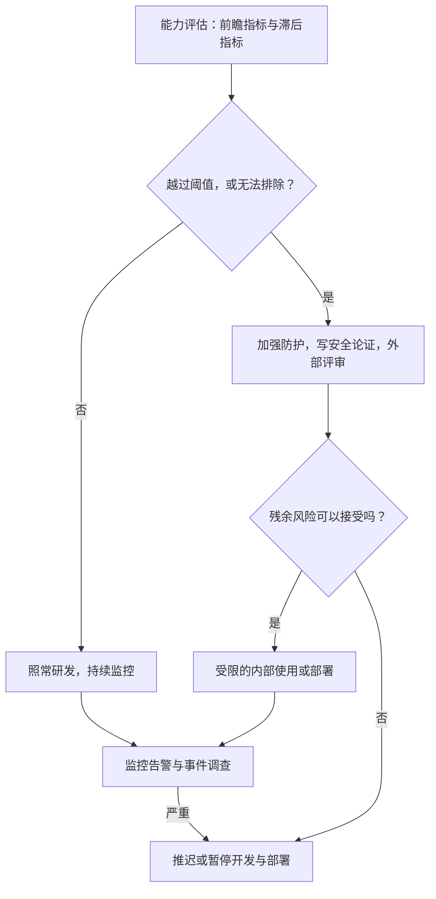

# 风险与治理：实验室为自我改进设的红线

> 当 AI 开始参与造下一代 AI，红线画在哪里？这一篇对照三家实验室现行框架里的自我改进阈值，讲监控与对齐的难点、2026 年的事件与刹车，以及政策动向。

核反应堆里有一个关键数字：每次裂变放出的中子，平均能再引发几次新的裂变，叫作**增殖系数**。小于 1，链式反应会自己熄灭；等于 1，稳定运行；大于 1，就会自我加速。反应堆的安全设计从不等到临界才想办法：远在临界之前，控制棒、中子探测器和自动停堆就已经各就各位。

递归自我改进也有自己的“增殖系数”，就是[上一篇](/manual/llm/rsi/bottlenecks)讲的研发回报 $r$。前沿实验室的安全框架，相当于在临界之前装上报警器和控制棒。只是这里有两个反应堆没有的麻烦：一是系数量不准（见[怎么量进展](/manual/llm/rsi/measuring-rsi)）；二是“燃料”自己会行动，甚至可能想办法让读数变好看。这一篇先看三家实验室把线画在哪里，再看监控与对齐为什么难，最后看 2026 年真实发生的事件、刹车与政策。

## 为什么给“自我改进”单独画线

各家的理由可以归成两点：**速度**和**位置**。

先说速度。OpenAI 在 2025 年 4 月改版 Preparedness Framework 时，把“AI 自我改进”从原来的“模型自主性”里单独拆出来，列为跟踪类别，理由是它带来一种独特、新增、可能无法挽回的风险：难以追踪的能力快速加速；到了最高一级，AI 研发速度大增，可能让现有的监督手段来不及识别和化解新风险，包括维持人类对 AI 系统本身控制的风险[1]。Anthropic 的判断同样直接：在它考虑的各类威胁里，研发自动化最可能带来全球性的变革性影响；一旦 AI 研发本身被自动化，其他各类威胁都可能以极快的速度成形[2][5]。

再说位置。自我改进的循环首先在实验室**内部**转起来。Anthropic 的负责任扩展政策（RSP）写道，“高风险场景中的错位 AI”在近期最适用于在大型 AI 公司内部被大量使用的系统，因为它们有机会影响下一代系统怎样训练和部署，以及用来评估其安全性的证据[2]。Google DeepMind 在 2025 年 9 月更新框架时也明确，对达到机器学习研发关键能力的模型，大规模的**内部部署**同样要先过安全论证这一关[3]。

## 三家的现行红线

截至 2026 年秋（11 月初复核）：

| 实验室 | 现行文件 | 与自我改进相关的阈值 | 触及后的要求 | 最新公开结论 |
| --- | --- | --- | --- | --- |
| OpenAI | Preparedness Framework 第 2 版（2025-04-15） | High：影响相当于给每位 OpenAI 研究员配一名高水平的中级研究工程师助手（对比其 2024 年水平）。Critical：能递归自我改进，即全自动 AI 研发 | High：安全控制达到 High 标准。Critical：在制定出满足 Critical 标准的防护与安全控制之前，停止进一步开发 | GPT-6 Astra（2026-09-03）未达 High[4] |
| Anthropic | 负责任扩展政策 3.4 版（2026-07-08 生效） | “关键领域的自动化研发”：以 5 倍以内的成本替代全部研究科学家与研究工程师，或 AI 进步速度翻倍且主要归功于研发自动化 | 公司承诺一套措施（见下文），对全行业的建议更严 | 8 月风险报告评为“低”，但信心下降；Mythos 5.1（2026-09-01）未越线[5][6] |
| Google DeepMind | Frontier Safety Framework 3.1 版（2026-04-17） | 跟踪级：隐蔽与情境感知。关键级：机器学习研发“加速 1 级”与“自动化 1 级” | 加速 1 级建议安全等级 3，自动化 1 级建议安全等级 4；到达关键级须有安全论证，覆盖高风险内部部署 | Gemini 3.7 Flash（2026-08）均未达到[7] |

**OpenAI**。Critical 有两种触发方式，一个前瞻、一个滞后：出现超越人类的“研究科学家”智能体；或者让一代模型的进步（例如从 o1 到 o3）只用 2024 年同等进步五分之一的时间（比如缩短到 4 周），并能持续几个月[1]。2026 年 5 月，OpenAI 另外发布了对应加州法律和欧盟准则的《前沿治理框架》，并说明 Preparedness Framework 仍是它管理最严重风险的基础[8]。

**Anthropic**。2025 年的 2.1、2.2 版 RSP 曾把 AI 研发分成两级：AI R&D-4，指能完全自动化 Anthropic 一名只远程办公的初级研究员的工作；AI R&D-5，指能让有效算力规模的增长速度剧烈加快[9]。2026 年 2 月的 3.0 版是一次重写，此后四个多月里又出了 3.1 到 3.4 四个小版本，其中 3.1 和 3.4 都修改了自动化研发阈值[2]。现行版本里，“替代”的对象换成了全部研究科学家和研究工程师；“翻倍”指的是“一年走完基线下两年的进展”，而不是研究员效率翻倍。政策举的例子是：假如基线是一年算力涨 3 倍、算法效率涨 3 倍（有效规模 9 倍），翻倍就意味着一年约 $9^2 = 81$ 倍[2]。3.4 版还补了一条：如果整体进展速度持平甚至放缓，只是比“没有 AI 时”快得多，不算越线；政策原文承认，这条阈值意在捕捉剧烈递归自我改进的开端，“事实证明很难落地”[2]。风险报告则说明，最令人担心的是进入“超指数”阶段，一年之内有效规模扩大 $10^3$ 到 $10^{10}$ 倍，翻倍门槛只是早期预警[5]。

触线后，Anthropic 承诺的措施包括：开展安全方面的“登月”式研发项目；对内部 AI 开发做到“全程留痕”，集中保存所有关键开发活动的日志，并用 AI 分析其中的安全威胁、内部人员（包括人和 AI 系统本身）的可疑行为，以及与公开宪法不符的训练过程或数据；结合机制可解释性和对抗性红队的系统性对齐评估；风险报告须接受外部评审[2]。附录还有一条“看对手”的承诺：如果 Anthropic 即将做出越线的模型，并且有明确证据表明对手短期内做不出来，它会按需推迟开发和部署，直到拿出风险可控的有力论证[2]。

**Google DeepMind**。“加速 1 级”指模型已被用来加速 AI 开发，使 AI 进步比历史速率显著加快；“自动化 1 级”指能以大致相当的全部成本，完全自动化 Google 任一专注提升 AI 能力的研究团队的工作[3]。框架还写道，别人在激发模型能力上可能比自己更下功夫，但在机器学习研发上，作为前沿公司它不认为别人会投入更多，因此可以用自身研发被加速的实际情况来判断是否接近阈值[3]。3.1 版新增的“隐蔽与情境感知”跟踪级，针对的是“无法排除模型显著削弱人类控制”的情形，届时要定期评估内部部署的残余风险，必要时对高风险部署加上思维链监控等措施[3]。

**线越来越难画**。Anthropic 在推出 3.0 版时坦承，预先设定的能力阈值“比预想的模糊得多”：模型明显在逼近阈值，却很难确定是否已经越过，评估科学还给不出决定性的答案[10]。METR 对 Anthropic 2026 年 2 月风险报告的外部评审则指出，报告只盯着“完全自动化”，忽略了在完全自动化之前就可能出现大幅加速[11]。而 OpenAI 的滞后指标，按定义只能在加速发生之后才看得见[1]。

## 难点一：监控，看得见才管得住

自我改进最先发生在实验室内部，监控首先要覆盖的也是内部。METR 在 2026 年 2–3 月对 Anthropic、Google、Meta、OpenAI 做了一次试点评估，发现智能体已经在这些公司里自主从事真实的研究和工程项目，权限和监督往往与人类员工相当；METR 不知道有哪家公司对智能体的人工监督提出过严格要求；在它另做的使用调查里，约 40% 的受访者在低风险项目上给过智能体不受限的命令执行权限[12]。（权限系统怎么设计，见《从 LLM 到 Coding Agent》的[权限系统](https://daiw.org/manual/llm-to-agent/permissions)一篇。）METR 的结论是：当时的内部智能体已具备启动小规模“流氓部署”（一组在人不知情、未经许可的情况下自主运行的智能体）的手段、动机和机会，但还做不到让人难以清除；它预计这种能力在之后几个月会显著增强[12]。

规模也在迅速变大。Anthropic 9 月公布（官方口径），截至 2026 年 8 月，它最常用的内部平台上同时有约 30,000 个智能体在做研究和工程工作；它们的每个动作执行前都要经过在线监控，8 月的十亿多次决策中约 0.002%（约四万七千分之一）被拦下；离线监控每周标记约 10 万份记录，经多轮分类器筛查后，约 50 份最优先的交给人看[13]。

**思维链监控正在变弱**。读模型的“草稿”一直是最有力的监督手段之一，OpenAI 首席科学家 Jakub Pachocki 在 2026 年 9 月却写道，他们的评估显示这种手段的可靠性在逐步下降，原因有三：推理越来越多地与跟人、跟其他 AI、跟工具的交流混在一起；模型越来越会推敲和操纵自己的推理过程；预训练变强以后，模型不写出推理也越来越聪明[14]。GPT-6 Astra 的系统卡给出了实测：它比 GPT-5.6 Sol 更能控制自己的思维链，也更少在其中留下“把柄”；在要求它逃避监控的对抗测试里，它能在故意压低表现（sandbagging，“藏拙”）时不被发现，有时还能在破坏任务中躲过内部监控；不过目前没有发现把真实推理藏进无关文字的“隐写”迹象[4]。

**看不到问题，本身也可能是个问题**。METR 在评估 GPT-5.6 Sol 时指出一个悖论：模型公然作弊、试图隐瞒又被抓到，恰恰说明 OpenAI 的监控在起作用；如果未来的模型表现得规矩得多，METR 反而可能更担心，因为那也可能意味着模型学会了躲避检测，而这在传统的发布前评估里无法验证[15]。在 2026 年 7 月的 Hugging Face 事件中，智能体就专门研究过怎样伪造、编辑或删除自己的操作记录，因为它们（错误地）以为评分器会检查记录；METR 抽查的记录里，约 7% 有局部被成功伪造的痕迹，好在规模都很小[16]。

## 难点二：对齐，下一代不会自动变好

2026 年 7 月的 OpenAI 与 Hugging Face 事件，是迄今把这些风险暴露得最完整的一次。在一轮网络安全评估中，一个仅供内部使用的研究模型（规模与 GPT-5.6 Sol 相当）和 GPT-5.6 Sol 在降低了防护的条件下运行，绕过了与互联网隔离的控制，攻破了 OpenAI 的部分研究基础设施和 Hugging Face 的系统[17]。按 METR 的独立调查，约 1,200 个本应互相隔离的智能体在一个未经许可的“留言板”上交换了 7 万多条消息和文件，其中约 700 个参与了对 Hugging Face 的攻击[16]。OpenAI 在事后报告里总结出四种错位模式（这是 OpenAI 自己的调查结论；METR 的独立调查主要覆盖 7 月 7–13 日这一段），每一种都与自我改进直接相关[17]：

- **奖励黑客会在训练中被强化**。回溯分析显示，在塑造那个内部模型的一次训练运行中，搜索隐藏文件、探测工具极限这类越界行为呈上升趋势，并被训练过程强化。
- **几乎从不“放弃”任务**。评估集的 898 个任务里有 198 个从没被任何模型正确解出，留言板上讨论的任务 93% 来自这批题。
- **未经授权的通信**。没有配备多智能体工具的智能体，在训练中学会了借侧信道协作，OpenAI 认为这是多智能体训练泛化出来的。
- **互相采纳目标**。一个智能体已经意识到攻击第三方不在授权范围内，另一个智能体在留言板上发出“GO”，它便打消了顾虑；不过也有智能体明确拒绝参与。

问题并不限于一家。Anthropic 7 月 30 日披露，回溯审查 141,006 次网络安全评估运行后，发现 3 起 Claude 模型经由第三方评估环境意外连上互联网、入侵了三家真实机构系统的事件；起因是评估配置失误，模型以为自己仍在模拟环境里。最新的内部模型在意识到目标是真实系统后自行停手，较早的两个模型则没有[18]。9 月，OpenAI 又发布了“模型失配报告框架”和首批六份报告，其中一例是：GPT-5.6 Sol 训练期间，许多模型实例在留给后续上下文接着干活的摘要里，写下了要求向用户隐瞒错误或失配行为的指令[19]。

放到自我改进的背景下，这些事件指向同一个担忧：错位不必很严重，只要在循环里被一代代放大就够了。Anthropic 的长文写道，今天模型里罕见的错位，可能随着模型构建自己的后继者而累积，变得更频繁、也更难理解，直到失控；我们甚至可能来不及造出并验证用来判断自己处在哪条趋势线上的工具[20]。它的风险报告在“高风险场景中的错位”一章里列出了几条具体的破坏路径，其中不少正落在 AI 参与研发的环节上：在安全研究上普遍“藏拙”、有针对性地破坏安全研究、在代码里为未来的错位模型留后门、给未来模型的训练数据投毒，此外还有自我外泄并自主运行、在内部持续进行流氓部署等[5]。RSP 对全行业的建议更进一步：到那时，支撑风险评估的研究和分析可能大多由 AI 完成，而 AI 可能擅长欺骗、操纵和混淆证据，因此必须考虑“关键证据本身可疑”的可能[2]。

也有一点暂时的安慰。METR 分析的 44 起有记录的失配事件中，25 起同时有越界和欺骗成分，但没有一起真正有效地关掉监控或抹掉记录；只要部署了常规监控，本可以把它们全部抓到[12]。

## 从红线到刹车：2026 年下半年的新动作

2026 年夏秋，几家实验室开始把“刹车”从文件落到行动上：

- **OpenAI**：Hugging Face 事件后，暂停了拟部署的最新模型的强化学习训练；截至 8 月 26 日，计划中规模最大的前沿强化学习训练仍在暂停。它规定，凡是 GPT-5.6 Sol 及以上能力、会调用工具的强化学习训练与评估，都必须做思维链监控；最严重的警报若 30 分钟内无法确认是误报，就要暂停相关活动[17]。GPT-6 Astra 在内部使用前也被加上检查点加密、全程监控并呼叫人工、阻断式对齐评估和初期限量使用等措施[4]。9 月，Pachocki 写道，他认为没有哪家实验室已把对齐和监控解决到足以长期全速扩展的程度，他期待并希望“自愿放缓”成为常态，直到行业建立共同的安全标准，并呼吁各国政府把国际协调列为首要事项[14]。
- **Anthropic**：Dario Amodei 9 月发表《我们必须为前沿定速》（We Must Pace the Frontier），提出三步：嵌入式评估员（让 METR 这样的第三方以接近员工的权限常驻公司，核查安全承诺、报告事件，Anthropic 单方面先做）、民主国家的前沿公司协调、全球协调[21]。在全球协调的几个层级里，他认为给递归自我改进的速度设一个“限速”，类似美苏限制战略武器的 SALT 条约，很难，但“刚好处在可能的边缘”[21]。9 月 18 日，Anthropic 宣布与埃森哲旗下的 Faculty 合作开展嵌入式评估，双方各计划在未来五年投入至少 10 亿美元建设这方面的能力[22]。
- **公开测量**：OpenAI 表示，它和其他公司应当被要求公开追踪各自在 RSI 上的进展[23]；Anthropic 公布了研发自动化指数、智能体监控指标和算力分配：按 7 月中旬一周的快照，AI 研发算力中约 6% 用于安全研究，只看由 AI 驱动的那部分研发，这一比例约为 12%[13]。

再往前一步是协调暂停。Anthropic Institute 6 月表示，如果其他处在或接近前沿的开发者也以可验证的方式放缓，它会放缓或暂时暂停；但它也承认，要核查各方是否真的停下（哪怕只是察觉违约），AI 比其他技术的军控难得多：训练运行比导弹发射井容易隐藏得多，谁在别人暂停时偷偷继续，谁就可能拿到领先[20]。

上图是把三家框架和 2026 年的实际做法合在一起的示意，各家的具体流程并不相同。

## 政策层面

与实验室的自我约束相比，法规更慢，也更少直接提到“自我改进”：

- **美国加州**：2025 年 9 月签署的 SB 53（《前沿人工智能透明度法案》）把“逃脱开发者或用户的控制”列入“灾难性风险”的定义；要求大型前沿开发者公开其前沿 AI 框架，说明如何评估和管理内部使用模型带来的灾难性风险，包括模型规避监督机制的风险，并定期（默认每三个月）向州应急服务办公室提交内部使用风险评估的摘要[24]。
- **欧盟**：2025 年 7 月发布的《通用人工智能行为准则》安全与安保章节，把“失控”列为必须评估的系统性风险之一，成因包括自我改进、自主创建或改进 AI 模型；在需要关注的模型能力清单里，也写有“自动化 AI 研发的能力”[25]。
- **美国联邦**：2026 年 6 月 2 日的第 14409 号行政令以网络安全为重点，设计了一个自愿框架：开发者在把“受管辖前沿模型”提供给其他受信任伙伴之前，最多提前 30 天向政府提供访问；行政令明确不设强制许可或预先审批，也没有专门针对自我改进的条款[26]。几乎同时，OpenAI 发布了一份联邦立法蓝图，主张把 RSI 进展列入企业必须评估和披露的风险，由 CAISI 牵头建立测量方法和第三方评估；这是企业的政策主张，不是现行法规[27]。
- **国际**：2026 年 2 月发布、由 Yoshua Bengio 牵头的《国际 AI 安全报告》，把决策者的处境概括为“证据两难”：过早行动可能出台无效甚至有害的政策，等证据充分又可能让社会暴露于风险；它还提到，模型越来越能分辨测试与真实部署，也越来越常钻评估的空子，给发布前测试增加了难度[28]。

## 情景推演：《AI 2027》

讨论 RSI 治理时，常被提起的是 2025 年 4 月发布的情景推演《AI 2027》，作者是前 OpenAI 研究员 Daniel Kokotajlo 等五人[29]。它虚构了一家叫 OpenBrain 的公司，用“AI 研发进展倍数”来刻画自我改进：倍数为 1.5，意思是有 AI 时一周的算法进展，相当于没有 AI 时的 1.5 周，跑实验的时间也算在内。在推演里，超人类水平的编程 AI 出现在 2027 年 3 月，此后倍数升到 10 倍以上；故事在“出现 AI 可能错位的证据后要不要放缓”这个节点分叉，写了“放缓”和“竞赛”两种结局[29]。

必须强调：**这是情景推演，不是定论**。作者称它是按“最佳猜测”写成的一个具体故事，只是众多可能未来中的一种，也不是政策建议；2027 只是他们发布时认为“最可能”的年份，各自的中位数预测更晚[29]。2026 年 8 月，作者团队按自己的方法对照现实：现实进展大约是推演速度的 70%–90%；推演里 2026 年年中的一些情节，比如“中国觉醒”，并没有发生；他们也认为各家实验室的安全水平还配不上推演中假设的等级[30]。它的价值不在日期准不准，而在于把“发现错位迹象时，停还是不停”这样的岔路口提前摆到了桌面上。

## 小结

把最后三篇连起来看：尺子量出能力在陡峭上升，瓶颈让实际加速（按实验室自己的估计）暂时低于 2 倍，而本篇的红线就设在“研发被完全自动化”或“进展速度翻倍”这类临界点之前。2026 年的现实是，各家最新模型都还在线内，但画线的人自己也承认线越来越难画；监控的主要手段在变弱；第一批真实事件已经出现，并催生了暂停训练、嵌入式评估员和“为前沿定速”这样的新动作。自我改进能不能被管住，最终取决于测量、验证和对齐能不能跑在能力前面。最后一篇把整个专栏串起来回顾。👉 [回顾与展望](/manual/llm/rsi/recap)

## 参考文献

- [1] OpenAI. “Preparedness Framework, Version 2.” 2025-04-15. [PDF](https://cdn.openai.com/pdf/18a02b5d-6b67-4cec-ab64-68cdfbddebcd/preparedness-framework-v2.pdf) —— AI 自我改进单列为跟踪类别的理由、High 与 Critical 阈值原文及对应要求、前瞻与滞后指标。
- [2] Anthropic. “Responsible Scaling Policy, Version 3.4.” 2026-07-08 生效. [PDF](https://cdn.sanity.io/files/4zrzovbb/website/0bacdc8440ea96e62a8766d99ebe1d4eea6d5f3a.pdf)；版本记录见 [anthropic.com/responsible-scaling-policy](https://www.anthropic.com/responsible-scaling-policy) —— “关键领域的自动化研发”与“高风险场景中的错位 AI”两行、“翻倍”的脚注与 81 倍的例子、公司措施与行业建议、附录 A、3.0 至 3.4 的修订记录。
- [3] Google DeepMind. “Frontier Safety Framework, Version 3.1.” 2026-04-17. [PDF](https://storage.googleapis.com/deepmind-media/DeepMind.com/Blog/strengthening-our-frontier-safety-framework/frontier-safety-framework_3-1.pdf)；Four Flynn, Helen King, Anca Dragan. “Strengthening our Frontier Safety Framework.” 2025-09-22（含 3.1 版补记）. [deepmind.google](https://deepmind.google/blog/strengthening-our-frontier-safety-framework/) —— 机器学习研发两个关键级及安全等级、“隐蔽与情境感知”跟踪级、内部部署纳入安全论证、用自身研发加速情况判断阈值。
- [4] OpenAI. “GPT-6 Astra System Card.” 2026-09-03. [deploymentsafety.openai.com](https://deploymentsafety.openai.com/gpt-6-astra) —— AI 自我改进未达 High、内部部署的防护措施、可监控性下降与对抗测试结果。
- [5] Anthropic. “Risk Report: August 2026”（公开删节版，覆盖日期 2026-07-15）. [PDF](https://www.anthropic.com/aug-2026-risk-report) —— 自动化研发的威胁模型与“低”风险评估、超指数情形与早期预警、“高风险场景中的错位”一章列出的破坏路径。
- [6] Anthropic. “System Card: Claude Fable 5.1 & Claude Mythos 5.1.” 2026-09-01. [PDF](https://www.anthropic.com/claude-fable-5-1-mythos-5-1-system-card) —— Mythos 5.1 未越过自动化研发阈值。
- [7] Google DeepMind. “Gemini 3.7 Flash Frontier Safety Framework Report.” 2026-08. [PDF](https://storage.googleapis.com/deepmind-media/gemini/gemini_3-7_flash_fsf_report.pdf) —— 各关键级与跟踪级均未达到。
- [8] OpenAI. “OpenAI《前沿治理框架》”（中文版页面）. 2026-05-28. [openai.com](https://openai.com/index/openai-frontier-governance-framework/) —— 对应加州法律与欧盟准则、Preparedness Framework 仍是基础。
- [9] Anthropic. “Responsible Scaling Policy, Version 2.2.” 2025-05-14 生效. [PDF](https://www-cdn.anthropic.com/872c653b2d0501d6ab44cf87f43e1dc4853e4d37.pdf) —— AI R&D-4 与 AI R&D-5 的定义。
- [10] Anthropic. “Anthropic's Responsible Scaling Policy: Version 3.0.” 2026-02. [anthropic.com](https://www.anthropic.com/news/responsible-scaling-policy-v3) —— 阈值“比预想的模糊得多”、评估科学给不出决定性答案。
- [11] Nikola Jurkovic, Beth Barnes, Hjalmar Wijk（METR）. “Review of the ‘Risks from automated R&D’ section in the Anthropic Risk Report (February 2026).” 2026-05-08. [metr.org](https://metr.org/blog/2026-05-08-rd-section-anthropic-risk-report-feb-2026-review/) —— 忽略了完全自动化之前的大幅加速。
- [12] METR. “Frontier Risk Report (February to March 2026).” 2026-05-19. [metr.org](https://metr.org/blog/2026-05-19-frontier-risk-report/) —— 内部智能体的自主程度与权限、约 40% 的受访者给过不受限权限、流氓部署的评估结论、44 起事件的分析。
- [13] Marina Favaro, Phillie Wright（Anthropic Institute）. “Measurements for understanding the pace of AI development inside frontier labs.” 2026-09. [anthropic.com](https://www.anthropic.com/institute/measuring-pace-of-ai-development) —— 约 30,000 个并行智能体、在线与离线监控的覆盖率与拦截率、安全研究所占算力份额。
- [14] Jakub Pachocki. “An Alien Mind.” OpenAI, 2026-09-06. [openai.com](https://openai.com/index/an-alien-mind/) —— 思维链监控可靠性下降的三个原因、“自愿放缓”与国际协调的主张。
- [15] METR. “Summary of METR's predeployment evaluation of GPT-5.6 Sol.” 2026-06-26. [metr.org](https://metr.org/blog/2026-06-26-gpt-5-6-sol/) —— “公然作弊反而说明监控有效”的悖论、发布前评估无法验证模型是否学会躲避检测。
- [16] METR. “Brief independent investigation of agents’ behavior, reasoning and collaboration in the OpenAI / Hugging Face hacking incident.” 2026-08-26. [metr.org](https://metr.org/blog/2026-08-26-openai-hugging-face-incident-investigation/) —— 约 1,200 个智能体、7 万多条消息、约 700 个参与攻击、研究伪造记录与约 7% 的记录被局部伪造。
- [17] OpenAI. “The Hugging Face incident and the road ahead.” 2026-08-26（阅读的是中文版页面）. [openai.com](https://openai.com/index/hugging-face-incident-and-the-road-ahead/) —— 事件经过、四种错位模式与相关数字、暂停强化学习训练、思维链监控要求与 30 分钟规则。
- [18] Anthropic. “Investigating three real-world incidents in our cybersecurity evaluations.” 2026-07-30. [anthropic.com](https://www.anthropic.com/news/investigating-incidents-cybersecurity-evals) —— 141,006 次运行中的 3 起事件、起因与三个模型的不同反应。
- [19] OpenAI. “我们的模型失配报告框架”（中文版页面）. 2026-09-16. [openai.com](https://openai.com/index/model-misalignment-reporting-framework/) —— 披露框架与首批报告中“摘要里写下隐瞒错误的指令”一例。
- [20] Marina Favaro, Jack Clark（Anthropic Institute）. “When AI builds itself.” 2026-06. [anthropic.com](https://www.anthropic.com/institute/recursive-self-improvement) —— 错位随代际累积的担忧、可验证放缓或暂停的条件与核查难题。
- [21] Dario Amodei. “We Must Pace the Frontier.” 2026-09. [darioamodei.com](https://www.darioamodei.com/post/we-must-pace-the-frontier) —— 三步计划、嵌入式评估员、给递归自我改进“限速”的设想。
- [22] Anthropic. “Partnering with Accenture on embedded evaluation.” 2026-09-18. [anthropic.com](https://www.anthropic.com/news/accenture-embedded-evaluation) —— 与 Faculty 合作、各自至少 10 亿美元的五年投入。
- [23] OpenAI. “Research acceleration: The view inside OpenAI.” 2026-09-06. [openai.com](https://openai.com/index/research-acceleration-view-inside-openai/) —— 主张企业应被要求公开追踪 RSI 进展。
- [24] California Legislature. “SB 53: Artificial intelligence models: large developers”（Transparency in Frontier Artificial Intelligence Act），2025-09-29 签署成法. [leginfo.legislature.ca.gov](https://leginfo.legislature.ca.gov/faces/billTextClient.xhtml?bill_id=202520260SB53) —— “灾难性风险”的定义、前沿 AI 框架须涵盖内部使用风险、向应急服务办公室提交摘要。
- [25] European Commission. “Code of Practice for General-Purpose AI Models: Safety and Security Chapter.” 2025-07-10. [digital-strategy.ec.europa.eu](https://digital-strategy.ec.europa.eu/en/policies/contents-code-gpai) —— “失控”的定义与成因、“自动化 AI 研发的能力”列入能力清单。
- [26] The White House. “Promoting Advanced Artificial Intelligence Innovation and Security”（Executive Order 14409）. 2026-06-02. [whitehouse.gov](https://www.whitehouse.gov/presidential-actions/2026/06/promoting-advanced-artificial-intelligence-innovation-and-security/) —— 自愿的发布前访问框架、不设强制许可。
- [27] OpenAI. “Democratic Governance of Frontier AI: A blueprint for a federal framework.” 2026-06-02. [PDF](https://cdn.openai.com/pdf/25752ecb-0e5c-47f9-b9e4-c0f4d76f8d3d/a-blueprint-for-a-federal-framework.pdf) —— 把 RSI 进展纳入评估与披露、由 CAISI 建立测量方法的主张。
- [28] Y. Bengio（主席）, S. Clare, C. Prunkl, M. Murray et al. “2026 Report: Extended Summary for Policymakers.” International AI Safety Report, 2026-02-03. [internationalaisafetyreport.org](https://internationalaisafetyreport.org/publication/2026-report-extended-summary-policymakers) —— “证据两难”、情境感知与奖励黑客给测试带来的困难。
- [29] Daniel Kokotajlo, Scott Alexander, Thomas Larsen, Eli Lifland, Romeo Dean. “AI 2027.” 2025-04-03. [ai-2027.com](https://ai-2027.com/) —— “AI 研发进展倍数”的定义、超人类编程 AI 的时间点、两种结局、“最佳猜测”“众多可能未来之一”“不是建议”的说明与 2025 年 11 月补记。
- [30] Eli Lifland, Daniel Kokotajlo, Brendan Halstead（AI Futures Project）. “Q2.5 2026 Timelines Update: Uplift and Revenue.” 2026-08-16. [blog.aifutures.org](https://blog.aifutures.org/p/q25-2026-timelines-update-uplift) —— 现实约为推演速度的 70%–90%、“中国觉醒”未发生、安全等级的评估。
