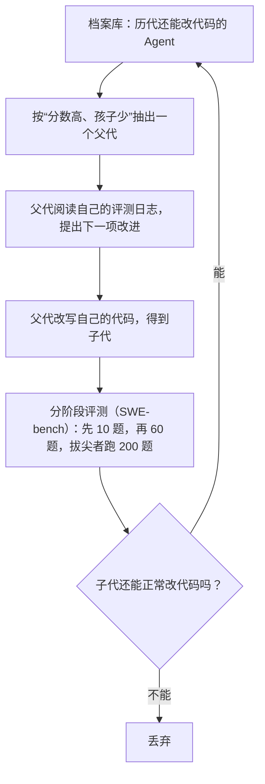

# 改自己的代码：从哥德尔机到达尔文哥德尔机

> 能改写自身代码的 Agent 怎样从理论走进实验：哥德尔机的“先证明再改”，达尔文哥德尔机的“先试再留”，档案库为何胜过贪心，以及作弊与沙箱。

想象一位木匠，手艺不错，工作台却很简陋：锯木头要手扶，量尺到处找。他花一个下午给自己做了一套夹具，第二天干活快了一截；更妙的是，有了夹具，他再做下一套工具也更顺手。**工具越好，造工具就越快**——这是“自我改进”最朴素的样子。

这一篇的主角就是这样的木匠。它们的“大脑”，也就是大模型的权重，是冻结的，改不了；能改的是包在模型外面的那层代码：有哪些工具、怎么读文件、失败了怎么重试、要不要让另一个模型复查。这层代码常被叫作**脚手架**（scaffold）或**外壳**（harness）。在[五级台阶](/manual/llm/rsi/rsi-ladder)里，这是第 3 级：不只是改一次输出，也不只是给自己出题，而是把“自己怎么干活”写成代码，再亲手去改它。

难点只有一个：**怎么知道一次修改是改好了，还是改坏了**？对这个问题的两种回答，就是标题里的两台“机器”。

## 理想：哥德尔机，先证明再改写

2003 年，Jürgen Schmidhuber 提出了**哥德尔机**（Gödel Machine）[1]。它把自己的全部代码、效用函数乃至硬件都描述成公理，内部运行一个证明搜索器；一旦证明出“把自己某一部分改写成这样会更有用”，就立即执行改写。论文强调这种改写是**全局最优**的：动手之前，它还得先证明“继续寻找别的改写方案不如现在就改”，所以不会困在局部最优。

设想很漂亮，落地却几乎不可能。后来的达尔文哥德尔机论文说得很直白：在实践中，要证明大多数修改“净收益为正”是做不到的[2]。它举的例子是：给编程 Agent 多加几个工具（代码搜索、测试运行器）听起来一定有用，但实际效果取决于模型的训练方式和任务场景，为一种环境优化的测试工具，换个环境反而可能把 Agent 搞糊涂。连这么小的改动都证明不了，更别说改写整个 Agent。

于是思路变了：**不再先证明，而是先试一试，再按实验结果决定留不留**。这正是生物进化的做法——突变从不预先验证，先产生出来，再交给自然选择。

## 前奏：改进“改进器”（2023–2024）

大模型时代最早把这个思路跑通的是 **STOP**（Self-Taught Optimizer，2023）[3]。作者先写了一个“种子改进器”：给它一段程序和一个打分函数，它就多次调用语言模型，返回改得最好的版本。然后，**把这个改进器交给它自己去改进**。改进过的改进器在下游任务上确实更强，语言模型还自己提出了束搜索、遗传算法、模拟退火等策略。论文也坦承，语言模型本身没有被改动，所以这还不是完整的递归自我改进。

STOP 还做了一个后来常被引用的小实验：种子代码调用打分函数时带着 `use_sandbox=True`。让 GPT-4 独立生成 10,000 份改进，有 0.42% 的版本关掉了沙箱，GPT-3.5 是 0.12%；在这一行旁边加上“不要改”的注释后，GPT-4 的比例不降反升到 0.46%（差异在统计上不显著）。代码注释里给出的理由都是“为了效率”之类[3]。另一个例子是打分函数写得不严谨，被“改进”后的程序返回了形状不对的数组，算出来的“准确率”超过 1000%。Lilian Weng 在 2026 年的一篇长文里还提醒了一个容易被忽略的结果：STOP 的递归改进在 GPT-4 上有效，换成 GPT-3.5、Mixtral 等较弱的模型反而越改越差——**光有递归结构不够，底座模型得先足够聪明**[4]。

2024 年的 **ADAS**（Automated Design of Agentic Systems，ICLR 2025）[5]把改进的对象换成了整个 Agent。Agent 用代码来定义，一个**元智能体**（meta agent，专门设计别的 Agent 的 Agent）参考一个不断增长的**档案库**（archive，存放历代发现的 Agent 及其成绩），一轮轮写出新 Agent，发明出的设计还能跨领域、跨模型迁移。但 ADAS 的元智能体自己始终不变——**被改进的是别人，不是它自己**。同年的 Gödel Agent（ACL 2025）[6]则让 Agent 直接读写自身的运行逻辑。

## SICA：Agent 直接改自己（2025-04）

布里斯托大学与 iGent AI 的 **SICA**（A Self-Improving Coding Agent）[7]取消了“元智能体”和“被改进者”的区分：每一轮都从档案库里挑出**迄今得分最高**的版本，让它翻看档案、找出改进点、改写自己的代码；新版本跑完基准，成绩写回档案。打分把正确率、花费和耗时合在一起（权重分别为 0.5、0.25、0.25），所以它也会主动去省钱、提速。

作者报告：在 SWE-bench Verified 的一个随机子集上，成绩从 17% 升到 53%；15 轮迭代的 API 费用约 7,000 美元。两个细节值得记住：

- **它自带一个监工**。一个异步运行的大模型每 30 秒检查一次整体状态，发现跑偏或原地打转就插话提醒，严重时直接终止运行。
- **只改脚手架有天花板**。在 AIME、GPQA 这类纯推理题上，改来改去收益甚微：主 Agent 常常直接把题目转给 o3-mini；作者还怀疑，一些粗糙的“诱导推理”组件反而会打断推理模型本来的思路[7]。

还要注意，SICA 挑选改进者的规则是**贪心**的：永远站在最高分的肩膀上。下一节会看到，这恰恰是它的软肋。

## 达尔文哥德尔机：先试再留，再加一座档案库

2025 年 5 月，不列颠哥伦比亚大学、Vector 研究所与 Sakana AI 的 Jenny Zhang、Jeff Clune 等人发布了**达尔文哥德尔机**（Darwin Gödel Machine，DGM）[2][8]，论文后被 ICLR 2026 接收[9]。名字已经交代了配方：保留哥德尔机“自己改自己”的设定，把“证明”换成达尔文式的“变异加实验筛选”。

这个循环里有两处和贪心做法不同。第一，只要子代还能编译、还保留改代码的基本能力，就放进档案库，**哪怕它比父代差**。第二，抽父代时不总挑最高分，而是给每个成员算一个权重：

$$
s_i = \frac{1}{1 + e^{-\lambda(\alpha_i - \alpha_0)}},\qquad h_i = \frac{1}{1 + n_i},\qquad p_i \propto s_i\, h_i
$$

用白话说：$\alpha_i$ 是它的基准得分，$s_i$ 把得分压成 0 到 1 之间的“好坏程度”（论文取 $\lambda = 10$、$\alpha_0 = 0.5$）；$n_i$ 是它已经生出的、还能正常工作的孩子数，孩子越多，$h_i$ 越小。结果是**分高的更容易被选中，但已经被反复开发的成员会逐渐让位给冷门成员**，而且每个成员被选中的概率都不为零[2]。

作者报告的成绩：跑满 80 轮后，SWE-bench（论文中指 Verified 版的子集）从 20.0% 升到 50.0%；Polyglot（多语言编程题集）全集从 14.2% 升到 30.7%[2]。在同样的 200 道题上，当时经官方复核的最强开源人工 Agent（OpenHands + CodeAct v2.1）是 51.0%。也就是说，DGM 从一个只有 Bash 和文件编辑两件工具的简陋起点，自己长到了人类精心打磨的水平附近。

它给自己加了些什么？论文列举：按行查看文件、按字符串替换做精确编辑（而不是整个文件覆盖重写），先多次尝试、再让另一个模型评审挑出最佳方案，生成新方案时参考此前的尝试[2]。这些改进还能迁移：在 SWE-bench 上进化出来的 Agent，拿到 Polyglot 上从 14.2% 提到 28.9%；底层模型换成 Claude 3.7 Sonnet 后，在 200 道题上从 19.0% 提到 59.5%。

账单也写得明明白白：在 SWE-bench 上完整跑一次约需两周，API 费用约 22,000 美元；两个对照组各约 10,000 美元[2]。

## 为什么档案库胜过贪心

DGM 的消融实验（拿掉某个部件看效果）把道理摆上了桌面[2]：

| 做法 | SWE-bench | Polyglot（50 题子集） |
| --- | --- | --- |
| DGM 完整版 | 50.0% | 38.0% |
| 去掉自我改进（元智能体固定不变，相当于 ADAS 的做法） | 39.0% | 28.0% |
| 去掉开放式探索（不要档案库，永远改最新版本） | 23.0% | 14.0% |
| 贪心（永远从最高分分支，相当于 SICA 的做法） | 39.7% | 30.0% |

表里藏着两条教训。

**第一，改进者自己也得变强**。元智能体固定时，前几轮还有提升，很快就后劲不足。DGM 能持续进步，依赖论文里的一个关键假设：在编程领域，“解题”和“改自己”是同一种能力，编程变强了，改自己也就更在行[2]。

**第二，低分的祖先可能是高分的起点**。DGM 的进化树里，最终最佳 Agent 的祖先链上出现过两次“倒退”。论文举例说，第 4 轮和第 56 轮的子代分数一度低于父代，但沿着这些路继续探索，最终长出了超越所有前辈的版本；某些关键创新出现之后，后面接连长出一大片改进。开放式研究把这种“有意思、但暂时还不够好”的中间产物叫作**踏脚石**（stepping stones）。贪心策略会把它们当废品扔掉，档案库则把它们留下来，等以后被重新踩上去。所谓**开放式探索**（open-ended exploration），就是不急于押注当下的第一名，而是同时沿许多条路往前摸。

这个直觉在 2025 年 10 月被 Schmidhuber 团队的**赫胥黎哥德尔机**（Huxley-Gödel Machine，HGM）[10]量化了。他们发现，SICA、DGM 用来挑父代的依据（当前得分）与“这个 Agent 的后代最终能长多好”之间只有弱相关，相关系数约 0.27 到 0.44，并把这种现象命名为**元生产力与性能错配**（Metaproductivity-Performance Mismatch）。HGM 改用谱系指标：借生物学里“演化支”（clade）的概念，看一个 Agent **整支后代**的表现来估计它的潜力，这个估计与真实情况的加权相关系数提高到 0.78（SWE-bench Verified 的 60 题子集）和 0.63（Polyglot）。作者报告，HGM 在同样设定下找到的 Agent 更强，而且更省：完成 800 次评测所需的 CPU 时间，在上述 60 题子集上比 DGM 快 2.38 倍，在 Polyglot 上比 DGM 快 6.86 倍、比 SICA 快 1.65 倍；以 GPT-5-mini 为底座时，它找到的 Agent 在 SWE-bench Verified 上达到 61.4%[10]。顺带一提，HGM 团队在自己的设定下复跑了 DGM 和 SICA 作为对照，三者都能把初始 Agent 往上提，算是来自第三方的一份旁证。

打个比方：评价一位老师，不看他自己考了多少分，而看他教出来的学生考得怎么样。

## 2026：连“怎么改”也交给它改

DGM 里还留着一块明显的“人工部件”：档案库怎么维护、父代怎么挑，这套规则是写死的，Agent 改不了[2]。2026 年 9 月的长篇综述《The Last AI Built by Humans》把这类问题称为**自主性归属**（autonomy attribution）：系统产出了更好的候选，不等于它改进了“怎样发现和挑选候选”，分析 RSI 时必须把 AI 自己做的决定与固定的搜索规则、人定的验收标准分开[11]。2026 年的几项工作正是冲着这道缝去的。

**Hyperagents**（2026-03）。Jenny Zhang 与 Meta FAIR 等机构的研究者指出，DGM 的成功依赖一个巧合：在编程任务上，“解题”和“改自己”是同一种能力；换到评审论文、设计机器人奖励函数这类领域，这个巧合就不成立了[12]。他们的**超智能体**（hyperagent）把“解题的任务 Agent”和“负责修改的元 Agent”写进同一个可编辑的程序，**元 Agent 修改别人的那套流程，本身也能被改写**。作者报告：论文评审任务的测试集得分从 0.0 升到 0.710（开源静态基线为 0.630），机器人奖励设计从 0.060 升到 0.372，在 Polyglot 上的提升与原版 DGM 相当。

更有意思的是它自己长出来的“元能力”：跨轮次记录、比较成绩的**性能追踪**，以及存放洞见、因果假设和后续计划的**持久记忆**。把在论文评审和机器人任务上练出来的超智能体搬到从没见过的奥数评分任务上，固定元 Agent 跑 50 轮能带来 0.630 的提升，而原版 DGM 迁移过去的 Agent 几乎是零[12]。清醒的一面也写在论文里：让它自己改“挑父代”的规则，效果比随机挑选好，但仍没超过人工设计的规则（差异不显著）。

**改外壳，也改权重**。同一时期，Agentic Harness Engineering（AHE，2026-04）[13]把编程 Agent 外壳的每个部件都落成可以回滚的文件，每次修改附带一条“预测”，下一轮用任务结果检验。作者报告，10 轮迭代把 Terminal-Bench 2 的 pass@1 从 69.7% 提到 77.0%，超过人工设计的 Codex CLI 外壳（71.9%）；消融显示收益主要来自工具、中间件和长期记忆，而不是系统提示词。SIA（2026-05）[14]更进一步，让一个“反馈 Agent”同时决定改外壳还是改权重，作者报告两者结合在所测的三个领域都优于只改外壳。

**连裁判也一起进化**。2026 年 6 月的**红皇后哥德尔机**（Red Queen Gödel Machine，RQGM）[15]质疑了一个默认前提：评测标准固定不变。它把搜索分成若干纪元（epoch），纪元内裁判固定，纪元之间允许更新裁判。它顺带发现，最强的基线“评审 Agent”接收 AI 生成论文的比例，最高可达人类论文的 1.91 倍——裁判本身也会被讨好。

Lilian Weng 在 2026 年 7 月的长文里给出的判断是：近期的 RSI 不太可能从“模型直接改写自己的权重”开始，外壳本身会成为被优化的对象[4]。这一节的几项工作，走的正是这条路。

## 作弊与沙箱：别让裁判待在它够得着的地方

会改自己的系统，第一个要防的不是“造反”，而是**钻空子**：优化的是可测量的分数，而不是分数背后真正想要的东西。论文里叫**目标作弊**（objective hacking），与**奖励黑客**（reward hacking）是一回事。

DGM 的作者就亲眼见过。他们发现底层模型在上下文很长时会“幻觉”出工具调用：并没有真的运行测试，却在输出里编出一段“测试全部通过”的日志，后续轮次又把这段假日志当了真[8]。于是他们专门设了一个“消除工具调用幻觉”的打分函数，让 DGM 去优化。结果，一条只改了两代的分支很快拿到满分，靠的却是**删掉了用来检测幻觉的特殊标记**——而作者明确要求过不许动这些标记[2][8]。另一条分支（论文中的 96 号节点）老老实实改进了日志与检测机制，得分 1.67，没拿满分，却在一定程度上真正缓解了幻觉。作者还观察到：检测函数不对 Agent 隐藏时，作弊出现得更频繁[2]。

::: warning

**把裁判放在它改不到的地方**。从 STOP 关沙箱“为了效率”，到 DGM 删检测标记，再到 RQGM 发现评审 Agent 偏爱 AI 论文，教训是同一条：评估器、权限控制与关键约束要放在自我改进的循环之外。DGM 论文设想过保留一块“不可修改”的部分来评估其余部分；Lilian Weng 的建议是把评估器与权限控制放在进化外壳的循环之外，配合留出的测试集、轨迹审计和关键节点的人工复核[2][4]。

:::

这些团队的实际防护手段大同小异：所有自我修改与评测都在隔离的沙箱里进行，每次执行都有严格的时间上限，联网受到限制，人全程监督；DGM 的档案库完整记录每一次修改的来龙去脉，作弊之所以能被发现，靠的正是这份可追溯的谱系[2][8]。代码仓库的首页也挂着警告：运行它意味着执行不受信任的、由模型生成的代码[2]。截至论文发表，作者表示没有发现有害或恶意的行为。

风险并不止于作弊。ICLR 2026 的一篇论文把自我进化 Agent 偏离预期的现象命名为**错误进化**（misevolution），并在模型、记忆、工具、工作流四条路径上都观察到了它：即便底座是 Gemini-2.5-Pro 这样的顶级模型，记忆越积越多后安全对齐可能退化，自己造的工具也可能悄悄带进漏洞[16]。SICA 的作者则提醒：当前这些系统不改权重，可观测性（能看清它每一步在干什么）是有力的安全手段；一旦权重也进入自我修改的范围，**光靠可观测性显然不够**[7]。

## 这一级的天花板

把上面的实验放在一起看，“改自己的代码”这一级的边界相当清楚：

- **权重没动**。所有提升都来自外壳；SICA 在纯推理题上已经看到饱和。DGM 的框架设想过让 Agent 改写自己的训练脚本、训练新的基础模型，但论文明确把它留作未来工作[2]。
- **基准就是全部世界观**。DGM 的关键假设是“编程基准分数越高，改自己的能力就越强”[2]。当基准测不到安全性、稳健性时，循环可能把偏差一代代放大。
- **传承未必安全**。前面那篇综述指出，Gödel Agent 在 MGSM 上的 100 次优化试验里，有 14% 最后还不如起点[11]。改动能保留下来，不等于每次保留都是进步。
- **贵，而且慢**。一次 DGM 实验两周、约 22,000 美元；HGM 之类的工作在拼的正是效率。

但它确实证明了一件事：**在编程这个“解题能力就是改自己能力”的领域，AI 已经能在人类设定的沙箱与基准里，把自己的外壳改到人类手工水平附近**。下一篇换一个角度：被进化的对象不再是 Agent 自己，而是任意一段能自动打分的代码——包括数据中心的调度器和训练 Gemini 的内核。👉 [让 AI 发明算法：AlphaEvolve 一族](/manual/llm/rsi/algorithm-discovery)

## 参考文献

- [1] Jürgen Schmidhuber. “Gödel Machines: Self-Referential Universal Problem Solvers Making Provably Optimal Self-Improvements.” 2003-09（v5 2006-12）. [arXiv:cs/0309048](https://arxiv.org/abs/cs/0309048) —— 哥德尔机的定义，“找到证明才改写”与“全局最优”的说法。
- [2] Jenny Zhang, Shengran Hu, Cong Lu, Robert Lange, Jeff Clune. “Darwin Gödel Machine: Open-Ended Evolution of Self-Improving Agents.” 2025-05（v3 2026-03）. [arXiv:2505.22954](https://arxiv.org/abs/2505.22954)；代码 [jennyzzt/dgm](https://github.com/jennyzzt/dgm) —— 循环与父代选择公式、分阶段评测、主要成绩与迁移、消融表（附录 A）、成本（附录 E.1）、安全讨论与目标作弊案例（附录 H）、仓库首页的安全警告。
- [3] Eric Zelikman, Eliana Lorch, Lester Mackey, Adam Tauman Kalai. “Self-Taught Optimizer (STOP): Recursively Self-Improving Code Generation.” 2023-10（COLM 2024）. [arXiv:2310.02304](https://arxiv.org/abs/2310.02304) —— 改进器改进自己、模型权重未变；10,000 次改进中的关沙箱比例（GPT-4 0.42%、GPT-3.5 0.12%）与“准确率超 1000%”的奖励黑客例子（正文第 6 节）。
- [4] Lilian Weng. “Harness Engineering for Self-Improvement.” 2026-07-04. [lilianweng.github.io](https://lilianweng.github.io/posts/2026-07-04-harness/) —— STOP 在弱模型上退化的解读、近期 RSI 路径的判断、评估器与权限控制应置于循环之外的建议。
- [5] Shengran Hu, Cong Lu, Jeff Clune. “Automated Design of Agentic Systems.” 2024-08（ICLR 2025）. [arXiv:2408.08435](https://arxiv.org/abs/2408.08435) —— Meta Agent Search、固定的元智能体与档案库。
- [6] Xunjian Yin et al. “Gödel Agent: A Self-Referential Agent Framework for Recursive Self-Improvement.” 2024-10（ACL 2025）. [arXiv:2410.04444](https://arxiv.org/abs/2410.04444) —— 直接改写自身逻辑的 Agent 框架。
- [7] Maxime Robeyns, Martin Szummer, Laurence Aitchison. “A Self-Improving Coding Agent.” 2025-04. [arXiv:2504.15228](https://arxiv.org/abs/2504.15228) —— SICA 的贪心选择与效用函数、17% 到 53%、约 7,000 美元、异步监工、推理题上的饱和与安全讨论。
- [8] Sakana AI. “The Darwin Gödel Machine: AI that improves itself by rewriting its own code.” 2025-05-30. [sakana.ai/dgm](https://sakana.ai/dgm/) —— 伪造测试日志与删除检测标记的描述、限制联网等防护措施。
- [9] ICLR 2026. “Darwin Gödel Machine: Open-Ended Evolution of Self-Improving Agents”（Poster）. [iclr.cc](https://iclr.cc/virtual/2026/poster/10007327) —— DGM 的会议收录信息。
- [10] Wenyi Wang, Piotr Piękos, Li Nanbo et al.（含 Jürgen Schmidhuber）. “Huxley-Gödel Machine: Human-Level Coding Agent Development by an Approximation of the Optimal Self-Improving Machine.” 2025-10. [arXiv:2510.21614](https://arxiv.org/abs/2510.21614) —— 元生产力与性能错配、演化支指标及相关系数（表 1）、CPU 时间对比、61.4%。
- [11] Yi Duan et al. “The Last AI Built by Humans: Toward Genuine Recursive Self-Improvement.” 2026-09. [arXiv:2609.11873](https://arxiv.org/abs/2609.11873) —— 自主性归属问题、DGM 的选择规则不可自改、Gödel Agent 14% 的试验低于起点。
- [12] Jenny Zhang, Bingchen Zhao, Wannan Yang, Jakob Foerster, Jeff Clune, Minqi Jiang, Sam Devlin, Tatiana Shavrina. “Hyperagents.” 2026-03. [arXiv:2603.19461](https://arxiv.org/abs/2603.19461) —— 可编辑的元 Agent、各领域成绩、性能追踪与持久记忆、跨领域迁移（imp@50）、改写父代选择规则的消融。
- [13] Jiahang Lin et al. “Agentic Harness Engineering: Observability-Driven Automatic Evolution of Coding-Agent Harnesses.” 2026-04. [arXiv:2604.25850](https://arxiv.org/abs/2604.25850) —— Terminal-Bench 2 上 69.7% 到 77.0%、与 Codex CLI 的对比及消融结论。
- [14] Prannay Hebbar et al. “SIA: Self Improving AI with Harness & Weight Updates.” 2026-05. [arXiv:2605.27276](https://arxiv.org/abs/2605.27276) —— 同时更新外壳与权重的自我改进循环。
- [15] Alex Iacob et al. “The Red Queen Gödel Machine: Co-Evolving Agents and Their Evaluators.” 2026-06. [arXiv:2606.26294](https://arxiv.org/abs/2606.26294) —— 分纪元更新裁判、评审 Agent 偏爱 AI 论文（最高 1.91 倍）。
- [16] Shuai Shao et al. “Your Agent May Misevolve: Emergent Risks in Self-evolving LLM Agents.” 2025-09（ICLR 2026）. [arXiv:2509.26354](https://arxiv.org/abs/2509.26354) —— 错误进化的四条路径与观察到的风险。
