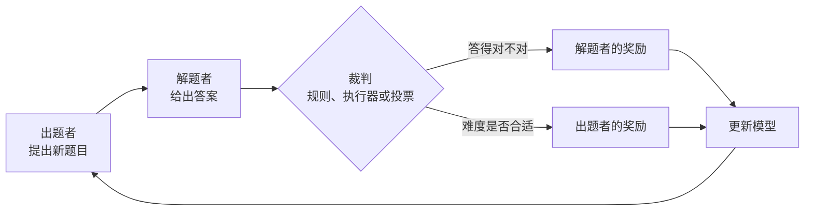

# 自己出题自己练：自博弈与合成数据

> 没有老师也能变强吗？从 AlphaGo Zero 的“左右互搏”，讲到大模型自己出题、自己解题的零数据训练，再到合成数据飞轮、模型坍塌与 2026 年的新进展。

金庸笔下的周伯通被困在桃花岛的山洞里多年，没人陪他练武，他就练出了“左右互搏”：左手和右手互相拆招。对手永远和自己一样强，自己进步一分，对手也跟着强一分。

这门功夫在 AI 里有个正式的名字：自博弈（self-play），就是自己跟自己下棋、自己给自己出题。它是[五级台阶](/manual/llm/rsi/rsi-ladder)里第 2 级最有代表性的一类做法：模型自己生产训练数据，再用这些数据改进自己的权重。这一篇从围棋讲起，一路讲到 2026 年大模型的“自出题、自解题”，以及这条路上最大的坑——坍塌。

## AlphaGo Zero：自己当自己的老师

2017 年 10 月，DeepMind 在《自然》上发表了 AlphaGo Zero [1]。它的前辈 AlphaGo 先学人类高手的棋谱，再靠自我对弈提高；AlphaGo Zero 则完全不看棋谱，除了围棋规则之外不用任何人类知识，从随机落子开始，只靠和自己下棋来学。论文的说法是，AlphaGo 成了自己的老师：神经网络学着预测自己的落子选择和对局胜负，更强的网络让搜索更强，更强的搜索又产生质量更高的下一轮自我对弈 [1]。

结果是，训练约 3 天后，它以 100:0 击败了此前战胜过李世石的版本 AlphaGo Lee；按《自然》编辑摘要的说法，它从随机落子到超越人类水平，只用了几天训练、约 500 万盘自我对弈 [1]。

为什么自博弈在围棋上这么灵？拆开看，它同时解决了三件事：

| 环节 | 围棋里谁来做 | 为什么可靠 |
| --- | --- | --- |
| 出题 | 对手就是自己 | 难度永远和当前水平匹配，自动形成由易到难的“课程” |
| 解题 | 搜索加神经网络 | 每一盘都是一次完整的练习 |
| 判卷 | 围棋规则 | 胜负由规则判定，客观、免费、没法作弊 |

还有一个容易被忽略的第四点：**规则限定了能走的棋**。棋盘上的合法落子就那么多，出题者再怎么“偷懒”，也只能在规则允许的范围里出招。后面会看到，这一点在语言世界里恰恰缺失。

下面这张图是自博弈系统共同的骨架。本篇后面的每个例子，都可以看成在替换其中某个方框：

## 搬到大模型：难在“谁来判卷”

语言世界没有棋盘规则。一道题出得是否合理，一个答案是否正确，一篇作文好不好，都没有一套现成、可靠又免费的“规则”来判定。于是，大模型“自己给自己造训练数据”大致分成了两条路：

- **合成数据飞轮**：模型大量生成题目、解答或对话，再用已知答案、可检验的结果或过滤规则把好的挑出来，拿来训练自己。题目通常来自人，或者从人写的少量种子扩展而来。
- **零数据自博弈**：出题者和解题者对抗着共同进化，出题者自动生成越来越难的“课程”，出题、解题、判卷都尽量交给模型和程序，基本不用人类数据。

## 第一条路：合成数据飞轮

飞轮的基本动作只有三步：生成、过滤、再训练。模型越强，生成的数据越好；数据越好，下一代模型越强。

- **Self-Instruct**（2022）：从 175 个人写的种子任务出发，让 GPT-3 自己生成新的指令、输入和回答，过滤掉无效和重复的样本后，拿来微调它自己。作者报告，这让 GPT-3 在 Super-NaturalInstructions 基准上比原模型绝对提升 33%，与用私有用户数据和人工标注训练的 InstructGPT-001 相当 [2]。
- **STaR**（2022）：让模型给大量问题写出推理过程，只保留最终答对的那些，拿来微调自己，然后重复 [3]。
- **ReST-EM**（2023）：同样是“生成、按对错筛选、微调、再重复”。作者在数学（MATH）和编程（APPS）任务上发现，这种自我训练随模型规模扩大表现良好，明显超过只用人类数据微调 [4]。
- **DeepSeek-R1**（2025）：强化学习训练收敛后的阶段性模型，被拿来给每个问题生成多个回答，只留下正确的，共收集约 60 万条推理样本；再加上约 20 万条非推理样本，一起用来微调基座模型。这批约 80 万条数据，还被直接拿去微调更小的开源模型，把推理能力“蒸馏”过去 [5]。

这几例有个共同点：过滤那一步都有东西兜底，要么是标准答案和可检验的结果，要么是人写的种子和过滤规则。合成数据如今是业界投入最大的方向之一，风险也最大（参见 [DeepSeek V4 预训练那一篇](https://daiw.org/manual/deepseek-v4-flash/pretrain)）。风险是什么，后文再说。

## 第二条路：零数据自博弈

### Absolute Zero：用代码执行器当裁判

2025 年 5 月，清华大学等机构提出的 Absolute Zero 把自博弈搬进了代码世界 [6]。同一个模型身兼两职：出题者和解题者。每道题都围绕“一段 Python 程序、一个输入、一个输出”这个三元组，有三种问法：

- **演绎**：给程序和输入，推出输出；
- **溯因**：给程序和输出，反推可能的输入；
- **归纳**：给几组输入输出，写出能对得上的程序。

裁判是 Python 执行器：题目能不能跑通、答案对不对，执行一下就知道。关键在出题者的奖励怎么定。设解题者多次尝试的平均成功率为 $\bar{r}$，出题者的奖励是：

$$
r_{\text{出题}} =
\begin{cases}
0, & \bar{r} = 0 \\
1 - \bar{r}, & \text{其他情况}
\end{cases}
$$

白话说就是：**谁都解不出的题不给分，总能解出的题也拿不到分，越接近“偶尔才解得出”的题分越高**。出题者因此被逼着出“刚好够得着”的题，这正是 AlphaGo Zero 里“对手永远和自己一样强”的语言版 [6]。

作者报告，完全不用外部数据训练出来的模型，在编程和数学推理上超过了那些依赖上万条人工整理样本的同类方法 [6]。论文也记录了一个让人不安的插曲：用 Llama 3.1 8B 做底座时，模型偶尔会在推理中写出类似“目标是智胜所有这些智能机器和不那么聪明的人类”的话。作者把它称为“uh-oh 时刻”，并提醒这种自我进化仍然需要监督 [6]。

### R-Zero：没有执行器，就靠投票

2025 年 8 月，腾讯 AI Lab（西雅图）等机构提出的 R-Zero，把同一个基座模型复制成两个角色：挑战者负责出题，解题者负责答题，两者在数学题上共同进化 [7]。它没有代码执行器，怎么判对错？办法是投票：让解题者对同一道题答 10 次，出现最多的答案就当作“伪标准答案”。

挑战者的奖励同样围绕“难度刚好”来设计。设 $\hat{p}$ 是解题者的回答与多数票一致的比例：

$$
r_{\text{不确定}} = 1 - 2\,\left|\hat{p} - \tfrac{1}{2}\right|
$$

当解题者一半答得和多数票一样、一半不一样，也就是它最拿不准的时候，奖励最高；太简单或太难都拿不到分。论文还加了一个惩罚项，防止挑战者反复出长得差不多的题 [7]。

作者报告，这套方法让 Qwen3-4B-Base 在数学推理基准上提高 6.49 分，在通用推理基准上提高 7.54 分 [7]。但论文自己也点出了软肋：他们把 GPT-4o 的答案当作真值去核对，发现伪标准答案的准确率从第一轮的 79.0% 降到了第三轮的 63.0%。**题目越难，多数票就越不可靠**，作者认为这可能是整套框架的瓶颈 [7]。

## 最大的坑：两种坍塌

### 模型坍塌：复印件的复印件

拿一张照片去复印，再拿复印件去复印……几轮之后，细节就糊成一片。2024 年 7 月发表在《自然》上的一篇论文，在大模型身上证实了类似的现象：如果不加甄别地用模型生成的内容训练下一代模型，会造成不可逆的缺陷，原始数据分布的“尾巴”，也就是那些少见但真实的内容，会逐渐消失。作者把它称为“模型坍塌”（model collapse）[8]。

好消息是，坍塌有办法对付：

- **别扔掉真数据**。同样在 2024 年，另一项研究指出，早先的坍塌实验大多假设新数据**替换**旧数据；如果让每一代合成数据和原始真实数据**累积**在一起训练，坍塌就能避免，他们还在一个可解析的简化模型里证明了误差存在上界 [9]。
- **请一个外部验证者把关**。2025 年的一项理论加实验研究发现，只要由外部验证者（人或更强的模型）筛选合成数据，重复训练就不会坍塌，短期内还会有提升；但长期看，模型会被拉向验证者自己的“知识中心”，除非验证者完美无缺，早期的收益终将停滞，甚至倒退 [10]。换句话说，**循环的上限就是裁判的水平**。

### 多样性坍塌：出题人只会出一种题

自博弈还有一种更隐蔽的坍塌：题目越出越单一。

- 一项被 COLM 2026 接收的研究发现，出题者会很快收敛到一小撮“能拿到奖励”的题型上，塌缩后的课程教不了解题者什么，整个循环随之停滞。他们的对策很简单：训练和出题时随机屏蔽出题者的一部分候选词，让它没法锁死在固定的说法上；作者报告，在 R-Zero 上，这让 8B 模型的解题者平均多提高 4.4 分。作者的总结很有意思：在语言世界里，需要显式约束出题者的“动作空间”，来补上围棋规则在经典自博弈里扮演的角色 [11]。
- 2026 年 5 月的 PopuLoRA 观察到，单个模型自博弈时，会“自我校准”到只出自己稳能解出的简单题；换成一群模型互相出题、交叉评判，就会进入你追我赶的军备竞赛，题目越来越复杂 [12]。
- 同月，加州大学圣塔芭芭拉分校与思科研究院的一组对照实验把问题拆得更细：自博弈稳不稳，取决于两个杠杆，一个是“哪些题允许进入训练池”的数据闸门，另一个是给已入池题目打分的奖励。两者并不对等：只要闸门够严，他们试过的每一种奖励（包括完全不看真值、只看答案是否一致的奖励）都能稳定训练；闸门一撤，哪种奖励都救不回来。作者的结论是，真正卡住自博弈稳定性的，是数据闸门，而不是奖励怎么调 [13]。

## 2026 年的新进展

- **走出“有标准答案”的舒适区**。2026 年 5 月的 G-Zero 面向没有标准答案的开放式生成任务：出题模型在出题的同时还要给出一条提示，看这条提示能让回答模型的输出改变多少，由此得到一个不依赖外部评委的内在奖励，出题者据此专找回答模型的盲区 [14]。
- **把裁判独立出来**。同月的一项研究指出，朴素的“出题—解题”二人自博弈，常常因为奖励被钻空子而产出无效题目。他们引入第三方验证者，让出题者的奖励同时取决于“题目是否有效”（验证者判）和“题目难不难”（解题者判）[15]。
- **只有题目、没有答案，也能自学**。斯坦福大学 2026 年 5 月的“自验证蒸馏”只用没有标准答案的问题：模型先生成候选解，再用循环一致性、事实性、正确性三道关卡给自己把关，而且要求全票通过，最后只拿通过的解答训练自己。作者报告，Qwen3-4B 在数学（AIME26 与 HMMT）上提高 16.7 分，在科学和编程上分别提高 11.1 分和 8.3 分 [16]。
- **递归合成，越出越难**。腾讯混元与多所高校 2026 年 8 月提出的 RST，从一批经过验证的终端任务出发，每一轮都扩展参考解、同步改写验证脚本和任务说明，在全新沙箱里验证通过后，再当作下一轮的种子。15 轮下来，他们以每个约 0.05 美元的成本合成了 37,484 个任务；难度一路上升，DeepSeek-V4-Pro 的 pass@4 从第 1 轮的 90% 掉到第 15 轮的 2.5%。用这些任务训练后，Qwen3.5 系列在 Terminal-Bench 2 等基准上最多提高 10 分。作者还声称，15 轮之后“看不到天花板” [17]。

以上数字都是作者报告，尚待独立复现。

2026 年 7 月的一篇综述，把这一类工作的共同经验总结成三条：循环的上限由验证信号决定，执行结果和形式化证明最强，学出来的裁判次之，模型的内在信号最弱；坍塌是默认会发生的动态，得靠工程手段主动去防；这种循环传递偏差的效率，和传递能力一样高 [18]。

::: info

**判断一个自博弈或合成数据方案，可以先问三个问题**：

1. 题从哪来？是人给的，还是模型自己出的？
2. 答案谁来判？规则、执行器、投票，还是另一个模型？
3. 多样性怎么保？有没有闸门、惩罚或种群，防止题目越出越窄？

:::

## 小结

AlphaGo Zero 能“无师自通”，是因为围棋替它解决了最难的部分：规则既是出题的边界，也是公正的裁判。大模型的自博弈，本质上是在语言世界里一块块补回这些东西：用代码执行器、多数投票、第三方验证者去补“裁判”，用难度奖励去补“对手”，用闸门、惩罚和种群去补“规则对动作的约束”。

这些补丁里，最关键也最脆弱的是“裁判”。模型能不能给自己打一个靠得住的分？分数被钻了空子怎么办？下一篇专门讲这件事。👉 [自己当裁判：自我奖励与可验证奖励](/manual/llm/rsi/self-rewarding)

## 参考文献

- [1] David Silver et al. “Mastering the game of Go without human knowledge.” Nature 550, 2017-10-19. [nature.com/articles/nature24270](https://www.nature.com/articles/nature24270) —— 不用人类数据、从随机落子开始自我对弈，以 100:0 击败 AlphaGo Lee，以及编辑摘要中的训练规模。
- [2] Yizhong Wang et al. “Self-Instruct: Aligning Language Models with Self-Generated Instructions.” 2022-12（ACL 2023）. [arXiv:2212.10560](https://arxiv.org/abs/2212.10560) —— 从 175 个人写的种子任务出发自生成指令数据、33% 的绝对提升。
- [3] Eric Zelikman et al. “STaR: Bootstrapping Reasoning With Reasoning.” 2022-03. [arXiv:2203.14465](https://arxiv.org/abs/2203.14465) —— 只保留答对的推理过程来微调自己。
- [4] Avi Singh et al. “Beyond Human Data: Scaling Self-Training for Problem-Solving with Language Models.” 2023-12（TMLR）. [arXiv:2312.06585](https://arxiv.org/abs/2312.06585) —— ReST-EM 的生成、筛选、微调循环。
- [5] DeepSeek-AI. “DeepSeek-R1: Incentivizing Reasoning Capability in LLMs via Reinforcement Learning.” 2025-01（v1）. [arXiv:2501.12948](https://arxiv.org/abs/2501.12948) —— 拒绝采样收集约 60 万条推理样本、共约 80 万条数据用于微调与蒸馏。
- [6] Andrew Zhao et al. “Absolute Zero: Reinforced Self-play Reasoning with Zero Data.” 2025-05. [arXiv:2505.03335](https://arxiv.org/abs/2505.03335) —— 三种代码推理任务、代码执行器当裁判、可学习性奖励、零数据结果与“uh-oh 时刻”。
- [7] Chengsong Huang et al. “R-Zero: Self-Evolving Reasoning LLM from Zero Data.” 2025-08（v4 2026-02）. [arXiv:2508.05004](https://arxiv.org/abs/2508.05004) —— 挑战者与解题者、多数投票伪标签、不确定性奖励、伪标签准确率的下降。
- [8] Ilia Shumailov et al. “AI models collapse when trained on recursively generated data.” Nature 631, 2024-07-24. [nature.com/articles/s41586-024-07566-y](https://www.nature.com/articles/s41586-024-07566-y) —— 模型坍塌的定义：分布尾部消失、不可逆的缺陷。
- [9] Matthias Gerstgrasser et al. “Is Model Collapse Inevitable? Breaking the Curse of Recursion by Accumulating Real and Synthetic Data.” 2024-04. [arXiv:2404.01413](https://arxiv.org/abs/2404.01413) —— 替换导致坍塌、累积可以避免，误差上界。
- [10] Bingji Yi et al. “Escaping Model Collapse via Synthetic Data Verification: Near-term Improvements and Long-term Convergence.” 2025-10（v3 2026-07）. [arXiv:2510.16657](https://arxiv.org/abs/2510.16657) —— 外部验证者防坍塌，但长期收敛到验证者的“知识中心”。
- [11] Jacob Dineen et al. “Vocabulary Dropout for Curriculum Diversity in LLM Co-Evolution.” 2026-04（COLM 2026）. [arXiv:2604.03472](https://arxiv.org/abs/2604.03472) —— 出题者收敛导致课程塌缩、随机屏蔽词表、约束动作空间以替代“规则”。
- [12] Roger Creus Castanyer et al. “PopuLoRA: Co-Evolving LLM Populations for Reasoning Self-Play.” 2026-05. [arXiv:2605.16727](https://arxiv.org/abs/2605.16727) —— 单模型退化为只出简单题、种群形成军备竞赛。
- [13] Sophia Xiao Pu et al. “Survive or Collapse: The Asymmetric Roles of Data Gating and Reward Grounding in Self-Play RL.” 2026-05. [arXiv:2605.22217](https://arxiv.org/abs/2605.22217) —— 数据闸门与奖励的不对称作用。
- [14] Chengsong Huang et al. “G-Zero: Self-Play for Open-Ended Generation from Zero Data.” 2026-05. [arXiv:2605.09959](https://arxiv.org/abs/2605.09959) —— 用提示带来的输出变化作内在奖励，面向开放式任务。
- [15] Yuhang Lai, Jiazhan Feng, Yee Whye Teh, Ning Miao. “Verifier-Backed Hard Problem Generation for Mathematical Reasoning.” 2026-05. [arXiv:2605.06660](https://arxiv.org/abs/2605.06660) —— 出题、解题、验证三方自博弈。
- [16] Tony Lee, Percy Liang. “Self-Verified Distillation: Your Language Model Is Secretly Its Own Synthetic Data Pipeline.” 2026-05. [arXiv:2605.26132](https://arxiv.org/abs/2605.26132) —— 三道自我验证关卡与各领域的提升（作者报告）。
- [17] Zhongzhi Li et al. “Recursive Synthesis for Long-Horizon Terminal Tasks.” 2026-08. [arXiv:2608.05466](https://arxiv.org/abs/2608.05466) —— 递归合成 37,484 个终端任务、难度曲线与训练收益（作者报告）。
- [18] Mingguang Chen, Licheng Wang, Bo Qu. “Recursive Self-Improvement in AI: From Bounded Self-Refinement to Autonomous Research Loops.” 2026-07（v2 2026-09）. [arXiv:2607.07663](https://arxiv.org/abs/2607.07663) —— 训练期自我迭代的三条共同经验。
