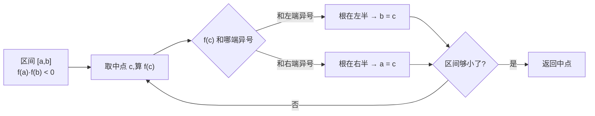

# 二分法 · 最笨，但绝不失手

进入第二站：**求根**——解方程 $f(x)=0$。很多问题最后都归结到这：$\sqrt{2}$ 是 $x^2-2=0$ 的根，某个方程的平衡点、某条曲线和 x 轴的交点，都是求根。

第一个方法，是最朴素、也最可靠的**二分法（bisection）**。它的思想小学生都懂，但它揭示了求根的核心张力：**可靠 vs 快。**

## 思想：夹住，然后对半砍

二分法基于一个直觉（严格说是**介值定理**）：**如果 $f(a)$ 是负的、$f(b)$ 是正的，那么 $a$ 和 $b$ 之间一定有个点让 $f=0$。** 这叫用区间 $[a,b]$ **夹住（bracket）** 了一个根。

夹住之后，就不断**对半砍**：取中点 $c$，看 $f(c)$ 的符号——它和哪一端**异号**，根就在那半边，把区间缩到那半边。每砍一刀，区间宽度减半，根被越夹越紧。



## 手写 + 收敛表

用二分法求 $\sqrt{2}$（即 $x^2-2=0$ 在 $[1,2]$ 上的根）：

```python
import math

def bisection(f, a, b, tol=1e-12):
    fa = f(a)
    steps = 0
    while (b - a) / 2 > tol:
        c = (a + b) / 2
        fc = f(c)
        if fc == 0:
            return c
        if (fa < 0) != (fc < 0):   # fa 和 fc 异号 → 根在左半
            b = c
        else:                      # 同号 → 根在右半
            a, fa = c, fc
        steps += 1
    return (a + b) / 2

root = bisection(lambda x: x*x - 2, 1, 2)
print(root, abs(root - math.sqrt(2)))
# 1.4142135623731...  误差 ~1e-13
```

打印每一步的「区间宽度 = 误差上界」，看它怎么稳稳地对半缩：

```text
step   中点 c          误差上界(区间半宽)
1      1.500000        2.5e-01
2      1.250000        1.2e-01
3      1.375000        6.2e-02
4      1.437500        3.1e-02
...    ...             每步 ×0.5
40     1.414213562373  4.5e-13
```

**每一步误差上界精确地减半**——这是二分法最让人安心的地方：它的进度**完全可预测**，你甚至能提前算出「要多少步能到某精度」。

## 取舍：极可靠，但慢

::: info

**二分法的最大优点是「绝不失手」。** 只要初始区间真的夹住了根（端点异号），它**保证收敛**，不挑函数形状、不需要导数、不会发散。这在下一章那些「快但会翻车」的方法面前，是极其宝贵的稳。

**它的缺点是慢。** 每步只把误差减半，即「**线性收敛**」——大约每 $3.3$ 步才多算准一位十进制数（$\log_2 10 \approx 3.3$）。要 12 位精度，得砍约 40 刀。对比下一章牛顿法「每步翻倍正确位数」，二分法确实笨。**但笨得可靠——它常被当作兜底 / 打底的方法。**

:::

## 两个实操细节

**① 停止条件别贪。** 循环条件 `(b-a)/2 > tol` 里，`tol` 别设得比[机器精度](/manual/math/numerical/machine-epsilon)还小——区间小到相邻浮点数的间隔时，中点就再也算不出新值，循环会空转甚至死循环。一个稳妥的 `tol` 是 $10^{-12}$ 左右（远大于 `eps≈2e-16`）。

**② 用异号判断，别用 `f(a)*f(c) < 0`。** 很多老代码用两个函数值相乘判符号——但 $f(a)$、$f(c)$ 若都很大，相乘会[溢出](/manual/math/numerical/floating-point)；若都很小，相乘会下溢成 0。上面代码里 `(fa < 0) != (fc < 0)` 只比符号、不做乘法，更稳。**这又是个「等价数学、不等价数值」的小例子。**

## 小结与下一章

二分法：夹住根（端点异号），然后每步对半砍，区间宽度就是误差上界。它**绝不失手、进度可预测**，但**线性收敛、慢**（每 3.3 步一位）。实操记住两点：`tol` 别小于机器精度、用异号判断别用乘积。

二分法慢在「每步只利用了 $f$ 的符号」。如果我们**利用 $f$ 的斜率**呢？顺着切线滑下去，收敛能快得惊人——每步正确位数翻倍。这就是牛顿法，快，但也更容易翻车。👉 [牛顿法：切线的力量，与它翻车的时候](/manual/math/numerical/newton)。

## 参考文献

-   \[1\] Burden & Faires.《Numerical Analysis》, §2.1 —— 二分法与介值定理。
-   \[2\] Cleve Moler.《Numerical Computing with MATLAB》, ch. 4 —— 求根方法概览。
-   \[3\] SciPy 文档.「scipy.optimize.bisect.」[https://docs.scipy.org/doc/scipy/reference/generated/scipy.optimize.bisect.html](https://docs.scipy.org/doc/scipy/reference/generated/scipy.optimize.bisect.html) —— 库实现。
