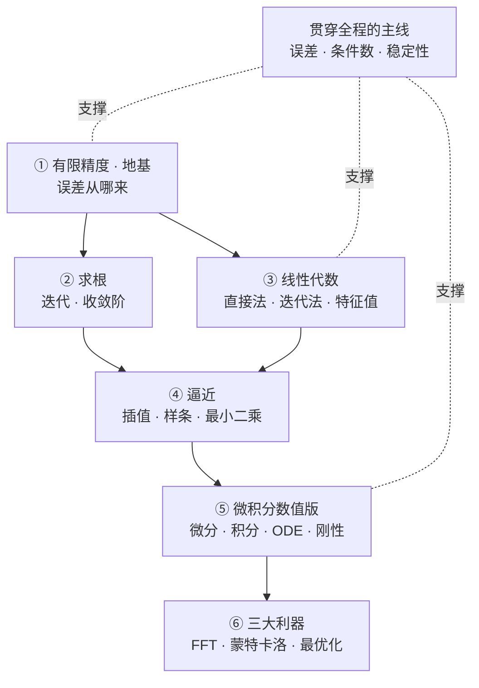

# 收尾 · 一张图串起整条主线

从 `0.1 + 0.2 != 0.3` 出发，我们走了整整七站。这一章不讲新东西，只做一件事：**把一路上反复冒头的那几条主线拎出来**，让它们从「零散的坑」变成「一套看待数值计算的世界观」。

## 七站全景

七站是「地图」，但真正的收获是横切它们的几条**主线**。下面逐条收束。

## 主线一：误差是贯穿始终的主角

::: info

**这门学问的主角，自始至终是「误差」，不是「答案」。** 计算机只有有限精度，于是每一步都在和两类误差搏斗：

-   **截断误差**：用有限近似无限（差分近似导数、有限项近似级数、有限步长解 ODE）。
-   **舍入误差**：每个数只能存有限位（[机器精度](/manual/math/numerical/machine-epsilon) $\epsilon\approx2.2\times10^{-16}$）。

一个数值方法好不好，从来不是「它给了个答案」，而是「**它的误差有多大、可不可控、会不会被放大**」。从[浮点数](/manual/math/numerical/floating-point)到[最优化](/manual/math/numerical/optimization)，全程如此。养成第一反应：**「这个结果的误差，从哪来、有多大？」**

:::

## 主线二：分清「问题病态」还是「算法不稳」

这是整门课**最重要**的一个区分，值得反复默念：

|  | 条件数（conditioning） | 稳定性（stability） |
| --- | --- | --- |
| 描述的是 | **问题**本身 | **算法**本身 |
| 坏的时候叫 | **病态**（ill-conditioned） | **不稳定**（unstable） |
| 含义 | 输入微扰 → 输出剧变，与算法无关 | 算法自己在放大舍入误差 |
| 能不能换算法救 | **不能**（问题的锅） | **能**（换个稳的算法） |

[条件数那章](/manual/math/numerical/conditioning)立起这把标尺后，它在后面每一站都在用：[主元消去](/manual/math/numerical/pivoting)是「算法不稳」的修复（问题没病，换部分主元就好）；[Hilbert 矩阵 / 特征值](/manual/math/numerical/eigenvalues)的困难是「问题病态」（换算法也白搭）。**遇到烂结果，先问一句：是问题的错，还是算法的错？** 问错方向，力气全白费。

## 主线三：灾难性抵消，那个反复出现的反派

::: warning

**两个相近的数相减，有效数字会成片湮灭**——[灾难性抵消](/manual/math/numerical/cancellation)是全专栏出镜最多的反派：

-   [求根公式](/manual/math/numerical/cancellation)里 $-b+\sqrt{b^2-4ac}$ 当 $b>0$ 时抵消 → 改用 Vieta 公式绕开。
-   [数值微分](/manual/math/numerical/differentiation)里 $f(x+h)-f(x)$ 当 $h$ 小时抵消 → U 形误差曲线，改用复步长 / 自动微分。
-   [最小二乘](/manual/math/numerical/splines-lsq)的正规方程把条件数平方 → 改用 QR/SVD。

应对套路永远一样：**认出减法里的抵消，然后从代数上把它绕开。**

:::

## 主线四：数学等价 ≠ 数值等价

纸面上相等的两个式子，在浮点世界里可能一个精准、一个稀烂。这是从「数学思维」升级到「数值思维」的关键一跃：

| 数学上等价的两种写法 | 该用哪个 | 为什么 |
| --- | --- | --- |
| `inv(A) @ b` vs `solve(A, b)` | **solve** | 求逆又慢又不稳（[解方程组](/manual/math/numerical/gaussian-lu)） |
| 正规方程 vs `lstsq` | **lstsq**(QR/SVD) | 正规方程把 $\kappa$ [平方](/manual/math/numerical/splines-lsq) |
| 特征多项式求根 vs QR 算法 | **QR 算法** | 多项式根对系数[极度敏感](/manual/math/numerical/eigenvalues) |
| 朴素求和 vs Kahan / `fsum` | **补偿求和** | 累加[丢低位](/manual/math/numerical/machine-epsilon) |
| 朴素求根公式 vs Vieta | **Vieta** | 绕开[抵消](/manual/math/numerical/cancellation) |

**记住：代数恒等式保证「值相等」，不保证「浮点上算出来相等」。** 选公式时，脑子里要同时挂着数学和数值两把尺。

## 主线五：步长与收敛——两难和「阶」

「一步迈多大」这个旋钮，在好几站以同一副面孔出现，而且都是**两难**：

-   [数值微分](/manual/math/numerical/differentiation)的 $h$：太大截断误差大，太小抵消误差大。
-   [ODE](/manual/math/numerical/ode-euler-rk) 的步长：太大不准 / 不稳，太小太慢；[刚性](/manual/math/numerical/stiffness)问题更是逼着显式法用极小步长。
-   [最优化](/manual/math/numerical/optimization)的学习率：太大发散，太小龟速。

而衡量方法快慢的尺子是**收敛阶**：[二分法](/manual/math/numerical/bisection)线性、[牛顿法](/manual/math/numerical/newton)平方、梯形 $O(h^2)$、[RK4](/manual/math/numerical/ode-euler-rk) $O(h^4)$。**阶越高，同样步长下误差降得越狠**——这是「值不值得每步多算」的判据。

## 主线六：直接法 vs 迭代法

解同一个问题，常有两条路，气质迥异：

-   **直接法**：有限步给出精确解（[高斯消去](/manual/math/numerical/gaussian-lu) / LU）。小规模、稠密矩阵首选。
-   **迭代法**：一步步逼近，可提前停（牛顿、[Jacobi/CG](/manual/math/numerical/iterative-linear)、梯度下降）。超大规模、稀疏、或只需近似解时首选。

**规模和结构决定选哪条**——这个二分贯穿求根、线性代数、最优化。

## 结语：理解原理，然后放心用库

你可能注意到，几乎每章末尾我都说同一句话：**「别自己写，用 `numpy` / `scipy`」**。这不矛盾——恰恰相反：

::: info

**手写算法是为了「看懂库在做什么、以及为什么那么做」；真到干活，库的实现几十年千锤百炼，又快又稳，你几乎永远赢不了。** 但理解原理让你有能力做真正重要的判断：

-   结果不对时，知道**去哪找病根**（是病态？不稳？抵消？步长？）。
-   选 API 时，知道**为什么 `solve` 而非 `inv`、`lstsq` 而非正规方程**。
-   遇到刚性、高维、病态时，知道**该换哪种武器**。

这就是数值计算的世界观：**对每一个数字都抱一份健康的怀疑，永远追问它的误差从哪来、有多大、会不会被放大。** 带着这份怀疑，你就能在浮点的世界里，把「看起来对」变成「真的可信」。

:::

《数值计算的艺术》到此完结。愿你从此看到任何一个浮点数，都会心一笑，然后多问一句：**它，可信吗？**

## 参考文献

-   \[1\] Nick Higham.《Accuracy and Stability of Numerical Algorithms》—— 误差、条件数、稳定性总纲。
-   \[2\] Trefethen & Bau.《Numerical Linear Algebra》—— 数值线性代数的现代经典。
-   \[3\] Cleve Moler.《Numerical Computing with MATLAB》—— 平易近人的数值计算入门(免费开放)。
